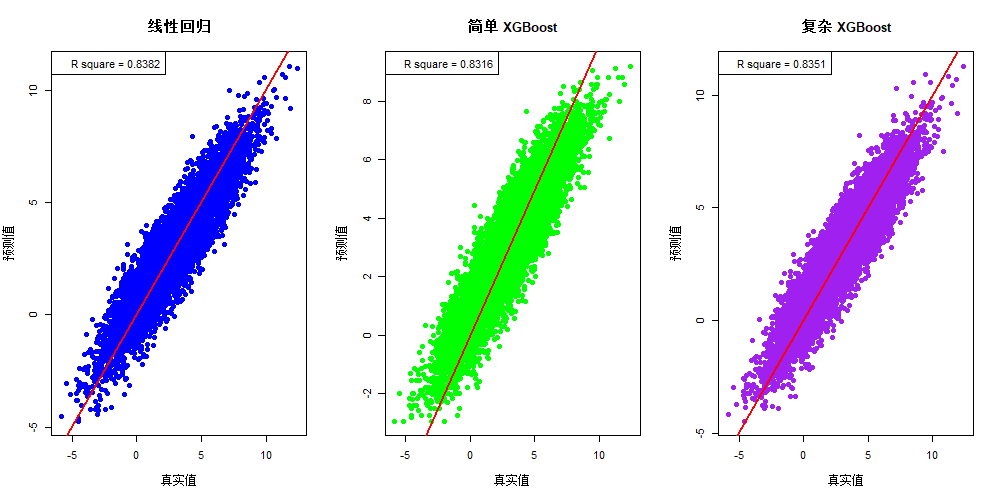
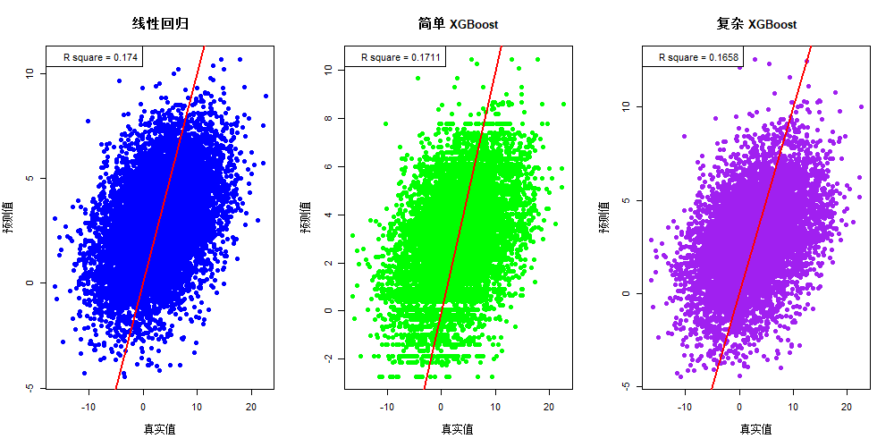
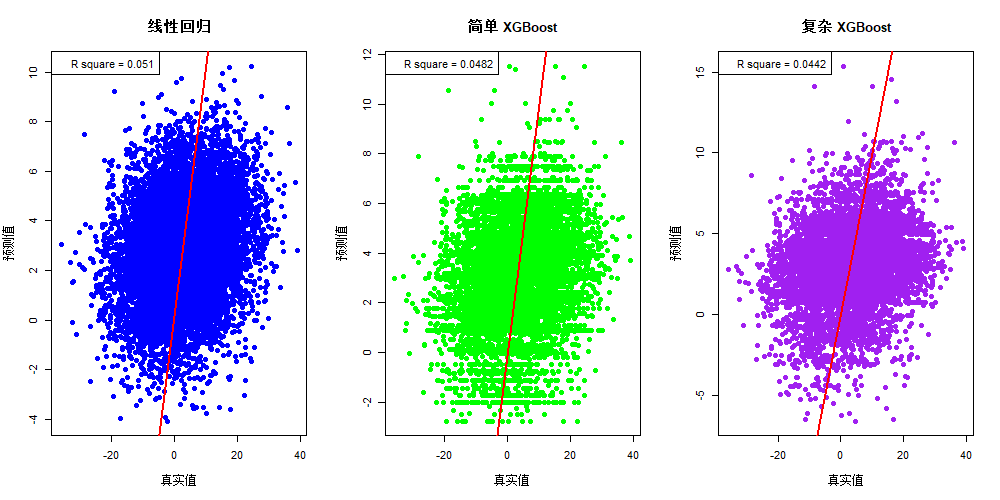

# 第4章 数据、统计与模型验证

## 第1节 数据

### 引言


量化投资是以数据为驱动。数据的广度、深度与质量直接决定了量化策略的有效性。从最基础的财务和行情数据，到高频数据，再到新闻舆情等另类数据，量化投资的数据版图正在以前所未有的速度扩张和深化。


数据和数据处理技术的发展，持续推动了量化投资策略的创新。相信在不远的将来，新的技术或许能实现多源异构数据的融合，在海量的信息中挖掘出独特的信息。最先掌握这些技术的人，将在激烈的市场竞争中占据领先优势。


### 一、数据分类介绍


当前量化投资领域所使用的主要数据包括：最基本的行情数据、财务数据、公告数据、分析师和研报数据，日益重要的高频数据，以及较为前沿的新闻数据和各种另类数据等。


#### 1.财务数据


财务数据是基本面量化分析的基石，它通过标准化的会计语言揭示了企业的经营状况，是评估公司内在价值的核心依据。各类量化策略，尤其是中低频策略，财务数据是必不可少的核心输入。


财务数据主要来源于上市公司定期发布的财务报告。财务报告主要由财务报表构成，包括五表一附注，即资产负债表、利润表、现金流量表、财务状况变动表、附表和附注。这些报表是量化投资中分析公司财务状况和盈利能力的重要依据。其核心价值在于提供了一个可量化、可比较的框架，用于评估企业的盈利能力、偿债能力、运营效率和成长潜力。通过对这些数据的深度挖掘，投资者可以发现被市场错误定价的投资机会。


基于财务数报告各科目，可以计算多个类别的财务指标，包括盈利能力指标、偿债能力指标、营运能力指标、估值指标和成长性指标等。这些指标具有较高的代表性和评价价值，最常作为构建量化模型的因子。附注中的信息也提供了深层次的市场洞察，如应收账款融资、坏账准备等，具有较高的信息含量和挖掘潜力。在一些金融数据服务商的数据库，帮助大家计算好一些比较重要的财务指标，可供用户直接调取。


管理层讨论与分析（MD&A）是近年来开始被挖掘的内容。MD&A是上市公司财务报告中的一项重要内容旨在补充传统财务报表，提供前瞻性信息和非财务信息，帮助投资者理解公司状况和未来前景。它通常包括对公司过去业绩的回顾、未来趋势的展望、管理层对风险和不确定性的分析以及关键会计政策的说明。MD&A的披露信息质量受到公司业绩、融资需求、规模等因素影响。MD&A未经审计，但其内容需基于事实，客观反映公司状况。MD&A在量化投资中具有重要价值，例如通过文本分析和量化方法提取信息，以评估其信息和对股价的影响。


#### 2.行情数据


行情数据，也称为价量数据，是市场交易行为的最直接体现。行情数据涵盖了所有与市场交易活动直接相关的动态信息，它记录了资产在交易过程中的价格波动和成交活跃度，是技术指标和高频策略的重要资源。其核心价值在于能够实时反映市场参与者的集体情绪、供需关系和资金流动情况。对于依赖于价格模式的因子和策略，行情数据是不可或缺的。


行情数据根据时间频率和精度的不同，可分为日频数据、日内数据和高频数据等。其中日度数据是最常见的行情数据形式。将一天内的交易信息精简为四个关键价格：开盘价（Open）、最高价（High）、最低价（Low）、收盘价（Close），也称K线数据；以及该时段内的成交量（Volume）、成交额（Amount）和换手率（Turn），这常简称为OHLCV数据。这些数据是构建绝大多数技术指标的基础。


在一些金融数据服务商的数据库，也会帮助大家计算好一些基于量价数据的常用技术指标，可直接调取。如：移动平均线（MA）、指数平滑移动平均线（MACD）、相对强弱指数（RSI）、布林带（BollingerBands）、真实波幅（ATR）、能量潮（OBV）、价量趋势（PVT）等。


#### 3.高频数据


高频数据（High-Frequency Data）也是一类行情数据，是行情数据在时间维度上的极致延伸，通常指秒级、毫秒级甚至微秒级的市场数据流。高频数据主要包括Tick数据（Tick Data）和订单簿数据（Limit Order Book, LOB）。Tick数据记录了市场上的每一笔成交。其数据字段通常包括成交时间、成交价格、成交数量、买卖方向等，精确到毫秒或更高。Tick数据是进行市场微观结构分析和开发高频策略的基础。订单簿数据记录了在特定时间点，交易所挂单系统中的所有未成交的买卖委托。通常包含多档买卖盘的价格、挂单量、订单数量等信息。Level-2行情数据就属于此类，它提供了更深层次的市场流动性视图。


高频数据为洞察市场微观结构、捕捉转瞬即逝的交易机会提供了可能。其核心价值在于提供了对市场交易动态最细致的刻画，使得分析资金流、流动性的供给与消耗、以及其他投资者行为成为可能。


高频数据可直接用于高频交易。也可以通过特征工程降频成低频的因子。原始高频数据噪声很大，需要通过复杂的特征工程来提取有效信号。常用特征因子例如： 订单簿不平衡（Order Book Imbalance）因子：买卖盘挂单量和价格的差异，用于预测短期价格走向。 交易流不平衡（Trade Flow Imbalance）因子：主动买入和主动卖出成交量之间的差异。 已实现波动率（Realized Volatility）因子：利用日内高频数据计算的波动率，比日线数据计算的更精确。


高频数据的采集、存储、和应用的技术和资本门槛都远高于低频数据，需要顶级的计算机硬件、极低的延迟网络和高度稳定可靠的交易系统，采购成本和维护成本投入巨大。因此应用上有很高的门槛。实践中，将一天内的高频交易信息，按一定的频率（如一分钟，五分钟，半小时等）聚合为分钟频率的OHLCV数据。相比于高频数据，该频率数据获取和存储相对更容易，处理起来更简单，构建因子和策略效果也不错，使用上效率更高。


#### 4.公告数据


公告数据是指上市公司通过法定信息披露渠道发布的，可能对公司股价产生重大影响的各类事件信息。它是事件驱动策略的核心信息来源。公告数据本质上是关于公司特定事件的非结构化或半结构化文本信息。主要类型包括： 业绩类公告：年报、半年报、一三季报、业绩预告、业绩快报。 公司行为公告：并购重组、定向增发、股权激励、高管/大股东增减持、分红、股票回购、限售股解禁等。 其他重大事件：获得重大合同、涉及重大诉讼、产品研发取得突破、高管变动等。


公告数据可通过爬取交易所官方信息披露网站、财经新闻门户网站，或直接购买第三方数据服务商提供的结构化公告数据库。


事件驱动策略是公告数据最直接的应用。该策略的核心是利用市场对重大事件“反应不足”或“过度反应”来获利。一般策略模式是：在事件公告前，基于预判进行“潜伏”；或在公告后，根据事件的超预期程度，快速介入，以捕捉短期价格波动。具体策略包括：业绩预告/快报超预期、并购重组公告复牌后进行交易、高送转公告的炒作行情等等。


公告数据也可以将事件本身或事件带来的影响进行量化，构建成因子。例如，可以构建“业绩超预期因子”、“分析师评级上调因子”等。


现在比较前沿的探索是，利用大语言模型和自然语言处理（NLP）技术，对公告正文、管理层讨论与分析（MD&A）等文本进行分析，提取管理层的情绪乐观或悲观程度、市场关注度等信息，作为辅助决策的另类因子。


#### 5.分析师预期数据


分析师预期数据是卖方分析师在公开发布的研究报告中表达的对上市公司未来盈利、目标价、评级等的预测数据。这些数据通常涵盖盈利预测、目标价、评级等信息，是公开数据中较为典型的有效数据。


研报和分析师数据通常以文本或表格形式呈现，多为非结构化数据，需要通过人工或者自然语言处理技术进行文本分析，提取关键数据、信息和情绪判断，对原始数据进行整理和转化，成为模型可用的结构化数据。很多商业数据服务商可提供这一服务。


基于分析师预期数据的量化策略，能够有效捕捉市场预期和市场情绪，提升选股能力。分析师预期数据在量化投资中被广泛应用于构建因子和策略。如一致预期因子、目标价因子、盈利预测因子等。与传统基本面因子和市场交易因子相比，分析师数据关联性不高，能够提供增量Alpha，具有较高的应用价值。此外，还可以通过文本情绪分析、报告页数、发布时点等维度挖掘另类Alpha。


分析师预期数据的有一定的缺陷和局限性。不同分析师其评价的稳定性和一致性可能存在误差。分析师覆盖范围有一定的偏好，主要覆盖中大市值的热门股票，可能导致数据覆盖度不足影响选股效果。在市场风格偏好小微盘风格，分析师预期数据及其因子则面临失效的风险。


#### 6.基金产品数据


法律规定，公募基金管理人需按规定向公众披露其运营状况。公募基金产品因其标准化、高透明度的信息披露机制，为量化投资者提供了丰富的数据来源。数据包括：基金业绩与行情数据、基金持仓数据、基金费用与现金流数据等等。这些数据不仅是评估和筛选基金的依据，更可以用于构建量化选股策略、进行市场情绪分析和风险管理。


##### 6.1.基金业绩指标


基金业绩指标是衡量基金投资管理能力的核心，通常每日或定期计算并公布。包括：净值数据、风险指标和风险调整后收益指标。其中，净值数据包括：单位净值、累计净值、净值增长率和年化收益率等；风险指标包括：波动率和最大回撤；风险调整后收益指标包括：夏普比率。


##### 6.2.市场交易数据


主要适用于在交易所上市交易的基金，如交易型开放式指数基金（ETF）和 上市型开放式基金（LOF）。通常每日或定期计算并公布，市场行情数据包括：开盘价、最高价、最低价和收盘价、成交量与成交额。此外，还包括：买卖价差和折溢价率。


##### 6.3.基金持仓数据


根据中国证监会发布的《证券投资基金信息披露内容与格式准则》系列文件规定，基金持仓信息的披露频率和详细程度有所不同： 季度报告：在每个季度结束后的15个工作日内披露。通常会公布期末的资产组合情况、按行业分类的股票投资组合，以及前十大重仓股的详细信息（名称、数量、市值、占净值比例）。 半年度报告：在上半年结束后的60日内披露。披露内容更为详尽，通常会公布全部持有的股票和债券明细。 年度报告：在每个会计年度结束后的90日内披露。这是最全面的报告，包含完整的投资组合明细、财务报表以及管理人报告等。


其中，各主要资产类别披露的信息包括： 股票持仓：包括股票代码、股票名称、持有数量、期末市值、以及占基金资产净值的比例。 债券持仓：包括债券代码、债券名称、持有数量、期末市值和占净值比例。 现金与银行存款：基金持有的现金头寸。


基金持仓数据揭示了基金经理的投资组合细节。这些数据常用于分析基金持有股票的行业偏好、个股选择能力和风格暴露（如价值、成长、大盘、小盘），以及分析持有债券的久期、信用风险暴露等特征，并且可作为“抄作业”策略的依据。


##### 6.4.费用与现金流数据


这两类数据对于精确评估基金的真实回报和理解市场资金流向具有重要意义。其中，管理费、托管费、销售服务费、申购/赎回费、业绩报酬等费用数据通常在基金的招募说明书和定期报告中详细披露。申购赎回与份额变动数据，反映了投资者的资金流向，是市场情绪的重要代理变量。


#### 7.宏观经济数据


宏观经济数据描绘了一个国家或地区的经济“全貌”，反映了其经济活动的整体状况、增长动力、通胀压力和金融环境。经济活动深刻影响着各类资产的长期价值和短期波动。将宏观经济数据纳入量化模型，能够帮助投资者以“自上而下”的视角理解市场的驱动因素，构建更为稳健和有效的投资策略。通过分析宏观数据，量化模型可以进行经济周期的判断，动态调整不同风格因子（如价值、成长、动量）或行业板块间的风险暴露。通常关注的宏观经济指标包括：经济增长、通货膨胀与物价水平、货币与信用，以其他指标。


##### 7.1.经济增长指标


经济增长是决定企业盈利和投资者回报的根本驱动力。量化模型通过监控这些指标，可以评估经济景气度，并预测其对不同资产类别的影响。


采购经理人指数（PMI）：PMI是量化投资领域最为关注的领先指标之一。它通过对企业采购经理的月度调查，快速反映制造业和服务业的景气变化。该数据通常在月初发布上个月的数据，是最早公布的重要经济指标，因此具有极强的时效性和预测价值。在量化策略中，PMI的绝对值（高于50代表扩张，低于50代表收缩）及其变化趋势，常被用来预测短期市场方向或调整行业配置。


国内生产总值（GDP）：衡量一个国家在特定时期内所有最终产品和服务市场价值的总和。GDP的增长率及其构成（消费、投资、净出口）为判断经济长期趋势和结构性变化提供了最权威的依据。GDP通常为季度发布。频率较低，且存在滞后性。量化中可使用nowcasting的方法提升其数据及时性。


工业增加值：衡量工业企业在报告期内以货币形式表现的工业生产活动的最终成果，是观察工业部门运行状况的重要途径。其同比增速的变动，直接关联到企业盈利和股市表现。量化策略会密切跟踪该数据，用以验证PMI等先行指标的有效性，可以此为基于对工业板块权重进行调整。


固定资产投资：反映了建设和购置固定资产的工作量和规模，曾经是拉动经济增长的重要引擎。其子项如房地产开发投资和基础设施建设投资，对于评估建筑、建材、机械等行业至关重要。


社会消费品零售总额：这是衡量消费需求的核心指标，反映了居民消费支出的变化，直接关系到零售、食品饮料、汽车等消费行业的景气度。


出口/进口：对外贸易数据的变化不仅影响本国经济，也反映了全球需求，对汇率和特定出口导向型行业有直接影响。


##### 7.2.通货膨胀与物价水平指标


通货膨胀水平直接影响中央银行的货币政策、债券的实际收益率以及企业的成本与定价，是所有量化模型都必须考虑的关键变量。


消费者物价指数（CPI）：CPI是度量一组代表性消费品和服务价格水平随时间变动的相对数，是观测通胀最核心、最直接的指标。CPI的上涨意味着居民购买力下降。在量化模型中，CPI数据是预测央行货币政策的关键变量。持续攀升的CPI通常利空债券市场，对股票市场则有利于资源类等抗通胀板块。


工业生产者出厂价格指数（PPI）：PPI衡量的是工业企业产品第一次出售时的出厂价格变化，反映了生产环节的价格水平。PPI与CPI之间的“剪刀差”（PPI增速-CPI增速）是量化模型中一个重要的分析点，它反映了中下游企业利润空间的受挤压程度。当剪刀差扩大时，中游制造业的盈利能力可能承压。


其他价格指数：剔除食品和能源价格的核心CPI能更好地反映潜在通胀压力；农产品价格指数则对CPI中的食品项有预示作用。


##### 7.3.货币与信用指标


金融市场的流动性状况和信贷成本是资产价格的重要决定因素。量化策略通过监控这些指标来评估金融体系流动性松紧程度，以此预测市场风险偏好。


货币供应量：M1（狭义货币）和M2（广义货币）是衡量经济体中货币存量的关键指标。M2的增速通常被视为社会总需求的体现，其快速增长往往预示着经济活跃或潜在的通胀压力。M1增速与M2增速的差值，常被用作衡量经济“活化”程度的指标。差值增大通常对股市较为有利。


利率：利率是资金的价格，是金融市场的核心。政策利率：如国内的贷款市场报价利率（LPR），美国的联邦基金利率，直接决定了整个金融体系的融资成本。市场利率：如国债收益率）、银行间同业拆放利率等，反映了市场流动性的松紧和对未来经济和通胀的预期。长期与短期利率的利差扩大，即收益率曲线陡峭程度，是经济衰退的重要信号。


社会融资规模：是中国特有的一个重要指标，全面反映了金融体系对实体经济的资金支持。其增速是判断信用周期和经济动能的关键变量。


汇率：如人民币汇率和美元指数，影响着跨境资本流动和进出口企业的盈利能力。对于全球配置的量化基金而言，汇率本身就是一个重要的交易标的和风险因子。


##### 7.4.其他指标


消费者/投资者信心指数：这些指数衡量了消费者和投资者对未来经济、收入和市场的看法，是消费和投资行为的领先指标。当信心指数与经济数据出现背离时，往往预示着未来经济可能出现拐点。


失业率：作为经济的“滞后”指标，失业率反映了劳动力市场的健康状况，与居民收入和消费能力密切相关，是衡量经济是否陷入衰退的重要标志。


发电量同比：通常被用作工业增加值的高频替代或验证指标。


波罗的海干散货指数（BDI）：被视为全球贸易和工业生产的晴雨表。


#### 8.新闻数据


量化投资中，新闻数据是重要的信息来源，它反映了市场情绪、投资者心理以及市场事件对投资决策的影响。新闻数据主要来源于新闻媒体、财经网站、社交媒体平台、企业运营、企业招聘信息、产品价格、用户评论和网络流量等。这些数据通常以文本形式存在，内容涵盖公司公告、市场动态、行业趋势、宏观经济事件等。新闻数据是非结构化文本，处理和分析的复杂性较高，需要借助大语言模型和自然语言处理（NLP）等技术进行处理。一般可以通过爬虫技术获取这些数据。在一些金融数据服务商的数据库也提供这类数据。


在量化投资中，新闻数据的应用主要体现在以下几个方面： 市场情绪分析：通过分析新闻文本的情感倾向（正面、负面、中性），可以评估市场情绪对股价的影响。负面新闻可能导致股价下跌，而正面新闻可能推动股价上涨。 事件驱动策略：公司公告、政策变化、突发事件等一些新闻事件可能引发市场波动。量化投资可以利用这些信息开发事件驱动交易策略。 另类数据挖掘：随着大语言模型和NLP等机器学习技术的发展，非结构化数据中的信息已经可以被提取和利用，转为特征因子加入模型中，以增强量化模型的预测能力。


通过合理的获取、处理和分析新闻数据，量化交易者可以更好地把握市场动态，提升投资策略的科学性和有效性。结合多源数据（如新闻、社交媒体、市场数据）的融合分析，利用复杂的深度学习模型进行预测，已经成为量化投资重要的前沿方向。


#### 9.另类数据


一般来说，另类数据是指除的财务、行情和宏观等传统数据之外的所有数据的总称。另类数据的涵盖范围广泛，其核心价值在于提供传统数据无法覆盖的、更及时、更细颗粒度的洞察，力求在新的维度上追踪公司和市场动态，探索独特的alpha来源。目前比较常见的另类数据主要有以下几类：


卫星图像数据：零售店停车场车辆数量、工厂开工情况、夜间灯光亮度、港口货物吞吐量、油罐储量等。 消费者交易数据：匿名的信用卡/借记卡交易记录、电子收据数据等。 社交媒体情绪：如网购平台的产品评论、互联网搜索热度、APP下载量、活跃用户数、公司网站访问流量等。 供应链数据：海关提单、物流信息、企业ERP系统等，以此了解公司的上下游关系、原材料采购量、库存水平等。 ESG数据：关于公司在环境（Environmental）、社会（Social）和治理（Governance）方面的表现和评级数据。


另类数据在量化模型中的应用尚处于起步阶段。与新闻数据一样，数据非结构化是其主要阻碍。随着大语言模型的出现和普及，另类数据在应用上的问题迎刃而解。例如，使用大语言模型分析数百万条新闻和社交媒体帖子，将其转化为量化的情绪得分作为新的因子，纳入多因子模型中，以期获得与传统因子低相关的收益来源。许多另类数据（如网络交易、卫星数据）可以作为公司经营状况的“高频代理变量”，帮助投资者在财报发布前即可准确的预测业绩。


### 二、数据来源


量化投资的数据源可以分为三大类进行介绍： 官方数据源：由国家政府机构，以及证券、期货交易所等权威机构发布的基础数据。 商业数据供应商：如万得、天软、同花顺等，对原始数据进行清洗处理和整合后提供的商业化数据服务。 开源与免费数据源：以开源库、社区平台等形式提供的免费或部分免费的数据接口。


#### 1.官方数据源


官方数据源是所有金融数据产品的起点，具有最高的权威性和不可替代性。主要由政府机构和交易场所发布，是构建宏观经济和市场研究的基础。


##### 1.1.政府机构官网


发布机构：国家统计局（https://www.stats.gov.cn）是最核心的宏观经济数据发布单位。此外，中国人民银行、海关总署、财政部、国家外汇管理局等部门也会发布其职责范围内的关键数据。


数据指标包括： 宏观经济：包括国内生产总值（GDP）、国民总收入（GNI）、居民消费价格指数（CPI）、工业品出厂价格指数（PPI）、采购经理人指数（PMI）、工业增加值、固定资产投资、社会消费品零售总额等。 金融数据：涵盖货币供应量（M0,M1,M2）、社会融资规模、金融机构存贷款余额、利率、汇率、外汇储备及黄金储备等。 其他行业数据：还包括财政收支、国际收支、各行业景气指数等。


数据发布频率：数据发布频率多样，包括年度、季度、月度等。例如，GDP数据通常在每季结束后次月的月中发布；而CPI、PPI、M2等重要指标则按月固定时间发布。


获取方式： 以国家统计局为例，用户可以直接访问国家统计局数据查询系统（ 国家数据）进行查询和下载，数据文件通常支持Excel或CSV格式。


近年来，为提升数据获取的自动化程度，国内外一些官方数据平台已提供API接口。开发者可以通过申请API密钥，利用HTTP请求的方式，传入相应参数，来批量获取所需的经济指标数据。这对于自动将宏观数据集成到投研系统中重要的进步。


##### 1.2.交易所


交易所是所有二级市场交易行为的发生平台。交易所发布的行情数据和交易信息的重要性不言而喻。国内主要交易所包括：上海证券交易所、深圳证券交易所以及上海期货交易所等。


上海证券交易所（SSE）： 数据内容：上交所提供的数据产品层次分明，包括Level-1、Level-2行情数据、股票期权历史数据等。内容覆盖了快照数据、逐笔成交数据以及各类周期的K线数据。 获取方式：历史数据主要通过专用的历史数据接口提供服务，文件格式通常为CSV，采用UTF-8编码。对于实时行情，则通过低延时行情发布系统（LDDS）等接口提供。 授权与费用：交易所的行情数据服务采用严格的许可经营模式。个人或小型机构难以直接从交易所获取接口，需要通过授权信息商间接获取，费用较高。


深圳证券交易所（SZSE）： 数据内容：深交所同样提供全面的市场数据，包括历史行情、实时行情、公司公告等。其数据产品也包含不同深度的买卖盘信息、交易量等。 获取方式：官方网站（https://www.szse.cn）是获取公开信息和部分历史数据的重要渠道。对于更底层和实时的数据，深交所提供了多种接口规范，如Binary行情接口、STEP数据接口等。数据格式包括平面文件格式（如TXT）、数据库文件（DBF）以及部分API返回的JSON格式。 授权与费用：深交所的数据经营权主要由其下属子公司深圳证券信息有限公司独家代理。机构用户需要向其申请授权并支付相应费用才能获得实时或深度的历史数据服务。


上海期货交易所（SHFE）： 数据内容：提供期货市场的历史行情、交易数据、持仓报告、仓单日报等。 获取方式：用户可通过官网查询历史数据。对于程序化接入，SHFE提供了如NGES交易系统的API接口规范。同时，也存在如“云行情”系列产品，旨在提供统一的Tick级行情数据接口方案。官方历史数据文件的标准格式在搜索结果中未明确，但通常会是结构化的文本文件（如CSV）或二进制文件。 授权与费用：SHFE对行情信息的授权管理同样非常严格，未经授权禁止转发。数据服务采用收费授权模式，且费用较高。


交易所数据源具有无可比拟的权威性和完整性，但其主要面向机构用户，获取门槛高、成本昂贵，且数据格式原始，需要使用者自行进行大量的清洗、对齐和存储工作。


##### 1.3.其他机构和组织


详细请参考本书第13章。


#### 2.商业数据供应商


商业数据供应商是目前国内量化投资机构主流的数据来源。他们由专业团队负责，从各类官方数据源采集数据，经过系统性的清洗、处理和整合，通过统一的终端或API接口提供给用户，极大地降低了数据使用的门槛。


国内金融数据服务市场经过多年发展，已形成较为稳定的竞争格局。其中万得（Wind）资讯被公认为国内金融数据服务的龙头企业，尤其在机构客户市场占据主导地位。同花顺iFinD作为国内领先的互联网金融信息服务商，是万得最主要的竞争对手。同花顺凭借其在C端的品牌影响力和具有竞争力的价格优势，在B端市场也取得了显著的份额。此外还有：国泰安，其数据在学术研究领域有广泛应用；天软数据，以国内股票和期货各类数据为主；以及东方财富Choice、聚源、锐思数据等。


-   **万得资讯：** 数据覆盖：极为全面，涵盖股票、债券、基金、期货、外汇、宏观行业、研究报告、新闻舆情、另类数据等几乎所有与投资相关的领域。其数据质量和完整性被市场高度认可。


    获取方式：主要通过其功能强大的“万得金融终端”以及多种API接口（如EDB、WDS等）提供服务。


    费用：价格昂贵是其最显著的标签。终端、数据库和API接口通常需要分开购买，且近年来价格持续上涨，一个终端账号的年费可达数万元人民币。高昂的成本使其主要服务于金融机构和大型企业。


-   **同花顺：** 数据覆盖：同样非常广泛，在覆盖股票、债券、基金等核心金融品种的基础上，iFinD在另类数据方面表现突出，例如提供了卫星数据、医药数据、电商数据、舆情数据等特色数据集。


    获取方式：提供iFinD金融数据终端和功能丰富的API接口。


    费用：价格策略是其核心竞争力之一。iFinD 的定价通常显著低于Wind，约为其一半左右，这使其在对成本敏感的高校、中小型私募等客户群体中具有很强的吸引力。


-   **朝阳永续：** 主要包括上市公司盈利预测数据库。该数据库整合了市场上主流卖方分析师的观点，形成朝阳永续的“盈利预测数据库”或“分析师预期数据”。该数据库的数据源于“合法授权的海量卖方研报”。朝阳永续收集了中国各大证券公司的卖方研究分析师发布的针对A股和港股上市公司的研究报告 。


    这些报告中包含了分析师对上市公司未来财务表现的详细预测。朝阳永续通过对这些海量、分散的预测数据进行清洗、标准化和算法整合，最终形成“一致预期”数据。


    此外，朝阳永续提供全面的私募产品数据、业绩监测报告以及专业的基金管理人评价体系，在私募与公募基金投研领域具备重要影响力 。


#### 3.开源与免费数据源


对于个人量化爱好者、学生以及初创的小型量化团队而言，商业数据源的成本难以承受。因此，开源与免费数据生态应运而生，它们以极低的成本提供了进行量化研究的可能性。


基于Python的开源数据接口库是当前最受欢迎的免费数据获取方式。其中，Tushare国内最早且最知名的财经数据开源接口库之一。它提供包括A股、指数、基金、期货、宏观经济等多维度数据。Tushare采用“积分制”，免费用户可以通过社区贡献等方式获取积分，用以调用更多的数据。部分高级或高频的数据接口则需要付费。AKShare是近年来迅速崛起的优秀开源数据接口库，基于Python以其简洁的接口设计和广泛的数据覆盖范围受到开发者的青睐。它整合了来自多个网站的公开数据，提供了一种便捷的“一站式”获取体验。其他还包括BaoStock、qtdata、AData等，它们共同丰富了开源数据生态。


除了纯粹的接口库，还有一些集数据、研究、回测、社区于一体的在线量化平台提供免费或部分免费的数据服务。其中，聚宽（JoinQuant）是国内领先的量化投研交易平台，提供从2005年至今的完整股票行情数据、财务数据、宏观数据等。用户可以在其提供的云端研究环境中免费调用这些高质量数据进行策略研究和回测。其免费版在数据调用频率和条数上存在一定限制。其他平台如掘金量化、BigQuant等，都为个人开发者提供了宝贵的数据和研究资源。万得资讯也推出的免费量化平台万矿，旨在吸引学生和个人开发者，培养用户生态。用户可以在该平台上免费使用一部分数据，是体验高质量商业数据的绝佳途径。


#### 4.网络爬虫


直接从新浪财经、东方财富网、网易财经等大型财经门户网站通过编写爬虫程序抓取数据，是获取免费数据的传统方式。这种方式灵活自由，但缺点也十分明显：数据质量参差不齐，可能缺乏关键字段（如企业财务数据细节）；网站页面结构可能随时变更，导致爬虫失效，维护成本高。


开源与免费数据源的最大优势在于其普惠性和灵活性，极大地降低了量化投资的入门门槛。然而，其局限性也不容忽视： 数据质量与稳定性：数据可能存在缺失、错误或延迟，接口可能因源网站改版而中断。


使用限制：大多存在调用频率、数据量或时间范围的限制。 服务与支持：通常缺乏商业级的技术支持和问题响应。因此，这类数据源更适合用于学习、学术研究、非核心策略的开发以及对实时性要求不高的应用场景。


中国的量化投资数据源已经形成了一个清晰的金字塔结构：塔尖是交易所和政府机构发布的原始数据，权威但获取成本高昂。塔身是商业数据供应商，它们是机构投资者的标准配置，提供高质量、高易用性但价格不菲的整合数据服务。塔基是庞大而活跃的开源与免费数据生态，为广大学生、个人爱好者和初创团队提供了低成本的入场券。


展望未来，可以预见几个发展趋势。首先，随着竞争加剧，商业数据供应商除了在传统数据上比拼质量，将更多地在另类数据、AI赋能分析工具等方面寻求差异化，以证明其高昂价格的合理性。其次，开源社区的力量将持续壮大，数据接口的覆盖面和易用性会进一步提升，迫使商业供应商推出更多类似“万矿”的免费或低价策略来吸引未来用户。最后，成熟的量化团队可能会采用混合数据源策略：核心高频策略依赖付费的交易所直播数据，中低频策略使用商业数据供应商的API，而一些探索性的研究则可以利用灵活的开源数据，从而在成本和效益之间取得最佳平衡。


### 三、数据获取方式


以万得为例，数据供应商主要提供三种数据获取方式：万得终端数据导出、API数据调取和落地数据库是三种常见的数据处理方式，各有其优缺点。以下是对这三种方式的详细介绍和对比分析。


#### 1.在终端直接导出数据


终端数据导出通常指通过手动或半自动的方式将数据从万得系统中导出。这种方式通常适用于离线分析或简单的数据处理需求。例如，用户可以通过手动导出CSV或Excel文件，然后在其他工具中进行进一步处理。


优点：操作简单，适合不熟悉编程的用户。无需复杂的编程知识，适合快速获取数据。


缺点：无法实现自动化处理，效率较低。数据处理和分析依赖人工，难以满足大规模数据处理需求。-数据更新不及时，难以实现实时数据更新。


#### 2.API调取


API（Application Programming Interface，应用程序编程接口）是一种允许不同软件应用之间相互通信和交换数据的协议与工具。对于万得而言，数据API就是你通过编写程序代码（如Python、R、C++、Matlab等）来主动提取或订阅万得数据服务器上数据的一种方式。


在你的程序（客户端）中，通过万得提供的API开发包，使用合法的账号和密码连接到万得的数据服务器。发送请求：编写代码，构造一个非常具体的数据请求指令。这个指令就像一句问得非常精确的话。


例如：


w.wsd（"600036.SH", "open,high,low,close,volume", "2023-01-01", "2023-01-31", "Fill=Previous"）


接收并处理数据：万得服务器收到请求后，会立即处理，并将你所请求的数据打包成一个结构化的数据对象（如DataFrame、List等）返回给你的程序。 程序接收到数据后，可以直接在内存中进行计算、分析、可视化，或者导入到你的模型/策略中。


API数据调取是通过调用万得提供的API接口，实现数据的自动化提取和处理。这种方式适用于需要自动化处理和集成到其他系统中的场景。


-   灵活高效：可以随时随地获取任意时间段、任意品种、任意指标的数据，非常适合研究和探索性分析。API支持多种编程语言（如Python、R、Java等），用户可以根据需求编写脚本进行数据处理。


-   实时性强：特别适合与实时行情对接，用于开发实时监控、预警、量化交易信号触发等系统。 易于集成：能够无缝嵌入到你自己的分析程序、交易系统、研究平台或内部工具中，实现自动化工作流实现数据的自动提取、处理和存储，减少人工干预。


-   按需索取：不需要存储全部数据，只用获取当前需要的部分，节省本地存储空间。 实时性好：API支持实时数据更新，适合动态数据场景。


缺点：


-   技术门槛较高：需要一定的编程知识和开发能力，适合具备技术背景的用户。


-   数据量有限制。


典型应用场景


-   量化投资研究：在程序中直接调用数据，进行策略回测和因子分析。


-   量化交易系统：实盘交易系统中，API用于实时获取行情、基本面数据，并生成交易指令。


-   自定义分析报告：定期自动运行脚本，获取最新数据，生成PDF或Excel格式的日报、周报。


-   实时风险监控大屏：从万得订阅实时行情和新闻，在公司大屏上动态展示投资组合的风险和盈亏情况。


#### 3.落地数据库


数据库传输是指万得通过专线或互联网，将其服务器上的全市场或客户选定范围的历史和实时数据，全量、增量地“推送”并同步到客户本地（或私有云）的数据库中（如SQL Server, Oracle, MySQL）。数据会在本地物理存储，形成一套完整的万得数据镜像。数据存储到本地的数据库中，以便进行长期存储和管理。这种方式适用于需要长期存储和频繁查询的数据场景。


工作原理 环境准备：客户在本地部署数据库服务器（如SQL Server, Oracle, MySQL等）。


-   初始化同步：万得会将客户订阅的所有历史数据一次性全部导入到本地数据库。


-   增量同步：此后，万得服务器会持续监控数据变化（如新交易日的数据、新闻公告、财务更新等），通过数据同步工具，在夜间或客户指定的时间点，自动、静默地将增量更新部分同步到本地数据库。


-   本地操作：客户的数据团队或程序员直接使用SQL语句访问本地数据库，进行任意复杂的查询、计算和加工。


主要特点：


-   数据本地化：所有数据都在客户自己的机房，数据访问速度极快，不受网络波动影响，尤其适合复杂的多表关联查询和巨量数据计算。


-   数据完整性：拥有从历史到当前的全部数据，方便进行深度历史回测和宏观研究。


-   高安全性：敏感财务数据、投资组合数据等无需通过公网频繁传输，所有计算在内部完成，符合金融机构严格的合规和风控要求。


-   释放终端压力：复杂的计算和查询在数据库服务器端完成，不占用万得终端（Wind Terminal）的授权和资源。


-   系统耦合度低：内部业务系统（如风控、估值、绩效评估系统）直接对接本地数据库，无需关心数据来源，即使外网中断，内部系统也能正常运行。


优点：


-   数据存储稳定：数据库提供稳定的数据存储和管理功能，适合长期数据存储。


-   查询效率高：数据库支持高效的查询和索引操作，适合大规模数据处理。


-   数据一致性高：数据库支持事务处理和数据一致性保障，适合复杂业务场景。


缺点：


-   开发和维护成本高：数据库的搭建和维护需要较高的技术投入和资源。


-   灵活性较低：数据库的结构和操作相对固定，不适合高度定制化的数据处理需求。


-   数据迁移复杂：数据迁移和迁移过程较为复杂，需考虑数据格式和兼容性问题。


典型应用场景：


-   基金估值与托管：每日收盘后，同步全部最新的净值、行情、债券信息，用于计算基金产品的净值。


-   风险管理系统：风险模型需要调用全市场海量的历史数据进行压力测试和情景分析，本地数据库查询效率最高。


-   信用评级模型：需要整合所有发债主体的财务报表、评级行动、舆情信息，进行批量计算，本地化操作最方便。


-   监管报送：自动从本地数据库提取数据，填充到监管机构要求的报表模板中。


#### 4.总结


-   终端数据导出适合简单、快速的数据处理需求，但缺乏自动化和灵活性。


-   API数据调取适合需要自动化处理和集成的场景，但对技术要求较高。


-   落地数据库适合长期数据存储和管理，但开发和维护成本较高。


根据具体需求和资源情况，选择合适的数据处理方式，可以提高数据处理的效率和效果。


在一些工作场景下，选择API， 进行灵活、探索性的数据分析和研究。 构建实时的交易或监控系统。 不需要处理极大规模的历史数据。


在一些工作场景下，选择落地数据库： 构建高性能、高稳定性的核心业务系统（如风控、估值）。 每天对全市场数据进行批量处理和分析。 对数据访问速度和安全有极致要求。 团队有专业的运维和数据库管理人员。


许多大型机构会同时采用两种方式：用数据库传输为后台核心系统（风控、估值）提供稳定、海量的数据支撑；同时用API为前台的投研和交易团队提供灵活、实时的数据服务，二者互补，形成一个完整的数据生


| 特性维度 | 数据接口 (API) | 落地数据库 (数据库传输) |
|:-----------------------|:-----------------------|:-----------------------|
| 数据位置 | 在万得服务器，按需调用 | 在本地数据库，完整存储 |
| 访问方式 | 主动请求（Pull），通过编程调用 | 被动接收（Push），自动同步后本地SQL查询 |
| 数据量 | 灵活，可大可小，单次调用数据量有限制 | 海量，全市场历史数据 + 每日增量 |
| 速度优势 | 获取单一数据速度快，但受网络影响 | 复杂查询和批量计算速度快（无网络延迟） |
| 实时性 | 高，可获取实时行情和最新数据 | T+1或定时同步，通常用于盘后分析 |
| 技术要求 | 需要编程能力（R, Python等） | 需要数据库管理和SQL能力 |
| 成本 | 相对较低（按数据量或接口调用次数计费） | 较高（涉及数据版权、专线、服务器硬件和维护成本） |
| 核心场景 | 研究、交易、实时应用 | 估值、风控、托管、批处理报告 |


### 四、数据存储和数据管理


量化投资是数据驱动的领域，从策略研发测试到策略部署执行，每一个环节都高度依赖于数据管理方式和数据存储效率。量化投资的需要覆盖的数据内容也是多种多样，它们在数据类型、数据格式、内容编排形式、和数据体量等各个方面都存在巨大差异，在读写频率、查询模式和存储效率等方面也有着巨大差异，这些差异直接决定了数据管理模式、数据存储方式以及技术路径的选择。


#### 1.CSV 格式


前文我们已经介绍过量化投资中常用的数据。其中最常用到的数据多数是日度频率甚至更慢频率的数据，包括日频行情数据、日内分钟频行情数据、财务报表数据、事件数据、宏观数据等，以及基于这些数据计算的低频因子数据。


这些数据一般体量很小，保存后不需要频繁查询和修改，对存储要求较低。对此，以CSV格式文件保存特定路径中，往往是最佳选择。数据保存通常是某一时间截面、某一个主题的内容（例如某日收盘，全部A股的开高低收数据）可以简单地组织为一个CSV文件，结构一目了然，存储和管理极为方便。


CSV的优势主要在于其简单性、通用性和易用性。CSV是纯文本文件，可以用任意文本编辑器（如记事本）或电子表格软件（如Excel）打开查看。在Windows操作系统中，使用文件资源管理器的预览窗格也可以快速预览文件内容。这对于快速检查看据内容、排查数据问题（比如缺失或异常）极为便利，大大提高了工作效率。


CSV不依赖于特定语言或数据库，几乎所有的编程语言（Python，R，C++，Java等）和数据处理工具（SQLite，Excel）都内置CSV读写支持。从不同的数据源获取数据，或者在不同系统之间传递数据，CSV也是通用的。使用CSV依赖于数据库服务器，也不需要SQL查询语言，使用门槛和复杂程度最低。


但随着数据量增长、对性能和数据完整性要求的提高，CSV的劣势会变得越来越明显。对于大体量的数据，CSV读写性能低下；CSV文件本身没有索引机制，查询效率比较低下；在文件末尾追加数据时效率比较低下；CSV无法体现数据表格之间的对应关系，表间合并不能通过SQL的JOIN操作完成。此外，CSV以纯文本形式存储所有数据，存在明显的冗余存储；CSV文件本身也不提供任何压缩机制，CSV存储空间利用率低。对于体量较大切需要高效的查询、添加和删改等数据情境下，CSV是完全不合适的。


#### 2.SQLite 和 DuckDB


这时候需要一些更为专业的数据库工具。个人推荐 SQLite 和 DuckDB。它们都是一个开源、轻量级SQL数据库引擎。以SQLite 为例，完整的 SQLite 库在编译后只有几百 KB，非常适合资源受限的环境，如小型桌面应用。不需要进行任何复杂的配置（如用户管理、内存分配、网络端口等）。


单文件数据库是 SQLite 最著名的特点，整个数据库（包括表、索引、触发器等）都存储在一个标准的磁盘文件中。要备份或移动数据库，只需要复制这个文件；没有复杂的数据库“实例”或“服务”需要安装和管理。传统客户端-服务器数据库需要一个一直运行在服务器上的独立进程，应用程序通过网络协议（如 TCP/IP）与之通信。


SQLite没有独立的服务器进程。SQLite库直接与你的应用程序链接，应用程序通过函数调用直接读写磁盘上的数据库文件。这简化了架构，减少了通信开销。数据库文件是跨平台的。你可以在Windows、macOS或 Linux上通用。主流编程语言（Python, R、Java, C++, Go, Rust 等）都提供了成熟的 SQLite 驱动或内置支持。在量化投资领域，我们需要频繁地从数据库中提取数据进行分析和测试。SQL是一项必备的核心技能。


#### 3.RData 和 fst 格式


一般情况下，我们会将计算的各个因子数据合并成一张大表每日储存。这张大表的列是全市场所有股票，行是数百甚至上千的因子。此表主要用于策略研究回测和低频策略的生产。此表是日频的，不需要频繁的更改，但体量较大，要求一定的压缩以节省空间，并要求较高的读取效率。我们一般会将其存储为RData格式。如果要求极致的读取效率，推荐存成fst格式。


fst是一种为快速序列化数据框而设计的高性能数据存储格式。它由R社区的Mark Klik开发，通过R包fst来使用。对于Python也有相应的库。它的核心设计目标是：极快的读写速度；高效的随机访问；良好的压缩率。但如果要追求跨语言、省磁盘空间、要分析查询，选HDF5或Parquet。对比如下图：


高频行情数据是量化投资中最具挑战性的数据类型，其特征包括：


-   数据量巨大（每天可能达到数十亿条记录）、摄入速率极高（每秒数十万条tick数据）、要求极低延迟（从几毫秒到几秒不等）以及严格的时间序列特性。存储方案必须在吞吐量、延迟和存储成本间取得最佳平衡。


-   高频行情数据通常采用分层架构：实时内存数据库处理最新数据，历史数据库存储长期数据。在这种情况下，一些更加专业的数据库工具是必不可少的，比如MySQL和PostgreSQL。由于笔者在这一方面经验较少，因而在本书中不做展开。


此外一些另类的数据，包括文本、图像、网络爬取的JSON等非结构化或半结构化数据，其特点是：格式多样、结构不规则、数据量巨大且价值密度低。可根据各自特征情况相机抉择其处理和保存。


#### 4.总结


综上所述，一个典型的工作流示例如下：


-   1.数据获取层：从API或数据源获取原始数据，保存为CSV文件，方便检查数据；较大型数据可保存SQLite数据库或Parquet文件中。


-   2.计算因子层：基于原始数据计算存储的散在的因子，保存为CSV文件，方便检查数据；


-   3.因子汇总库：基于以上散在的因子表，检验、筛选、汇总成为因子总表，保存为fst追求极致读取性能，方便建模回测调用。

## 第2节 统计方法和模型

### 引言

前文中反复强调，量化投资是通过系统性的、基于数学和统计模型的分析，利用计算机技术来制定和执行投资策略的过程。早期，量化投资主要依赖于经典的统计学方法，如广义线性模型和时间序列分析。这些方法为理解资产价格行为和构建投资策略提供了基础理论框架和实用工具。

随着数据的爆炸式增长和新兴技术的发展，传统模型的局限性越来越突出，这为机器学习模型的崛起创造了契机。机器学习，特别是深度学习，凭借其强大的模式识别和拟合能力，正在重塑量化投资的各个环节。

本章我们将系统性地梳理和回顾量化投资领域中广泛应用的主要的统计方法与机器学习模型。

### 一、经典统计学原理和方法

从本质上讲，早期的量化投资，就是统计学理论在金融市场的实践应用。无论是识别影响资产价格因素、预测市场未来走势，还是构建风险收益最优的投资组合，都离不开统计学提供的框架和工具。虽然机器学习和人工智能技术等新兴技术有着传统统计学无法比拟的强大能力，但在很多场景下其应用受到客观条件的限制（如小样本和低信噪比数据）。因此，经典统计学的思想和工具依然是量化投资重要组成部分，并与新兴技术共同推动着该领域的发展。

经典统计学的核心使命在于从不确定性中提炼可度量的规律，这与量化投资的需求高度契合。其研究内容主要围绕“描述、推断与分析”展开。

-   **描述统计：**对观测数据进行系统概括，将原始信息浓缩为可解释的数字特征与可视化图形，是理解数据的第一步；

-   **推断统计：**基于概率论进行假设检验、参数估计、估计置信区间，从样本推断总体，并量化推断过程中的不确定性；

-   **分析统计：**通过方差分析、相关分析、回归分析等方法进一步探索变量间的关联与因果关系，为构建模型提供基础。

我们在后文对这些内容将逐一回顾。

#### 1.描述性统计

描述性统计学的核心任务，是对已观测到的数据集进行系统性的提炼、概括和可视化，将其从无序的原始信息转化为简洁、可理解且具有信息量的数字与图形摘要。其研究主要围绕三个核心维度展开：集中趋势、离散程度和分布形态。

集中趋势指标包括：如均值、中位数，告诉我们数据的“平均”位置在哪里；离散程度指标包括：方差、标准差、极差、四分位距等，揭示了数据围绕中心的波动或风险有多大；而分布形态分析包括：如偏度、峰度，刻画了数据分布的形状是否对称，尖峰或者厚尾。

**集中趋势分析**用于描述数据的集中位置，常用指标包括：

-   **均值（Mean）：**所有数据的总和除以数据个数，是描述数据集中趋势最常用的指标，但易受极端值影响。

-   **中位数（Median）：**将数据按顺序排列后位于中间的值，不受极端值影响，适用于偏态分布或存在异常值的数据。

**离散程度分析**用于衡量数据的离散程度，常用指标包括：

-   **方差（Variance）：**数据点与均值偏差的平方的平均值，反映数据的离散程度，是标准差的平方。

-   **标准差（Standard Deviation）：**方差的平方根，反映数据与均值的偏离程度，是衡量离散程度最常用的指标之一。

-   **变异系数（Coefficient of Variation, CV）：**标准差与均值的比值，适用于比较不同单位或均值差异较大的数据的离散程度。

-   **极差（Range）：**数据最大值与最小值之差，简单直观，但易受极端值影响。

-   **四分位距（Interquartile Range, IQR）：**上四分位数（Q3）与下四分位数（Q1）之差的一半，反映中间50%数据的离散程度，对极端值不敏感。

**分布形态分析**，常用指标包括：

-   **偏度系数（Skewness）：**衡量数据分布不对称性的指标，揭示数据在均值两侧的分布差异，正偏度表示右尾较长而众数集中在左侧，负偏度则相反。

-   **峰度系数（Kurtosis）：**描述数据分布尾部厚重程度与尖峰状态的指标，反映极端值出现的概率，高峰度意味着分布比正态分布更尖峭且尾部更厚。

#### 2.参数估计

参数估计是统计推断的理论基础。其核心任务是利用样本数据，对未知的总体数据的关键参数进行科学的“估计”，旨在透过样本的表象去探寻更本质的总体规律。其研究内容主要包括：点估计与区间估计。

**点估计**旨在构造一个由样本数据确定的统计量，作为总体待估参数的唯一数值近似。其核心在于研究估计量的抽样性质，并通过一定的准则（如无偏性、有效性、均方误差最小或极大似然原理）筛选出最优估计量。例如，样本均值$\bar{X}$作为总体期望$\mu$的估计量，在独立同分布条件下具有无偏性与最小方差性。在量化投资中，资产收益率、波动率以及因子模型的系数等，均需通过点估计进行校准，为模型提供具体的输入参数。

**区间估计则**进一步考虑了估计的不确定性，其目标是以一定的置信水平（$1-\alpha$）构造一个随机区间，使得该区间覆盖总体真实参数的概率达到预设要求。该区间通常以点估计为中心，并基于估计量的抽样分布（如正态分布、t分布）或其渐进性质确定误差边际。在量化投资中，区间估计不仅提供参数的可能取值范围，更重要的在于量化了估计风险。

点估计为区间估计提供中心锚点，区间估计则揭示了点估计的可靠程度。在量化实践中，严谨的模型构建必须同时报告点估计值及其区间估计，以此表达信号与噪声，为投资决策提供兼具指向性与稳健性的统计依据。

#### 3.假设检验

假设检验是统计推断的核心方法论之一，其本质是基于概率反证法的统计决策过程。在量化投资领域，它为我们提供了一套严谨的、可量化的框架，用以区分数据中的系统性规律与随机的噪声。

从学术范式而言，假设检验首先建立一对互斥的假设：

-   原假设（H₀）通常代表一种保守的、待挑战的基准状态；

-   备择假设（H₁）则代表研究者希望证实的发现或理论。

检验的逻辑并非直接证明H₁为真，而是基于“在H₀成立的假定下”这一前提，考察当前样本数据出现的可能性。我们计算在H₀下得到当前或更极端样本结果的概率，即p值。若p值小于预先设定的显著性水平（α值，如0.05），则依据“小概率事件在一次试验中实际不发生”的原理，我们拥有足够的统计证据拒绝H₀，从而倾向于接受H₁。此过程中可能犯两类错误：第一类错误（弃真）与第二类错误（取伪），其权衡由α和检验功效共同决定。

在量化投资中，假设检验贯穿于策略研发与评估的全过程。任何一个宣称有效的量化因子或量化策略，都必须经历各种假设检验的严格审查层层把关。可以说，假设检验是量化投资从“数据挖掘”走向“科学发现”的“裁判员”。

#### 4.相关分析和回归分析

相关分析与回归分析是量化投资中探究变量间统计关系的两大核心方法论。

**相关分析**用**相关系数**刻画两个或多个随机变量之间线性关联的方向与强度。其核心在于衡量变量变动的协同性，例如资产收益率之间的同向或反向运动。在量化投资中，它是进行因子初筛、资产配置与风险分散化分析的基础工具。

**回归分析**通过建立模型，刻画一个或多个解释变量（自变量）对被解释变量（因变量）的条件期望的影响。其核心输出是回归系数，该系数在控制其他变量的情况下，定量解释了“自变量每变动一单位，因变量平均预期变动多少”。在量化领域，从最基本的CAPM模型到复杂的多因子模型，回归分析构成了资产定价、风险暴露度量与绩效归因的骨架。其分析过程严格依赖于一系列统计假设，包括线性、同方差、无多重共线性等，并需通过一系列假设检验（t检验、F检验）来判定各因子或模型的统计显著性。

在量化投资的研究范式中，相关分析常用于关系的初步探索与可视化，而回归分析则用于关系的定量建模和预测。二者共同构成了从观察市场现象到构建可验证投资模型的完整分析链条，是剥离随机噪声、识别稳健规律的重要工具。

我们必须严谨地声明其**局限性：**相关关系和回归分析仅揭示了数据上的统计关联，并确定现实中的因果逻辑。并且，它们只能捕捉线性关系，对非线性结构的解释力有限。

#### 5.因果推断

在量化投资中，找到两个变量之间的相关性非常容易，但确定其中是否存在因果关系则非常困难。一个策略在回测中表现优异，可能仅仅是因为它捕捉到了某个偶然的相关性，而非真正的经济规律。

因果推断代表了一种根本性的研究范式演进。其核心目标是从观测数据中识别并量化变量间具有方向性、机制性、反事实稳定的内在关系，从而超越传统统计方法对相关性与预测性的局限。

该框架的核心在于系统性地应对内生性问题，即解释变量与模型误差项之间的相关性，其来源包括遗漏变量、双向因果关系、样本选择偏差及测量误差。例如，观察到的“低波动率股票获得更高风险调整后收益”这一统计现象，可能并非源于低波动特性本身带来的溢价（因果），而是由某个未被观测的稳健性因子（如低流动性）同时驱动了低波动与超额收益（伪相关）。

现代量化研究依赖于一套严谨的计量经济学设计，以实现可靠的因果识别，主要方法包括：

-   **自然实验与准实验设计**：如利用监管政策突变、指数成分股调整等外生冲击作为“处理”，构建近似随机的处理组与对照组；

-   **工具变量法**：寻找仅通过特定渠道影响被解释变量的工具，以隔离解释变量的外生变异部分；

-   **双重差分法**：通过比较处理组与对照组在事件前后趋势差异来估计因果效应；

-   **断点回归设计**：利用基于连续变量的明确规则阈值进行局部因果推断。这些方法本质上是在非实验性金融数据中，构造或识别一个“近似随机化”的环境，从而将因果效应从混杂因素中剥离出来。

因果推断为量化策略的构建提供了更多的的逻辑稳定性与经济学基础。它要求研究者从单纯的“数据挖掘”转向“机制解释”，不仅要回答策略“是否有效”，更须论证其“为何有效”的内在经济学原理。一个基于严谨的因果推断过程构建的因子或策略，其克服模型过拟合及适应市场结构变迁的能力会得到本质的提升。

### 二、线性模型

线性模型是量化投资领域中最核心、最基础的工具之一。尽管近年来机器学习与人工智能技术飞速发展，但线性模型凭借其不可替代的优势，至今仍然在资产定价、风险管理、因子构建和策略开发中占据着不可或缺的地位。线性模型的优势，主要源于以下几个核心优势：

-   理论根基：大量的经典金融理论，如有效市场假说、APT理论和FamaFrench模型，都是建立在线性框架之上的。这使得线性模型不仅是数据拟合的工具，更是检验和应用金融经济理论的桥梁。

-   可解释性：在投资实践中，理解模型为何做出某个决策甚至比决策本身更重要。线性模型提供了清晰直观的解释。例如，在线性回归中，每个自变量的系数直接量化了该因素对因变量的边际影响，这对于因子归因、风险敞口分析和策略逻辑构建至关重要。

-   计算高效：线性模型具有解析解或高效的数值解法，能够快速处理大规模数据集。在需要频繁训练和迭代模型的应用场景中，这种效率是至关重要的。

-   稳定性：线性模型简单的结构使其在面对金融市场固有的高噪声数据时，比复杂的非线性模型更不容易产生过拟合，表现出更强的稳定性。

-   性能基准：一个新模型是否有效，通常需要与一个简单但稳健的线性模型进行比较。事实证明，许多复杂的模型在经过严格的样本外测试后，表现并不能稳定的超越线性模型。

深入理解和掌握线性模型，是每一位量化从业者的必备技能。它不仅是构建复杂策略的起点，也是评估和理解市场行为的强大分析工具。本节将系统性地梳理线性模型的理论框架与实践应用，包括简单线性回归、Logistic回归、岭回归（Ridge）、Lasso回归以及弹性网络（ElasticNet）在内的关键模型。

#### 1.多元线性回归

##### 1.1.原理

简单线性回归研究的是单个自变量（X）与因变量（Y）之间的关系，其数学形式为：

$Y=\beta_0+\beta_1X+\epsilon$

其中：

$Y$是因变量（例如，股票的未来收益率）。 $X$是自变量（例如，股票的市盈率）。

$\beta_0$是截距项，表示当$X=0$时$Y$的期望值。

$\beta_1$是斜率系数，表示$X$每增加一个单位，$Y$的期望变化量。它是模型的核心，量化了$X$对$Y$的影响。

$\epsilon$是误差项或残差，代表了模型无法解释的部分，包含了所有其他影响$Y$但未被模型包含的因素以及随机噪声。

当自变量扩展到多个时，模型就演变为多元线性回归：

$Y=\beta_0+\beta_1X_1+\beta_2X_2+\dots+\beta_pX_p+\epsilon$

模型的目标是通过样本数据估计出最优的参数$\beta_0,\beta_1,\dots,\beta_p$。

最经典的方法是**普通最小二乘法（Ordinary Least Squares，OLS）**，其目标是最小化所有样本点的实际观测值与模型预测值之间的残差平方和（Sum of Squared Residuals，SSR）。

OLS依赖于一系列严格的假设：

-   **线性关系：**自变量与因变量之间存在线性关系；

-   **误差项的零均值**：$E(\epsilon)=0$；

-   **同方差性（Homoscedasticity）：**误差项的方差对于所有自变量的取值都是一个常数，即：

```         
$Var(\epsilon_i)=\sigma^2$；
```

-   **无自相关（No Autocorrelation）：**误差项之间相互独立，即$Cov( \epsilon_i, \epsilon_j)=0$ for $i \neq j$；

-   **误差项与自变量不相关：**$Cov(X_i,\epsilon_i)=0$； 6）误差项正态分布：$\epsilon \sim N(0, \sigma^2)$。

这些假设在金融数据的建模实践中往往面临严峻的挑战。例如：金融市场中许多关系是非线性的。金融时间序列数据普遍存在**异方差性（Heteroscedasticity）**，最典型的就是“波动率聚集”现象。金融资产的收益率分布通常呈现**“尖峰厚尾”（leptokurtosis）**的特征，这使得基于正态假设的风险评估可能严重低估尾部风险。在不满足以上假设的情况下，量化研究者需要采用更稳健的方法，例如使用异方差自相关稳健的标准误、引入**非线性项**、或使用**广义最小二乘法（GLS）**等解决各种问题。

##### 1.2.模型评估标准

线性回归模型的优势还在于一套严谨的评估标准：

-   **R²(决定系数)：**衡量模型对因变量变异性的解释程度，取值在0到1之间。R²越高，说明模型的拟合优度越好。但在金融数据中，由于信噪比极低，一个较低的R²（例如低于10%）可能已经具有显著的经济价值。

-   **调整后的R²(AdjustedR²)：**在R²的基础上，对模型中自变量的数量进行了惩罚。当增加一个对模型解释能力贡献不大的变量时，R²会上升，但调整后的R²可能会下降，这有助于避免模型因变量过多。

-   **F检验(F test)：**用于检验整个模型的显著性，即所有自变量作为一个整体是否对因变量有显著的线性影响。

-   **t检验(t test)：**用于检验单个回归系数的显著性，即判断某个特定的自变量是否对因变量有统计上显著的影响。

-   **信息准则(AIC/BIC)：**赤池信息准则（AIC）和贝叶斯信息准则（BIC）是用于模型比较的指标，它们在衡量模型拟合优度的同时，也对模型的复杂度（参数数量）进行惩罚。在多个候选模型中，通常选择AIC或BIC值较小的模型。

-   **残差分析：**通过检验模型残差是否满足白噪声假设（零均值、同方差、无自相关、正态分布），来判断模型是否充分提取了数据中的信息。

##### 1.3.应用

CAPM模型是典型的简单线性回归应用。它描述了单个资产的预期超额收益$E(R_i)-R_f$与市场组合的预期超额收益$E(R_m)-R_f$之间的线性关系：

$E(R_i)-R_f=\alpha_i+\beta_i*[E(R_m)-R_f]$

通过对某只股票的历史超额收益与市场组合的历史超额收益进行时间序列回归，可以估计出该股票的$\alpha$，代表剥离市场风险后的超额收益，以及$\beta$，代表其系统性风险暴露。一个显著为正的$\alpha$通常被认为是超额收益的来源。

FamaFrench三因子模型是多元线性回归的经典应用。它认为股票的超额收益可以由市场风险因子（MKT）、规模因子（SMB）和价值因子（HML）共同解释：

$R_{it}-R_{ft}=\alpha_i+\beta_{i,MKT}(R_{mt}-R_{ft})+\beta_{i,SMB}SMB_t+\beta_{i,HML}HML_t+\epsilon_{it}$

通过回归，可以得到个股或投资组合在各个风格因子上的暴露度，并进行风险归因和业绩评价。

#### 2.Logistic回归

##### 2.1.模型原理

在量化投资中，很多问题是预测一个离散的类别结果。例如，判断当前市场处于“牛市”还是“熊市”状态。对于分类问题，Logistic回归是最经典和常用的工具之一。Logistic回归的核心思想是，首先像线性回归一样，计算出一个线性的预测值$z=\beta_0+\beta_1X_1+\dots+\beta_pX_p$。

然后，通过一个非线性的Sigmoid函数（也称为Logistic函数），将这个连续的$z$值映射到(0,1)区间，从而得到一个概率的估计值：

$P(Y=1|X)=\sigma(z)=\frac{1}{1+e^{z}}=\frac{1}{1+e^{(\beta_0+\beta_1X_1+\dots+\beta_pX_p)}}$

这个输出的$P(Y=1|X)$就可以解释为在给定自变量$X$的条件下，事件$Y=1$（例如，股价上涨）发生的概率。通常，我们会设定一个阈值（如0.5），当$P>0.5$时，预测为类别1；当$P \le 0.5$时，预测为类别0。

Logistic回归的参数$\beta$是通过最大似然估计（Maximum Likelihood Estimation, MLE）求解。其基本思想是：寻找一组参数$\beta$，使得在这组参数下，我们观测到的样本数据出现的概率（即似然函数）最大。这个优化问题通常没有解析解，需要使用数值优化算法，如梯度下降法（Gradient Descent）或牛顿法等迭代求解。

##### 2.2.模型评估

Logistic回归的分类模型评估，有其自己独特的评估体系。对于某一个模型的预测结果，可以计算混淆矩阵（Confusion Matrix）展示了模型预测结果与真实结果的对应关系，包括真正例（TP）、假正例（FP）、真反例（TN）、假反例（FN）。

-   **TP (True Positive)：**真正例，正确预测为正类的样本数量。

-   **TN (True Negative)：**真负例，正确预测为负类的样本数量。

-   **FP (False Positive)：**假正例，错误预测为正类的样本数量。

-   **FN (False Negative)：**假负例，错误预测为负类的样本数量。

以此我们可以计算：

-   **准确率（Accuracy）：**准确率是指模型预测正确的样本占总样本的比例，$(TP+TN)/(TP+FP+TN+FN)$。

-   **精确率（Precision）：**$TP/(TP+FP)$，衡量所有被预测为正类的样本中，有多少是真正的正类。

-   **召回率（Recall）或灵敏度：**$TP/(TP+FN)$，衡量所有真正的正类样本中，有多少被模型成功预测出来。

-   **F1分数（F1 Score）：**精确率和召回率的调和平均数，是综合评价模型性能的指标。

-   **ROC曲线与AUC值：**ROC曲线描绘了在不同分类阈值下，真正例率（TPR，即召回率）与假正例率（FPR）之间的关系。曲线下的面积（AUC）是衡量模型整体分类性能的重要指标，AUC值越接近1，模型性能越好。

##### 2.3.应用

Logistic回归最常见的应用是预测股价方向问题。简单说，我们可以构建一个模型来预测下一个交易日或周期的股价是上涨还是下跌。 因变量(Y)：定义为二元变量，例如，如果收盘价高于开盘价，则Y=1（上涨），否则Y=0（下跌）。 自变量(X)：可以包括各种技术指标、量价因子、基本面因子以及宏观经济数据等。 模型输出：模型会输出一个上涨的概率。当该概率高于某个设定的阈值时，我们可以产生一个买入信号，反之则产生卖出信号。

##### 2.4.类别不平衡问题

在许多应用场景中，我们预测的事件往往是稀有事件，这就导致了严重的类别不平衡（Class Imbalance）问题。

例如，在信用违约预测中，违约的样本数量远远少于正常的样本数量。如果直接使用不平衡的数据集训练模型，模型会倾向于将所有样本都预测为多数类（未违约），因为这样做可以在整体准确率上获得很高的分数，但对于我们真正关心的少数类（违约）的预测能力几乎为零。

针对这个问题，有多种处理技术：

-   **调整类别权重：**在模型训练时，为不同类别的样本赋予不同的权重。例如，在损失函数中增加少数类样本的权重，使得模型在错分少数类样本时受到更大的惩罚。

-   **过采样（Oversampling）：**增加少数类样本的数量。最简单的方法是随机复制少数类样本，但更好的方法是SMOTE（Synthetic Minority Oversampling Technique），它通过在少数类样本之间进行插值来生成新的、合成的少数类样本。

-   **欠采样（Undersampling）：**减少多数类样本的数量。可以随机地从多数类样本中抽取一部分与少数类样本数量相当的样本进行训练。

-   **调整分类阈值：**模型默认的分类阈值是0.5。对于不平衡问题，我们可以根据实际需求（例如，更关注召回率）来调整这个阈值。例如，将阈值降低到0.3，这样模型会更容易将样本预测为正类（少数类）。

#### 3.Lasso、岭回归与弹性网络

在处理高维金融数据时，多元线性回归和Logistic回归常面临**多重共线性（Multi-collinearity）**和**过拟合（Overfitting）**问题。当模型中存在大量预测因子，且这些因子之间高度相关时，OLS估计的系数会变得非常不稳定，使得模型解释性和预测性都大大降低。过多的因子会使模型过于复杂，拟合了训练数据中的噪声，但在样本外数据上表现不佳。**正则化（Regularization）**技术正是为了解决这些问题而生的。它通过在模型的损失函数中加入一个对模型参数大小的惩罚项，来约束模型的复杂度，从而提高模型的稳定性和泛化能力。

##### 3.1.岭回归，L2正则化

**岭回归（Ridge Regression）**在线性回归的最小二乘损失函数的基础上，增加了一个L2范数惩罚项，即所有回归系数的平方和。其目标函数变为：

$Loss_{Ridge}=\sum_{i=1}^{n}(y_i(\beta_0+\sum_{j=1}^{p}\beta_jx_{ij}))^2+\lambda\sum_{j=1}^{p}\beta_j^2$

$\lambda\geq0$是一个超参数，称为正则化参数或惩罚系数，用于控制惩罚的强度。$\lambda$越大，惩罚越强。当$\lambda=0$时，岭回归退化为普通的OLS回归。当$\lambda \to infty$时，所有系数$\beta_j$都将趋近于0。

岭回归对处理多重共线性问题非常有效。当自变量高度相关时，OLS估计的系数方差会非常大。L2惩罚项的存在可以有效地压缩这些系数的量级，使得估计结果更加稳定。岭回归会将所有变量的系数都向0进行收缩，但不会将任何一个系数精确地压缩到0。这意味着它会保留所有的预测因子，只是降低了它们的影响力。

##### 3.2.Lasso回归，L1正则化

**Lasso回归(Least Absolute Shrinkageand Selection Operator)**与岭回归非常相似，但它使用的是L1范数惩罚项，即所有回归系数的绝对值之和。其目标函数为：

$Loss_{Lasso}=\sum_{i=1}^{n}(y_i(\beta_0+\sum_{j=1}^{p}\beta_jx_{ij}))^2+\lambda\sum_{j=1}^{p}|\beta_j|$

由于L1惩罚项的几何性质，在优化过程中，它有能力将某些不重要的变量的系数精确地压缩到0。这相当于自动进行了变量筛选，最终得到一个更简洁、更易于解释的稀疏模型（Sparse Model）。Lasso回归可以作为一种强大的因子筛选工具，自动地从庞大的因子库中挑选出对收益预测最有效的一组因子，从而构建一个简约而有效的多因子模型。这对于降低模型复杂度、防止过拟合以及提高模型的可解释性都非常有帮助。

##### 3.3.弹性网络，L1与L2的融合

**弹性网络（ElasticNet）**同时结合岭回归和Lasso回归的优点而提出的。它在损失函数中同时包含了L1和L2两种惩罚项：

$Loss_{ElasticNet}=\sum_{i=1}^{n}(y_i(\beta_0+\sum_{j=1}^{p}\beta_jx_{ij}))^2+\lambda_1\sum_{j=1}^{p}|\beta_j|+\lambda_2\sum_{j=1}^{p}\beta_j^2$

通常，这个公式会用一个混合参数$\alpha \in[0,1]$来表示：

$Penalty=\lambda\left(\alpha*\sum_{j=1}^{p}|\beta_j|+(1-\alpha)*\sum_{j=1}^{p}\beta_j^2\right)$

当$\alpha=1$时，弹性网络等价于Lasso回归。 当$\alpha=0$时，弹性网络等价于岭回归。

弹性网络既能像Lasso一样进行特征选择，产生稀疏解，又能像岭回归一样有效地处理高度相关的变量。在特征数量远大于样本数量（p\>\>n）的情况下，或者在因子库中存在大量相关因子（例如，同一类风格的多个不同定义的因子）时，弹性网络表现尤为出色和稳健。

##### 3.4.参数调优

对于所有正则化模型，诸如正则化参数$\lambda$，以及弹性网络的$\alpha$，这些的选择至关重要。这个参数不能通过模型在训练集上的表现来确定。必须通过交叉验证（Cross Validation）来选择最优的超参数。最常用的方法是K折交叉验证（K Fold Cross Validation）。其步骤是：

1.  将训练数据随机分成K个子集（或“折”）。

2.  进行K次循环。在每次循环中，选择其中一个子集作为验证集，其余K1个子集作为训练集。

3.  在一系列候选的$\lambda$值上训练模型，并在验证集上评估其性能（例如，均方误差MSE）。

4.  K次循环结束后，对每个$\lambda$值，计算其在K个验证集上的平均性能。

5.  选择平均性能最好的那个$\lambda$值作为最终模型的超参数。

对于金融时间序列数据，也有类似的交叉验证策略，如**滚动窗口交叉验证（Rolling Window Cross Validation）**或**扩展窗口交叉验证（Expanding Window CrossValidation）**。

#### 4.总结

大量研究和实践表明，在面对非线性问题、高维度数据、高频数据和因子间交互效应时，线性模型的受到限制。此时，非线性模型往往具有优势。然而这种优势并非绝对。在许多中低频的量化策略中，由于数据量相对有限、且信噪比低，结构简单且正则化约束的线性模型，往往会表现更好，稳定性更高，相对更安全。建议将模型与因果推断方法结合起来，将有助于研究者更深刻地理解市场，构建更稳健的策略模型。

### 二、支持向量机、树模型和集成学习

传统统计模型通常依赖于严格的线性关系假设，而金融市场的实际运行规律更多非线性的。机器学习模型为量化投资提供了强大的工具来捕捉这些非线性特征。在深度神经网络模型普遍推广应用以前，我们经常用到的模型主要是支持向量机和各种树模型。

#### 1.支持向量机

**支持向量机（Support Vector Machine，SVM）**核心思想是在特征空间中寻找一个**超平面（Hyperplane）**，使不同类别的样本点有最大化分类间隔（Margin）。间隔是指距离分离超平面最近的样本点（即**支持向量，Support Vectors**）到该超平面的距离。对于线性不可分的数据，SVM引入了两个关键概念：

-   **软间隔（Soft Margin）：**允许一部分样本点被错误分类或落在间隔内部，通过引入一个惩罚参数C来权衡间隔最大化与分类错误的数量。C值越大，对误分类的惩罚越重，模型倾向于选择更小的间隔以保证更高的训练集准确率，但这可能导致过拟合。反之，较小的C值允许更大的间隔和更多的分类错误，泛化能力可能更强。

-   **核（Kernel）：**是SVM处理非线性问题的核心武器。其思想是，通过一个非线性映射函数Φ(x)，将原始特征空间的样本点映射到一个更高维甚至无限维的特征空间，使得在原始空间中线性不可分的数据，在新空间中变得线性可分。

    巧妙之处在于，我们无需知道这个映射函数的具体形式，也无需实际计算高维空间中的坐标，只需定义一个核函数$K(x_i，x_j)=Φ(x_i)·Φ(x_j)$，它能直接计算出样本点在高维空间中的内积。常用的核函数包括：

    -   线性核（Linear Kernel）:$K(x_i，x_j)=x_i^Tx_j$，即原始的线性SVM。

    -   多项式核（Polynomial Kernel）:$K(x_i，x_j)=(γx_i^Tx_j+r)^d$。

    -   高斯径向基函数核（RBF Kernel）:$K(x_i，x_j)=exp(-γ||x_i-x_j||^2)$，这是最常用也是最强大的核函数之一，能够处理复杂的非线性关系。

支持向量机的优点在于：

-   在高维空间中表现良好，适合特征维度高于样本数量的场景；

-   对样本量要求不高，适合小规模数据；通过核技巧能有效处理复杂的非线性关系。基于结构风险最小化原则，理论基础扎实；

-   泛化能力较强，不易过拟合。模型决策仅由支持向量决定，计算效率高；

-   决策边界仅由支持向量决定，个别非支持维度的异常点对模型影响较小，对异常值具有良好的稳定性。

支持向量机的缺点在于：

-   对缺失数据敏感；

-   对于大规模数据集，训练时间和复杂度较高；

-   模型性能高度依赖于核函数的选择以及参数C和$gamma$的调优；

-   模型本身是一个“黑箱”，解释性不如决策树。

对SVM进行调优通常涉及使用网格搜索（Grid Search）或随机搜索（Random Search），结合交叉验证来寻找最佳的参数组合。关键参数包括：

-   核函数：通常从linear和RBF开始尝试。

-   $C$：惩罚参数，控制对错误分类的容忍度。一般在$10^-3$到$10^3$的对数空间内搜索。

-   $gamma$：定义了单个训练样本的影响范围。$gamma$越大，支持向量的影响范围越小，决策边界会变得更不规则，容易过拟合。通常也在对数空间内搜索。

#### 2.决策树

**决策树（Decision Tree）**是一种模仿人类决策过程的非参数监督学习模型。它通过一系列“if-then-else”规则，将复杂的决策过程可视化为一个树状结构。模型从代表整个数据集的根节点开始，递归地选择一个最优特征进行分裂，将数据划分到不同的子节点中。这个过程持续进行，直到满足某个停止条件，最终的叶子节点代表一个决策结果。

选择“最优特征”的分裂标准是决策树算法的核心。常用的标准有两种：

-   **信息增益（Information Gain）：**基于信息熵（Entropy）的概念。熵衡量的是一个系统的不确定性。信息增益指的是，根据某个特征进行分裂后，系统不确定性降低的程度。I**D3算法**使用信息增益作为标准。

-   **基尼不纯度（Gini Impurity）：**衡量的是从一个数据集中随机抽取两个样本，其类别标记不一致的概率。基尼不纯度越小，数据集的纯度越高。**CART（Classificationand Regression Tree）算法**，也是scikit-learn中默认的实现，使用基尼不纯度作为分类树的分裂标准。

决策树优点在于：

-   模型结果易于理解、解释和可视化；

-   能够处理数值型和类别型数据，对数据预处理的要求较低；

-   能够捕捉特征之间的非线性关系和交互作用；

-   模型构建速度相对较快。

决策树缺点在于：

-   极易过拟合，决策树倾向于生成过于复杂的树来完美拟合训练数据，导致其在未见数据上表现很差；

-   不稳定性，训练数据微小的变动可能会导致生成一棵完全不同的树；

-   采用的是启发式贪心算法，不能保证找到全局最优解。

为了对抗过拟合问题，最常用的方法是对决策树进行**剪枝（Pruning）**，包括：

-   预剪枝（Pre-pruning）：在决策树生长过程中，通过设定一些阈值提前停止分裂。最常用的参数包括：

    -   `max_depth`：树的最大深度。

    -   `min_samples_split`：一个节点必须包含至少多少样本才能进行分裂。

    -   `min_samples_leaf`：一个叶子节点必须包含至少多少样本。

-   后剪枝（Post-pruning）：先生长一棵完整的树，然后自底向上地考察非叶子节点，如果将其替换为叶子节点能提升模型的泛化性能（通常在验证集上衡量），则进行剪枝。

#### 3.集成学习

单一模型往往存在局限性。通过构建并结合多个学习器来完成学习任务，以获得比单一学习器更优越的泛化性能，即集成学习（Ensemble Learning）。它体现了“三个臭皮匠，顶个诸葛亮”的哲学。集成学习主要分为两大流派：Bagging和Boosting。

##### 3.1.Bagging与随机森林（RandomForest）

Bagging是Bootstrap Aggregating的缩写。其步骤如下：

1.  Bootstrap（自助采样）：从原始N个样本的数据集中，进行有放回的随机抽样，抽取N个样本，构成一个新的训练子集。这个过程重复M次，得到M个不同的训练子集。

2.  Aggregating（聚合）：在每个训练子集上独立地训练一个基学习器（比如决策树）。对于分类问题，通过投票的方式决定最终结果；对于回归问题，通过平均化得到最终预测值。

随机森林是Bagging思想的一个杰出扩展。它在Bagging的基础上，进一步引入了特征随机性来降低决策树之间的相关性，从而增强集成的效果。在构建每棵决策树时，当需要选择一个特征进行分裂时，随机森林并不会在所有特征中寻找最优解，而是在一个随机选择的特征子集中进行寻找。

样本随机性和特征随机性一起，确保了森林中的每棵树都尽可能地不同，使得它们的错误也趋于不相关。根据大数定律，只要基学习器的表现比随机猜测好，聚合大量不相关的错误就会让整体的错误率趋近于零。

随机森林的优点在于：

-   相比单一决策树，极大地降低了过拟合风险，提高了模型的泛化能力；

-   能够处理高维数据，并且可以输出特征的重要性；

-   对于缺失值不敏感，且对异常值有较好的容忍度；

-   练过程可以高度并行化，效率较高。

随机森林的缺点在于：

-   模型的可解释性相较于单棵决策树大大降低，成为一个“黑箱”。

-   对于某些噪声较大的数据集，可能会出现过拟合。

-   由于需要存储大量的决策树，模型体积较大。

参数调优：

-   $n_estimators$：森林中树的数量。理论上越多越好，但超过一定数量后性能提升会饱和，而计算成本持续增加。通常选择一个足够大的数（如100）逐渐增加，观察模型性能是否稳定。

-   $max_features$：在分裂节点时考虑的特征子集的大小。这是控制树之间相关性的关键参数。较小的值会降低相关性但可能削弱单棵树的性能。

-   $max_depth$，$min_samples_split$，$min_samples_leaf$：这些参数用于控制单棵树的复杂度，与决策树中的作用相同，是防止过拟合的重要手段。

##### 3.2.Boosting和AdaBoost

与Bagging并行训练弱学习器不同，Boosting是一种串行的集成方法。它通过迭代的方式，每一轮都根据上一轮学习器的表现来调整数据分布或学习器的权重，使得后续的学习器更加关注那些之前被“学错”的样本。

**AdaBoost（AdaptiveBoosting）**是Boosting家族最早也是最著名的算法之一。其核心思想是：

1.  初始化权重：为训练集中的每个样本赋予相等的权重。

2.  迭代训练：在第$m$轮，使用当前带有权重的样本集训练一个弱学习器$G_m(x)$。

3.  计算错误率：计算$G_m(x)$在训练集上的加权错误率。

4.  计算学习器权重：根据错误率计算该弱学习器在最终模型中的权重$α_m$。错误率越低的弱学习器，权重越大。

5.  更新样本权重：增加被$G_m(x)$错误分类的样本的权重，降低被正确分类的样本的权重。这样，下一轮的弱学习器将更加关注这些“错误分类”。

6.  组合模型：最终的模型是所有弱学习器的加权和$G(x)=sign(Σα_mG_m(x))$。

AdaBoost的优点是：算法实现简单，可以应用在各种基学习器上，分类精度很高。缺点是：对异常值和噪声非常敏感，因为AdaBoost会倾向于在这些点上投入过高的权重，可能导致模型性能下降。

梯度提升决策树（GradientBoostingDecisionTree，GBDT）是Boosting思想的更一般化和更强大的实现，也是XGBoost等后续模型的基础。它不再像AdaBoost那样通过调整样本权重，而是通过拟合残差来逐步优化模型。

其核心思想是，假设我们已经有了一个模型$F_{m-1}(x)$，我们希望找到一个新的模型$h_m(x)$，使得$F_m(x)=F_{m-1}(x)+h_m(x)$能够更好地拟合目标$y$。

GBDT巧妙地将这个问题看作是一个函数空间的梯度下降过程。每一轮，我们计算损失函数关于当前模型预测值$F_{m-1}(x)$的负梯度。对于平方损失函数，这恰好就是残差$y-F_{m-1}(x)$。然后训练一个新的弱学习器，比如CART回归树，来拟合这个负梯度。这样，每一步都是在损失函数下降最快的方向上进行优化。

最终的模型是所有弱学习器的加和：$F_M(x)=Σh_m(x)$。

为了防止过拟合，通常会引入一个**学习率（learning rate）**或**shrinkage** $η$，将每一步的更新缩减为$F_m(x)=F_{m-1}(x)+η*h_m(x)$。

#### 4.XGBoost，LightGBM，CatBoost

**XGBoost、LightGBM和CatBoost**是对传统GBDT算法的重大改进和工程优化，它们在性能、速度和功能上各有千秋，共同定义了当前结构化数据机器学习的最高水平。而其输出的**特征重要性（Feature Importance）**指标，在我看来是非常有用的工具，常用于评估各输入因子特征对预测目标的相对贡献度和重要性。

##### 4.1.XGBoost

XGBoost（Extreme Gradient Boosting）在问世之初便凭借其在各大机器学习竞赛中的统治级表现而声名鹊起，它不仅仅是一个GBDT的实现，更是一个经过深度优化的、可扩展的系统。

相比于GBDT，XGBoost改进之处在于：

-   **二阶泰勒展开：**传统GBDT在优化损失函数时只用到了一阶导数（梯度），而XGBoost创造性地使用了损失函数的二阶泰勒展开，同时利用了一阶和二阶导数信息。这使得XGBoost能够更精确地找到损失函数下降的方向和步长，收敛速度更快，精度更高。

-   **内置正则化**：过拟合是所有复杂模型的天敌。XGBoost在目标函数中直接加入了L1（Lasso）和L2（Ridge）正则化项，惩罚模型的复杂度。这使得模型在学习过程中就内在地对抗过拟合，泛化能力更强。

-   **稀疏感知分裂算法：**XGBoost能够自动学习缺失值的处理策略。在分裂节点时，它会分别计算将缺失值划分到左子节点和右子节点的增益，选择增益更大的方向作为缺失值的默认划分方向，从而无需手动填充缺失值。

-   **系统级优化：**XGBoost在工程实现上做了大量优化，极大地提升了计算效率。

XGBoost的调优是一个系统工程。通常先调整控制模型复杂度的参数，再调整降低过拟合的参数。

-   核心参数包括：

    -   $eta$（或$learning_rate$）：学习率，取值范围0-1，控制每棵树的贡献。较小的值需要更多的树（$n_estimators$）来拟合，但模型通常更稳健。典型取值：0.01-0.2。

    -   $n_estimators$：总共迭代的树的数量。

-   树结构控制参数：

    -   $max_depth$：树的最大深度。值越大，模型越复杂，越容易过拟合。典型取值：3-10。

    -   $min_child_weight$：子节点中所有样本的二阶导数之和的最小值。用于控制树的生长，值越大，算法越保守。

-   正则化与采样参数：

    -   $gamma$：节点分裂所需的最小损失降低。值越大，算法越保守。

    -   $subsample$：训练每棵树时，随机采样的样本比例。防止过拟合。典型取值：0.5-1。

    -   $colsample_bytree$：训练每棵树时，随机采样的特征比例。防止过拟合。典型取值：0.5-1。

    -   $lambda$（L2正则）和$alpha$（L1正则）：正则化惩罚项。

##### 4.2.LightGBM

LightGBM（Light Gradient Boosting Machine）其设计哲学是在保证高精度的同时，最大化训练速度和降低内存占用，特别是在处理大规模数据集方面，它带来了革命性的提升。

相较于XGBoost，LightGBM提出了一系列算法创新：

-   **基于直方图的算法：**这是LightGBM速度优势的核心来源。传统的GBDT（包括XGBoost的预排序算法）在分裂节点时需要遍历每个特征的每个取值来计算增益，时间复杂度与$datafeature$成正比。LightGBM则将连续的浮点型特征离散化为K个整数箱，构建一个宽度为K的直方图。在寻找分裂点时，只需遍历K个箱即可，时间复杂度降为$dataK$，且$K<<feature$。这极大地加速了训练过程并减少了内存消耗。

-   **带深度限制的Leaf-wise生长策略：**XGBoost默认采用Level-wise按层生长策略，它会同时分裂同一层的所有叶子节点，便于并行但效率不高，因为许多分裂的增益很低。LightGBM则采用Leaf-wise按叶子生长策略，每次都从当前所有叶子中找到分裂增益最大的那个进行分裂。这种策略能以更少的迭代次数达到更高的精度，但需要通过$max_depth$参数来防止生成过深的树从而导致过拟合。

-   **梯度单边采样（Gradient-based One-Side Sampling，GOSS）：**Boosting的核心是拟合梯度。GOSS认为，梯度越大的样本对信息增益的贡献越大。因此，它在训练时保留所有梯度较大的样本，并从梯度较小的样本中进行随机抽样，从而在不怎么损失精度的情况下，显著减少了计算量。

-   **互斥特征捆绑（Exclusive Feature Bundling，EFB）：**在高维稀疏数据中，许多特征是互斥的，即它们不会同时取非零值。EFB算法能将这些互斥特征捆绑成一个单一特征，从而在不损失信息的情况下减少特征维度，进一步加速训练。

LightGBM调优的核心参数包括：

-   $num_leaves$：一棵树上的最大叶子节点数。这是控制模型复杂度的最主要参数。理论上，$num_leaves$\<=$2^max_depth$。对于同样深度的树，$num_leaves$越大，模型越复杂。

-   $learning_rate$和$n_estimators$：与XGBoost类似，需要协同调整。

-   $max_depth$：限制树的深度，防止过拟合。

-   $feature_fraction$：等价于XGBoost的$colsample_bytree$和bagging的$subsample$，通过采样降低模型方差。

-   $lambda_l1$和$lambda_l2$：L1和L2正则化。

##### 4.3.CatBoost

CatBoost（CategoricalBoosting）由俄罗斯的搜索巨头Yandex开发，其设计的初衷是为了解决GBDT模型在处理类别特征时遇到的问题和减少参数调优的负担。

CatBoost算法创新与核心优势在于：

-   **无需独热编码：**通过Ordered Target Statistics直接处理类别变量（如股票代码、行业板块、交易所等），避免高基数特征导致的维度灾难，保留原始语义信息。

-   **Ordered Boosting机制：**采用排序原则构建无偏梯度估计，有效缓解金融时间序列数据中常见的过拟合问题，提升样本外预测稳定性。

-   **预测精度与鲁棒性良好：**表现出与XGBoost和LightGBM相仿的预测性能，尤其在处理非线性交互效应方面。 支持CPU/GPU加速和模型量化，满足实时交易系统的低延迟要求。

CatBoost的设计目标之一就是减少调优。通常，其默认参数就能取得非常好的效果。核心参数类似lightGBM。

##### 4.4.特征重要性指标

以上三种梯度提升树模型都可以输出**特征重要性（Feature Importance）**指标。这是非常有用模型解释工具，常用于评估各输入变量（即因子或特征）对预测目标的相对贡献度和重要性。

特征重要性指标基于以下两种主流计算方法：

-   分裂贡献度（Gain-based Importance）：特征重要性由该特征在所有树中作为分裂节点时所带来的损失函数减少量（信息增益）的累计值衡量。贡献度越大，表明该特征对提升模型预测精度越关键。

-   分裂频次（Split-based：Importance）：通过统计特征被选为分裂节点的总次数进行评估，高频特征往往代表其具备较强的区分能力。

特征重要性指标在量化实践中的应用包括：

-   因子筛选与降维：识别有效的阿尔法因子，剔除冗余或噪声特征，提升模型的精简程度和泛化能力。

-   策略可解释性：解析模型依赖的关键驱动力，增强策略逻辑的透明度。

-   风险监控：检测特征重要性随时间的变化，及时捕捉因子失效或市场状态转换的信号。

### 三、深度学习模型

随着高性能计算软硬件的普及，深度学习（Deep Learning）迅速渗透到了量化投资领域。深度神经网络（Deep Neural Networks, DNNs）凭借其强大的拟合能力、自动特征提取以及处理高维复杂数据的优势，为量化策略的研发提供了全新的视角和强大的工具。

限于篇幅，本节仅简单梳理几种核心的深度神经网络架构，包括：多层感知机（MLP）、卷积神经网络（CNN）、长短期记忆网络（LSTM）与门控循环单元（GRU），强化学习（Reinforcement Learning, RL）在量化投资中的应用。

#### 1.多层感知机(Multilayer Perceptron, MLP)

##### 1.1.模型原理与架构

MLP是最基础的深度学习模型之一。其结构由一个输入层、一个或多个隐藏层以及一个输出层组成，层与层之间通过权重完全连接。每个神经元（节点）接收来自前一层所有神经元的带权输入，通过一个非线性激活函数（如ReLU, Sigmoid或Tanh）转换后输出。其数学表达形式可以概括为：

$\mathbf{h}_{l+1}=f(\mathbf{W}_l\mathbf{h}_l+\mathbf{b}_l)$

其中，

$\mathbf{h}_l$是第$l$层的输出（或输入），

$\mathbf{W}_l$和$\mathbf{b}_l$分别是第$l$层的权重矩阵和偏置向量，

$f(\cdot)$是激活函数。通过堆叠多个这样的层，MLP能够近似任何复杂的连续函数，从而捕捉数据中高度非线性的关系。

##### 1.2.应用

MLP在量化领域的应用非常广泛，可以看作是传统线性回归和逻辑回归模型的非线性扩展。

-   因子挖掘与因子合成：在多因子模型中，传统方法通常假定因子与预期收益之间存在线性关系。MLP可以被用来构建非线性因子模型，输入多个基础因子（如估值、动量、质量等），输出对未来股票收益率的预测。它能够自动学习因子之间的交互效应和非线性关系，从而发现传统模型无法捕捉的Alpha来源。例如，一个因子在特定市场环境下可能与收益率呈正相关，而在另一环境下呈负相关，这种复杂模式是MLP擅长捕捉的。

-   市场状态分类：MLP也可以作为一个分类器，用于判断市场的宏观状态，例如预测未来一段时间市场是处于“牛市”、“熊市”还是“震荡市”。输入可以是宏观经济指标、市场情绪指数、波动率指数等，输出则是对应市场状态的概率。

#### 2.LSTM和GRU

在金融市场中，资产价格、交易量、宏观数据等都带有明显的时间戳，当前的状态深受历史状态的影响。**循环神经网络（Recurrent Neural Network,RNN）**及其变体**长短期记忆网络(Long Short-Term Memory, LSTM)**和**门控循环单元(Gated Recurrent Unit, GRU)**，正是为处理此类序列数据而设计的。

##### 2.1.模型原理与架构

标准RNN在处理长序列时会遇到梯度消失或梯度爆炸的问题。LSTM通过引入一个精巧的内部结构，细胞状态（Cell State）和三个“门”控机制（输入门、遗忘门、输出门），来解决这个问题。

-   细胞状态($C_t$)：像一条传送带，贯穿整个时间序列。信息可以很容易地在上面流动而保持不变，使得长期记忆得以保存。

-   遗忘门($f_t$)：决定从上一个细胞状态$C_{t-1}$中丢弃哪些信息。它查看$h_{t-1}$(前一时刻的隐藏状态)和$x_t$(当前输入)，输出一个0到1之间的数值，1表示完全保留，0表示完全丢弃。

-   输入门($i_t$)：决定将哪些新信息存入细胞状态。它包含两部分：一个Sigmoid层决定要更新哪些值，一个tanh层创建一个新的候选值向量$\tilde{C}_t$。 输出门($o_t$)：决定从细胞状态中输出什么。输出的信息将基于细胞状态，但会经过一个过滤，并作为当前时刻的隐藏状态$h_t$。

LSTM在时刻$t$的核心数学方程如下：

-   遗忘门:$f_t=\sigma(W_f\cdot[h_{t-1},x_t]+b_f)$

-   输入门:$i_t=\sigma(W_i\cdot[h_{t-1},x_t]+b_i)$

-   候选细胞状态:$\tilde{C}_t=\tanh(W_C\cdot[h_{t-1},x_t]+b_C)$

-   更新细胞状态:$C_t=f_tC_{t-1}+i_t\tilde{C}_t$

-   输出门:$o_t=\sigma(W_o\cdot[h_{t-1},x_t]+b_o)$

-   隐藏状态:$h_t=o_t\tanh(C_t)$

-   其中$\sigma$是Sigmoid激活函数，$[h_{t-1},x_t]$表示将前一时刻的隐藏状态和当前输入拼接，W和b是各门的权重和偏置。通过这种设计，LSTM能够选择性地记忆、遗忘和输出信息，从而有效地捕捉金融时间序列中跨越较长时间步的依赖关系。

GRU是LSTM的一个流行变体，其结构更为简化，计算效率更高。它将LSTM的遗忘门和输入门合并为一个“更新门”，同时还合并了细胞状态和隐藏状态。GRU只有两个门：

-   更新门($z_t$)：类似于LSTM的遗忘门和输入门的结合，决定了在多大程度上保留过去的信息以及接收新的信息。

-   重置门($r_t$)：决定在计算当前候选隐藏状态时，要忽略多少过去的信息。

GRU在时刻$t$的核心数学方程如下：

-   重置门:$r_t=\sigma(W_r\cdot[h_{t-1},x_t]+b_r)$

-   更新门:$z_t=\sigma(W_z\cdot[h_{t-1},x_t]+b_z)$

-   候选隐藏状态:$\tilde{h}_t=\tanh(W_h\cdot[r_th_{t-1},x_t]+b_h)$

-   隐藏状态:$h_t=(1-z_t)h_{t-1}+z_t\tilde{h}_t$

由于参数更少，GRU的训练速度通常比LSTM更快，且在许多任务中能达到与LSTM相近甚至更好的性能，尤其是在数据量不是特别巨大的情况下，其更强的正则化效果有助于防止过拟合。

##### 2.2.应用

LSTM和GRU天然契合金融时间序列的分析需求，是量化领域应用最广泛的深度学习模型之一。

-   价格与收益预测：这是最直接的应用。通过输入历史的价量数据（OHLCV）、技术指标序列以及其他另类数据序列，LSTM/GRU可以学习价格运动的动态模式，从而预测未来某个时间窗口的价格方向（涨/跌/盘整）或具体的收益率。同样，它们也可以用于预测已实现波动率或GARCH模型中的条件波动率。

-   时序因子挖掘：传统量化因子通常是静态或线性组合，而LSTM/GRU的核心优势在于捕捉因子序列中复杂的非线性时序依赖关系，并将这些动态模式转化为对未来横截面收益的预测能力。具体而言，即是将每个股票在某个时间点 t的过去N日数据（或因子）序列视为一个样本，预测其在未来H日的超额收益。

#### 3.卷积神经网络（CNN）

CNN最初因在图像识别领域的巨大成功而闻名，其核心优势在于通过**卷积核（filters）**和**池化（pooling）**操作，有效提取数据的局部特征和空间层次结构。虽然金融数据不是传统意义上的图像，但通过巧妙的转换，CNN同样能发挥巨大威力。

##### 3.1.模型原理与架构

CNN的核心是卷积层。卷积层中的神经元只与输入数据的一个局部区域（感受野）相连。这个局部连接的权重集合就是卷积核。卷积核在整个输入数据范围内滑动，进行卷积运算，从而生成一个特征图（feature map），图中的每个元素代表了输入数据在某个局部区域的特定模式，如边缘、纹理等。池化层跟在卷积层之后，用于降低特征图的空间维度，从而减少参数数量、控制过拟合，并使模型对输入的微小位移不敏感。通过堆叠多个卷积和池化层，CNN能够学习到从低级到高级的特征。

##### 3.2.应用

从“技术图表”中学习：我们可以将一段时间内的多变量金融时间序列（如OHLCV价量数据、多个技术指标）排列成一个二维矩阵，类似于一张灰度图片。然后，使用CNN来处理这个“金融图片”，自主学习和识别技术分析中的各种模式，如头肩顶、双底等等，并基于这些模式进行预测。

#### 4.强化学习

**强化学习（ReinforcementLearning，RL）**为量化投资提供了一个全新的视角。传统模型都是静态的。强化学习将投资过程建模为一个序列决策问题，其核心思想是让一个“智能体”（Agent）在与“环境”（Environment）的交互中，通过不断试错来学习最优的决策策略，以最大化累积“奖励”（Reward）。智能体（投资策略）在每个时间步观察市场状态（State，宏微观环境），采取一个行动（Action，如调整持仓），并获得一个奖励（如投资回报），其最终目标是最大化累积的长期奖励。

以交易问题为例，将其化为RL问题，需要定义以下核心要素：

-   智能体(Agent)：交易策略本身。它观察市场状态，并决定采取何种行动。

-   环境(Environment)：金融市场，包括价格、订单簿、交易成本、滑点等。

-   状态(State,S)：智能体在做决策时所能观测到的所有信息。这可以包括当前的持仓情况、账户资金、历史价量数据、技术指标，甚至是LSTM/CNN模型的预测信号。

-   动作(Action,A)：智能体可以执行的操作，例如： 离散动作：买入固定数量、卖出固定数量、持仓不动(Buy/Sell/Hold)。

-   连续动作：买入/卖出总资产的某个百分比。

-   奖励(Reward,R)：衡量智能体在某个状态下采取某个动作后得到的好坏程度。奖励函数的设计至关重要，直接影响策略的学习方向。它可以是 累积收益，夏普比率或索提诺比率等。

智能体的目标是学习一个策略(Policy,π)，即一个从状态到动作的映射函数$\pi(A|S)$，使得从初始状态开始，遵循该策略所能获得的期望累积奖励最大化。

RL框架的强大之处在于其灵活性。我们可以将前述的监督学习预测模型嵌入到RL的状态表示中，构建一个端到端的智能交易系统。一个结合LSTM预测和DRL决策的系统架构可以是这样的：

1.  状态表示模块：一部分状态是“原始”市场数据，如最近N期的OHLCV序列、技术指标序列。另一部分状态是来自一个或多个预训练好的预测模型的输出。例如，一个LSTM模型根据历史价格预测未来1期的收益率分布，这个分布（或其期望值和方差）就成为RL智能体状态的一部分。

2.  决策模块（DRL智能体）：智能体接收这个增强后的复合状态。基于这个状态，DRL算法（如PPO）的策略网络输出一个交易动作（如做多、做空、平仓或调整仓位大小）。

3.  学习与优化：智能体与市场环境（通常是高保真的回测模拟器）交互，执行动作，获得奖励。根据获得的奖励，同时更新Actor和Critic网络，不断优化交易策略。 这种架构的优势在于，它将“预测”和“决策”两个环节有机地结合起来。预测模型为RL智能体提供了对未来的“洞察”，使其能够做出更具前瞻性的决策，而RL框架则负责将这些预测信息转化为最优的、考虑了交易成本和风险的实际交易行为。

可见，RL框架更加契合投资决策实际过程。在不确定的市场中，根据当前信息不断做出调整，以期实现长期收益最大化。强化学习作为一种强大的序列决策框架，凭借其端到端的学习能力和对动态环境的适应性，正逐步成为推动量化投资范式革新的关键技术。

#### 5.前沿新兴模型

##### 5.1.图神经网络(GNN)

金融市场并非由孤立的资产组成，而是一个复杂的、相互关联的网络。公司之间存在产业链上下游关系、竞争关系、共同持股关系等。GNN是一种专门处理图结构数据的深度学习模型，它能够将这些关系信息显式地纳入建模过程。

传统的因子挖掘主要关注单个公司的特征。GNN可以聚合一个公司及其关联公司（如供应商、客户）的信息，从而构建更强大的Alpha因子。例如，一个公司的股价异动可能会传递到其产业链下游的公司，GNN可以捕捉这种信息传递并用于预测。

GNN可以用于分析系统性风险在金融网络中的传导路径。通过构建公司间的债务或持股网络，可以预测局部冲击（如某公司违约）可能引发的连锁反应。

##### 5.2.Transformer

Transformer模型最初为自然语言处理（NLP）设计，其核心是自注意力机制（Self-Attention），能够捕捉序列中任意两个位置之间的依赖关系，而不受它们之间距离的限制\]。这解决了RNN/LSTM在处理超长序列时信息传递效率衰减的问题。

##### 5.3.LLM

2024以来，以GPT、DeepSeek等为代表的大语言模型（LLM）的发展取得了巨大突破，其在处理和理解海量非结构化文本数据方面的能力，为量化投资开辟了全新的数据来源和策略维度。

LLM能够从新闻、财报、社交媒体、电话会议记录中提取更细粒度和更准确的情绪，并识别复杂的金融事件及其对特定公司的影响，而不仅仅是简单的“正面/负面”判断。

利用LLM的推理能力来模拟人类研究员的思考过程。通过向LLM提供基础数据和市场知识，让其自主提出投资逻辑、构建因子、生成代码，极大地提高了因子挖掘的效率和创造性。

此外，LLM可以作为量化研究员的强大助手，帮助他们快速验证想法、生成代码、解释模型结果，从而缩短研究周期，提升工作效率。

#### 6.总结

量化投资的发展趋势将继续由数据、算力和算法这三大支柱驱动。深度学习正以前所未有的深度和广度重塑量化投资的生态，推动量化投资进入一个更加认知化、关系化和自动化的新纪元。

未来的顶尖量化策略，将是一个复杂的混合模型系统：LLM负责从海量的非结构化数据中解读世界，GNN负责梳理资产间的复杂关系网络，LSTM负责理解市场演化的时间脉络；这一切信息都汇入一个强化学习智能体，它在与高保真市场环境的持续博弈中，学习并执行最优的交易决策。

同时，我们也必须清醒地认识到，金融市场的复杂性、非平稳性和对抗性，决定了量化投资永远是一场认知与风险的赛跑。技术终究是工具，其背后不变的核心依然是对市场深刻的洞察、对风险的敬畏以及在模型构建中对“过拟合”这一永恒敌人的警惕。

### 四、其他工具

#### 1.聚类分析

**聚类分析(Clustering Analysis)**作为一种核心的无监督机器学习技术，其本质是在没有预先定义标签的情况下，依据数据对象自身的属性（即特征）来发现其内在的自然分组或结构。在量化投资领域，它被广泛应用于将具有相似行为模式、风险收益特征或基本面属性的金融资产划分到不同的“簇”中，揭示出基于真实市场数据所体现的资产间深层次关联性。

##### 1.1.原理

聚类分析的根本目标是最大化“簇内相似性”并最小化“簇间相似性”。为了实现这一目标，需要解决两个核心问题：如何度量相似性，以及采用何种算法进行分组。

**相似性度量(Similarity Measurement)：**这是聚类分析的基石。在量化投资中，相似性的定义非常灵活，可以根据策略目标进行选择。

-   **距离度量：**最常用的是欧几里得距离，适用于基于资产特征向量（如估值、成长性、盈利能力等基本面因子）的聚类。例如，两只股票在多维因子空间中的欧式距离越近，则认为它们越相似。

-   **相关性度量：**在处理资产收益率时间序列时，相关性是更有效的度量。例如，可以使用`distance=1-correlation`作为距离。两只股票的收益率相关性越高，它们的距离就越近，表明它们在市场波动中倾向于同涨同跌。

-   **其他度量：**还可以使用更复杂的度量，如动态时间规整（DynamicTimeWarping, DTW），来衡量两个不等长时间序列的相似性，适用于分析不同周期下的价格行为模式。

主流聚类算法：

-   K-均值聚类(K-Means Clustering)：这是一种基于划分的算法，需要预先指定簇的数量k。算法通过迭代移动簇的质心（均值中心）来最小化每个数据点到其所属簇质心的距离平方和。它计算效率高，适合处理大规模数据集，但对初始质心的选择敏感，且假设簇为球状。

-   层次聚类(Hierarchical Clustering)：该算法无需预设簇数k，而是构建一个嵌套的簇结构（树状图）。它可以是“自下而上”的，即开始时每个点自成一簇，然后逐步合并最相近的簇；也可以是“自上而下”的。这种方法可以提供更丰富的结构信息，但计算复杂度较高。

##### 1.2.应用

聚类分析在量化投资的多个环节都发挥着关键作用，从资产选择到风险管理，其应用非常广泛。

-   **数据驱动的资产分类与板块构建：**传统的行业分类虽然直观，但有时无法准确反映公司的实际业务关联和股价联动性。例如，一家被划分为工业板块的公司可能其主要收入来自软件服务。通过对股票的收益率序列或基本面因子进行聚类，可以构建出数据驱动的“新板块”或“股票组合”。这些聚类结果往往更能揭示真实的风险暴露和收益来源。例如，可能会发现一些不同行业的公司，由于其商业模式都高度依赖于某一特定宏观经济变量，而被聚为一类。

-   **构建多元化投资组合：**多元化是投资的免费午餐。聚类分析为实现有效多元化提供了强大工具。在构建投资组合时，可以通过在每个识别出的簇中选择代表性资产（，来确保组合中的资产来自不同行为模式的群体，从而有效降低组合的内部相关性，分散非系统性风险。

-   **配对交易与统计套利策略开发：**配对交易的核心是找到两只高度相关的股票，并在它们的价格差偏离历史均值时进行套利。聚类分析可以系统性地大规模发现潜在的配对交易目标。通过对一个股票池进行聚类，同一簇内的股票由于具有高度相似性，是开发配对交易或更复杂的多变量统计套利策略（如一篮子股票套利）的理想候选池。

-   **风险因子识别与风险可视化：**通过对大量策略或基金的表现数据进行聚类，可以识别出它们共同的风险暴露。例如，可能会发现一个簇的策略都在某个特定因子上有很高的敞口。这种分析有助于投资者构建更加多元化的策略组合。

#### 2.主成分分析

**主成分分析（PrincipalComponentAnalysis,PCA）**是一种广泛应用的线性降维技术，其核心思想是通过正交变换将一组可能存在相关性的高维变量，转换为一组线性不相关的低维变量，即“主成分”。在量化投资中，它能够穿透纷繁复杂的资产价格波动或海量因子数据的表象，识别出驱动整个市场或特定资产组运动的最主要、最核心的几个“共同因子”。这些主成分不仅极大地简化了数据分析的复杂性，提高了模型的稳健性和计算效率，还为构建统计因子模型、进行风险管理和开发交易策略提供了深刻的洞见。

##### 2.1.原理

PCA的数学基础是线性代数中的特征值分解。其目标是找到一个新的坐标系，使得数据在新坐标系下的方差能够被最大程度地解释。基本步骤：

1.  **数据标准化：**由于PCA对变量的尺度敏感，第一步通常是对原始数据（如股票收益率矩阵）进行标准化处理，使其均值为0，标准差为1。

2.  **计算协方差矩阵：**计算标准化后数据矩阵的协方差矩阵。这个矩阵描述了数据集中不同变量之间的线性关系。

3.  **特征值分解：**对协方差矩阵进行特征值分解，得到一系列的**特征值（Eigenvalues）**和对应的**特征向量（Eigenvectors）**。

4.  **选择主成分：**每个特征向量代表一个新的坐标轴方向，即一个主成分。与之对应的特征值则表示数据在相应主成分方向上的方差大小。特征值越大，说明该主成分解释了越多的原始数据方差。通常，我们会按照特征值从大到小的顺序排列，并选择前k个能够解释足够比例总方差（如90%）的主成分作为降维后的新特征。

5.  数据转换：将原始数据投影到选定的k个特征向量上，得到降维后的新数据集。

##### 2.2.应用

PCA的降维和因子提取能力使其在量化投资中应用极为广泛。

-   **构建统计风险因子模型：**PCA可以直接从股票收益率数据中“盲”提取出驱动收益变化的统计因子，而无需预先指定经济学假设。这些提取出的主成分可以作为风险因子，用于构建多因子风险模型，精确度量和管理投资组合的风险暴露。例如，一个投资组合在第一主成分上的暴露度，就反映了它对市场系统性风险的敏感度。

-   **特征工程与信号增强：**在构建基于机器学习的预测模型时，输入的特征因子数量可能非常庞大且存在高度共线性。这不仅增加了计算负担，还容易导致模型过拟合。PCA可以作为一种强大的特征提取工具，将数百个相关的原始因子压缩成少数几个不相关的主成分因子，作为机器学习模型的输入，从而提升模型的预测性能和泛化能力。

-   **投资组合风险管理：**在宏观风险因子框架中，投资者通过PCA识别出投资组合面临的主要风险来源，即前几个主成分，并可以通过对冲或调整权重的方式，来特异性地降低这些风险暴露。例如，如果一个组合在代表利率风险的主成分上有很大的暴露，可以调整组合权重，或做空与该主成分高度相关的资产（如长期国债）、以降低利率风险的暴露。

#### 3.优化算法

优化算法贯穿于量化投资中的几乎每一个环节，是量化投资的核心技术和重要基础。它是用于在给定约束下，在众多可行方案中，寻找最优解的数学方法论。无论是构建一个夏普比率最高的投资组合，还是训练一个预测能力最强的机器学习模型，或是寻找一个交易策略的最佳参数组合，其核心都是一个数学优化问题。从最简单的网格寻优，到经典的二次规划，再到启发式算法，优化算法致力于为量化投资的每一个决策环节寻找“最佳答案”。量化投资中用到的优化算法可以大致分为几类：

##### 3.1.网格寻优（Grid Search）

在量化投资实践中，网格寻优是最简单却最常用的参数优化方法。其原理是在设定好的多维坐标网格中进行系统性的“穷举”搜索。研究者首先为策略中需要优化的关键参数各自设定一个合理的取值范围和步长，这些参数的所有可能取值组合便构成了一张多维的“网格”。研究者遍历网格中每一组参数组合，并通过历史数据回测来评估其绩效，选择其中表现最优的一组参数作为策略的最终参数。

##### 3.2.机器学习中的优化算法

这类算法主要用于训练机器学习模型，通过迭代调整模型参数来最小化一个“损失函数”（Loss Function），该函数衡量了模型预测值与真实值之间的差距。

**梯度下降法(Gradient Descent)**及其变体是该领域的核心。随机梯度下降(Stochastic Gradient Descent,SGD)及其改进版本（如Adam,RMSprop）通过计算损失函数对参数的梯度（导数），并沿着梯度的反方向小步更新参数，从而逐步找到损失函数的最小值。它们是训练深度神经网络等复杂模型的标准方法。

##### 3.3. 凸优化(Convex Optimization)

当优化问题的目标函数是凸函数，且约束条件定义了一个凸集时，该问题就是凸优化问题。这类问题的完美之处在于，任何局部最优解都是全局最优解，因此可以被高效且可靠地求解。二次规划(Quadratic Programming, QP)是其中的典型代表，它用于最小化（或最大化）一个二次型目标函数，并满足一组线性约束。

马克维茨的均值-方差投资组合优化就是最经典的QP问题。在给定预期收益下，最小化投资组合的方差。在实践中，投资组合构建远比均值-方差模型复杂，常常需要考虑交易成本、最小持仓、最大持仓、行业中性、换手率限制等复杂约束。凸优化往往都能给出令人满意的答案。

但当约束之间相互冲突，或有多重优化目标时，问题便变为非凸的混合整数规划问题，凸优化方法便不再适用。此时，进化算法展现出巨大优势。特别是**多目标进化算法(Multi-Objective Evolutionary Algorithms, MOEA)**，如NSGA-II，能够同时优化多个相互冲突的目标，例如，同时最大化预期收益、最小化风险、最大化夏普比率、并最小化最大回撤。算法的输出不再是一个单一的最优解，而是一个被称为“帕累托前沿(Pareto Front)”的解集，其中每个解都是一种不同的风险-收益权衡，为投资经理提供了丰富的决策选择。

##### 3.4.启发式与进化算法(Heuristicand Evolutionary Algorithms)

当优化问题非常复杂，例如非凸、非线性、有大量局部最优解，或者包含离散变量和复杂约束时，传统优化算法往往难以求解。启发式算法，特别是受自然选择和遗传学启发的**进化算法(Evolutionary Algorithms, EA)**，为解决这类难题提供了强大的框架。它们不保证找到绝对的全局最优解，但通常能在合理的时间内找到非常高质量的“满意解”。

代表算法：**遗传算法(Genetic Algorithm, GA)**和**NSGA-II(Non-dominated Sorting Genetic AlgorithmII)**是其中的杰出代表。这些算法维护一个由多个候选解组成的“种群”，通过模拟“选择”、“交叉”和“变异”等进化过程，让种群一代代地向更优的解空间区域进化。

策略参数优化是进化算法最常见的应用场景。任何量化策略都包含一系列参数。这些参数的选择直接决定了策略的最终表现。进化算法非常适合用于策略的参数寻优。可以将策略的历史回测性能作为“适应度函数”，让遗传算法在巨大的参数空间中自动搜索能够最大化该性能指标的参数组合。

进化算法还经常用于因子挖掘。其核心任务是从海量、高维的金融数据中，自动发现能够稳定预测未来资产价格走势的有效特征或因子表达式。过程框架一般为：将因子（如一个数学表达式或指标组合）编码为“基因”，通过模拟自然进化中的选择、交叉（重组）和变异等操作，在庞大的可能解空间中进行迭代搜索。算法会依据因子在历史数据上的风险调整后收益、稳健性等绩效指标进行“优胜劣汰”，驱使因子种群不断向更优、更适应市场规律的方向进化，从而高效地发掘出人脑难以直观构建的、非线性且具有经济逻辑的Alpha来源。

#### 4.其他

除上述内容外，还有若干重要的统计方法与技术需要读者深入掌握，例如**贝叶斯估计（Bayesian estimation）**、**隐马尔可夫模型（Hidden Markov Model, HMM）**、**傅里叶变换（Fourier Transform）**、**经验模态分解（Empirical Mode Decomposition，EMD）**、**HP滤波（HP Filter）**以及**凯利公式（Kelly Formula）**等。这些方法在量化投资中具有广泛的应用，本书将在后续章节的案例中结合实际场景逐步阐释。鉴于篇幅限制，本章不做展开，建议读者结合后续案例并查阅专业资料进行系统性学习。

### 六、建模中的核心概念

在量化投资的建模实践中，深刻理解并妥善处理以下几个核心概念是构建稳健模型的前提。这些概念贯穿于模型开发、评估与部署的全过程，直接关系到策略能否在实盘策略中取得稳定的成功。

#### 1.训练集、验证集和测试集

数据的划分是建模的起点。我们通常将数据分为**训练集、验证集和测试集**。训练集用于让模型学习数据的内在规律；验证集用于调整超参数和选择模型，间接影响训练过程；而测试集则仅在最终用于无偏评估模型的泛化能力,必须被严格隔离。当数据有限时，交叉验证（如K折交叉验证）成为一种有效的替代方案，它通过多次划分来更充分地利用数据并稳定评估结果，但计算开销较大。需谨记，即便使用交叉验证，一个独立的测试集对于最终评估仍是必不可少的。

#### 2.样本内和样本外

与此紧密相关的概念是样本内和样本外。样本内是指模型构建阶段所使用的历史数据，包括训练集和验证集，用于参数估计和回测；样本外则指模型从未见过的、独立的数据，包括预留的测试集或未来的真实交易期，用于检验模型的真实预测能力。

量化策略最危险的陷阱之一，便是在样本内表现卓越却在样本外大幅失效，这通常意味着模型发生了过拟合。导致这种不一致的原因包括过度拟合噪声、参数估计误差、数据量不足以及市场环境的结构性变化。因此，在研发过程中必须始终坚持严格的样本外检验，例如保留部分数据或采用滚动窗口进行前瞻性测试，并对样本内绩效保持审慎的怀疑态度。

#### 3.偏差、方差与不可约误差

模型的泛化误差可分解为**偏差（Bias）、方差（Variance）与不可约误差（Irreducible Error）**之和。**偏差**衡量的是模型对真实数据分布的逼近能力，反映了模型在学习目标函数时的系统性误差。通常，偏差较高的模型过于简单，无法捕捉数据的复杂规律。偏差高表现为模型欠拟合（Underfitting），即模型过于简单，忽略了数据中的重要模式。偏差来源于：模型假设不正确，例如使用线性模型去拟合非线性数据；特征不足；数据预处理不充分。

-   **方差**描述了模型对训练数据的敏感程度，反映了模型对数据波动的过度拟合程度。方差较高的模型通常过于复杂，过度关注训练数据中的细节甚至噪声，导致泛化能力差。方差高表现为模型过拟合（Overfitting），即模型在训练集上表现优异，但在测试集上误差较高。方差来源于：模型过于复杂，例如使用过深的神经网络拟合小数据集；训练数据不足；包含过多噪声。

-   **不可约误差**是由数据本身的噪声或随机性引起的，反映了即使我们拥有完美的模型，也无法减少的误差。这种误差与模型无关，不可约误差来源于：数据采集中的噪声；输入特征中遗漏的重要信息；数据分布本身的固有不确定性。机器学习中的核心矛盾即偏差-方差权衡，简单模型往往偏差高、方差低，复杂模型则相反。我们的目标是通过选择适当的模型复杂度，找到总误差最小的平衡点。

-   **过拟合与欠拟合**是量化建模中最核心的问题。过拟合的模型记忆了训练数据中的噪声和偶然模式，在样本外表现急剧下滑，其成因包括模型复杂度过高、数据窥探偏见、回测过拟合以及虚假相关性等。

-   防范过拟合需要多管齐下：严格区分数据、使用交叉验证或滚动窗口验证、采用正则化（如L1/L2惩罚）、早停法、Dropout以及集成学习（如Bagging/Boosting）等技术，并始终遵循奥卡姆剃刀原则，优先选择简洁的模型。相对而言，欠拟合的解决则更为直接，主要通过增加模型复杂度、引入更有信息的特征或降低正则化强度来实现。

总之，成功的量化建模是一场精密的平衡艺术。它要求我们以严谨的数据划分和样本外检验为框架，以偏差-方差权衡为理论指导，运用各种技术手段主动防范过拟合，从而构建出不仅能在历史数据中自洽，更能在未知市场中保持稳健预测能力的交易策略。

## 第3节 模型的选择

### 前言

前文中，我们简单介绍了量化投资中常用的模型和方法，感受了数据科学的进步带来的“量化革命”。市场中许多投资者痴迷于地追寻更为精妙的数学模型和算法，错误的认为模型和算法越先进就会越有效，反而忽略了模型的稳健性和泛化能力，也忽略了策略的背后的经济学逻辑。结果是，一些结构复杂、参数众多、缺乏可解释性、且依赖高深数学理论的策略，样本内可以很好的拟合数据，样本外表现却很差，甚至不如算法简单的量化策略。这一现象既令人疑惑，也引发了深刻的思考：为何那些算法简单的量化策略，往往能跑赢复杂模型的量化策略？这种反差究竟反映了什么市场规律和数学原理？我们应该怎么做？本节内容将做详细讨论。

### 一、金融数据的特征

#### 1.低信噪比

金融市场呈现给量化投资用于建模的数据，绝大多数都是“低信噪比”的数据。这里的“信”指的是能够带来预测价值的、具有持续性的市场规律或模式，称之为信息；而“噪”则是指那些随机的、不具预测价值的价格波动，称之为噪声。所谓低信噪比，就是数据中所包含的有用信息相比于噪声，比例非常低。笔者基于经验上大胆估计，金融数据中所蕴涵的可以有效利用的信息甚至不到十分之一。

噪声的来源极其广泛且不可避免。金融市场由数亿万计、目标各异的参与者构成，包括长期价值投资者、高频交易、对冲基金、散户、做市商以及被动指数基金等。他们的交易行为基于完全不同的逻辑和时间框架。大量非信息驱动的交易（如流动性需求、风险对冲、算法交易触发的链式反应）构成了价格波动的绝大部分。

真正的市场无效性或无风险套利机会有，但往往是极为短暂的。如果一个信号过于明显和简单，会被市场大量参与者同时使用，其效力会因集体行为而被迅速消化。重大信息在发布瞬间就被市场迅速消化并体现在价格中。投资者获取信息时，价格调整通常已经完成，此时再交易已无超额收益。这意味着任何有效的信号都可能是局部和暂时的。

最重要的是，模糊信息、谣言和情绪波动也持续产生大量噪声。在结构层面，充斥着大量模糊性与未证实的“软信息”，它们难以量化且真伪难辨，却足以引发资金的试探与博弈；在信息层面，谣言与小道消息在社交媒体与即时通讯中光速传播、不断放大，在真相浮出桌前就已制造出剧烈的短期波动；在最底层的心理层面，市场参与者的集体贪婪与恐惧情绪相互传染，形成强大的反馈环路，这种情绪洪流会系统性扭曲价格，使其长期偏离内在价值。模糊的前瞻信息、未经核实的市场传言，以及由群体心理驱动的情绪波动，共同构成了一个复杂的市场叙事生态。它们持续注入噪声，不仅引发随机和逆转的短期价格波动，更在更深层次上干扰资产的理性定价机制。

#### 2.非平稳性

金融市场的规律是动态变化的，也就是非平稳性。一个在现在有效的规律可能在未来弱化、消失、甚至逆转。这在数据层面表现为，数据生成过程的统计属性（如均值、方差、协方差）会随着时间而改变。在金融领域，这不仅仅是缓慢的“漂移”，更常常表现为剧烈的“机制转换”。这种非平稳性主要来源于以下几方面：

-   **宏观经济周期的演变：** 市场在复苏、繁荣、滞胀、衰退等不同经济周期下，其驱动因素和表现规律截然不同。例如，在宽松货币环境下有效的选股因子（如高增长因子），在紧缩环境下可能完全失效。

-   **市场参与者结构与行为的演化：** 随着新技术的出现（如算法交易的普及）和监管政策的变化（如限制做空），市场参与者的行为模式会发生根本性改变，从而改变价格的形成机制。

-   金融产品与工具的创新： 新的衍生品、ETF结构或交易场所的出现，会改变资金流向和风险传导路径，创造出新的相关性模式。

-   **投资者的学习效应与博弈行为：** 市场本身是一个由具有学习能力的主体构成的复杂自适应系统。当一个流行因子（如动量因子）被广泛认知后，大量资金涌入会使其效果衰减甚至发生逆转（如动量崩溃）。

-   **重大事件引发结构性断点**： 重大事件（如2008年全球金融危机、2020年新冠疫情、主要央行的政策转向）会导致市场统计特性发生突然且持久的改变，过去的关联性被打破，市场状态发生彻底的切换。

总之，金融数据“低信噪比”和“非平稳性”这两大特征，共同决定了金融机器学习是一项极具挑战性的任务。它要求量化投资的从业者不仅是一名出色的数据科学家，还应该是一名深刻理解市场运行逻辑的经济学家，以及时刻保持警惕的风险管理者。因此，成功的量化投资实践并非去追求一个静态的完美的终极模型，而是一个能够不断追求自我修正和自我进化的持续迭代过程。

### 二、量化模型的选择

#### 1.量化策略的本质

量化策略，本质上是利用历史数据和数学模型对未来市场走势或价格变动规律进行预测与交易决策的工具。无论是最简单的动量策略，还是复杂的高频交易模型，其核心目标是发现并利用市场中的“统计套利”机会。市场结构的复杂性决定了量化策略的开发与应用必须考虑信息有效性、参与者行为模式、市场微结构、流动性等因素。

传统金融学中有效市场假说认为，市场价格完全反映所有已知信息，任何试图通过历史数据预测未来的策略本质上是徒劳的。然而，实际市场远非理想状态，有一定程度的非效率和结构性异象，例如动量效应、均值回复、季节效应等。这些市场异象为量化策略提供了基础。因此，量化策略的有效性并不取决于模型本身的复杂度，而是取决于能否捕捉和利用真实存在且短期稳定的市场信息和规律。在这个意义上，策略本质是对市场信息的简化与抽象。

许多简单的策略，例如动量策略和均值回复策略，正是基于市场行为的经验性观察，利用非常直接且具有经济逻辑的信号。它们通常不依赖复杂的数学推导，而是依托稳健的统计规律和行为金融学的洞见。相比之下，复杂模型往往试图捕捉市场多维度的非线性关系和高阶统计特征，但这些高阶信号往往非常微弱，且受噪声干扰，致使学习到的往往是噪声而非稳定的规律。

#### 2.复杂模型的风险

在量化策略设计中，复杂模型通常表现为：参数众多、结构复杂，涵盖非线性、时变参数、多层嵌套等特征。诸如机器学习、深度神经网络等技术，最常用来从海量数据中挖掘难以直观捕捉的规律。

然而，这类模型通常面临一系列风险：

-   首要挑战是过拟合问题。由于金融数据噪声高、非平稳性强，复杂模型极易过度拟合历史数据中的偶然模式，导致在样本内回测表现优秀，却在样本外或实盘环境中泛化能力不足。

-   其次，复杂模型的训练与调优成本高昂，不仅计算资源消耗大，参数空间的“维度灾难”也使得优化过程容易陷入局部最优，且参数敏感性高，微调常引发输出结果剧烈波动，影响策略稳定性。

-   再者，复杂模型高度依赖大规模和高质量数据。低频金融数据往往数据量有限，而高频金融数据虽量大，却伴随严重的噪声与微观结构干扰。实践中，往往难以满足复杂模型对数据规模和信噪比的要求，限制其实际效能发挥。

-   最后，复杂模型普遍存在可解释性弱的问题，其决策过程如同“黑箱”，投资者难以理解信号生成的逻辑。这在模型失效时尤其突出，不仅降低信任度，也增加风险排查与迭代优化的难度。

因此，在量化实践中需警惕复杂模型带来的潜在陷阱，强调在模型复杂度与稳健性、可解释性之间审慎权衡。

#### 3.简单模型的优势

简单模型往往只聚焦于少数核心信号，参数较少，结构清晰，可解释性强，便于投资者理解与信任。例如，动量策略只基于过去一定时间内资产的收益表现排序，均值回复策略关注价格偏离历史均值的幅度。这样的策略能够在多数市场环境中保持较好稳定性。而且这种透明性帮助投资者更好地掌控风险，并在市场条件变化时灵活调整策略。

复杂模型中，参数空间庞大，极易陷入训练数据的偶然性噪声，导致过拟合。相比之下，简单模型的参数少，结构单一，更难陷入“假象”，因此在面对未知市场环境时更能保持一定的适应能力。统计学中常用“偏差-方差权衡”（bias-variance tradeoff）理论来解释。复杂模型虽然能在训练数据中极大降低偏差，但方差急剧上升，导致泛化误差增大；简单模型虽然引入一定偏差，换取更低的方差，从而获得整体更好的泛化性能。

金融市场中价格变化高度混杂着噪声与信号。噪声包括无效信息、随机波动、交易者情绪变化等，这些噪声难以被模型捕捉且无规律可循。策略的目标是最大化捕获信号，最小化受噪声干扰。复杂模型往往试图捕捉细微信号，但这类信号往往是噪声中极其微弱的成分，难以区分。简单模型则通过聚焦“强信号”，即市场中普遍且稳健出现的统计规律，规避了大量噪声。

复杂模型通常需要大量高质量的数据进行训练，数据不足或数据质量差会极大降低模型表现。而金融市场数据虽然量大，但极端事件稀缺、数据结构非平稳、分布随时间变化，严重制约了复杂模型的学习能力。简单模型则通常依赖较短窗口的统计特征或基于经济直觉的规则，不依赖海量数据，能更灵活应对市场环境变化。

除了理论和数据层面，策略设计还受限于投资者的认知能力和操作环境。复杂模型的设计、调试、监控需要高水准的数学、统计和计算机技能。任何细微误差都可能导致灾难性后果。而简单模型更容易被团队内多方理解和验证，降低人为操作风险。

最后需要反复强调的是，量化策略的成功与否并非取决于模型的数学复杂度，而在于策略能否准确把握市场中稳健且真实的结构性信号。简单模型凭借其可解释性、稳健性和对噪声的抵抗能力，往往在实际市场中胜过复杂模型。复杂模型虽然具有捕捉高阶非线性关系的潜力，但在金融市场的非平稳、噪声和数据限制面前，容易陷入过拟合和稳定性不足的困境。投资者应当审慎看待模型复杂度，在复杂性和稳健性之间找到最佳平衡，注重策略的泛化能力和实际操作中的风险控制，力求在理论深度和实务需求之间达到平衡。

#### 4.过度简化的风险

那么，这是否意味着复杂模型毫无价值？并不是。过度简化同样是建模风险。金融市场是复杂自适应系统，其行为确实需要一定复杂度的模型来捕捉。过度简化的模型可能无法捕捉市场中的重要非线性关系或结构性变化，导致欠拟合和预测性能下降。

金融经济学理论提供了一些不应简化的核心要素，如风险因子、市场异象和行为金融效应等。基于有理论和逻辑支持的“复杂”是值得的。需要区分"不必要的复杂"和"必要的复杂"，这需要深厚的经济金融领域的理论知识和经验判断。

数据质量显著影响最优模型复杂度的选择。高质量、低噪声的数据通常支持更复杂模型的训练，而低质量、高噪声的数据则更需要简洁模型来避免过拟合。金融数据通常具有低信噪比特性，这在一定程度上解释了为什么相对简单的模型在量化投资中常常表现优异。

数据维度也是一个关键考量。高维数据可能需要更复杂的模型来处理，但同时也可以通过降维技术来简化。奥卡姆剃刀原则在高维环境下的应用需要更加谨慎，因为过度简单模型可能无法充分捕捉变量间的复杂交互作用。

### 三、实践建议

在量化策略开发流程中，建议采用循序渐进的复杂度增加策略：从最简单的基础模型（如线性模型）开始，建立性能基准系统地增加模型复杂度，每次只引入一个复杂化元素严格评估每次复杂度增加带来的样本外性能提升，仅当性能提升显著且经济上合理时才保留复杂化改进。定期回顾和简化现有模型，剔除不再提供价值的复杂组件。这种流程确保了模型复杂度始终与实际需求相匹配，避免了不必要的复杂化。

实施因子特征筛选时，建议结合多种方法以提高稳健性：

-   首先基于经济逻辑和领域知识进行初步筛选，使用统计方法（如相关性分析、重要性排序）进行定量筛选。

-   应用正则化技术进行自动化特征选择，通过交叉验证评估不同特征子集的样本外性能，最终特征集应同时满足统计显著性和经济合理性要求。

-   因子剔除应基于严格的标准，包括统计显著性、经济意义、稳健性和独立性等维度。

-   结合领域知识和因子研究，避免纯数据驱动陷阱，将理论与实证结合，可提升策略的有效性和稳健性。

-   定期回顾因子库，剔除表现不再显著或与其他因子高度冗余的因子。

模型评估应重点关注样本外性能和稳健性。不仅要看平均表现，还要分析在不同市场环境下的表现一致性。复杂模型可能在平稳市场中表现优异，但在市场机制变化时可能出现严重性能恶化。建立持续的模型监控机制，跟踪模型复杂度与性能之间的关系。如果发现模型复杂度增加但性能没有相应提升，应考虑简化模型。

### 四、“奥卡姆剃刀”原则

**奥卡姆剃刀（Ockham's Razor）**原则源于14世纪哲学家奥卡姆的威廉提出的哲学思想，其核心主张是**"如无必要，勿增实体"（Entities should not be multiplied beyond necessity）**的原则。奥卡姆剃刀原则的本质是**简约性原则（principle of parsimony）**，认为在竞争性假设或模型中选择时，应当偏好需要最少假设的那一个。

奥卡姆剃刀原则为此提供了重要的哲学指导和方法论基础。在量化投资的语境下，奥卡姆剃刀原则被重新诠释为”模型简洁性优先“的理念：即在保证预测性能的前提下，选择最简单、假设最少、参数最少、结构最简洁的模型，而非追求模型复杂度，仅在简单模型无法满足性能要求时才考虑增加复杂度。奥卡姆剃刀原则强调通过模型简化来实现泛化能力、稳健性和可解释性的提升。

#### 1.模型类型的简化

具体而言，模型的选择从最简单可行的模型开始：

-   **优先选择线性模型而非非线性模型；**

-   **优先选择浅层网络而非深度神经网络；**

-   **优先选择参数少的模型而非参数多的模型。**

这种"由简入繁"的方法不仅降低了过拟合风险，还提高了模型的可解释性和运维效率。

在实际应用中，包括我之内的很多量化团队都发现发现：中等复杂度的模型（如梯度提升树或浅层神经网络）往往能在预测准确性和模型简洁性间取得最佳平衡。过度复杂的模型（如深层神经网络）虽然在训练集上表现优异，但常常因过拟合问题而在实盘交易中表现不佳。

#### 2.模型结构的简化

**正则化**技术是奥卡姆剃刀原则在机器学习中的直接数学体现。通过在损失函数中添加惩罚项，正则化约束了模型复杂度，鼓励模型选择更简单的解决方案。前文中提到的**L1正则化（Lasso）、L2正则化（岭回归）和弹性网络（Elastic Net）**技术不仅可以应用于线性回归，也普遍应用于深度学习。

#### 3.因子特征的简化

在量化股票策略中，因子选择是奥卡姆剃刀原则最重要的应用场景之一。现代多因子模型因子（或称为特征）是成百上千甚至无穷尽的。但其中许多因子可能提供冗余信息或引入噪声。应用奥卡姆剃刀原则意味着需要系统性地削减因子数量，只保留那些提供独立且稳定收益来源的核心因子。实践证明，合理的因子简化通常能在样本外测试中带来更好的风险调整后收益。

#### 4.投资策略和投资思想的简化

投资市场是复杂的，不少投资者整天在忙忙碌碌地分析、研究和频繁操作，投入了大量精力，却依然难以应付市场中庞杂的信息。 面对复杂的投资市场，应拿起奥卡姆剃刀，把复杂事情简单化，简化自己的投资策略，对那些消耗了大量金钱、时间、精力的事情加以区分，然后釆取步骤去摆脱它们。

#### 5.人生的简化

人生的诸多困扰，往往源于我们为其增添了过多的负累。当面临困惑和迷茫，不妨也可以借鉴一下奥卡姆剃刀原则所启示的“如无必要，勿增实体”。将这一哲学智慧应用于生活与事业主动剥离那些繁复的表象与非核心的杂音，直指问题的本质。在工作上，它启示我们摒弃冗余流程与无效社交，聚焦于最关键的任务，用最简洁的路径创造核心价值；在人生规划上，它引导我们审视内心的真实渴望，剃除社会期待与虚荣心强加的目标，专注于真正滋养生命的关系与体验。当你学会放下九成无关紧要的忙碌，剩余的那一成精髓，便足以支撑起你全部的职业成就与人生意义。

### 五、代码实验

本节内容最后，我将呈现给读者一段R代码实验。该实验旨在对比简单模型（线性回归）与复杂模型（XGBoost）在线性关系数据上的预测性能。代码主要内容如下：

1.  首先生成20,000个样本的模拟数据，其中因变量y与自变量x1、x2严格遵循线性关系（y = x1 + x2 + ε），并划分为训练集和测试集。

2.  随后分别拟合三个模型：普通最小二乘线性回归、树深度为1层的XGBoost（简单版）以及树深度为3层的XGBoost（复杂版），三者均基于训练集学习，并对测试集进行预测。

3.  通过计算R²和绘制真实值-预测值散点图评估发现，线性回归的拟合效果显著优于两种XGBoost模型，且XGBoost性能并未随树深度增加而提升。

```r
######### 设置环境 #########

rm(list=ls())           # 清理工作空间
library(xgboost)        # 加载包
options(encoding="GBK") # 设定默认编码格式
set.seed(42)            # 设定种子


######### 1. 生成数据 #########


n <- 20000  # 样本量


# 生成两个随机变量作为自变量
x1 <- rnorm(n, mean = 1, sd = 1)
x2 <- rnorm(n, mean = 2, sd = 2)


# 生成残差项
epsilon <- rnorm(n, mean = 0, sd =5)


# 建立y = x1 + x2 + 残差的关系
y <- x1 + x2 + epsilon


# 合并为数据框
data <- data.frame(y = y, x1 = x1, x2 = x2)


# 查看数据前几行
train_data <- data[1:10000,]
test_data  <- data[10000:20000,]


######### 2. 线性回归拟合 #########


lm_model <- lm(y ~ x1 + x2, data = train_data)
lm_pred <- predict(lm_model, newdata = test_data)


######### 3. XGBoost 拟合 简单版 #########


# 准备xgboost数据格式
dtrain <- xgb.DMatrix(data = as.matrix(train_data[, c("x1", "x2")]), label = train_data$y)


# 训练XGBoost模型
xgb_model <- xgboost(
  data = dtrain,
  nrounds = 100,
  objective = "reg:squarederror",
  verbose = 0,
  params = list(eta = 0.1, max_depth = 1) # 最大深度设为1层
)


dttest <- xgb.DMatrix(data = as.matrix(test_data[, c("x1", "x2")]))
xgb_pred <- predict(xgb_model, dttest)


######### 4. XGBoost拟合 复杂版 #########


# 训练XGBoost模型
xgb_model <- xgboost(
  data = dtrain,
  nrounds = 100,
  objective = "reg:squarederror",
  verbose = 0,
  params = list(eta = 0.1, max_depth = 3) # 最大深度设为3层
)


xgb2_pred <- predict(xgb_model, dttest)


#########  5. 结果比较 #########


# 计算R square
y <- test_data$y
r2_lm   <- cor(y, lm_pred  )^2
r2_xgb  <- cor(y, xgb_pred )^2
r2_xgb2 <- cor(y, xgb2_pred)^2


cat(sprintf("线性回归 R square: %.4f\n", r2_lm))
cat(sprintf("XGBoost R square:  %.4f\n", r2_xgb))
cat(sprintf("XGBoost R square:  %.4f\n", r2_xgb2))


# 可视化真实值vs预测值
par(mfrow = c(1, 3))


plot(y, lm_pred, main = "线性回归", xlab = "真实值", ylab = "预测值", pch = 19, col = "blue")
abline(0, 1, col = "red", lwd = 2)
legend("topleft",legend = paste0("R square = ",round(r2_lm,4)))


plot(y, xgb_pred, main = "简单 XGBoost", xlab = "真实值", ylab = "预测值", pch = 19, col = "green")
abline(0, 1, col = "red", lwd = 2)
legend("topleft",legend = paste0("R square = ",round(r2_xgb,4)))


plot(y, xgb2_pred, main = "复杂 XGBoost", xlab = "真实值", ylab = "预测值", pch = 19, col = "purple")
abline(0, 1, col = "red", lwd = 2)
legend("topleft",legend = paste0("R square = ",round(r2_xgb2,4)))
```

场景1：设定 epsilon \<- rnorm(n, mean=0, sd=1)，数据中信息含量83%，计算线性回顾模型、简单XGBoost和复杂XGboost拟合优度。

可见，简单XGBoost和复杂XG boost都能够很好的拟合线性关系，复杂XGboost甚至表现优于简单XGBoost。



场景2：设定 epsilon \<- rnorm(n, mean=0, sd=2)，数据中信息含量17%，线性回归模型、简单XGBoost和复杂XGboost拟合优度。

线性回顾模型拟合最好，简单XGBoost和复杂XG boost的拟合能力均有所下降，复杂XGboost下降更明显。



场景3：epsilon \<- rnorm(n, mean=0, sd=5)，数据中信息含量5%，线性回顾模型、简单XGBoost和复杂XGboost拟合优度。

线性回顾模型拟合最好，简单XGBoost和复杂XG boost的拟合能力均有所下降，复杂XGboost下降更明显。



实验结果表明：

1.  在高信噪比的数据中，对于具有明确线性结构的数据，简单的线性回归比复杂的集成学习方法更精准高效，适当增加模型的复杂可以提升精准高效。

2.  在低信噪比的数据中，对于具有明确线性结构的数据，简单的线性回归比复杂的集成学习方法更精准高效，简单的XGBoost比复杂的XGBoost更精准高效。

3.  XGBoost模型的优势主要体现在非线性场景中，线性场景下优势并不准确捕捉数据线性关系，过度增加模型复杂度反而可能降低泛化能力。

4.  以上简单线性回归的优势建立在良好的特征工程的基础之上，存在线性关系是线性模型有效的前提。

## 参考文献

1. Benjamini, Y., and Hochberg, Y. “Controlling the False Discovery Rate.” *Journal of the Royal Statistical Society: Series B*, 1995. [DOI](https://doi.org/10.1111/j.2517-6161.1995.tb02031.x)
2. NIST/SEMATECH. *e-Handbook of Statistical Methods*. [Official handbook](https://www.itl.nist.gov/div898/handbook/)（访问日期：2026年11月12日）
3. Hastie, T., Tibshirani, R., and Friedman, J. *The Elements of Statistical Learning*. Springer, 2nd ed., 2009. [DOI](https://doi.org/10.1007/978-0-387-84858-7)
4. Hyndman, R. J., and Athanasopoulos, G. *Forecasting: Principles and Practice*. [Official online edition](https://otexts.com/fpp3/)（访问日期：2026年11月12日）
