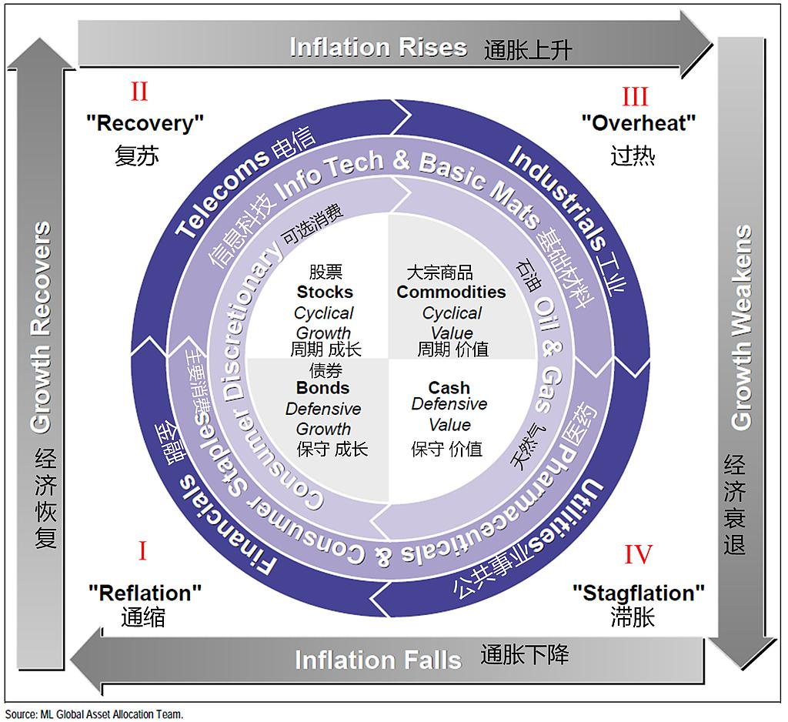
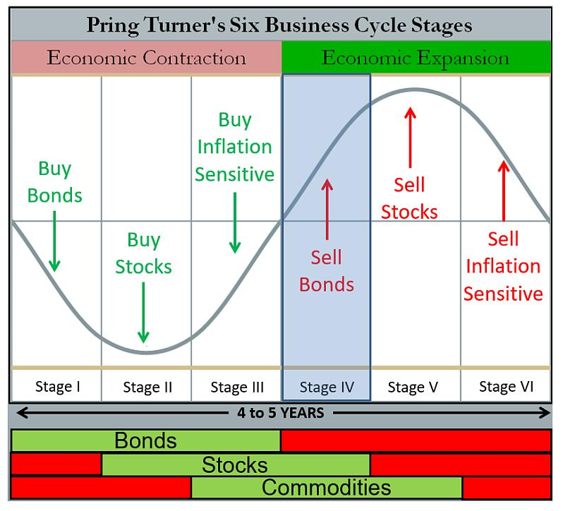

# 第22章 资产配置与宏观策略

## 第1节 概述

### 引言

大类资产配置，被誉为投资管理行业“皇冠上的明珠”，它从战略高度决定了投资成败的基调，是“收益与风险”管理的最高艺术，也是专业投资管理机构核心竞争力的终极体现。它并非孤立追求单一资产的短期超额回报，而是基于对宏观经济、市场结构、资产定价和投资者自身约束的深刻理解和系统化分析，将资金策略性地分配于股票、债券、商品、现金等不同类别的资产中。

本文，我们将系统性地阐述大类资产配置的核心目标、整体研究框架，并回顾其从朴素的经验法则到严谨的量化模型，再到人工智能赋能的演进历程。

### 一、大类资产配置的目标

大类资产资产配置，其目标并非单一的“追求高收益”，而是围绕**“收益-风险-流动性-适配性”四大维度**，构建动态平衡的目标体系。四大维度目标相互支撑、缺一不可，覆盖研究、决策、落地全的流程。

#### 1.目标一：收益与风险的动态平衡

投资的永恒主题，是在承担既定风险水平下追求收益最大化，或在实现既定收益目标的前提下承担最小化风险。

然而，这个“平衡”是动态的，而非静止的。传统理论中，风险常被狭义地定义为波动率，但真实的投资世界中，风险的内涵要丰富得多，它包含了永久性资本损失的可能性、购买力被通胀侵蚀的风险、以及在关键时刻流动性枯竭的风险。

大类资产配置的首要目标，就是构建一个能够应对不同经济情境、具有韧性的投资组合。这要求我们不再仅仅关注资产本身的预期收益率，而是要穿透表层，理解其背后的风险暴露和收益驱动因子。例如，配置股票不仅仅是买入权益Beta，更是暴露于经济增长、实际利率和投资者情绪等宏观因子。

通过平衡这些底层因子的风险暴露，我们才能在根源上实现收益与风险的真正平衡。当经济增长强劲时，权益类资产和商品可能表现优异；而当衰退来临，长久期国债和黄金则能提供保护。一个设计精良的配置方案，正是通过资产间此消彼长的关系，熨平组合整体的净值曲线，实现穿越周期的稳健回报。

#### 2.目标二：资产轮动与拐点预判

大类资产的表现呈现出显著的周期性轮动特征，没有任何一类资产能永远称王。这种轮动背后是宏观经济周期的潮起潮落、货币政策的松紧交替以及市场情绪的贪婪与恐惧。因此，大类资产研究的第二个核心目标是识别、理解并前瞻性地预判这种轮动规律，尤其是在周期拐点附近做出正确的战略与战术调整。

经典的**“美林投资时钟”**正是这一思想的集大成者，它将经济周期划分为衰退、复苏、过热和滞胀四个阶段，并指明了每个阶段中占优的资产类别：债券、股票、商品和现金。

然而，在后金融危机时代，全球央行前所未有的干预扭曲了传统的周期信号，使得简单的框架频频失效。因此，现代资产轮动研究已进化到更复杂的层面。普林格周期模型通过引入信贷周期，将经济周期细化为六个阶段，更细致地捕捉了从流动性注入、到经济复苏、再到通胀上行的传导链条，为预判资产轮动提供了更精细的图谱。

当前，区域选择、货币配置和行业轮动正成为获取超额收益的关键变量，这要求我们在全球视野下，对不同经济体所处的周期位置进行精准定位，从而捕捉结构性机会。

#### 3.目标三：匹配需求与约束

任何脱离投资者自身禀赋的资产配置都是空中楼阁。大类资产研究的第三个核心目标是将配置方案与投资者的特定需求、风险承受能力、投资期限、现金流需求和法律法规等硬性约束深度融合。一个拥有万亿规模的养老金、一个追求绝对收益的对冲基金、以及一个为子女教育储蓄的家庭，其最优资产配置方案必然是天壤之别。

这种匹配体现在多个维度：

-   **首先是收益目标的匹配。**需要明确组合需要实现的是绝对回报还是相对回报，是追求高增长还是稳定的现金流。

-   **其次是风险容忍度的匹配。**这不仅仅是问卷调查得出的心理承受力，更要量化分析其资产负债表的稳健程度和未来现金流出的刚性。例如，寿险公司面临长期的负债，其配置必然向长久期债券倾斜，以进行资产负债久期匹配，规避再投资风险和利率风险。

-   **再次是流动性的匹配。**需要确保组合在任何时候都能满足资金赎回或追加保证金的需求，避免被迫在不利的市场时点贱卖资产。

-   **最后，还须考虑法规、税收甚至环境、社会和治理（ESG）等非财务性约束。**只有将这些个性化的需求和约束内化到模型的边界条件中，生成的配置方案才是可执行且负责任的。

#### 4.目标四：风险管理和流动性管理

风险是收益的来源，没有风险就没有溢价。风险管理的首要原则，不是试图消除风险，而是识别、评估并主动管理那些组合无法承受的尾部风险。研究需兼顾各类风险的防控，包括政策风险（如监管政策调整对权益、债券市场的冲击）、汇率风险（如全球资产配置中的美元汇率波动）、信用风险（如债券市场的违约风险）、模型失效风险（如量化配置模型的假设与实际市场偏离）。完备的风险管理，在极端市场环境下确保组合“不被大幅击穿”，实现“先活下来，再追求做得更好”的核心诉求。

流动性是市场的血液，是大类资产配置的“生命线”，脱离流动性的收益毫无意义。一些资产虽长期收益可观，但短期流动性匮乏，在资金需要赎回时，可能面临“折价变现”的风险。历史反复证明，压倒骆驼的最后一根稻草，往往不是投资能力危机，而是流动性危机。2008年的全球金融危机和2020年3月的市场熔断，都是流动性瞬间蒸发的典型案例。而另一方面，过度追求流动性，又可能牺牲长期收益。大类资产配置研究需明确各类资产的流动性特征，平衡“流动性”与“收益”的矛盾。

风险管理和流动性管理并非孤立的两大目标，而是相互交织、互为支撑的统一体。流动性危机往往是风险的放大器，当市场下跌触发流动性枯竭，流动性枯竭又反过来加剧资产抛售和价格下跌，形成恶性循环。完善的风险管理，能够提前识别组合的脆弱环节，避免在极端市场下被迫抛售；而充足的流动性储备则为风险管理提供了操作空间，使组合管理者能够在市场恐慌时“逆势布局”而非“仓皇出逃”。

时刻牢记，我们构建的不仅是一个纸面上收益风险比最优的投资组合，更是一个在真实市场风暴中具备强大生存能力的“反脆弱”投资系统。

### 二、大类资产配置研究框架

大类资产配置的研究框架，可以理解为一个从宏观到微观、从战略到战术、从逻辑到验证、从理论到落地的决策系统。自宏观向微观逐层穿透，再由微观反馈修正宏观判断，形成"方向→定价→验证→配置"的工作流程。整个投研框架由宏观研究、中观定价、微观验证、和组合构建四个环节步骤构成，最终以资产配置组合比例作为最终输出端，将研究转化为可执行的投资组合。

#### 1.宏观研究：识别周期，匹配资产

宏观研究是大类资产配置研究的“起点”和“基石”，其核心在于分析宏观经济周期与政策导向，判断当前市场所处的周期阶段与主要矛盾，为资产配置提供战略方向指引。不同经济周期下，各类资产的表现存在显著差异，因此宏观研究的本质是“识别周期、匹配资产”。

研究过程中，主要参考美林时钟、普林格周期模型等经典分析框架，并结合对央行政策路径的判断，形成对经济状态的基准情景。例如，当判断全球处于“增长放缓但未衰退，通胀缓慢回落但粘性犹存”的状态时，这一宏观锚定将直接指导我们超配或低配哪类资产：预期长期利率下行，长久期国债将成为战略配置重点；预判“滞胀”风险上升，黄金、商品和现金的配置价值随之凸显。

##### 1.1.经济周期分析

研究核心是跟踪经济增长（GDP增速、工业增加值、PMI）与通胀水平（CPI、PPI）两大指标，同时结合库存周期、信用周期，判断经济在“衰退→复苏→过热→滞胀”四阶段中的具体位置，从而明确各类资产的优劣排序。参考美林时钟，典型资产匹配规律为：衰退期，债券＞现金＞权益＞商品；而复苏期，权益＞商品＞债券＞现金。

需要特别注意的是，传统美林时钟模型在国内市场的适用性有限，实际研究中通常结合国内现实情况和历史规律，补充信用周期、货币周期等等本土化指标进行修正。

##### 1.2.政策导向分析

重点跟踪货币政策（央行利率调整、存款准备金率、公开市场操作、资金利率）、财政政策（财政支出、税收、专项债发行）以及产业政策与监管政策。

其中，货币政策是债市的核注焦点，宽松政策推动资金利率下行，利好股市、债市；财政政策发力则可能推动商品与权益资产走强；监管政策的调整会（如平台经济监管、房地产调控）能对特定资产类别产生深远的结构性冲击。

宏观层的核心输出是“周期判断报告”与“政策解读报告”，旨在明确当前市场的核心矛盾（如经济复苏乏力、通胀超预期、政策宽松不及预期），为中观资产定价与微观配置提供方向指引。

#### 2.中观研究：量化价值和资产筛选

中观研究是大类资产配置研究的“核心”，聚焦于拆解资产定价逻辑、跟踪核心驱动因素、评估估值水平，从而筛选出收益风险比更优的资产，预判资产轮动的拐点。

实践中，一般会利用各类定价模型对不同资产进行公允价值评估：

-   对于股票市场，基于宏观因子（如PMI、实际利率）构建估值模型，判断其高估或低估区间；

-   对于债券市场，将远期利率曲线与宏观预测进行比较，寻找期限利差和信用利差上的机会；

-   对于外汇和商品，则更多从供需基本面、库存、全球贸易和地缘政治溢价等角度进行建模。

这一过程将宏观判断转化为具体的、可比的量化指标，为下一阶段的组合构建提供输入参数。

结合研究实践，可将大类资产分为五大类，每类的定价逻辑与核心跟踪指标各有侧重：

-   **权益资产（A股、港股、美股等）**

    核心定价逻辑：盈利预期+风险偏好+流动性，核心在于企业盈利增长与市场情绪的共振。

    核心跟踪指标：市盈率（PE）、市净率（PB）、企业盈利增速、融资余额、风险偏好指数。

    收益风险特征：长期收益最高，短期波动剧烈，择时难度大，适合长期配置。

-   **债券资产（国债、金融债、信用债等）**

    核心定价逻辑：货币政策+资金面+信用风险，核心是资金利率与期限利差的变化。

    核心跟踪指标：资金利率、期限利差、信用利差、央行政策、基金久期变化。

    收益风险特征：收益稳定，波动较低，具备避险属性，是稳健组合的核心配置。

-   **商品资产（原油、有色金属、农产品等）** 核心定价逻辑：供需格局+通胀预期+美元走势，核心是供需缺口的变化。 核心跟踪指标：供需数据、PMI原材料库存、CPI/PPI、美元指数、地缘政治。 收益风险特征：波动剧烈，收益弹性大，具备通胀对冲属性，适合短期波段操作。

-   **黄金**

    核心定价逻辑：全球定价+美元实际利率+避险需求+去美元化趋势，核心是美元地位的变化。

    核心跟踪指标：美元实际利率、各国央行购金数据、地缘政治风险、美元指数。

    收益风险特征：长期保值，避险属性突出，与权益、债券相关性较低，是组合的理想对冲工具。

-   **现金及等价物（货币基金、短期理财等）**

    核心定价逻辑：流动性需求+短期资金利率，核心是满足即时赎回需求。

    核心跟踪指标：活期利率、货币基金7日年化收益率、银行间资金面。

    收益风险特征：流动性最强，收益最低，风险几乎为零，用于流动性缓冲。

| 资产类别 | 核心定价逻辑 | 核心跟踪指标 | 收益风险特征 |
|------------------|------------------|------------------|------------------|
| 权益资产（A股、港股、美股） | 盈利预期＋风险偏好＋流动性，企业盈利增长与市场情绪的共振 | PE、PB、企业盈利增速、融资余额、风险偏好指数 | 长期收益最高，短期波动剧烈，择时难度大，适合长期配置 |
| 债券资产（国债、金融债、信用债） | 货币政策＋资金面＋信用风险，资金利率与期限利差的变化 | 资金利率、期限利差、信用利差、央行政策、基金久期 | 收益稳定，波动较低，具备避险属性，稳健组合的核心配置 |
| 商品资产（原油、有色金属、农产品） | 供需格局＋通胀预期＋美元走势，供需缺口的变化 | 供需数据、PMI原材料库存、CPI/PPI、美元指数、地缘政治 | 波动剧烈，收益弹性大，具备通胀对冲属性，适合短期波段操作 |
| 黄金资产 | 全球定价＋美元实际利率＋避险需求＋去美元化趋势，美元信用体系的变化 | 美元实际利率、央行购金数据、地缘政治风险、美元指数 | 长期保值，避险属性突出，与股债相关性低，组合对冲工具 |
| 现金及等价物（货币基金、短期理财） | 流动性需求＋短期资金利率，满足即时赎回需求 | 活期利率、货基7日年化收益率、银行间资金面 | 流动性最强，收益最低，风险极低，用于流动性缓冲 |

中观层的核心输出是“各类资产研究报告”与“估值评估报告”，明确各类资产的“高估/低估”状态、核心驱动因素与未来走势预判。例如，在去美元化趋势下，黄金因各国央行购金支撑而长期值得关注；当国内利率下行空间有限时，债券资产的投资性价比可能被压缩。

#### 3.微观验证层：洞察市场情绪与结构

微观验证层通过分析高频市场数据和参与者行为，验证或证伪基于上层架构形成的判断，并寻找最佳的战术交易时机。该层是连接“研究”与“交易”的桥梁，有效规避“价值陷阱”和，是落实大类资产研究的追后一环。

这一层的分析工具包括技术分析、市场情绪指标（恐慌指数、涨跌比、资金流）、以及衍生品市场隐含前瞻信息（如期权偏度）。例如，当宏观看多权益资产、中观也显示估值合理时，微观验证层若发现市场情绪过度狂热、资金流入边际枯竭，便会提示应暂缓建仓或避免高位接盘。

资金流向指标，系统跟踪公募基金、私募基金、保险资金、北向资金等主力机构的持仓变化与资金流向，据此判断市场情绪与资产偏好的边际变化。北向资金持续净流入往往预示外资对A股市场的乐观预期；基金久期变化则是债券市场的关键前瞻信号，久期处于历史高位区间往往释放过热风险信号。

机构行为指标，具有强化短期趋势并引发结构性影响的重要特征。市场顶部通常形成于绝大多数参与者情绪亢奋之时，而市场底部则在参与者极端悲观中构筑。不同机构的资金属性与配置偏好亦会为特定板块带来结构性增量资金，从而影响资产定价。研究机构行为的核心在于捕捉"趋势强化"与"拐点信号"两大关键节点，规避情绪驱动的追涨杀跌行为。

微观层的核心输出是“市场情绪和资金行为报告”，据此最终确定各类资产的配置比例、调整节奏与止损止盈规则。

#### 4.配置比例优化：融合战略、战术与约束

配置比例优化是将前序所有研究成果转化为最终投资组合的关键环节。它并非一个简单的数学求解过程，而是一个融合战略定力、战术灵活性与约束条件的综合决策艺术。

**战略资产配置（SAA）**基于长期的宏观锚定和投资者的长期目标与约束（收益目标、风险容忍度、流动性需求、投资期限等），确定组合中各类资产的长期目标配置比例。这是整个投资组合的"锚"，大量研究表明，战略配置决策决定了组合90%以上的长期回报和风险特征。

**战术资产配置（TAA）**基于中短期的周期判断、中观估值评估和微观验证信号，对战略配置比例进行有限度的、积极的偏离，以捕捉市场错误定价和资产轮动的机会，获取超额收益。战术配置是主动管理能力的集中体现，其偏离幅度和调整频率均须有严格的纪律约束，避免将战术判断异化为风格漂移。

资产价格的持续变动会导致实际配置比例偏离战略目标。再平衡机制通过纪律性的"低买高卖"操作，不仅将组合风险暴露稳定在目标水平，其本身也能在长期创造可观的再平衡溢价。再平衡可以基于阈值触发（偏离目标比例一定幅度即操作），也可以基于固定日历（按月或按季度调整），实践中往往采用两者结合的方式。

综上，大类资产配置比例的确定和优化，需结合宏观周期、中观资产估值与微观资金信号，以此确定各类资产的核心配置比例，并制定动态调整规则。

战略层面，宏观研究层集中体现了周期配置的精髓，以经济周期和政策周期为锚确定战略方向；战术层面，中观定价层采取驱动归因思路，将宏观判断拆解为各类资产的具体定价参数；微观验证层则对接智能配置时代的动态调整理念，通过高频行为信号实现观点迭代。

三层架构打通了从"宏观周期识别→中观资产估值→微观信号验证→组合优化输出"的完整投研链条，最终落脚于一个可执行、可追踪、可归因的资产配置方案。

### 三、资产配置理论的演进历程

1986年，Brinson等人发表的奠基性研究论文《投资组合绩效的决定因素》确立了资产配置其核心地位。研究通过对91只大型养老金基金长达十年的数据进行归因分析，发现高达93.6%的投资组合收益波动，源于其长期持有的战略资产配置结构；而市场择时和证券选择这两项看似能创造超额收益的操作，其贡献微乎其微。

这一结论震撼了整个投资界，它深刻地揭示了，与其耗费心力预测资本市场的短期波动，不如专注于构建并坚守一个科学的资产配置方案。

资产配置理论的发展，是投资者不断尝试用更精确的工具理解市场、管理风险、追求稳健回报的进化史。其历程可清晰地划分为五个阶段：传统的资产配置、风险配置、周期配置、因子配置、以及AI赋能的探索。整个发展历程呈现出从简单到复杂、从表面到内核、从静态到动态的鲜明特征。

#### 1.传统资产配置模型：从经验法则到量化模型

##### 1.1.恒定混合模型

在20世纪30年代，投资者便意识到大类资产配置的重要性。当时投资者关注到股票和债券资产具备不同的风险收益特征，同时配置股票和债券资产可以起到风险分散的作用。投资者采用的配置方法为简单的恒定混合模型。这是最古老的资产配置策略，核心是设定一个固定的资产权重比例，并通过定期再平衡来维持这一比例。

其代表性策略是股债60/40组合（60%资金投资于股票，40%投资于债券）和等权重组合。其核心逻辑在于，利用股票（高收益高风险）与债券（低收益低风险）资产之间的低相关性或负相关性，实现风险分散；而再平衡机制本质上是一种纪律性的“高卖低买”。其简单、透明、低成本的特性使其至今仍是许多机构和个人投资者的基准。

恒定混合模型的优点在于，规则极度简单，执行成本低，纪律性强，能被动地实现均值回归策略；缺点在于，配置僵化，无法响应经济周期变化与估值极端情况，其风险并未真正分散，组合绝大部分风险仍由波动率最高的股票资产所贡献。

##### 1.2.均值-方差模型与现代投资组合理论

1952年，马科维兹提出著名的均值-方差模型（Mean-Variance Optimization Model，MVO）奠定了现代组合投资理论（Modern Portfolio Theory，MPT）的基础，开启了量化资产配置的时代。

该模型首次用数学语言精确描述了“风险与收益权衡”和“分散化”两大核心投资原则，开创性的提出，资产组合的风险不在于单个资产的风险，而在于资产之间的协动关系；通过加入低相关性资产，可以在不牺牲预期收益的情况下降低组合整体风险。模型使用均值和方差刻画资产收益和风险，并基于“约束+优化求解”的范式来解决资产配置问题，开启了量化资产配置时代。

然而，在实际应用中，均值-方差模型对输入参数极度敏感的缺陷暴露无遗。预期收益率或相关性估计的微小偏差，都可能导致优化器给出极端集中、经常违背直觉的配置权重。此外，模型忽略了收益分布的峰度和偏度，方差计算上也未能区分亏损和盈利，等一些列缺陷。此后的众多研究，都围绕如何改进这些模型缺陷而展开。

##### 1.3.改进一：改进风险度量指标

用方差来衡量风险，意味着上涨和下跌都被同等地视为“不好的”。这与投资者的真实感受相悖。因此，一系列更符合投资者心理的风险度量指标被引入，其中最具代表性的是下行标准差、在险价值（VaR）和条件在险价值（CVaR）。下行标准差只关注低于某一目标收益率或平均收益率以下的波动部分，更精准地刻画了“损失”的风险。VaR回答了“在给定概率下，未来特定时间内最大可能的损失是多少”，而CVaR则进一步回答了“当损失超过VaR阈值时，平均的损失是多少”，从而更好地捕捉了尾部风险。这些改进使得优化目标更贴近真实的投资管理需求。

##### 1.4.改进二：改进预期收益估计

仅用历史平均收益作为预期收益的估计，既不稳定也不可靠。Black-Litterman模型（1992）是解决这一问题的里程碑。BL模型巧妙地绕开了直接估计历史收益率的难题。它从市场均衡假设出发，推导出先验的预期收益。然后，投资者可以加入自己对资产未来表现的“主观观点”，并通过贝叶斯方法将观点与市场均衡相结合，形成后验预期收益。这一过程既克服了完全依赖历史数据的盲目性，又避免了纯粹主观判断的过度自信，生成的“后验预期收益”更加稳健，由此推导出的最优配置权重也更具直觉和分散性，极大地缓解了模型对输入参数的敏感性，提升了模型的实用性。

##### 1.5.改进三：改进协方差估计

用历史数据计算得到的样本协方差矩阵包含大量的估计误差，尤其是在资产数量众多而数据时间窗口有限的情况下。压缩估计方法提供了一个精巧的解决方案。它将高误差的样本协方差矩阵，向一个低误差、高度结构化的“目标矩阵”（例如，假设所有资产两两相关性都等于平均相关性的常数相关矩阵）进行“收缩”。通过这种方式，我们在保留样本信息的同时，又向一个更稳健的假设进行回归，从而得到一个估计误差更小的协方差矩阵，显著提升了组合优化结果的稳定性。此外，还可以利用因子模型估计协方差矩阵，通过设定一定的结构来减少待估参数，从而达到降低估计误差的目的。

##### 1.6.改进四：再抽样

既然历史数据只是真实数据生成过程的一个可能路径，那么我们可以通过统计技术来模拟出更多的路径，从而评估估计误差带来的影响。1998年，Michaud提出了再抽样方法（Resampling），通过反复进行有放回的随机抽样，生成大量“虚拟历史数据”进行计算和平均化，以降低模型对参数的敏感性，使有效边界更加稳定。具体步骤如下：

1.  参数估计：先用历史数据估计均值和协方差矩阵。

2.  生成再抽样数据： 基于估计的均值和协方差，使用蒙特卡洛模拟生成许多可能的收益序列。

3.  多次优化：对每个模拟样本，分别做一次均值-方差优化，从而得到一个有效边界，并求解最优组合权重。

4.  组合平均：对所有模拟得到的最优组合权重进行平均，最终形成一个“再抽样有效边界”。

再抽样方法通过蒙特卡洛抽样+多次均值-方差优化+组合平均，减少了参数估计误差对组合的冲击，使得有效边界更加平滑和稳定，同时得到的组合更加分散，具备更强的稳健性。

#### 2.风险配置模型：从资金权重到风险权重

传统模型无论怎么改进，都始终在“资金权重”上进行优化，都无法解决一个根本问题：在典型的60/40组合中，因股票波动率远高于债券，60%的股票仓位往往贡献了超过90%的组合风险，并未实现真正的“风险分散”。投资者逐渐意识到，忽视了风险结构的资产配置方法并不能真正的分散风险。风险配置思想应运而生，其核心是将配置的焦点从“资金比例”转向“风险贡献”。

##### 2.1.桥水全天候策略：风险配置的实践先驱

桥水基金最早将风险配置理念应用于实践。经典的桥水全天候策略的哲学基础是：不去预测经济，而是构建一个在任何经济环境下都能表现稳健的组合。

首先根据经济增长与通胀指标是否超预期将经济周期划分为四种宏观经济状态，在不同宏观经济状态下配置不同的占优资产，同时可以通过杠杆机制调整各资产的风险收益特征。

然后将风险权重等量分配给四种宏观经济状态下的子资产组合，在每个子资产组合中又将风险权重等量分配给组合中的各资产，从而得到各资产的最终风险权重。

这意味着，无论未来出现哪种经济环境，组合中总有一组资产能表现优异，从而实现对冲风险、穿越周期的目标。全天候策略在历史实践中表现优异，尤其是在市场动荡时期表现稳定，深刻验证了风险配置思想的强大生命力。

##### 2.2.风险平价模型：理论的正式确立

2005年，钱恩平首次正式提出了“风险平价”的概念与数学模型，即平衡各类资产对组合总风险的贡献，求解一组资产权重，目标是使组合中每一项资产对组合总风险的贡献度相等，以实现真正的风险分散。

与均值-方差模型聚焦于最大化收益风险比不同，风险平价的核心纯粹在于“风险管理”。它不再需要对预期收益进行预测，从而避开了那个最大的误差来源。其构建出的投资组合，天然具有高度的分散化特征。风险平价模型一经提出，便与桥水的全天候实践相互印证，在资管行业引发了一场范式革命。

然而，该模型也非完美无缺，其数学原理决定了它倾向于超配低波动的资产，如债券。为达到收益目标，往往需要对整个组合施加杠杆。在利率上行或流动性急剧收紧的时期，杠杆会放大损失，构成其主要的风险源。除此之外，模型的风险用方差进行衡量，未能充分反映组合风险特征，可采用下行方差、VaR、期望损失等指标来衡量组合风险。

##### 2.3.风险预算模型：风险平价的广义化

风险预算模型是风险平价模型的一般化推广。它同样基于风险贡献确定资产权重，但是不再要 求各资产的风险贡献相同，而是允许投资者根据自身的风险偏好、对于不同资产后市走势的主观判断等因素设定各资产的风险贡献占比，从而能够更好地满足不同投资者个性化的资产配置需求。模型的主要风险在于，若投资者对不同资产后市走势的判断有误，则可能会面临承担了额外风险却无法取得理想收益的情况。

#### 3.周期配置模型：宏观经济信息的引入

风险配置模型解决了组合内部的风险结构问题，但它仍是相对静态的，它并未直接回答：在当前时点，我们应该如何动态调整各类资产的配置，以应对变化中的宏观经济环境？以美林投资时钟和普林格周期模型为代表的周期配置模型应运而生，将自上而下的宏观视角系统性地引入配置决策。

这些模型的共同内核是：识别当前经济周期的位置，并超配在该阶段历史表现最佳的资产。美林时钟以其简洁明了的四阶段划分而广为人知，成为战术资产配置的经典工具。普林格周期模型则进行了更精细的六阶段划分，能更早地捕捉到经济复苏的信号，其指导意义愈发受到重视。

然而，在2008年后量化宽松成为常态、央行政策深度干预市场的背景下，这些基于历史规律的经济时钟也遇到了挑战。例如，在流动性驱动下，市场可能在实体经济增长乏力的“衰退”阶段就率先反弹，导致时钟模型的信号失灵。

因此，当下的周期配置实践，更加强调结合政策因子和流动性因子对传统框架进行修正，而非机械地照搬。

##### 3.1.美林投资时钟

2004年，Greetham和Hartnett提出著名的美林投资时钟理论，根据经济增长率（GDP）和通货膨胀率（CPI）两个宏观指标的变化将经济周期分成衰退期、复苏期、过热期、滞胀期四个阶段。随着经济周期推进，债券、股票、商品和现金依次为各周期下的占优资产。

美林时钟的优点在于逻辑清晰且操作简单，为自上而下配置提供研究框架，将经济周期与资产配置策略动态联系起来。

但在实际应用过程中也存在缺陷：首先由于GDP、CPI等经济数据的披露存在滞后性，故经济周期阶段识别可能存在错配；此外，美林时钟仅根据经济增长和通胀划分经济周期，忽略货币政策等因素带来的影响，对我国经济环境适用性较差。

##### 3.2.货币信用周期

海外学者在很早之前便已经关注到货币和信用对经济周期的影响。例如：Wicksell在19世纪末提出了货币利率与自然利率的背离会引发经济累积性扩张或收缩，为后续信贷周期理论提供了利率分析框架；此后，Hayek（1929,1931）吸收了Wicksell的利率思想，构建了以过度信贷扩张导致的资源跨期错配为特征的商业周期理论；Fisher于1933年提出了“债务紧缩理论”，其开创性的研究正式拉开了金融经济周期理论发展的序幕。1980年代，Minsky提出了“金融不稳定假说”，以及伯南克提出了“金融加速器”机制的研究，都为货币信用周期奠定了理论基础。

虽然货币信用周期理论起源较早，但主要在2000年以后被应用于大类资产配置。尤其在2008年金融危机爆发以后，人们逐渐意识到货币宽松≠信用扩张，于是开始将“货币-信用”状态两两组合，划分出了四个象限：宽货币+紧信用、宽货币+宽信用、紧货币+宽信用、紧货币+紧信用。

-   在宽货币-紧信用周期，虽然货币已经放松，但还未传导至信用，企业信用问题并未解决，这是衰退时期会出现的经济状况，此时选择债券和黄金进行防御配置更具性价比。

-   在宽货币-宽信用周期，货币宽松逐渐传导到了信用宽松，从而刺激企业的经营生产，企业利润开始逐步恢复正常，步入了类似于复苏时期，此时表现最好的资产是股票。

-   在紧货币-宽信用周期，货币与信用早已高涨，政策开始逐步收紧货币，但信用利差仍然处在较低水平，经济体现出过热的特征，此时商品表现最为出色。

-   在紧货币-紧信用周期，信用随着货币的收紧开始逐步收紧，经济增长放缓，但之前高涨的信用所带来的通胀后遗症仍然存在，类似投资时钟中的滞涨周期，此时黄金成为最优资产。

##### 3.3.普林格周期

普林格周期理论萌芽最早诞生于1980年代，早期主要用宏观经济指标与金融市场价格关系描述经济周期，强调债券、股票、商品之间存在先后轮动关系。

2008年金融危机之后，该理论被投资者广泛应用于大类资产配置。普林格周期理论将一个完整的周期划分为六个阶段，在不同的经济周期阶段，债券、股票、商品三大类资产会依序见顶或见底，形成一个连续的轮动链条。

在模型的具体应用层面，普林格分别构建了债券、股票和商品三大类资产的独立“晴雨表”（Barometers），旨在独立判定各市场内部的趋势方向（上行或下行）。通过综合比对三个晴雨表的多空信号组合，即可精准定位经济周期所处的六阶段之一（例如债券率先走强为阶段Ⅰ，商品最后见顶为阶段Ⅲ等）。每个晴雨表均由12至15个分类精细的成分指标综合加权构成，当该晴雨表中多数成分指标释放积极信号时，即判定该市场处于看涨态势。

此外，为进一步提升对六阶段轮动拐点的前瞻识别能力，普林格引入了一套辅助指标体系。该体系并非为了替代晴雨表，而是用于监测周期转换的边际变化，主要包括两大层次：

-   一是宏观序列指标，如贴现率、领先经济指标（LEI）、同步经济指标（CEI）、滞后经济指标及收益率曲线形态；

-   二是跨市场比值指标，如领先/滞后指标比率、股票/商品比率、商品/债券比率，以及普林格特有的扭矩指标（Torque Indicator）。这些辅助工具通过捕捉背离与趋同信号，为各阶段之间的过渡转换提供早期预警。

六阶段轮动包括：

-   阶段1，只有债券市场是牛市。投资组合应该着重关注高收益率的现金和债券，而后还可以关注一些早期领导行业的股票，债券在阶段1的相对表现最好。

-   阶段2，只有商品市场是熊市。表现最好的是股票市场，同时债券也表现不错，但不如其在阶段1的表现，也不如此时股票的表现。

-   阶段3，每个市场都是牛市。股票价格会继续增长，但增长速度变缓，此时所有市场都在增长，货币市场收益率较低，现金头寸处于经济周期中的最低时期，此时可以积累一些商品资产。

-   阶段4，债券开始熊市而股票和商品保持牛市。应该减少债券头寸或缩短债券的期限，投资组合中的股票应该被转换为中期领导行业和收益驱动型的后期领导行业。

-   阶段5，只有商品是牛市。投资组合中的股票头寸应该减少，并相应地增加现金头寸。

-    阶段6，没有一个市场是牛市。现金为王，同时在一些债券市场筑底时购买一些债券资产。另外值得注意的是，普林格提

#### 4.宏观因子配置模型：穿透表象

宏观因子配置模型的思想起源于经典的CAPM模型（1964），后来经过广大学者的发展，成为金融投资领域的重要学术分支和理论方法。桥水基金的全天候策略根据经济增长和通货膨胀两个因子将宏观经济划分为四种形态并设置不同的资产配置比例，是使用宏观因子进行大类资产配置的雏形。

2008年金融危机，大家逐渐发现，由于资产暴露于同一组因子，在极端市场情况下资产间的风险会大幅上升，传统资产配置方法并不能带来有效的分散风险。因此，大家转而去寻找驱动资产价格变化的底层逻辑。因子投资的理念在大类资产配置领域得到迅速发展。

基于宏观因子的资产配置仍然是一种“自上而下”的方法。该方法论的核心思想在于，任何大类资产的回报与风险都可以被分解为对一系列共同的、系统性的宏观经济因子的暴露。与传统配置策略直接在股票、债券等资产类别上分配权重不同，宏观因子配置框架将投资决策的重心从“投什么资产”转移到“承担什么类型的宏观风险”上 。这种转变使得投资者能够更清晰地理解投资组合的真实风险来源，实现更有效的风险分散，并能主动地根据对未来宏观经济环境的判断来调整因子暴露，从而构建更具稳健性和前瞻性的投资组合 。

宏观因子框架通过“穿透”资产类别的表象，揭示其背后共同的风险驱动因素。例如，股票和高收益债券可能都对“经济增长”因子有正向暴露，而国债则可能对“利率”因子更为敏感。通过在因子层面进行配置，投资者可以避免在不经意间对某一特定宏观风险过度集中，从而实现真正的风险分散 。这种方法将投资组合的风险来源与真实的宏观经济世界联系起来，使风险管理更具逻辑性和可解释性 。

基于宏观因子的资产配置框架为投资者提供了一个更深刻、更具经济直觉的投资组合管理范式。通过将资产风险分解到经济增长、通胀、利率等基本驱动因素上，该框架不仅增强了投资组合的风险透明度和可控性，也为主动管理提供了基于宏观经济判断的清晰路径。从实施流程来看，它融合了经济学洞察、数据科学处理和量化优化技术，形成了一个系统化、可重复的投资流程。

然而，该框架也面临挑战。宏观因子本身并非一成不变，其对资产价格的影响力或资产对因子的敏感度都可能随市场机制和投资者行为的变化而发生结构性改变。此外，模型对历史数据的依赖，以及模型自身风险，都可能使其在面对前所未有的“黑天鹅”事件时发生短暂的失效 。

#### 5.人工智能技术应用探索：人工智能赋能资产配置

当前，以大语言模型为代表的人工智能技术正在深刻影响和重塑资产配置领域。人工智能技术，特别是自然语言处理、深度学习、和强化学习等一系列模型和方法，正在从以下几个维度颠覆传统范式：

-   **非结构化数据的处理与因子挖掘：**超过80%的市场相关信息以文本、图像、音频等非结构化形式存在。大语言模型能够高效地解析央行会议纪要、新闻舆情、社交媒体情绪、分析师研报等海量文本，从中提炼出关于经济增长、通胀、政策意图和投资者情绪的量化洞察，并构建出具有显著预测能力的另类因子，极大地扩展了信息优势的边界。

-   **复杂非线性关系的建模：**宏观经济变量与资产价格之间的关系远非简单的线性模型所能描述。如LSTM、Transformer等深度学习模型，善于从海量数据中自动学习复杂、动态的非线性关系，能够捕捉不同经济状态下变量之间的结构突变。这使得我们对于资产轮动和拐点预判有望实现质的飞跃。

-   **动态、自适应模型：**强化学习可以在与市场环境的持续互动中学习最优配置策略，其目标是最大化长期累积回报，天然地适用于动态资产配置问题。它可以在模拟的历史和极端的市场环境中进行无数次的试错和训练，学到人类未曾经历的危机应对之道。

-   **研究范式的跃迁：**传统基于人类认知的量化策略开发主要遵循“假设-检验”或“假设-回测-模拟-实盘”研究范式。而人工智能技术驱动的投研可以实现“数据挖掘-规律发现-动态优化”的闭环。这种研究范式跃迁使量化策略开发突破了人类认知的局限，并具备自主进化和创新的能力。

然而，我们必须保持专业的审慎。人工智能并非万能。它存在“信息幻觉”的风险，可能编造出看似合理但实际错误的分析；其模型的“黑箱性”和可解释性差，与资管行业严格的合规风控要求存在矛盾；基于历史数据训练出的模型，在面对前所未有的、由地缘政治等非市场因素引发的“黑天鹅”事件时，其预测能力同样会失效。

因此，当下的前沿探索，不是追求完全由AI取代人类的“自动驾驶”，而是构建“AI+人类”的协同工作流。由AI负责处理海量多维数据、识别复杂模式、生成各种情景和配置方案建议；而人类专家则负责顶层逻辑判断、宏观情景设定、对AI输出结果的验证与挑战，并做出最终、最负责任的决策。这种人机结合的投研体系，代表了当前大类资产配置研究的最高水平和未来发展方向。

### 四、总结与展望

回顾资产配置的百年演进，我们看到的是一部人类运用理性工具不断征服投资不确定性的壮阔史诗。从马科维茨用“有效边界”将投资从艺术推向科学，到风险平价模型揭示出风险集中的真相；从美林时钟为我们提供观察经济的宏观透镜，到因子投资带我们穿透资产表层、直击收益本源；再到今天，人工智能正以前所未有的力量，推动我们超越自身认知的局限。这一历程，是模型日趋复杂的历程，更是我们对市场认知日趋深刻的历程。

展望未来，大量资产配置的发展将呈现以下清晰趋势：

-   **融合化：**未来的主流配置框架不会是单一模型，而是一个融合体。它将汲取风险平价的稳健内核、周期模型的宏观视野、因子投资的深度洞察以及智能算法的动态学习能力，形成“宏观定方向、风险定仓位、因子优结构、AI做增强”的综合架构。

-   **智能化：**AI将从一个“可选工具”演变为“核心基础设施”。能够处理高维异构数据、具备在线学习与进化能力的自适应系统，将能够更早地嗅到市场风格的变化，并迅速调整配置，持续创造阿尔法。

-   **本土化：**针对我国市场的特有市场特征、投资者结构、和资产类别，对经典模型进行深度改造和创新，是我们获取超额收益的关键。

-   **普惠化与个性化：**在智能投顾平台的推动下，过去仅服务于机构巨头的复杂配置策略，正以极低的门槛和成本提供给普通投资者。结合大数据对投资者风险偏好的精准画像，真正意义上的“千人千面”个性化资产配置将成为现实。

人类百年的投资实践深刻地揭示了一个真理：不存在普适的“最优模型”，只存在与特定市场环境、投资者目标和约束条件相匹配的“最适模型”。资产配置目标，也不是寻找一个一劳永逸的“圣杯”，而是构建一个坚韧而灵活的系统。这个系统能够兼容并包各种理论的智慧，从容应对市场的不测风云，并始终如一地守护着投资者的长期财务目标，引领我们穿越时间的河流，抵达财富的彼岸。

## 第2节 美林时钟

### 引言

在资产配置研究和工作中，如何前瞻的预判宏观经济趋势，捕捉大类资产配置周期性机会，规避风险，是所有专业投资者面临的重要课题。以“投资时钟”为代表的宏观周期分析框架，为我们提供了在宏观经济的不同阶段进行战略性资产轮动的理论基石。

我们将在未来两个章节，详细的梳理与剖析两种最具影响力的经典周期理论：美林投资时钟（Merrill Lynch Investment Clock）与普林格经济周期模型（Pring's Six-Stage Model），并深入探讨这些理论在中国独特的经济与政策环境下，如何被修正、重构，最终演化出更具本土适应性的“货币-信用”分析框架。

美林时钟，作为2004年由美林证券提出的宏观资产配置理论，以其简洁优雅的逻辑框架，一度成为全球投资者的重要参考工具。它试图通过经济增长（Growth）和通货膨胀（Inflation）两个核心宏观变量，将经济周期划分为四个可预测的阶段：衰退、复苏、过热、滞胀，并为每个阶段指定了表现最优的大类资产。

然而，这一诞生于成熟市场历史数据之上的理论，在进入中国这个结构性特征鲜明、政策影响力巨大的新兴市场后，遭遇了严重的“水土不服”，其实际应用效果一度被市场戏称为“美的电风扇”，时转时停，甚至反转。

本文，我们将对美林时钟理论进行简单回顾，而后深入剖析其在中国市场“失灵”的根本原因，并系统的梳理国内投资机构在实践中如何对其进行“本土化改造”。最后我们将看到，一个经典的二维框架，如何在中国特色的宏观环境中，演化为一个包含政策、信用、流动性等多维度的、更具动态适应性的分析范式。这不仅仅是一个投资模型的迭代过程，更是深刻理解中国宏观经济与资本市场联动机制的必经之路。

### 一、经典美林时钟的理论框架与逻辑

在深入探讨其在中国应用的复杂性之前，我们必须首先精准地理解经典美林时钟的理论内核。它的核心魅力在于，将复杂的宏观经济波动简化为一个可循环、可识别的“时钟”，为资产配置提供了看似清晰的路线图。

#### 1.时钟的核心驱动：经济增长与通货膨胀

美林时钟的理论基石是两个宏观经济中最核心的指标：经济增长和通货膨胀。通常，经济增长的代理变量是国内生产总值（GDP）的增长率，或者更精确地说，是产出缺口（Output Gap），即实际产出与潜在产出的差额。通货膨胀的代理变量则是居民消费价格指数（CPI）的年增长率。

理论上，这两个指标的交叉组合，构成了经济周期的四个象限：低增长，低通胀；高增长，低通胀；高增长，高通胀；低增长，高通胀。这四个象限，分别对应着美林时钟的四个阶段。该理论的精髓在于，它不仅描述了经济状态，更重要的是揭示了在不同经济状态下，各大类资产（股票、债券、大宗商品、现金）的相对表现优劣顺序。



#### 2.时钟的四个周期阶段与资产轮动

美林时钟的四个阶段以顺时针方向轮动，每个阶段都有其典型的宏观经济特征和相应的最优资产类别。

#### 2.1.第一阶段：衰退期（Recession），债券为王

宏观特征：经济增长乏力甚至为负（产出缺口为负且不断扩大），通货膨胀持续下行。企业盈利能力大幅下滑，消费者信心疲弱，市场需求不振。

政策应对：在此阶段，为了刺激经济，中央银行通常会采取宽松的货币政策，即降息和/或量化宽松。这导致市场利率下行。

资产表现：

-   债券最优：债券价格与利率成反比。央行的降息周期直接推动债券价格上涨，使其成为衰退期表现最好的资产。投资者寻求避险，国债等高信用等级债券尤为受益。

-   股票最差：企业盈利预期悲观，盈利能力恶化，直接打压股价。即使估值下降，但盈利下滑的“戴维斯双杀”效应往往更为显著。

-   大宗商品疲软：经济活动萎缩导致对原材料和能源的需求下降，大宗商品价格承压。

-   现金中性偏好：虽然现金的实际回报率可能因降息而降低，但在股市和商品市场大幅下跌时，持有现金提供了宝贵的资本保全和流动性。

#### 2.2.第二阶段：复苏期（Recovery），股票牛市

宏观特征：经济增长开始触底回升（产出缺口收窄），但由于经济中仍存在大量闲置产能，通货膨胀依然保持在低位。企业盈利开始修复，市场信心逐步恢复。

政策应对：货币政策通常维持宽松，为经济复苏提供支持。财政政策也可能积极发力。低利率环境依然存在。

资产表现：

-   股票最优：这是股票的黄金时期。经济复苏带来企业盈利的快速增长，而宽松的流动性和低利率环境则为股票估值提供了强力支撑，形成“戴维斯双击”。周期性股票（如工业、材料、非必需消费）往往表现突出。

-   债券承压：随着经济好转，通胀预期开始抬头，市场对未来加息的预期逐渐形成，长期债券的收益率开始上升，价格面临下行压力。债券牛市接近尾声。

-   大宗商品开始回暖：经济活动的恢复带动了对商品的需求，价格开始反弹。

-   现金吸引力下降：在股市强劲上涨的背景下，持有现金的机会成本变得非常高。

#### 2.3.第三阶段：过热期（Overheat），商品盛宴

宏观特征：经济增长率持续高于潜在增长水平（产出缺口转正并扩大），产能利用率达到极限，劳动力市场紧张，通货膨胀显著上升。

政策应对：为了抑制通胀，中央银行开始实施紧缩的货币政策，即加息或缩减资产负债表。

资产表现：

-   大宗商品最优：强劲的经济增长和高涨的通胀是推动大宗商品价格上涨的完美组合。作为通胀的直接对冲工具，商品在此时期备受青睐。

-    股票表现分化，整体承压：尽管企业盈利仍在增长，但持续的加息会打压股票估值。同时，原材料和劳动力成本上升也会侵蚀企业利润率。股市波动加剧，牛市进入后半场甚至尾声。

-   债券最差：央行持续加息，债券市场进入熊市。持有债券意味着持续的资本损失。

-   现金吸引力回升：随着利率上升，持有现金的利息收益增加，其作为避险资产的价值开始显现。

#### 2.4.第四阶段：滞胀期（Stagflation），“现金为王”

宏观特征：这是最坏的经济状态。经济增长开始放缓甚至停滞，但通货膨胀依然居高不下。企业面临成本上升和需求下降的双重挤压，盈利急剧恶化。

政策应对：央行面临两难困境。若要抑制通胀，需要继续加息，但这会进一步扼杀经济增长；若要刺激经济，降息又可能加剧通胀。政策空间非常狭窄，通常会优先控制通胀。

资产表现：

-    现金最优：在股票和债券双双下跌的环境下，现金是唯一能够保全资本的资产。高利率也使得持有现金的回报不菲。此外，黄金在此阶段具有良好的避险属性。

-   股票表现糟糕：企业盈利预期恶化，高利率环境压制估值，股市通常会经历熊市。

-   债券表现糟糕：尽管经济增长放缓，但为了对抗顽固的通胀，央行可能无法迅速降息，甚至可能维持高利率。债券市场依然承压。

-   大宗商品回落：经济增长放缓最终会导致对商品需求的减弱，商品牛市见顶回落，但其回落速度可能慢于股票。

#### 3.时钟理论的前提条件

美林时钟的理论之所以广为流传，在于其逻辑闭环的优雅性：经济周期驱动央行政策，央行政策（利率）作为核心变量影响各类资产的估值和相对吸引力，从而引发资产间的轮动。它为投资者提供了一个简洁、动态的宏观对冲策略框架。

然而，这种优雅是建立在一系列强假设之上的，这些假设并非放之四海而皆准，其规律仅限于美国等成熟的发达经济体，以及在20世纪70年代至21世纪初的特定的历史时期内。其隐含的前提条件包括：

-   市场化的经济体系：经济能够自发地进行周期性波动，政府干预相对有限且有规律。

-   明确的政策目标：央行货币政策以控制通胀和促进就业为首要目标，其行为模式是可预测的。

-   利率是资产定价的核心锚：利率的变动能有效地传导至各类资产的定价中。

-   清晰的周期划分：经济增长与通胀之间存在着可识别的、稳定的领先或滞后关系，四个阶段界限分明。

当我们将时钟理论应用于中国市场，会发现上述几乎每一个前提条件都受到了严峻的挑战，必然导致了时钟理论的彻底失效。

### 二、美林时钟在中国的实践困境

过去二十年，许多国内外的研究者和投资机构都不断的尝试将美林时钟框架直接应用于中国市场，但结果往往差强人意。实践证明，中国的宏观经济和市场运行逻辑与美林时钟的经典范式存在巨大差异，导致该模型频繁“失灵”。

#### 1.挑战一：“中国特色”的经济周期

美林时钟的起点是“周期”，但中国的经济运行在过去数十年呈现出与西方经典周期理论显著不同的特征。

一方面，自改革开放以来，尤其是加入WTO以来，中国经济的主旋律是高速的、趋势性的增长，而非在零增长上下波动的“周期”。即便我们经历了经济增速从10%以上逐步回落至中高速的“换挡”，但并未出现过西方经济学意义上产出绝对下降的“衰退期”。因此，美林时钟中关于“衰退”和“复苏”的定义在中国情境下变得模糊不清。用产出缺口来衡量，由于中国潜在增长率本身在动态变化，其测算也极具挑战。

另一方面，中国强大的宏观调控体系，尤其是积极的财政政策和逆周期调节的货币政策，极大地“熨平”了经济的自然波动。当经济面临下行压力时，政府主导的基建投资等政策工具会迅速介入，托底经济，从而使得经济周期的振幅变小，阶段切换的信号变得微弱和不规则。经济周期不再是纯粹的市场内生行为，而是内生动力与外生政策强力干预的混合体。

#### 2.挑战二：“多目标”的政策函数与利率传导不畅

经典美林时钟假设央行是货币政策目标单一，主要盯住通胀和增长，但在中国，货币政策的目标更为复杂和多元化。

中国人民银行的货币政策不仅要关注经济增长和物价稳定，还要兼顾金融稳定、国际收支平衡、汇率稳定乃至结构性改革等多重目标。这使得其政策行为函数远比美林时钟所假设的要复杂。例如，有时为了防控金融风险（去杠杆），央行可能会在经济增长尚未过热时就收紧流动性；有时为了支持特定产业（如普惠金融、科技创新），会采用结构性货币政策工具，造成“总量平稳，结构分化”的局面。这种复杂性使得预测央行行为变得困难，打破了美林时钟的政策传导逻辑链。

在过去很长一段时间里，中国的利率体系尚未完全市场化，存在“利率双轨制”，政策利率向信贷市场和资产价格的传导并不总像成熟市场那样顺畅，即利率传导机制的梗阻。资产的定价不仅受无风险利率影响，更受到信贷的可得性（即“信用”）的巨大影响。这使得单纯依靠利率变动来判断资产轮动的逻辑大打折扣。

#### 3.挑战三：数据指标的适用性问题

增长指标方面，官方未公布产出缺口数据。而作为替代的GDP数据是季度发布的，频率低且存在时滞，对于高频的资产配置决策而言过于滞后。其他高频指标如工业增加值、发电量等虽然能部分反映经济景气度，但其与整体经济的关联度也在随经济结构转型而变化。

通胀指标方面，中国的CPI构成中，食品（尤其是猪肉）权重较高，使得CPI波动常受到供给侧冲击的巨大影响，例如“猪周期”，而不能完全反映总需求的变化。

与此同时，更能反映工业需求的生产者价格指数（PPI）则与全球大宗商品价格高度相关，其波动常与CPI出现背离。究竟哪个指标更能代表美林时钟意义上的“通胀”，在不同时期结论完全不同，这给阶段判断带来了极大的困扰。

#### 4.挑战四：投资者结构与资产定价逻辑

中国资本市场的投资者结构和资产定价逻辑，也与美林时钟的成熟市场假设有别。长期以来，A股市场的表现出很强的“政策市”与“情绪市”特征。市场运行在很大程度上受到政策预期、改革议程、监管动向和投资者情绪的影响。一个重要的产业政策或改革文件，其对相关板块股价的驱动力可能在短期内远远超过宏观基本面的变化。这种“事件驱动”和“主题驱动”的特征，削弱了宏观经济周期作为资产定价主导因素的地位。

另一方面，流动性的变化对市场起到了决定性作用。相比于经济基本面，中国的资产价格，尤其是股票和房地产，对流动性的变化更为敏感。这里的流动性不仅指货币供给（Money），更指社会信用扩张的总量（Credit）。“宽货币”到“宽信用”的传导过程，往往是驱动市场牛熊转换的关键。经典美林时钟在中国“失灵”的核心原因之一是，未将流动性/信用作为一个独立的维度进行考察。

正是在这些系统性差异的共同作用下，直接套用美林时钟在中国进行大类资产配置，往往会得出错误的结论。例如，在某些经济下行、本应配置债券的“衰退”阶段，由于强烈的政策宽松预期，股市反而可能因为“政策底”的出现而提前见底反弹。又如，在经济数据看似进入“滞胀”的阶段，资产表现却可能因为供给侧改革的推进而呈现出“股债双杀”之外的复杂格局。美林时钟，在中国市场的复杂气候中，时常表现出指针摇摆不定，甚至逆向旋转。

### 三、美林时钟的“本土化改造”

面对经典美林时钟理论框架的失效，中国的投资者和研究者并对其进行了深刻的反思和大刀阔斧的“本土化改造”。这种改造的核心，是从一个二维的、由经济内生决定的框架，演变为一个多维的、政策与市场紧密互动的分析范式。

#### 1.改造一：引入“政策/信用”轴

这是所有本土化改造中最为关键的一步。研究者们普遍认识到，在中国的宏观分析框架中，独立于经济增长和通货膨胀的“政策”或“信用”周期，是理解资产轮动的“第三个轮子”。

与西方经济中信用扩张通常顺周期而动不同，中国的信用周期（通常以社会融资规模存量增速为代理变量）具有极强的独立性，并具有极强的的逆周期调节特性。在经济下行时，政策引导“宽信用”以托底经济；在经济过热或金融风险累积时，政策引导“紧信用”以降温去杠杆。因此，信用周期本身就成为一个领先于经济周期的、由政策决定的关键变量。

基于上述逻辑，可以构建**“增长-通胀-信用”三维框架**。在这个新的三维框架下，资产配置的逻辑发生了细化和改变。例如，同样是“经济下行、通胀下行”的“衰退”象限，可以根据信用周期的不同，进一步细分为：

-    “衰退+紧信用”：这是最差的组合，对应政策去杠杆和经济下行叠加，市场往往经历剧烈下跌，现金为王。

-    “衰退+宽信用”：这是“政策底”的明确信号，虽然经济基本面仍在恶化，但宽信用预示着未来经济的复苏和企业盈利的修复。此时，股市往往领先于经济基本面见底，是战略性布局股票的窗口期，而债券牛市也仍在持续。

通过引入信用维度，原本模糊的周期拐点变得清晰，许多看似“反常”的资产表现得到了合理解释。这个三维框架也被一些机构称为“中国特色的投资时钟”或“宏观三因子模型”。

#### 2.改造二：指标体系的“本土化”重构

为了解决原始指标水土不服的问题，国内机构进行了大量的实证研究，寻找更适合中国国情的代理变量。对于增长指标重构，放弃难以测算且低频的产出缺口和GDP，转而使用一系列更高频、更贴近实体经济景气度的指标组合。例如：

-   工业端包括：工业增加值（VAI）增速、制造业PMI、发电量、铁路货运量、挖掘机销量等；

-   需求端包括：社会消费品零售总额、房地产销售面积、出口增速等。

通过对这些高频数据进行加权或合成，可以构建一个更及时的中国经济景气指数，作为新的“增长”轴。

对于通胀指标重构，不再拘泥于CPI或PPI的单一选择，而是根据不同经济环境和分析目的，动态地使用或组合它们。例如：

-   核心CPI，剔除食品和能源价格波动后，更能反映真实的总需求状况。

-   “PPI-CPI”剪刀差，被广泛用于分析中下游行业的利润分配格局。剪刀差扩大，PPI上行快于CPI，意味着上游侵蚀中下游利润，利好上游周期股；剪刀差收窄则反之。

-   还有一些机构会构建包含CPI、PPI、房价等多种价格因素的综合通胀指数，以更全面地刻画宏观价格压力。 综合通胀指数：

#### 3.改造三：构建“货币-信用”周期

在经典美林时钟中，流动性（利率）是经济周期的结果。而在中国的实践中，流动性环境本身就是一个极其重要的、甚至常常是主导性的定价因子。因此，本土化改造的另一个重要方向是建立独立的流动性分析框架。

首先，流动性分析被细化为“货币”和“信用”两个层面。

-   货币（Money）：主要指银行间市场的流动性，由央行的公开市场操作、存款准备金率等政策工具决定，代理指标包括DR007等短期市场利率。

-   信用（Credit）：主要指实体经济获得的融资总量，由信贷政策、监管政策等决定，代理指标是社融增速。

构建“货币-信用”周期矩阵，通过分析“货币”的松紧和“信用”的宽紧，可以形成四种组合，每种组合都对应着不同的资产表现：

-   宽货币+紧信用：对应经典美林时钟的衰退期，资金在金融体系内“空转”，利率下行，利好债券，但实体经济融资难，股票缺乏基本面支撑，可能出现“资产荒”下的结构性行情。

-   宽货币+宽信用：对应经典美林时钟的复苏期，最优的宏观环境，股债双牛的概率最高。

-   紧货币+宽信用：对应经典美林时钟的过热期，政策意图是“脱虚向实”，引导资金进入实体，但金融市场流动性收紧，对股债估值均构成压力。

-   紧货币+紧信用：对应经典美林时钟的滞胀期，最差的宏观环境，股债双杀。

这个矩阵分析，有时会与“增长-通胀-信用”的三维时钟框架结合使用，共同构成了中国大类资产配置决策的重要工具。

#### 4.改造四：加入“结构性”与“改革”视角

与“增长-通胀-信用”周期性波动同样重要的是中国的结构性变迁和改革的过程。时钟理论框架的本土化，必须能够将长期的结构性趋势与中短期的周期性波动结合起来。

中国的产业政策和改革举措，对于市场产生的影响往往非对称，如供给侧结构性改革、“双碳”目标、发展“新质生产力”等，往往会对特定行业和资产类别产生深远且非对称的影响。例如：在宏观经济整体下行周期中，符合国家战略方向的新兴产业（如新能源、半导体）可能因为强大的政策支持而走出独立的牛市行情。

因此，要在时钟之上叠加“赛道”选择，这意味着，即使美林时钟判断当前处于应配置债券的“衰退期”，一个更优的策略可能是在低配股票总仓位的同时，结构性地超配那些受益于长期政策红利的“核心赛道”。

同理，资产配置不再是简单的“股/债/商/现”之间的轮动，而是在大类资产内部，增加了基于产业政策和结构趋势的行业/风格选择。

### 四、前沿实践框架：动态多维投资决策系统

经过以上的“本土化改造”，改造后的“投资时钟”可能早已不是美林证券当年那张简洁的二维图表，而已经演化为一个动态的、多维度的宏观决策支持系统。其日常运作流程大致如下：

-   输入层：高频宏观数据监控

    -   增长模块：实时跟踪工业增加值、PMI、发电量、信贷脉冲、出口订单等一系列高频指标，合成实时经济景气指数。

    -   通胀模块：监测CPI、PPI、核心CPI、主要商品价格、猪粮比等数据，判断通胀的水平、趋势和结构。

    -   流动性模块：紧盯DR007、Shibor、国债收益率曲线、社融存量增速、M1/M2增速等指标，评估“货币”和“信用”的松紧状态。

    -   政策模块：这是最具“中国特色”的模块，通过文本分析等量化手段，解读中央政治局会议、中央经济工作会议、政府工作报告、央行货币政策执行报告等关键文件，量化政策信号的边际变化。

-   分析层：多维框架定位

    -   “增长-通胀”定位：首先，在经典的二维平面上确定当前经济所处的大致象限。

    -    “信用/政策”修正：接着，用信用周期和政策信号对初步判断进行修正。例如，经济数据指向“衰退”，但信用脉冲已强劲回升，且政策会议释放强烈稳增长信号，那么对风险资产的评估就需要从“悲观”转向“谨慎乐观”。

    -    “流动性环境”确认：最后，用“货币-信用”矩阵来确认金融市场的环境。例如，即使“宽信用”已经启动，但如果银行间市场流动性（货币）仍然紧张，那么资产价格的反弹可能会一波三折。

-   输出层：大类资产强弱排序

    -   生成资产胜率排序：综合以上所有维度的分析，系统会输出当前宏观环境下，股票、债券、商品、现金等大类资产的预期表现排序。

    -   细化至行业/风格配置：在大类资产配置比例确定的基础上，结合对产业政策、改革议程和估值水平的分析，进一步给出在股票内部应超配/低配的行业（如周期vs成长，大盘vs小盘）和在债券内部应选择的久期和信用等级。

以2024-2025年的市场为例：宏观经济数据呈现出典型的“弱复苏”特征，增长动能不强，通胀温和。如果严格按照经典美林时钟，这介于“衰退”末期和“复苏”初期之间，股票的吸引力应逐步增加。然而，本土化框架会发现，尽管经济增长数据温和，但中央持续强调发展“新质生产力”，并出台了一系列针对人工智能、先进制造、生物科技的强力支持政策。同时，信用扩张呈现出明显的结构性特征，大量资金被引导至这些重点领域。因此，正确的决策并非笼统地增配股票，而是在控制总仓位的同时，极大地超配受益于“新质生产力”政策的科技成长板块，同时低配与传统经济周期关联度高的板块。这一决策的成功，正是本土化改造框架价值的体现。

### 五、结论

对于中国的量化投资者而言，美林时钟的价值已经不在于其原始的、刻板的四阶段轮动预测，而在于它提供了一个思考“宏观-资产”联动的初始逻辑框架。

中国市场的投研人员，通过解构、重组和增维，将这个古典时钟升级为了一个更适应中国国情的、复杂的“仪表盘”。它不仅有经济增长和通胀的指针，更有信用周期、流动性松紧、政策风向等多个关键刻度。

模型永远在演化，市场永远在变化。随着中国经济结构的进一步转型、金融市场的进一步开放、全球宏观环境的变迁，今天我们所演示这套框架，未来也必然会而不断迭代升级。对宏观经济与资本市场联动机制的深刻理解、对本土化特征的持续敬畏、以及对分析框架的不断扬弃，才是穿越周期的真正智慧。

## 第3节 普林格六周期

### 引言

本节我们将继续介绍在宏观经济周期研究与大类资产配置领域占据重要地位的“普林格六周期理论”（Pring's Six Business Cycles）。作为美林投资时钟理论的精妙延伸与改良，普林格周期通过引入流动性作为先行指标，构建了一个更为立体和动态的经济周期分析框架。

首先，我们将详细阐述该理论的核心逻辑，以及“先行、同步、滞后”三类关键指标的内在传导机制，并逐一解构其划分的六个阶段的宏观经济特征与经典的大类资产配置范式。之后，我们将深入探讨普林格周期理论在中国这一独特且充满活力的市场中的本土化实践与修正。最后，报告将从量化投资的实操视角出发，阐述如何将抽象的周期阶段判断，转化为一套可执行、可回测、可优化的量化资产配置规则。这包括指标选择与数据处理、周期信号的合成与识别、资产配置权重的动态调整逻辑，以及构建稳健回测框架的关键考量。我们致力于为投资者提供一个兼具理论深度与实践指导意义的综合性宏观配置框架。

### 一、普林格六周期理论的框架与逻辑

在全球宏观对冲基金和资产配置管理者的工具箱中，基于经济周期进行资产轮动配置始终是核心策略之一。在众多理论模型中，由著名技术分析大师马丁·普林格（Martin Pring）提出的六周期理论，因其逻辑的完备性和对市场动态的精细刻画而备受推崇。

#### 1.理论渊源：从美林时钟到普林格周期

马丁·普林格的六周期理论源于其对债券、股票和商品这三大主要资产类别市场周期性顶部与底部的先后关系的深刻洞察。

普林格观察到，从历史数据来看，债券市场通常最先见底并开启牛市，因为利率的下降或预期下降是经济复苏的前奏；股票市场随后跟进，在经济确认复苏、企业盈利预期改善时进入牛市；商品市场的牛市通常出现在经济周期的后半段，与通货膨胀的上升和经济的过热紧密相关。这种“债券 -\> 股票 -\> 商品”的轮动顺序是普林格周期理论的基石。通过观察这三大资产价格的相对强弱，可以为判断经济所处阶段提供关键线索 。

要理解普林格周期，我们必须先回顾“美林时钟”。美林时钟开创性地将经济周期划分为“衰退、复苏、过热、滞胀”四个象限，并分别对应着“债券、股票、商品、现金”的投资阶段。这个经济增长与通胀二维框架，为大类资产配置提供了宏观叙事的“第一性原理”。

但随着全球金融市场的深化和复杂化，尤其是在央行货币政策扮演越来越重要角色的时代，仅靠增长和通胀两个维度有时显得力不从心。马丁·普林格敏锐地洞察到这一点，他的核心贡献在于，在美林时钟的基础上，显性地引入了第三个关键维度，流动性和信贷周期。他认为，在经济机器的传动链条中，流动性的变化往往领先于实体经济的增长，而实体经济的增长又领先于通货膨胀的变化。这种“领先-同步-滞后”的序列关系，构成了普林格周期理论的基础。通过将经典的四阶段细化为六个阶段，普林格周期能够更精确地捕捉经济从一个状态到另一个状态的过渡期，从而为战术性资产配置提供更为敏锐的指引。



#### 2.核心逻辑：三类指标的传导链条

普林格周期的核心分析框架，是围绕三组相互关联且存在时序差异的宏观经济指标展开的：

-   先行指标（Leading Indicators）：主要反映流动性与信贷环境。

    在经典的普林格框架中，通常使用广义货币供应量（M2）或狭义货币供应量（M1）的同比增速作为代理变量。其逻辑在于，中央银行的货币政策，如降息、降准等会首先作用于金融体系的流动性，表现为货币供应的扩张或收缩。流动性的宽裕会降低企业和个人的融资成本，刺激投资和消费意愿，是未来经济活动的“先行燃料”。因此，这类指标的拐点通常领先于经济本身的拐点。

-   同步指标（Coincident Indicators）：主要反映实体经济的景气程度。

    国内生产总值（GDP）的同比增速或工业增加值同比增速是其最经典的代表。这些指标直接衡量当前经济活动的产出和强度。当流动性等先行指标持续改善后，会逐渐传导至实体经济，表现为企业生产扩张、就业改善和消费增长，从而推动同步指标的回升。反之亦然。

-   滞后指标（Lagging Indicators）：主要反映通货膨胀的压力。

    生产者价格指数（PPI）或消费者价格指数（CPI）的同比增速是常用的滞后指标。当经济活动（同步指标）持续扩张，需求旺盛，并传导至上游原材料和下游消费品时，物价水平便会开始上涨。由于价格调整相对于产出调整存在粘性，通胀的拐点通常滞后于经济增长的拐点。

这三者之间形成了一条清晰的传导链条：“货币松紧→经济冷热→通胀高低”。普林格周期理论的精髓，就在于通过观察这三类指标的边际变化，上升、下降、见顶、触底等，来判断经济周期所处的具体阶段。

#### 3.普林格六阶段详解：宏观特征与资产配置范式

基于上述三类指标的轮动关系，普林格将一个完整的经济周期划分为六个阶段。需要注意的是，不同文献对各阶段的命名略有差异，但其内在的宏观经济学含义是一致的。以下是对六个阶段的标准化描述：

#### 3.1.阶段一：复苏初期（或称萧条末期/逆周期调节期）

宏观特征：这是经济最坏的时刻，但也是希望的开始。此时，经济增速（同步指标）仍在下滑或处于底部徘徊，通胀（滞后指标）也因需求疲弱而持续下行。但关键的变化在于，为了应对经济衰退，政府和央行已经开始实施强力的逆周期调节，表现为先行指标（流动性）率先触底反弹，开始进入上升通道。

简单概括为：流动性↑，经济↓，通胀↓。

资产配置：此阶段的核心逻辑是“衰退式宽松”。利率下行是主旋律。因此，债券是绝对的王者。随着央行降息，债券价格持续上涨。现金虽然安全，但随着利率走低，其吸引力下降。股票市场可能仍在寻底，但对利率敏感的板块（如公用事业、高股息股票）和未来经济复苏的预期开始让聪明的资金左侧布局，市场开始从绝望走向希望。商品则因全球需求疲软而继续承压。

核心配置：债券\>现金\>股票\>商品。

#### 3.2.阶段二：复苏末期（或称全面复苏期）

宏观特征：流动性的持续注入开始显现效果。先行指标（流动性）继续上行，更重要的是，同步指标（经济增速）也确认触底反弹，进入上升通道。此时，经济从复苏走向扩张。由于产能过剩尚未完全消化，通胀（滞后指标）依然在低位运行，甚至可能继续探底。

简单概括为：流动性↑，经济↑，通胀↓。

资产配置：这是典型的“增长友好”环境，即“高增长、低通胀”的黄金组合，对风险资产极为有利。经济基本面的改善驱动企业盈利预期大幅上修，而低通胀环境又使得央行没有收紧货币政策的压力。因此，股票成为表现最佳的资产。这个阶段通常是股票牛市最猛烈、最确定的主升浪。债券虽然仍受益于低通胀，但随着经济走强，其相对吸引力开始弱于股票。商品价格可能开始企稳，但尚未迎来大行情。

核心配置：股票\>债券\>现金\>商品。

#### 3.3.阶段三：过热初期（或称繁荣期）

宏观特征：经济全面繁荣。先行指标（流动性）可能因前期过快增长而边际放缓，但仍在高位。同步指标（经济增速）继续强劲上行，甚至开始加速。关键变化在于，持续的需求扩张终于传导至价格端，滞后指标（通胀）确认触底反弹，进入上升通道。

简单概括为：流动性→或↓，经济↑，通胀↑。

资产配置：此阶段是“增长与通胀共舞”。经济的强劲势头继续支撑企业盈利，股票市场依然表现良好，但波动可能开始加大。更引人注目的是商品，受益于强劲的实体需求和通胀预期的双重推动，商品开始进入牛市，表现往往超越股票。债券市场则面临压力，因为通胀上行和未来可能的货币紧缩预期会压制债券价格。

核心配置：商品\>股票\>现金\>债券。

#### 3.4.阶段四：过热末期

宏观特征：经济过热的迹象愈发明显，通胀压力持续加大。为了抑制通胀，央行开始收紧货币政策（加息、收紧信贷），导致先行指标（流动性）确认见顶回落，进入下降通道。然而，由于经济的惯性，同步指标（经济增速）此时可能仍在冲顶或高位运行。滞后指标（通胀）则继续加速上行。

简单概括为：流动性↓，经济↑或→，通胀↑。

资产配置：这是“紧缩式繁荣”，市场进入最复杂的阶段。流动性收紧对股票估值构成压力，但强劲的盈利增长在短期内仍能提供支撑，市场往往表现为高位震荡或“最后一舞”。商品在此阶段依然是最佳选择，因为通胀仍在加速，是最好的通胀对冲工具。债券市场继续承压，是最差的配置品种。此时，持有部分现金以应对流动性风险变得重要。

核心配置：商品\>现金=股票\>债券。

#### 3.5.阶段五：滞胀期（Stagflation）

宏观特征：货币紧缩的滞后效应开始全面显现。先行指标（流动性）继续下行。同步指标（经济增速）确认见顶回落，经济开始步入下行通道。然而，由于价格粘性和成本推动等因素，滞后指标（通胀）此时仍在冲顶或高位运行，尚未回落。这就形成了“经济停滞”与“通货膨胀”并存的尴尬局面。

简单概括为：流动性↓，经济↓，通胀↑或→。

资产配置：这是对所有金融资产都极不友好的阶段，俗称“股债双杀”。经济下行打击企业盈利，股票承压。通胀高企和持续的紧缩预期打击债券价格。在此阶段，现金为王的逻辑开始凸显。同时，作为传统避险和抗通胀资产，黄金的表现往往脱颖而出。部分大宗商品可能因供给侧因素仍有表现，但整体已是强弩之末。

核心配置：现金/黄金\>商品\>债券\>股票。

#### 3.6.阶段六：衰退期（Recession）

宏观特征：经济进入全面衰退。先行指标（流动性）在低位徘徊或继续下行。同步指标（经济增速）加速下滑。关键变化在于，经济的深度衰退终于压制了总需求，滞后指标（通胀）确认见顶回落，进入下降通道。这为下一轮的货币宽松打开了政策空间。

简单概括为：流动性↓或→，经济↓，通胀↓。

资产配置：这是“衰退式紧缩”的末期。股票市场在盈利和估值的双重压力下继续寻底。商品价格因需求萎缩而大幅下跌。然而，随着通胀回落，市场开始预期央行将转向宽松，利率下行的预期重新燃起。因此，债券的配置价值重新显现，开始筑底并逐步走牛，成为黑暗中的一丝曙光。黄金作为避险资产也仍有配置价值。

核心配置：债券/黄金\>现金\>股票\>商品。

至此，一个完整的六阶段周期循环结束，经济在衰退的谷底孕育着新一轮复苏的希望，即将再次进入阶段一。其中，阶段一复苏初期、阶段二复苏末期、阶段三过热初期，三期合并称为扩张半周期（Expansion Phase）；阶段四过热末期、阶段五滞胀期、阶段六衰退期、三期合并称为收缩半周期（Contraction Phase）。

**普林格六周期各阶段特征综合分析表**

| 阶段 | 阶段命名变体 | 核心宏观经济特征 | 主要资产典型表现 |
|:-----------------|:-----------------|:-----------------|:-----------------|
| 阶段一 | 衰退末期/经济失速/债券牛市 | 经济活动处于低谷或仍在下滑，通胀下行，企业盈利差。货币政策开始宽松，利率持续下降或处于低位。政府可能开始逆周期调节。 | 债券：表现最佳，进入牛市。股票：熊市末期，可能仍在探底。商品：熊市，需求疲软。现金：仍是较好的避险选择。 |
| 阶段二 | 复苏初期/只有商品是熊市 | 经济开始显现触底回升迹象，领先指标改善。利率维持在低位，信贷开始扩张。市场信心逐步恢复，但通胀依然温和。 | 债券：仍在牛市，但收益率上升空间有限。股票：开启牛市，表现开始超越债券。商品：仍在熊市，但可能开始筑底。现金：配置价值下降。 |
| 阶段三 | 复苏末期/三市牛市 | 经济确认进入复苏和扩张通道，GDP增长加速，企业盈利强劲。通胀开始温和上行，但尚未构成威胁。 | 债券：牛市进入末期，收益率开始面临上行压力。股票：处于牛市主升浪，表现强劲。商品：需求回暖，开启牛市。现金：机会成本高，配置价值最低。 |
| 阶段四 | 过热初期/债券熊市，股商品牛 | 经济增长强劲甚至出现过热迹象，产能利用率高。通胀压力明显加大，促使货币政策开始收紧，利率上升。 | 债券：转向熊市，价格下跌。股票：牛市延续，但波动加剧，板块开始分化，价值股可能优于成长股。商品：牛市延续，受益于通胀预期。现金：配置价值开始回升。 |
| 阶段五 | 滞胀/只有商品是牛市 | 经济增长开始放缓甚至停滞（“滞”），但通胀依然高企（“胀”）。企业盈利受到成本挤压而下滑。政策面临两难。 | 债券：仍处于熊市或底部震荡。股票：转向熊市，盈利和估值双杀。商品：可能是唯一表现良好的资产，成为对抗通胀的工具。现金/黄金：表现优异，成为主要避险资产。 |
| 阶段六 | 衰退初期/三市熊市 | 经济确认进入衰退，GDP负增长，失业率上升。通胀压力开始缓解，为后续货币政策转向宽松创造条件。市场情绪悲观。 | 债券：熊市结束，开始为下一轮牛市筑底。股票：处于熊市主跌浪。商品：因需求萎缩而进入熊市。现金：现金为王，是最佳配置。 |

### 二、普林格周期的量化实现

作为量化投资者，如何将普林格周期这一宏观叙事框架，转化为一套客观、系统、可执行的投资策略。这个过程大致可以分为四个关键步骤。

#### 1.步骤一：指标选择、量化与数据处理

这是将理论“落地”的第一步，为三类指标选择具体的、可获取的、高频的数据序列。

指标选择：

-   先行指标：经典选择是M1、M2同比增速。在量化模型中，我们还会考察M1-M2剪刀差、社会融资规模（存量或增量）同比增速等，以更全面地捕捉信贷脉冲。

-   同步指标：季度GDP数据频率太低，实战中通常使用月度的工业增加值同比、制造业PMI指数、发电量、铁路货运量等更高频的数据作为代理。

-   滞后指标：月度的CPI和PPI同比增速是标准选择。核心CPI（剔除食品和能源）可以提供更稳定的通胀趋势信号。

数据处理与信号初构：

-   数据清洗：原始数据可能存在缺失值、异常值，需要进行插值或剔除处理。

-   季节性调整：尤其是中国的经济数据受春节等因素影响，季节性效应显著，必须进行季调，如X-12-ARIMA方法，以揭示真实的趋势。

-   信号平滑：月度数据波动较大，直接使用会产生大量噪音交易。通常使用移动平均（如3个月或6个月移动平均）来平滑数据，提取趋势项。

-   趋势判断：如何量化趋势“上升”或“下降”？最简单的方法是比较当前值与前一个月的值。更稳健的方法是观察移动平均线的斜率，或者使用HP滤波、小波分析等更复杂的信号处理技术来分离周期项和趋势项。

#### 2.步骤二：信号合成与周期阶段的划分

这是整个量化体系的核心，即如何根据处理后的三组指标信号，自动判断当前经济处于哪个阶段。主流方法有两种：

##### 2.1.方法一：基于规则的“投票”系统

为每个指标的趋势定义清晰的“状态”。如：加速上升、减速上升、见顶回落、加速下降、减速下降、触底反弹，等等。

然后，根据普林格理论中每个阶段的指标组合特征，建立一个“特征库”。例如：

IF（先行指标状态=="触底反弹"）AND（同步指标状态=="加速下降"）AND（滞后指标状态=="加速下降"）

THEN 当前周期阶段=阶段一

这个方法的优点是逻辑清晰，解释性强，直接对应理论。缺点是规则设定较为僵硬，可能无法很好地处理模糊的过渡状态。

| 阶段 | 阶段名称 | 先行指标 | 同步指标 | 滞后指标 | 解读 |
|------------|------------|------------|------------|------------|------------|
| 阶段一 | 衰退末期 | \+ | \- | \- | 政策开始发力，但经济基本面尚未好转，通胀低迷。 |
| 阶段二 | 复苏 | \+ | \+ | \- | 政策效果显现，经济开始复苏，但通胀尚未启动。 |
| 阶段三 | 过热 | \+ | \+ | \+ | 经济、金融、通胀三者共振上行，全面扩张。 |
| 阶段四 | 狂热/过热末期 | \- | \+ | \+ | 金融环境开始收紧，但经济和通胀仍有惯性，是周期顶部信号。 |
| 阶段五 | 滞胀 | \- | \- | \+ | 金融和经济基本面双双走弱，但通胀依然顽固，是最困难的时期。 |
| 阶段六 | 衰退 | \- | \- | \- | 经济、金融、通胀三者共振下行，全面收缩。 |

##### 2.2.方法二：构建综合指数法

这种方法试图将三类指标合成为一个或几个综合指数，通过观察综合指数的数值和变化来判断周期。一种常见的做法是：

-   对每个指标序列进行标准化处理，如Z-Score，消除量纲影响。

-   根据理论或实证经验，为先行、同步、滞后三类指标赋予不同的权重。例如，可以认为先行指标的拐点信息最重要，给予更高权重。

-   将加权后的指标合成为一个“普林格周期综合指数”。

-   通过观察该指数的绝对位置（高/低）和变化方向（上升/下降）来划分周期阶段。例如，指数从低位开始回升，可能对应阶段一、二；指数在高位开始回落，可能对应阶段四、五。

这个方法的优点是更加连续和平滑，能更好地处理过渡期，但缺点是模型的解释性略有下降，且权重的设定有一定主观性。

##### 2.3.方法三：机器学习拟合法

近年来，一些机构开始尝试使用机器学习模型，如Logit回归、隐马尔可夫模型、支持向量机SVM、神经网络等，来识别周期状态。模型可以自动从历史数据中学习不同周期阶段的复杂模式，减少了人为设定规则的主观性。

#### 3.步骤三：从周期信号到可执行的资产配置规则

一旦确定了当前的周期阶段信号，下一步就是将其转化为具体的投资组合。该理论的投资应用遵循一个清晰的逻辑链条：

-   识别阶段： 利用第二部分介绍的指标体系，判断当前经济处于哪个周期阶段 。

-   确定配置： 根据所在阶段的资产表现特征（如第一部分的表格所示），制定大类资产的配置策略，即超配该阶段表现强势的资产，低配或规避表现弱势的资产 。

-   动态调整： 持续跟踪宏观指标，当判断经济周期发生阶段转换时，果断调整资产组合，以适应新的市场环境 。

例如，当判断经济从阶段六（衰退）转向阶段一（衰退末期）时，投资者应开始逐步减持现金，增加对债券的配置。而当经济从阶段四（过热）转向阶段五（滞胀）时，则应果断降低股票仓位，转向商品和现金。

##### 3.1.静态配置规则

这是最简单直接的方式。为每个阶段预设一个固定的资产配置比例。例如： 触发阶段二信号：股票60%，债券30%，商品5%，现金5%。 触发阶段五信号：股票10%，债券10%，黄金20%，现金60%。 这种方法的优点是简单、明确。缺点是比较僵化，无法反映信号的强度。

##### 3.2.动态权重调整

更精细化的做法是根据信号的“强度”或“确定性”来动态调整权重。例如，我们可以构建一个“周期确定性分数”（0到1之间）。如果多个指标都明确指向同一个阶段，分数就高；如果指标之间存在分歧，分数就低。然后，根据这个分数来调整偏离基准组合的幅度。分数越高，就越“满仓”该阶段建议的优势资产。此外，还可以结合风险平价模型、均值-方差优化等现代投资组合理论，在周期信号给出的方向性指引下，构建风险收益特征更优的组合。

#### 4.步骤四：策略回测与优化

-   回测框架设计：需要构建一个能够模拟真实交易环境的回测引擎，考虑交易成本、滑点、流动性约束等因素。回测的时间跨度应尽可能长，覆盖多个完整的经济周期。

-   绩效评估指标：除了年化收益率，还必须关注风险指标，如最大回撤、夏普比率、索提诺比率、卡玛比率等。这有助于全面评估策略的风险调整后收益。

-   稳健性检验：参数敏感性分析：测试改变模型参数（如移动平均的周期、划分阶段的阈值）对结果的影响。一个稳健的策略不应对参数的微小变动过于敏感。

-   样本外测试：将数据分为训练集（用于构建模型）和测试集（用于检验模型）。在训练集上表现优异但在测试集上表现糟糕的策略，很可能存在“过拟合”问题。

-   情景分析与压力测试：模拟历史上发生过的金融危机、黑天鹅事件等极端情景，观察策略的表现，评估其在极端风险下的生存能力。

通过以上四个步骤，我们就完成了一个将普林格周期理论从宏观叙事转化为严谨量化投资策略的完整闭环。国内许多机构正是沿着这条路径，对普林格周期进行了深入的研究和实践。

#### 5.实践中的挑战与局限性

尽管上述判断逻辑清晰，但在实际应用中面临诸多挑战：首先，是缺乏量化标准。现有研究并未提供判断指标“上行”或“下行”的具体计算公式或量化阈值（如同比增速超过/低于多少）。这使得判断过程带有较强的主观性，依赖于研究者的经验。其次，是指标选择与合成。每一类指标都包含多个子项，如何选择、加权并合成为一个综合指数，是应用中的难点 。最后，是数据滞后性： 宏观经济数据本身存在发布延迟，这会影响判断的及时性，可能导致错过最佳的资产配置调整时点。

### 三、普林格周期的“本土化”修正和实践

将任何一个源于西方成熟市场的经典模型，机械照搬的应用于中国，都必然面临“水土不服”的挑战。普林格周期也不例外。直接套用经典框架在中国市场的效果往往不尽如人意。因此，对其进行本土化修正是国内机构实践的重中之重。

#### 1.为什么经典模型在中国会“失灵”？

-   **“政策周期”的压倒性影响：**与西方市场主要由内生经济动力和市场自发调节不同，中国经济周期的起伏在很大程度上受到政府宏观调控政策的深刻影响。一个产业政策的出台、一次环保限产的加码、一轮金融去杠杆的决心，其影响的力度和速度往往会打破经典的“流动性→增长→通胀”传导链条。

    例如，强力的行政干预可以迅速改变商品供需格局，导致PPI的波动有时更多反映“供给冲击”而非“需求拉动”，使其作为滞后指标的属性发生扭曲。因此，任何在中国的宏观模型都必须将“政策变量”置于核心位置。

-   **独特的经济增长引擎与结构：**中国经济在过去数十年间高度依赖投资驱动，尤其是房地产和基建驱动。这使得固定资产投资完成额、房地产开发投资额等指标，在判断经济动能方面的重要性甚至超过了消费。这种增长模式也导致了经济对信贷的敏感度极高，信贷的扩张与收缩几乎是同步甚至领先于经济冷热的最关键变量。

-   **金融市场的结构性差异：**中国的资本市场相对年轻，资产类别之间的轮动规律不如美国等拥有上百年数据的市场那般清晰和稳定。A股市场散户占比较高，情绪驱动和主题炒作的现象更为普遍，有时会放大或扭曲宏观基本面的信号。此外，尽管利率市场化已取得长足进步，但政策利率向市场利率的传导机制仍在不断完善中，这会影响债券市场对货币政策的反应速度和幅度。

-   **数据特征与可得性：**部分宏观数据的统计口径、发布频率和历史长度与西方国家存在差异。例如，相比M1/M2，“社会融资规模”被普遍认为更能全面反映中国整体的信用环境。

基于以上原因，对普林格周期进行本土化改造，不仅是必要的，更是提升其在中国市场实战有效性的唯一途径。

#### 2.指标、逻辑与周期阶段的重构

国内投资机构，在普林格周期的本土化修正方面进行了大量富有成效的探索。其修改主要集中在以下几个方面。

##### 2.1.指标体系的重构

这是最基础也是最关键的一步。核心思想是用更符合中国经济运行特征的指标来替代或补充经典指标。

-   先行指标：

    M1同比增速和社会融资规模存量同比增速被普遍确立为中国版普林格周期的核心先行指标。M1反映企业活期存款，代表了企业的交易和投资意愿；社融则全面刻画了实体经济从金融体系获得的资金支持，是中国“信用周期”最精准的观察哨。

    此外，除了通过信贷指标观察流动性的“量”，还需通过利率指标观察“价”。DR007、10年期国债收益率等市场利率指标，能更及时地反映银行间市场的流动性松紧和市场对未来经济与政策的预期。

-   同步指标：

    制造业采购经理人指数（PMI）每月度初即发布，可以及时且真实的反映当下经济活动，其涵盖新订单、生产、库存等，具有良好的综合性，在实践中被赋予了极高的权重，常被用作工业增加值的“先行确认”或替代。

    此外，部分前沿机构开始尝试引入更高频的另类数据，如发电耗煤量、主要行业的开工率、拥堵指数、快递物流指数等，以求在官方数据发布前，更早地捕捉经济活动的边际变化。

-   滞后指标：

    在中国，由于产业结构和价格传导机制的原因，主要反映工业品价格的PPI和主要反映消费品价格的CPI经常出现显著分化。PPI受国际大宗商品价格和国内供给侧改革影响巨大，而CPI则易受猪肉、蔬菜等食品价格的短期扰动。因此，在判断通胀压力时，不能简单地看某一个指标，而需要综合分析，并关注剔除食品和能源的核心CPI，以判断真实的需求端通胀压力。

    除了已实现的价格指数，模型中还会加入国债市场隐含的通胀预期（BEI）等前瞻性指标。

##### 2.2.周期划分逻辑的调整

实证研究表明，中国市场的周期运行与经典理论存在显著差异：

-   周期顺序变化：中国经济周期可能出现阶段顺序倒置、跳跃甚至“逆时针”旋转的现象，六个阶段的完整循环很少清晰出现。

-   “政策周期”的主导作用： 与西方市场相比，中国的宏观调控政策对经济周期的影响更为直接和显著。政府的逆周期调节往往能强力干预经济的自然运行轨迹，导致周期特征发生改变。

-   资产轮动不显著：中国市场股\\债\\商三大资产的轮动特征不如美国市场那样鲜明，存在阶段重叠和特征模糊的情况 。仅仅替换指标是不够的，更深层次的本土化在于对周期传导逻辑和阶段划分的重构。

构建“政策底→信用底→经济底”的新传导链，这是对经典普林格传导链最重要的本土化修正。在中国，一个新周期的起点往往不是市场自发的流动性宽松，而是明确的政策转向信号，如中央重要会议释放“稳增长”信号。

政策信号出现后，会引导信贷开始扩张，出现“信用底”；信用扩张一段时间后，才会最终传导至实体经济，带来经济增速的企稳回升，出现“经济底”。这个链条的识别，对于在中国市场进行左侧布局至关重要。

##### 2.3.其他调整

此外，在中国的实践中，阶段六衰退期和阶段一复苏初期的界限往往很模糊。通常，一旦确认通胀回落进入阶段六，市场就会强烈预期政策放松，债券牛市和股票估值修复的逻辑几乎同时启动，使得这两个阶段在资产表现上高度重合。

中国历史上出现的“类滞胀”环境（如2019-2020年），往往是由于供给侧冲击，如猪瘟导致的猪价飙升，引发的结构性通胀，而非全面的需求过热。在这种情况下，货币政策难以大幅收紧，股债表现也与经典滞胀期股债双杀有所不同，呈现结构性行情。

强有力的宏观调控可能导致某些阶段被大大缩短甚至“跳过”。例如，在经济刚有过热苗头时，果断的调控措施可能直接将其压制，使经济跳过典型的阶段四和阶段五，直接进入增速放缓的阶段。反之，在经济面临失速风险时，大规模的刺激政策也可能让经济跳过深度衰退，直接进入复苏通道。

总之，尽管各家机构在指标选择和模型细节上有所差异，但普遍认同普林格周期本土化的核心思路：即强化信用和政策变量，并结合中国经济结构进行逻辑重构。

#### 3.小结

综上，普林格周期理论在中国并非一个可以“即插即用”的模板，而是一个需要被深度理解、解构、并用中国本土的“零部件”和“运行逻辑”进行重组的强大分析框架。国内很多机构的实践已经证明，经过精心本土化改造的普林格周期，是量化宏观投资在中国市场取得成功的“金钥匙”之一。

### 四、研究前沿和展望

站在2026年的今天，回望普林格周期理论在中国市场的应用历程，我们可以清晰地看到一条从引进、质疑、到本土化改造并最终创造价值的演进路径。展望未来，这一经典框架的生命力将通过与前沿技术的不断融合而得以延续和升华。未来的普林格周期量化应用将呈现以下发展趋势：

#### 1.机器学习模型应用

**动态指标选择与加权：**利用机器学习算法，让模型自动学习在不同宏观环境下，哪些指标的有效性更高，并动态调整其在综合指数中的权重，从而提升模型的适应性。

**非线性模式识别：**运用深度学习等技术，捕捉经济变量之间复杂的非线性关系，以更准确地识别周期的细微变化和非典型模式。

#### 2.自然语言处理（NLP）和另类数据的应用

通过自然语言处理（NLP）技术，大规模、实时地分析政府工作报告、央行会议纪要、新闻舆情等文本数据，将其量化为“政策情绪指数”或“市场情绪指数”，作为传统经济指标之外的重要输入变量。

未来的宏观模型将不再局限于官方发布的月度或季度数据。卫星图像（包括：监测港口吞吐量、工厂夜间灯光）、线上招聘数据、信用卡消费数据、供应链信息、商品库存高频数据等另类数据，将为我们提供关于经济活动近乎“实时”的洞察，极大地提升模型的时效性和前瞻性。

#### 3.情景分析与压力测试的常态化

量化模型将更加注重“反脆弱性”的构建。通过更复杂的基于主体的建模（Agent-Based Modeling）等方法，模拟不同宏观情景下的市场反应，并将压力测试的结果作为优化投资组合的重要依据，而不仅仅是作为事后评估。

### 五、结论

普林格六周期理论，以其对“流动性-增长-通胀”三维联动的深刻洞察，为我们理解宏观经济的脉搏和驾驭大类资产的轮动提供了优秀的理论框架。它是一个强大的、结构化的宏观分析思维框架。

中国市场的实践证明，这一理论的价值不在于教条式的遵循，而在于创造性的转化。通过对指标体系、传导逻辑和阶段划分进行深度本土化改造，国内量化投资者已经成功地将其锻造为一把能够在中国复杂市场环境中披荆斩棘的利器。

普林格周期的核心思想将历久弥新。未来，随着人工智能、大数据等前沿科技的不断赋能，这一经典框架将被注入新的活力，其捕捉市场规律的精度和速度将达到前所未有的高度。

对于追求长期稳健超额收益的投资者而言，持续深化对普林格周期及其本土化应用的研究，无疑将是在未来十年乃至更长时间里，构建核心竞争力的关键所在。成功将属于那些既能深刻理解宏观逻辑，又能熟练运用量化工具，并始终保持对市场敬畏与谦逊的专业投资者。

## 第4节 Black-Litterman 模型

### 一、理论基础与核心思想

Black-Litterman 模型（B L模型）由高盛公司的Fischer Black和Robert Litterman于上世纪90年代初提出。其根本目的在于解决现代投资组合理论的马科维茨（Markowitz）均值-方差模型（ MVO模型）在实际应用中遇到的诸多难题。

#### 1.MVO模型的局限性

MVO模型构建了一个在给定风险水平下最大化收益，或在给定收益水平下最小化风险的数学框架，奠定了量化投资的基石。然而，其在实践中暴露了几个核心问题：

-   输入参数的敏感性：MVO的输出即最优投资组合权重，对输入的预期收益率向量极为敏感。预期收益的微小变动可能导致投资组合权重发生剧烈变化，产生不稳定的、难以执行的资产配置方案。

-   极端权重与“角落解”‍：由于模型完全依赖输入数据，当某些资产的预期收益率稍高或与其他资产相关性较低时，模型倾向于分配极高的权重，甚至100%的权重，而完全忽略其他资产。这在现实中往往是不现实的，因为它忽略了模型本身的不确定性和参数的估计误差。

-   预期收益估计的困难：准确预测未来资产收益率是金融领域最具挑战性的任务之一。使用历史平均收益作为未来预期收益的代理变量，其有效性备受争议，因为历史不完全代表未来。

正是为了克服这些缺陷，Black-Litterman模型应运而生。它并未全盘否定MVO框架，而是通过一种创新的方式来生成更稳健、更符合直觉的预期收益率向量，从而作为MVO模型的优化输入。

#### 2.BL模型的核心框架

BL模型最核心的创新在于引入了贝叶斯统计学的思想。它将资产的预期收益率不视为一个确定的数值，而是一个服从某种概率分布的随机变量。整个模型可以被理解为一个信息融合的过程，融合了两种不同来源的信息：

-   先验分布（Prior Distribution）：这代表了在获得任何个人观点之前，我们对资产预期收益的初始信念。BL模型巧妙地提出，这种初始信念不应是凭空猜测的，而应来源于市场的整体均衡状态。它假设，当前全球市场的资产配置（由各资产的市值权重决定）本身就是所有市场参与者集体智慧的体现，是“最优”的。通过逆向工程（Reverse Optimization），可以从市场均衡权重中推导出市场隐含的均衡预期收益率，以此作为先验分布的均值。

-   投资者观点（Investor's Views）：这代表了投资者或基金经理基于其专业研究和判断所形成的、关于部分资产未来表现的主观预测。这些观点是模型中融入“新信息”的渠道。模型允许这些观点是灵活的，可以是关于某个资产绝对收益的预测，例如“苹果公司股票未来一年将上涨10%”；也可以是关于资产间相对表现的预测，例如“美国国债的表现将超过德国国债2%”。每个观点都伴随着一个不确定性水平，即投资者对自己的观点有多大的信心。

-   后验分布（Posterior Distribution）：这是模型最终的输出。通过贝叶斯定理，模型将先验的市场均衡信息与投资者主观观点信息进行数学上的结合，得到一个新的、更新后的预期收益率分布，即后验分布。这个后验分布的均值，即“Black-Litterman 预期收益率”，就是我们最终用于输入到均值-方差优化器中，以计算最终投资组合权重的结果。

这个过程的直观理解是：我们从一个中性的、被市场普遍接受的基准（先验）开始，然后根据我们自己的、有一定置信度的专业判断（观点），对这个基准进行合理的调整，最终得到一个既包含了市场智慧又体现了个人洞见的、更加稳健的预期收益（后验）。

### 二、BL模型完整推导过程

BL模型核心是通过贝叶斯定理将市场均衡收益的先验分布与投资者主观观点的条件分布融合，得到资产预期收益的后验分布，最终将后验分布代入均值-方差（MVO）模型求解最优资产配置权重，核心逻辑为：**先验分布+主观观点→后验分布→MVO优化**。以下结合报告内容，分四步完成完整推导，并补充模型关键假设与参数设定。

#### 1.模型核心假设

-   资产收益率服从多元正态分布，即$R\sim N(\mu,\Sigma)$，其中$\mu$为资产预期收益率向量，$\Sigma$为资产收益率的协方差矩阵；

-   市场处于均衡状态，所有投资者均持有市场组合，满足资本资产定价模型（CAPM）；

-   投资者主观观点相互独立，观点误差也服从正态分布；

-   收益先验分布的协方差与资产收益率协方差成比例，即$\Sigma_{\Pi}=\tau\Sigma$（$\tau$为主观观点权重系数）。

#### 2.步骤1：资产预期收益的先验估计

先验收益是无投资者主观观点的市场均衡收益，通过逆向优化从市场均衡条件推导，核心是结合CAPM和投资者效用最大化原理。

##### 2.1.基于CAPM的市场均衡收益

市场均衡下，单个资产的预期收益率满足CAPM公式： $$E[R]=r_f+\beta_m\left(E\left[R_m\right]-r_f\right) \tag{1}$$

其中：$r_f$为无风险收益率，$\beta_{i,m}$为资产$i$的市场Beta，$E[R_m]$为市场组合的预期收益率。

该式反映市场对风险资产的定价共识，是无观点的收益基准。

##### 2.2.基于效用最大化的逆向优化

假设市场投资者的效用函数为均值-方差效用函数，追求“收益最大化、风险最小化”： $$U_m=w_m^T \Pi-\frac{\lambda}{2} w_m^T \Sigma w_m \tag{2}$$

其中： $w_m$：市场均衡下的资产配置权重向量； $\Pi$：资产超额收益率向量（$E[R]-r_f$）； $\lambda$：市场风险厌恶系数（越大表示投资者越厌恶风险）； $\Sigma$：资产收益率的协方差矩阵。

##### 2.3.求解均衡超额收益率 $\Pi$

市场均衡时，效用函数达到最大化，对$w_m$求一阶偏导并令其等于0（极值条件）： $$\frac{d U_m}{d w_m}=\Pi - \lambda \Sigma w_m = 0 \tag{3}$$ 整理得核心逆向优化公式（BL模型先验收益的关键）： $$\Pi = \lambda \Sigma w_m \tag{4}$$

##### 2.4.风险厌恶系数$\lambda$的标定

结合市场组合的风险与收益，对式(4)两边同时左乘$w_m^T$，且市场组合的方差$\sigma_m^2=w_m^T \Sigma w_m$，代入得： $$w_m^T \Pi = \lambda \sigma_m^2 \tag{5}$$

而$w_m^T\Pi=E[R_m]-r_f$（市场组合的超额收益），因此风险厌恶系数可表示为： $$\lambda = \frac{E(R_m)-r_f}{\sigma_m^2} \tag{6}$$

结论：已知$\lambda$、$\Sigma$、$w_m$中任意两个，即可通过式(4)求解第三个，得到市场均衡的超额收益率$\Pi$，即先验收益核心。

##### 2.5.先验收益的概率分布 

由于无法精准预测未来收益率，$\mu$（实际预期收益）是关于$\Pi$（均衡收益）的随机变量，结合模型假设$\Sigma_{\Pi}=\tau\Sigma$，最终得到资产超额收益率的先验分布： $$P(A) \sim N\left(\Pi, \tau \Sigma\right) \tag{7}$$

其中：$\tau$为主观观点权重系数，越小表示先验分布的波动性越低，市场均衡收益的参考性越强。

#### 3.步骤2：投资者主观观点的矩阵构建

BL模型的核心优势是兼容主观观点，需将投资者对资产收益的判断转化为三个矩阵，并定义观点的概率分布。

##### 3.1.主观观点的矩阵表示

假设投资者对$n$个资产提出$k$个主观观点，观点的数学表达为： $$P \times \mu = Q + \varepsilon \tag{8}$$

其中： $P$：$k \times n$的资产观点矩阵，每行代表一个观点，元素表征该观点中各资产的权重（如“资产1的收益率比资产2高2%”，则行向量为$[1,-1,0,...,0]$）；

$Q$：$k\times1$的观点收益矩阵，每行代表对应观点的预期收益率（如上述例子中$Q=[2\%]$）；

$\varepsilon$：$k\times1$的观点误差向量，服从正态分布$\varepsilon \sim N(0, \Omega)$，代表观点的不确定性。

##### 3.2.关键矩阵定义

观点误差协方差矩阵$\Omega$：$k \times k$的对角阵，对角线元素为各观点误差的方差，方差越小表示投资者对该观点的信心越高；其逆矩阵$\Omega^{-1}$直接表征观点的置信度；

若投资者对每个资产单独提出观点（最常用形式），$P$为单位对角阵（$P=diag(1,1,...,1)$），此时观点为“资产$i$的预期收益率为$Q_i$”。

##### 3.3.主观观点的条件分布

在已知先验收益分布的前提下，投资者主观观点服从条件正态分布： $$P(B | A) \sim N(Q, \Omega) \tag{9}$$

映射到资产收益率空间，观点的分布可表示为： $$P(B | A) \sim N\left(P^{-1} Q,\left[P^T \Omega^{-1} P\right]^{-1}\right) \tag{10}$$

#### 4.步骤3：贝叶斯定理下的收益后验分布推导

BL模型的核心是通过贝叶斯定理融合先验分布（市场均衡）和条件分布（主观观点），得到后验分布（融合后的资产预期收益），后验分布是最终用于资产配置的收益依据。

##### 4.1.贝叶斯定理基本形式

贝叶斯定理描述“新信息对先验概率的更新”，数学公式为： $$P(A | B)=\frac{P(B | A) \times P(A)}{P(B)} \tag{11}$$ 其中： $P(A)$：先验概率（市场均衡收益的分布，式7）；

$P(B|A)$：似然度（先验分布下主观观点的条件分布，式9）；

$P(B)$：边缘概率（无市场信息时主观观点的概率，为常数，不影响分布形态）；

$P(A|B)$：后验概率（融合主观观点后的资产收益分布，核心求解目标）。

需要指出的是，在贝叶斯推断中，当我们只关心后验分布的均值、协方差时，可以直接忽略$P(B)$，因为它是一个与μ无关的常数，不影响后验分布的参数形式。这种处理在贝叶斯线性模型的推导中非常常见。

##### 4.2.后验分布的均值与协方差

结合资产收益率的正态分布假设，贝叶斯融合后的后验预期收益率均值$\hat{\Pi}$和后验协方差矩阵$\hat{\Sigma}_{\Pi}$均为闭式解，是BL模型的核心公式：

后验预期收益率均值（融合观点后的预期收益） $$\hat{\Pi}=\left[\Pi(\tau \Sigma)^{-1}+P^T \Omega^{-1} Q\right]\left[(\tau \Sigma)^{-1}+P^T \Omega^{-1} P\right]^{-1} \tag{12}$$

含义：后验收益是市场均衡收益和投资者主观观点收益的加权平均，权重由先验分布的置信度（$(\tau\Sigma)^{-1}$）和主观观点的置信度（$P^T\Omega^{-1}P$）决定。

后验收益的协方差矩阵 $$\hat{\Sigma}_{\Pi}=\left[(\tau \Sigma)^{-1}+P^T \Omega^{-1} P\right]^{-1} \tag{13}$$

含义：后验协方差反映融合后收益的不确定性，其值小于先验协方差$\tau\Sigma$，说明主观观点的引入降低了收益的预测不确定性。

#### 4.3.用于MVO优化的总协方差矩阵

需要特别注意的是，$\hat{\Sigma}_{\Pi}$是后验收益均值的协方差，而非资产收益率的总协方差。结合模型假设，最终代入MVO模型的资产收益率总协方差矩阵$\hat{\Sigma}_R$为： $$\hat{\Sigma}_R = \Sigma + \hat{\Sigma}_{\Pi} = \Sigma + \left[(\tau \Sigma)^{-1}+P^T \Omega^{-1} P\right]^{-1} \tag{14}$$

#### 5.步骤4：后验分布代入MVO模型求解最优配置

将贝叶斯融合后的后验收益均值$\hat{\Pi}$和总协方差矩阵$\hat{\Sigma}_R$代入经典均值-方差模型，求解最优资产配置权重$w$，实现“风险约束下的收益最大化”。

目标函数为投资者效用最大化，同时加入权重和为1、单资产权重非负的实际约束（可根据需求添加换手率、权重上限等约束）： $$\begin{gathered} \max _{w} w^T \hat{\Pi}-\frac{\lambda}{2} w^T \hat{\Sigma}_R w \\ \text{s.t.} \quad \sum_{i=1}^{n} w_{i}=1,\quad 0 \leq w_{i} \leq 1 \quad (i=1,2, ..., n) \end{gathered} \tag{15}$$

其中：$w=(w_1,w_2,...,w_n)^T$为资产配置权重向量，$\lambda$为投资者风险厌恶系数（与步骤1中市场风险厌恶系数一致，或根据投资者偏好调整）。

当无单资产权重非负约束（即允许卖空）时，优化问题有闭式解，对目标函数求导并令其为0，得： $$w^* = \frac{1}{\lambda} \hat{\Sigma}_R^{-1} \hat{\Pi} \tag{16}$$

含义：最优权重与后验收益均值正相关，与风险厌恶系数、后验协方差矩阵负相关，符合“高收益、低风险、低风险厌恶→高配仓”的直觉。

当存在权重非负、换手率上限、单资产权重上限（如公募基金的大类资产比例约束）时，闭式解不再成立，需通过数值优化方法（如二次规划、梯度下降）求解最优权重，这也是实际应用中更为常见的方式。

#### 6.模型参数的设定

BL模型的效果高度依赖参数合理性，报告中结合A股市场实际设定了核心参数，补充如下：

-   风险厌恶系数$\lambda$：如果要求严格控制最大回撤，设定$\lambda=60$；若对波动容忍度高，可设$\lambda=30$ 以追求更高收益；

-   主观观点权重系数$\tau$：沿用Walters(2009)设定，与历史数据长度$T$、资产个数$n$相关，$\tau=\frac{1}{T-n}$；

-   观点误差协方差$\Omega$：沿用He和Litterman(1999)设定，$\Omega=diag\left(P(\tau\Sigma)P^T\right)$，与先验协方差成比例；

-   主观观点$P,Q$：通过资产择时模型+OLS回归生成，如债券/黄金/A股择时信号的复合值，经滚动12期OLS回归得到收益率预测，作为$Q$；单资产观点下$P$为单位对角阵。

#### 7.结论

-   BL模型的本质是贝叶斯推断，通过市场均衡收益定“基准”，通过主观观点做“修正”，解决了传统MVO模型“参数敏感、脱离实际”的痛点；

-   后验收益均值$\hat{\Pi}$是先验与主观观点的加权平均，权重由双方的置信度决定，主观观点信心越高，对后验收益的影响越大；

-   最优配置权重的核心是将后验分布代入MVO，带实际约束的数值解是机构资产配置的实际应用形式；

-   模型效果的关键是主观观点的准确性和参数的合理性，报告中通过资产择时模型和回归分析提升了主观观点的有效性。

### 三、择时信号的实践

在BL模型中，核心是把债券、黄金、A股的择时信号转化为可量化的收益率预测值，作为BL模型主观观点的核心输入$Q$。具体操作分步骤，采用OLS最小二乘法回归构建映射关系，以下是详尽的操作流程、公式设定、参数选择和实操细节：

#### 1.前置基础：资产择信号的生成

在构建收益率映射前，已针对债券、黄金、A股分别完成了多维度择时指标设计→单指标信号生成→复合信号合成的全流程，这是回归建模的输入基础，核心结果为：

-    对每个资产标的，通过其专属择时维度设计若干细分指标，并为每个指标设定0-1二值信号规则，越接近1表示择时看多信号越强，越接近0表示看空；

-   将每个资产标的的所有细分指标0-1信号做算数平均值，得到该标的在每个时间点t的复合择时信号$Signal_{i,t}$；

-   为匹配BL模型调仓频率的实操需求，择时信号与收益率预测均采用月度频率，即所有信号和收益率均为月度数据。

#### 2.核心步骤：OLS回归映射

对每个资产标的，通过滚动时间窗口的OLS最小二乘法构建滞后1期的复合择时信号对当期资产收益率的回归模型，实现“信号→收益率”的定量映射，再代入最新信号完成下期收益率预测，分模型构建、参数设定、收益率预测三步完成，全程滚动更新以保证模型的时效性和稳定性。

##### 2.1.模型构建

在任意月度时间t，对单个资产$i$，构建一元线性回归模型，核心是将资产的当期收益率作为被解释变量，资产的上期复合择时信号作为核心解释变量，同时加入截距项，回归方程为： $$Return_{i,t}=\alpha_i+\beta_i \cdot Signal_{i,t-1}+\varepsilon$$

其中： $Return_{i,t}$：被解释变量资产，$i$在第t个月的实际月度收益率；

$\alpha_i$：截距项模型基础收益，代表无择时信号时资产的基础收益率水平；

$\beta_i$：斜率系数择时信号的收益率弹性，代表信号每变动0.1，收益率的变动幅度；

$Signal_{i,t-1}$：解释变量资产$i$在第t-1个月的复合择时信号，滞后1期，避免未来信息泄露；

$\varepsilon$：残差项模型拟合误差，服从均值为0的正态分布，代表信号无法解释的收益率波动。

##### 2.2.滚动窗口回归

模型的系数$\alpha_i$、$\beta_i$并非固定值，而是通过滚动时间窗口的OLS最小二乘法持续更新，保证系数能适配市场环境变化，报告中明确了两个核心参数：

-   滚动窗口长度：12期（1年），即每次估计系数时，仅采用最新的12个月度连续样本（如t=2025年12月时，用2024年12月\~2025年11月的12组样本）；

-   估计方法：OLS最小二乘法，求解最优的截距项估计值$\hat{\alpha}_i$和斜率系数估计值$\hat{\beta}_i$。

##### 2.3.收益率预测

完成滚动OLS的系数估计后，代入资产i在当前时间t的最新复合择时信号$Signal_{i,t}$，即可预测该资产在下一个时间t+1月的收益率，预测公式为： $$\hat{Return}_{i,t+1}=\hat{\alpha}_i+\hat{\beta}_i \cdot Signal_{i,t}$$

其中： $\hat{\alpha}_i$、$\hat{\beta}_i$：通过最新12期滚动OLS得到的系数估计值；

$Signal_{i,t}$：资产i在当前t月已公布的最新复合择时信号；

$\hat{Return}_{i,t+1}$：资产i在t+1月的收益率预测值，作为BL模型中该资产主观观点收益矩阵$Q$的核心输入。

##### 2.4.其他资产的收益率预测

针对货币基金等非核心资产，报告未设计专属择时模型，而是通过历史收益率的衰减加权平均方法预测收益率，公式为： $$\hat{Return}_{j,t+1}=\sum_{T=1}^{t} \frac{T}{\sum_{T=1}^{t} T} \cdot Return_{j,T}$$ 其中： 资产$j$：货币基金等非择时建模资产；

$Return_{j,T}$：资产$j$在第T期的历史实际收益率；

权重：$\frac{T}{\sum_{T=1}^{t}T}$，即时间越晚的历史收益率，权重越大（衰减加权，最新数据的预测价值更高）；

$\hat{Return}_{j,t+1}$：资产$j$在$t+1$期的收益率预测值。

这类资产的择时难度高，或收益率波动极低（如货币基金），无需通过复杂择时信号建模，采用衰减加权平均既能利用历史数据，又能赋予最新数据更高权重，兼顾简单性和有效性。

#### 3.BL模型主观观点矩阵的构建

完成所有资产的收益率预测后，将预测值转化为BL模型所需的主观观点矩阵（$P$、$Q$、$\Omega$），这是择时信号→收益率预测→BL模型主观观点的最终落地，核心设定为：

-   资产观点矩阵$P$：

    对角阵，$P=diag(1,1,...,1)$，

    表示投资者对每个资产单独提出收益率观点，观点间相互独立；

-   观点收益矩阵$Q$：列向量，

    $Q=(\hat{Return}_{1,t+1},\hat{Return}_{2,t+1},...,\hat{Return}_{n,t+1})^T$，

    即所有资产的t+1期收益率预测值直接作为$Q$的元素；

-   观点误差协方差矩阵$\Omega$：

    $\Omega=diag\left(P(\tau\Sigma)P^T\right)$，

    与资产收益先验协方差$\tau\Sigma$成比例，保证观点误差的合理性。

4.总结

整个“择时信号→收益率预测”的过程，本质是把定性的择时观点转化为定量的收益率数值，并通过滚动OLS回归保证这种转化的有效性、动态性和实操性，最终为BL模型提供高质量的主观观点输入$Q$。这一过程均围绕BL模型的实操性和主观观点的稳定性设计，是BL模型实践的核心环节之一。

### 四、案例一：BL模型的R语言实现

#### 1.准备输入数据

-   资产的历史收益率数据（用于计算协方差矩阵）。

-   市场组合的市值权重（或等权替代）。

-   无风险利率（可选，用于计算超额收益）。

-   投资者的观点：每个观点可以表示为绝对收益（如“资产A未来收益为5%”）或相对收益（如“资产A比资产B高3%”），以及观点的置信度（用方差或权重表示）。

#### 2.计算市场隐含均衡收益 

根据CAPM理论，市场组合的均衡超额收益可以通过以下公式反推：

$\Pi=\lambda \Sigma w_{mkt}$

其中： $\Pi$：隐含超额收益向量（相对于无风险利率）。

$\lambda$：市场风险厌恶系数，可估计为

$\lambda=(R_m-R_f)/\sigma_m^2$，

其中$R_m-R_f$是市场超额收益，$\sigma_m^2$是市场方差。

$\Sigma$：资产收益的协方差矩阵。

$w_{mkt}$：市场组合权重，可使用等权或自定义权重。

#### 3.设定投资者观点 

每个观点由以下元素构成：

-   观点矩阵$P$：每个观点对应一行，长度为资产数量。

    对于绝对观点（如资产i收益为x），该行在i处为1，其余为0；对于相对观点（如资产i比资产j高y），该行在i处为1，j处为-1，其余为0。

-   观点收益向量$Q$：每个观点对应的收益值（绝对或相对）。

-   观点误差矩阵$\Omega$：对角矩阵，对角线元素为每个观点收益的方差。

    通常设定为$\Omega=\tau P \Sigma P^T$，其中$\tau$是标量（一般取0.025\~0.05），表示观点相对于先验的不确定性。

#### 4.计算后验收益 Black-Litterman后验收益的公式为： 

$E[R]=[(\tau\Sigma)^{-1}+P^T\Omega^{-1}P]^{-1}[(\tau\Sigma)^{-1}\Pi+P^T\Omega^{-1}Q]$

其中$\tau$是控制先验协方差缩放的参数。

后验协方差矩阵为：

$\Sigma_{p}=\Sigma+[(\tau\Sigma)^{-1}+P^T\Omega^{-1}P]^{-1}$

#### 5.组合优化 

得到后验收益$E[R]$和后验协方差$\Sigma_p$后，使用均值-方差优化求解最优权重，例如最大化夏普比率或给定目标收益下最小化风险。

下面是一个完整的R示例，演示如何手动实现BL模型。我们将使用$quadprog$包进行二次规划求解。

```r

# 一般设定
options(encoding = "GBK", scipen = 10)


# 设置随机种子
set.seed(123)


# 模拟数据
n_assets <- 5
assets <- c("A", "B", "C", "D", "E")


# 模拟生成十年共120个月的收益率数据，假设每个资产年化收益率10%，计算每月收益。
r <- 0.1/252*21
ret <- matrix(rnorm(120 * n_assets, mean = r, sd = r*2), ncol = n_assets)
colnames(ret) <- assets


# 计算历史协方差矩阵
Sigma <- cov(ret)


# 市场组合权重
w_mkt <- rep(1 / n_assets, n_assets)
names(w_mkt) <- assets


# 市场超额收益，取历史平均
R_m <- mean(rowMeans(ret))


# 市场组合方差
var_m <- as.numeric(t(w_mkt) %*% Sigma %*% w_mkt)


# 风险厌恶系数 lambda = 市场超额收益 / 市场方差
lambda <- R_m / var_m


# 隐含均衡收益 Pi
Pi <- lambda * (Sigma %*% w_mkt)
Pi <- as.vector(Pi)
names(Pi) <- assets


# 投资者观点
P <- matrix(0, nrow = 2, ncol = n_assets)
colnames(P) <- assets


# 观点1：资产A绝对收益为1.2%
P[1, "A"] <- +1


# 观点2：资产B比资产C高0.8%）
P[2, "B"] <- +1
P[2, "C"] <- -1


# 观点收益
Q <- c(0.012, 0.008)   


# 观点不确定性参数 tau
tau <- 0.05


# 观点误差协方差矩阵，假设观点独立，生成对角矩阵
Omega <- tau * P %*% Sigma %*% t(P)
Omega <- diag(diag(Omega))


# 计算后验收益与后验协方差
# 先验协方差矩阵的逆
tauSigma_inv <- solve(tau * Sigma)


# 后验协方差矩阵
Sigma_post <- solve(tauSigma_inv + t(P) %*% solve(Omega) %*% P)


# 后验收益向量
E_post <- Sigma_post %*% (tauSigma_inv %*% Pi + t(P) %*% solve(Omega) %*% Q)
E_post <- as.vector(E_post)
names(E_post) <- assets


# Sigma_post后验估计的收益率均值的协方差矩阵，计算预期收益率的协方差均值：
Sigma_post_R <- Sigma + Sigma_post


# 输出结果
print(round(E_post, 8))
print(round(Sigma_post_R, 8))


# 加载 quadprog 用于优化
library(quadprog)


# 风险厌恶系数
risk_aversion <- 10


# 二次规划目标，最小化：-w'μ + 0.5 * risk_aversion * w'Σ w
Dmat <- risk_aversion * Sigma_post
dvec <- E_post


# 下界约束：w_i >= 0
n <- n_assets
A_lower <- diag(n)   # 每列对应一个变量
b_lower <- rep(0, n)


# 上界约束：w_i <= 0.5  →  -w_i >= -0.5
A_upper <- -diag(n)   # 每列对应一个变量
b_upper <- rep(-0.5, n)


# 合并所有不等式约束
Amat <- cbind(1, A_lower, A_upper)
bvec <- c(1, b_lower, b_upper)


# 等式约束
meq <- 1


# 求解
qp_sol <- solve.QP(Dmat = Dmat, dvec = dvec, Amat = Amat, bvec = bvec, meq = meq)
w_opt <- qp_sol$solution
names(w_opt) <- assets


# 打印
print(round(w_opt, 4))
```

### 五、案例二：$PortfolioAnalytics$包 $black.litterman$函数

#### 1.函数调用

$PortfolioAnalytics$包中的$black.litterman$函数用于实现Black-Litterman资产配置模型。

该函数的核心参数包括：

$R$：矩阵/数据框资产的历史收益率数据，用于计算先验分布的协方差矩阵（若未提供）。

$P$：矩阵(KxN)选择矩阵。$K$代表观点数量，$N$代表资产数量。它将投资者的观点与具体的资产对应起来。

$Mu$：向量先验收益的均值。若不指定，函数默认使用$R$的样本均值作为先验。

$Sigma$：矩阵先验收益的协方差矩阵。若不指定，函数默认使用$R$的样本协方差矩阵。

$Views$：向量观点向量。长度为$K$，表示投资者对特定资产（或资产组合）的预期收益。

函数执行后返回一个包含两个元素的列表：

$BLMu$:后验期望收益向量，即经过观点调整后的新预期收益。

$BLSigma$:后验协方差矩阵，反映纳入观点后收益估计的不确定性变化。

R代码示例如下：

```r
# 加载包
library(PortfolioAnalytics)


# 调用函数计算
E_post_check <- black.litterman(ret, P, Views = Q, Mu = NULL, Sigma = NULL)


print(round(E_post_check$BLMu[,1], 8))
print(round(E_post_check$BLSigma, 8))
```

#### 2.与传统公式的区别

运行代码可以发现，$PortfolioAnalytics$包中的$black.litterman$函数与前文中的计算公式细节有一定区别。

案例一遵循He & Litterman (1999)的原始版本，而$PortfolioAnalytics$包采用的是Attilio Meucci在《Risk and Asset Allocation》中重新整理后的计算方法。两者在数学上是等价的，但它们计算略有不同。

##### 2.1.先验收益(Prior)

PortfolioAnalytics包默认直接使用历史样本均值($colMeans(R)$)。

传统公式则使用通过反向优化推导出的市场隐含均衡收益($Π=λΣw_mkt$)。

PortfolioAnalytics包将先验简化为历史数据，而传统模型认为历史均值误差大，均衡收益更稳定。

##### 2.2.观点置信度(Ω)

PortfolioAnalytics包默认计算$Omega=tcrossprod(P\ \%*\%\ Sigma,P)$，即$P%*%Sigma%*%t(P)$。这种计算方法将观点不确定性直接与先验协方差$Sigma$和$P$矩阵挂钩。

传统公式则需要用户明确指定参数τ，用于计算$Ω=τ*P*Σ*Pᵀ$；且假设观点独立，需要将Ω转变为对角矩阵。PortfolioAnalytics包的自动设定简化了输入，这种简化使用户无法独立表达对某个观点的绝对信心。

##### 2.3.后验估计的收益率的协方差矩阵$BLSigma$

PortfolioAnalytics包计算后验协方差采用的是Meucci形式：$PosetSigma=Σ-Σ*Pᵀ(PΣPᵀ+Ω)⁻¹*P*Σ$。其逻辑是先验协方差减去观点带来的信息量，得到后验协方差。

而在传统公式中：$PosetSigma=Σ+[(τΣ)⁻¹+PᵀΩ⁻¹P]⁻¹$。

逻辑是将资产收益本身的波动(Σ)与对收益均值估计的不确定性相加。

两种形式等价，但包公式在编程实现上更紧凑，且输出的是条件协方差。从贝叶斯视角看，它是对资产收益率分布的整体估计，综合考虑了收益率自身的波动和均值估计的误差。因此，它更常用于最终的组合优化。

##### 2.4.关键参数$tau$

在标准的Black-Litterman模型中，通常有一个参数$τ$（tau）来控制先验与观点的权重。

$PortfolioAnalytics$包中的$black.litterman$函数在默认计算$Omega$时并没有显式使用$τ$参数。

缺少τ参数意味着无法调节先验收益估计的不确定性。

通过上面的对比，可以看到$PortfolioAnalytics$包提供的是一个大幅简化的Black-Litterman模型实现：

-   先验的简化：它跳过了BL模型“从市场组合反向推导均衡收益”，直接使用了历史均值。这在量化分析中通常不被推荐，因为历史均值被认为是糟糕的先验估计。

-   观点的简化：它将观点的置信度$Ω$与历史协方差$Σ$强制绑定，而不是允许用户根据自己对预测的信心独立设定。 3）参数的简化：它完全忽略了对后验分布影响巨大的$τ$参数。 该函数的实现直接引用Meucci的框架，但它与金融从业者通常理解的、由高盛推广的“经典”BL模型存在差异。

需要指出的是，函数在设计上给用户预留了了可选项。

通过 $black.litterman(ret, P, Views = Q, Mu = Pi, Sigma = Sigma)$ 这种方式，你可以传入自己计算好的任何先验收益向量$Π$和协方差矩阵$Σ$，从而纠正它的默认行为。

最后，可以通过以下代码，在案例一代码的基础上。手动实现Meucci算法的BL模型：

```r
tau <- 1

Omega <- P %*% Sigma %*% t(P)

BLSigma <- Sigma - Sigma %*% t(P) %*% solve(P %*% Sigma %*% t(P) + Omega) %*% (P %*% Sigma)

print(round(BLSigma, 8))
```

## 第5节 全天候策略和风险平价模型

### 前言

在当今全球金融市场，不确定性已然成为唯一的确定性。从2008年的全球金融海啸，到2020年新冠疫情引发的全球市场熔断，再到2022年因地缘政治冲突和全球央行同步紧缩导致的股债双杀，投资者面临的挑战愈发严峻。在这样的背景下，著名的桥水基金（Bridgewater Associates）及其创始人瑞·达利欧（Ray Dalio）所倡导的全天候（All Weather）投资策略，愈发彰显其独特的价值与前瞻性。

全天候策略的核心不在于精准的预测未来，而是通过巧妙的资产配置结构，为所有可能发生的经济环境做好准备，力求在任何市场条件下都能实现资产的保值与增值。它所追求的，是一种结构性的平衡，一种投资组合内在的“反脆弱性”。

本文我们将深入剖析桥水全天候策略的哲学思想、核心框架、运作机制，及其背后的核心算法——风险平价（Risk Parity）模型。我们将探讨其如何定义和应对不同的宏观经济环境，如何通过风险平价模型实现真正意义上的风险分散，并结合其在历次市场危机中的表现，审视其优势与固有的挑战，为专业投资者提供一份关于全天候策略全面而深刻的理解。

### 一、全天候策略的哲学思想

要理解全天候策略，首先必须理解其背后深刻的投资哲学。这是一种从根本上颠覆传统投资思维的范式转换，其核心是从对未来的“预测”转向对所有可能未来的“准备”。

#### 1.投资的“圣杯”：不相关的回报流

瑞·达利欧在长期的投资实践中发现，任何单一的资产类别，无论其长期回报多么诱人，都无法避免周期性的巨大回撤。股票有牛市也有熊市，债券在利率上升周期会受损，大宗商品则随着供需和通胀预期剧烈波动。将宝押在任何单一资产或单一策略上，风险都极高。

由此，达利欧提出了他著名的“圣杯”投资理念：寻找到15-20个良好的、互不相关的回报流，并将它们组合在一起，可以在不降低预期回报的情况下，显著降低投资组合的整体风险。这里的关键是“不相关”。当一部分资产因为某种经济环境而下跌时，另一部分资产会因为同样的环境而上涨或保持稳定，从而平滑整个组合的回报曲线。全天候策略正是这一“圣杯”理念的极致体现，它试图在资产类别层面构建一个能够应对各种宏观经济冲击的、内在对冲的组合。

#### 2.Alpha与Beta的分离：专注于结构性回报

桥水基金的另一个重要贡献是清晰地划分了投资回报的两个来源：Alpha和Beta。Alpha指的是通过主动管理、市场择时或个股/个券选择等方式，获取的超越市场基准的超额收益。Alpha的获取难度极高，是零和游戏，依赖于管理人的特殊技能。Beta指的是来自广泛市场风险敞口的系统性回报。例如，持有股票指数基金获得的回报，就是承担了整个股票市场的风险而获得的回报。

达利欧认为，投资者往往混淆了这两者，支付了高昂的主动管理费，却只得到了普通的市场Beta回报。桥水主张将Alpha和Beta彻底分开管理。全天候策略，本质上是一个纯粹的、经过精心设计的Beta策略。它不试图去战胜市场，即不追求Alpha。它的目标是构建一个最优的Beta组合，这个组合能够高效地捕获各类资产在不同经济环境下的系统性回报，并将其以最稳健的方式呈现给投资者。这种“被动管理”的理念，并非指不作为，而是指策略的运行不依赖于对市场短期的主观判断或择时操作。

#### 3.核心思想的转变：不问“未来会怎样”，只问“发生了什么”

传统投资策略的出发点通常是“预测未来经济会增长/衰退，通胀会上升/下降，因此，买入/卖出X资产”。这种模式的成败完全系于预测的准确性。然而，历史反复证明，持续准确地预测宏观经济和市场走向几乎是不可能的。

全天候策略则彻底颠覆了这个问题。它问的是“如何构建一个资产组合，无论未来经济和通胀发生任何变化，它能从容应对”。这一策略的设计初衷，是为了在所有主要的宏观经济情景下，组合都能有一定的风险暴露，从而实现风险的平衡。当某种经济环境出现时，组合中为该环境设计的资产部分就会发挥作用，对冲掉其他受损资产的损失。这是一种基于“经济情景识别”而非“经济情景预测”的范式。策略不需要知道未来会怎样，只需要在事情发生时，组合的结构能够自动适应。这种“不择时”的原则是其长期稳健性的基础。

### 二、全天候策略的核心驱动：经济环境四象限框架

全天候策略的构建并非凭空想象，而是基于一个简洁而深刻的宏观经济分析框架。桥水的研究表明，从长期来看，资产价格的变动主要由两个宏观经济因素的预期变化所驱动：经济增长（Growth）和通货膨胀（Inflation）。更准确的将，是市场对这两大因素的“预期”与“实际发生”之间的差异，导致了资产价格的重估。例如，当经济增长超出市场普遍预期时，通常有利于风险资产（如股票）；而当通胀低于预期时，则有利于固定收益资产（如长期债券）。基于这两大驱动因素，我们可以将所有可能的经济环境划分为四个基本象限。全天候策略的目标，就是在每个象限中都配置能够表现良好的资产，从而确保无论经济最终落入哪个象限，投资组合都具有韧性。

#### 1.象限一：经济增长超预期

经济特征：经济活动蓬勃发展，企业盈利增长强劲，消费者信心高涨，就业市场改善。这通常是我们所说的“经济复苏”或“繁荣”期。

受益资产： 股票（Stocks）：企业盈利的增长是股价上涨最直接的驱动力。在经济增长超预期的环境中，投资者对未来的盈利预期会提高，从而推高估值。 大宗商品（Commodities）：经济增长意味着对原材料（如工业金属、能源）的需求增加，从而推高商品价格。 公司信用债（Corporate Credit）：企业经营状况改善，违约风险降低，信用利差收窄，有利于公司债券，尤其是高收益债。 新兴市场货币/资产：全球经济增长通常会带动资本流向增长潜力更高的新兴市场。

#### 2.象限二：经济增长低预期

经济特征：经济活动放缓，企业盈利预期下调，失业率可能上升，市场避险情绪升温。这对应着“经济衰退”或“通货紧缩”的环境。

受益资产： 名义政府债券（Nominal Government Bonds）：在经济衰退期间，中央银行通常会采取降息等宽松货币政策以刺激经济。利率下降会直接导致现有债券的价格上涨。同时，政府债券作为最安全的资产之一，其避险属性会吸引大量资金流入。 通胀保值债券（Inflation-Linked Bonds，如TIPS）：虽然其主要功能是抗通胀，但在通缩环境下，如果出现“安全资产抢购潮”，TIPS也会因其政府信用的避险属性而受益。

#### 2.3象限三：通货膨胀超预期

经济特征：物价水平持续、普遍上涨，超出市场预期。这可能是由于需求过热（需求拉动型通胀），也可能是由于供应冲击（成本推动型通胀，即“滞胀”）。货币的购买力下降。

受益资产： 通胀保值债券（TIPS）：这是最直接的通胀对冲工具。其本金和票息会根据通胀率进行调整，从而保护投资者的实际回报不受通胀侵蚀。 大宗商品（Commodities）：大宗商品本身就是构成通胀的一篮子商品的重要组成部分。因此，在通胀时期，商品价格通常会上涨。 黄金（Gold）：黄金作为一种实物资产和历史悠久的价值储存手段，在纸币因通胀而贬值时，其保值功能凸显。 新兴市场货币/资产：许多新兴市场国家是商品出口国，商品价格上涨会改善其贸易条件，支撑其货币和资产价格。

#### 4.象限四：通货膨胀低预期

经济特征：物价上涨速度放缓，甚至出现下降，即“通货紧缩”（Deflation）。这通常与经济增长疲软同时发生，但也可以独立出现（例如，技术进步带来的生产率大幅提升）。

受益资产： 股票（Stocks）：在温和的“去通胀”环境下，如果经济增长保持稳定，即“金发姑娘”经济，企业成本压力减小，盈利空间扩大，有利于股票。 名义政府债券（Nominal Government Bonds）：通胀下降意味着未来货币的购买力更强，这使得固定支付未来名义货币的债券更具吸引力。央行也可能为了对抗通缩风险而维持宽松政策，利好债券价格。

全天候策略的精髓，就在于构建一个投资组合，其风险被平均分配到这四个象限中。理想情况下，当世界从一个象限转向另一个象限时，一部分资产的损失会被另一部分资产的收益所抵消。例如，当市场从“增长超预期”（利好股票）突然转向“增长低预期”（利空股票）时，组合中配置的政府债券就会发挥作用，价格上涨，从而缓冲股票下跌带来的冲击。这使得组合的回报曲线更加平滑，回撤更小。

+--------------------------------------------+---------------------------------------------------------------------+----------------------------------------------------+
| 宏观状态                                   | 主要经济特征                                                        | 优势资产类别                                       |
+:===========================================+:====================================================================+:===================================================+
| 增长-通胀上行                              | 经济增长强劲，通胀压力显著上升，经济趋于“过热”。                    | 股票、大宗商品、通胀保值债券（TIPS）、新兴市场资产 |
|                                            |                                                                     |                                                    |
| (Growth High & Inflation High)             |                                                                     |                                                    |
+--------------------------------------------+---------------------------------------------------------------------+----------------------------------------------------+
| 增长-通胀下行                              | 经济增长强劲，但通胀保持温和或下行，呈现“金发女孩经济”特征。        | 股票、公司债、长期国债                             |
|                                            |                                                                     |                                                    |
| (Growth High & Inflation Low)              |                                                                     |                                                    |
+--------------------------------------------+---------------------------------------------------------------------+----------------------------------------------------+
| 衰退-通胀上行                              | 经济增长放缓甚至停滞，而通胀水平依然高企，即“滞胀”（Stagflation）。 | 通胀保值债券（TIPS）、大宗商品、黄金               |
|                                            |                                                                     |                                                    |
| (Growth Low & Inflation High)              |                                                                     |                                                    |
+--------------------------------------------+---------------------------------------------------------------------+----------------------------------------------------+
| 衰退-通胀下行 (Growth Low & Inflation Low) | 经济增长疲软或进入衰退，同时伴随通缩压力，即“衰退”或“通缩”。        | 长期国债、现金、黄金                               |
+--------------------------------------------+---------------------------------------------------------------------+----------------------------------------------------+

### 三、风险平价（Risk Parity）

#### 1.风险平价的诞生：对传统资产配置的颠覆

在风险平价问世以前，经典的配置策略是“60/40”组合，即60%的资金投资于股票，40%投资于债券。这是由先锋集团创始人约翰·柏格提出的投资策略，其核心理念是通过股票提供潜在高收益，同时通过债券分散风险，降低整体组合波动性。股票收益不确定但潜在回报高，而债券收益相对稳定，能在股市下跌时提供缓冲，从而实现风险对冲和长期稳健增长

从资本分配的角度看，这似乎是一个平衡的组合。但从风险分配的角度看，则完全是另一番景象。股票的长期年化波动率通常在15%-20%左右，而高质量政府债券的波动率可能只有5%-8%。这意味着，在一个60/40组合中，虽然股票只占了60%的资金，但它可能贡献了整个投资组合超过90%的风险。换言之，这个配置方法看似分散了资本，实际上却高度集中了风险。这样的组合，其表现与纯股票组合高度相关，在股市大跌时，40%的债券所能提供的保护往往杯水车薪。

风险平价策略正是为了解决这一根本性缺陷而生。风险平价模型则提出了一种全新的视角：一个真正分散化的投资组合，其风险也应当是分散的。其核心目标是构建一个组合，使得其中每类资产对组合总风险的贡献度（Risk Contribution）完全相等。通过这种方式，没有任何单一资产或单一经济情景能够主导组合的整体表现，从而实现更深层次的、基于风险的多元化。

#### 2.风险平价的运作机理：从波动率到权重分配

风险平价模型通过一个系统性的过程，将“风险贡献均等”这一理念转化为具体的资产权重。这个过程可以被理解为以下几个步骤：

1.  定义与度量风险：首先，需要对“风险”进行量化。在风险平价模型中，风险通常由资产的波动率（以标准差衡量）以及资产之间的相关性（以协方差矩阵衡量）共同定义。

2.  确定目标风险贡献：策略的目标是让组合中的每一类资产（或每一个风险因子）对总风险的贡献相等。例如，如果组合中有股票、债券、商品三类资产，理想状态下，每一类都应贡献组合总风险的1/3。

3.  逆波动率加权：这是实现风险平价最直观的体现。为了平衡风险贡献，模型会给高波动性的资产分配较低的资本权重，而给低波动性的资产分配较高的资本权重。简单来说，资产的权重与其自身的风险（波动率）成反比。例如，如果股票的波动率是债券的3倍，那么在不考虑相关性的简化情况下，债券的配置权重就应该是股票的3倍，这样两者对组合的初始风险贡献才能大致相当。

4.  考虑相关性进行优化：简单的逆波动率加权未考虑资产间的相关性。专业的风险平价模型会运用优化算法，求解一个复杂的数学问题，即在满足“各资产风险贡献相等”这一约束条件下，找到一组最优的资产权重。这个过程中，资产间的相关性，即协方差至关重要。如果两种高波动率资产是负相关的，那么将它们组合在一起，反而能降低整体风险，模型可能会给它们都分配比单独存在时更高的权重。

通过这一系列操作，风险平价模型构建了一个风险上均衡的组合，而不是资本上均衡的组合。

#### 3.风险平价的数学原理与核心公式

风险平价模型的核心思想可以通过以下几个关键的数学概念来理解：

-   投资组合总风险（波动率）

    投资组合的总风险（通常以年化波动率$σ_p$来衡量）由其成分资产的权重、各自的波动率以及它们之间的相关性共同决定。其数学表达式为：

    $\sigma_p = \sqrt{w^T \Sigma w}$

    其中，$w$是一个由各资产权重$w_i$组成的向量，$\Sigma$是资产收益率的协方差矩阵。协方差矩阵$\Sigma$捕捉了所有资产自身的波动性（对角线元素）和两两之间的相关性（非对角线元素），是风险计算的核心输入。

-   边际风险贡献（Marginal Contribution to Risk, MCR）

    MCR衡量的是，在组合中微小地增加某个资产$i$的权重时，组合总风险$σ_p$会发生多大的变化。它是组合总风险对该资产权重的偏导数：

    $MCR_i = \frac{\partial \sigma_p}{\partial w_i}$

    通过计算可以得到：

    $MCR_i = \frac{(\Sigma w)_i}{\sigma_p}$

    其中$(\Sigma w)_i$是矩阵$\Sigma$与向量$w$相乘后得到的向量中的第$i$个元素。MCR反映了该资产在当前组合结构下的“单位风险”。

-   风险贡献（RiskContribution，RC）

    单项资产对组合总风险的贡献，等于其资产权重乘以其边际风险贡献：

    $RC_i = w_i \cdot MCR_i = w_i \cdot \frac{\partial \sigma_p}{\partial w_i}$

    风险贡献是一个至关重要的概念，它量化了每个头寸对组合整体风险的具体贡献值。根据欧拉分配定理，所有资产的风险贡献之和恰好等于组合的总风险：

    $\sum_{i} RC_i = \sigma_p$。

-   风险平价的目标函数 风险平价模型的核心目标就是求解一组最优的资产权重$w$，使得所有资产的风险贡献相等：

    $RC_1=RC_2=...=RC_n$

    或者：

    $w_1*MCR_1=w_2*MCR_2=...=w_n*MCR_n$

    由于这个方程组通常没有解析解，实践中需要通过数值优化算法来求解。例如，可以构建一个优化问题，目标是最小化各资产风险贡献之间的方差$\sum (RC_i - RC_j)^2$，同时满足权重之和为1，权重非负等约束条件。

#### 4.实践中的关键：协方差矩阵的估计

风险平价模型的输出质量高度依赖于协方差矩阵$\Sigma$的计算准确性。如何估计未来一段时间内资产的波动率和相关性，是量化投资领域的核心挑战之一。

**4.1.历史数据法**

最直接的方法是使用过去一段时间的历史数据来计算样本协方差矩阵。这种方法的优点是简单直观，但其隐含假设是“未来会重复过去”，并且对所有历史数据给予同等权重，可能无法及时反映市场结构的变化。

**4.2.滚动窗口法**

为了增加模型的适应性，可以采用滚动窗口法。例如，仅使用过去2-3年数据来估计协方差矩阵，并每日向前滚动。窗口长度的选择是一个权衡：窗口太短，估计结果不稳定，噪音大；窗口太长，对近期市场变化的反应又过于迟钝。

**4.3.指数加权移动平均法（Exponentially Weighted Moving Average, EWMA）**

这是一种更为精细的方法，它对越近的数据赋予越高的权重，权重随时间呈指数级衰减。这种方法能够更好地捕捉波动率聚集（volatility clustering）等市场现象。

EWMA模型只有一个关键参数，即衰减因子λ。J.P. Morgan在其著名的Risk Metrics模型中推广了此方法，并给出了行业内广泛应用的参考值：对于日度数据，λ通常取0.94；对于月度数据，λ取0.97。这个λ=0.94的值已成为事实上的行业标准之一，被许多机构直接采用。

注：0.94和0.97是Risk Metrics基于历史大样本数据优化出的、在模型简洁性和预测准确性之间取得平衡的“推荐值”，已成为行业的通用基准。当然，使用者也可根据自身数据和判断进行调整。

λ值的大小决定了模型对历史数据的“记忆长度”或对最新信息的反应速度。λ值越大，模型越平滑，对近期变化的反应越慢。λ值越小，模型越敏感，能更快捕捉到最新的市场变化。这个差异可以通过“半衰期”，即权重衰减一半所需的时间来直观理解。

日度数据采用0.94，约11个交易日前的数据权重衰减一半，模型对近期信息高度敏感。这是因为金融市场的日度收益率序列中，显著的波动冲击发生得更频繁。因此，模型需要一个更小的λ来快速响应这些每日的市场噪音。

月度数据采用0.97，约23个月前的数据权重衰减一半，模型“记忆”更长，对近两年的数据都给予相当权重，估计结果更平滑，让模型更稳定。

**4.4.更复杂的模型**

在学术界和业界前沿，还发展出更多复杂的估计方法，如多元GARCH模型，以及能够提高矩阵稳定性的压缩估计法（如Ledoit-Wolf方法）。这些方法试图更精确地刻画金融时间序列的动态特性。

在协方差估计的语境下，Ledoit-Wolf方法本质上是一种“**压缩估计”（ShrinkageEstimator）**，专门用来解决高维数据中传统样本协方差矩阵“失真”的问题。它的核心可以概括为：通过将“不稳定”的样本协方差矩阵，向一个“稳定”的结构化目标矩阵压缩，从而在偏差和方差之间找到最佳平衡点。

当数据维度（特征数$p$）接近或超过样本量（$n$）时，直接计算出的样本协方差矩阵会出现严重问题： 病态化（Ill-conditioned）：矩阵变得几乎奇异，即存在大量接近于0的特征值，导致其逆矩阵极不稳定（波动巨大）。 估计误差爆炸：虽然它是无偏估计，但方差极大，导致估计结果严重偏离真实情况。

Ledoit-Wolf构建了一个新的估计量$\Sigma^*$，它是样本协方差矩阵$S$和目标矩阵$T$的加权平均：

$\Sigma^*=(1-\alpha)S+\alpha T$

其中： 目标矩阵（$T$）：通常选择单位矩阵的缩放版（即假设所有变量方差相等且互不相关）。

这个模型虽然“有偏”，但极其稳定且可逆。 收缩系数（$\alpha$）：取值在0到1之间。这是该方法最精妙的地方:Ledoit和Wolf推导出了一个解析公式，能根据手头数据自动计算最优的$\alpha$。该公式旨在最小化估计值与真实协方差矩阵之间的均方误差（MSE）。

该方法的技术优势是：

-   无需交叉验证：通过闭式解（Closed-formsolution）直接算出最优系数，计算速度极快，非常适合实时或大规模计算。

-   保证正定性：压缩后的矩阵保证是正定矩阵（特征值均大于0），确保其逆矩阵稳定可用（这是很多后续算法如马氏距离、投资组合优化的前提）。

-   大样本渐近最优：当样本量无穷大时，$\alpha$趋向于0，估计值会退化为传统样本协方差，保证了理论上的兼容性。

全天候策略的实践者必须在模型的复杂性、准确性和稳健性之间做出审慎的权衡，以确保风险模型的可靠性。

#### 5.杠杆的运用

在风险平价的框架下，杠杆的使用并非投机工具，而是实现风险平衡的必要手段。不同资产类别的风险收益特征差异巨大。例如，长期国债的年化波动率可能只有5%-8%，而股票的波动率通常在15%-20%或更高。如果不使用杠杆，即使将全部资金投入债券，其风险贡献也远远无法与股票相提并论。

此外，低风险、低波动率的资产（如长期国债）会被分配非常高的资本权重，这些资产的预期回报率通常也较低。如果仅仅是高配低收益资产，整个组合的长期回报可能会非常平庸，缺乏吸引力。

为了使低风险资产（如债券）的风险贡献能够与高风险资产（如股票）相匹配，风险平价策略必须对低风险资产施加杠杆。

通过借入资金来增加对债券等低波动性资产的投资头寸，可以有效提升其在组合中的风险权重，直至其风险贡献与其他资产类别达到同一水平。这解释了为何在一些简化的全天候策略配置示例中，债券的名义权重会超过100%。杠杆的使用使得组合能够在不牺牲预期回报的前提下，实现真正意义上的风险分散。

风险平价策略引入了杠杆。这里的杠杆，并非用于投机性地放大赌注，而是作为一种风险平衡和收益校准工具。具体来说，杠杆被审慎地应用于那些被高配的、低风险的资产类别上（主要是债券），目的是将其风险（和对应的预期回报）提升到与其他高风险资产（如股票）相当的水平。

通过这种方式，杠杆使得低风险资产在贡献了“安全”属性的同时，也能在“回报”维度上与高风险资产并驾齐驱，从而构建出一个风险均衡且预期回报合理的投资组合。需要强调的是，这种杠杆的使用是系统性的、分散的，并且是施加在整个多元化的低风险资产池上，其风险特征与单一个股上加杠杆进行投机有着本质区别。

当然，杠杆的管理（如杠杆倍数、调整规则）是策略执行中的关键环节，需要审慎的风险控制。风险平价模型的最常被误解和批评的一点，就是对杠杆的使用。

### 四、全天候策略的资产构成

桥水在构建全天候组合时，选择的是能够代表不同宏观经济力量、具有良好流动性且历史悠久的资产类别。尽管桥水基金的全天候组合具体细节是其核心机密，但根据其公开的理念和业界的分析，其核心资产池通常包括以下几类：

-   股票（Equity）：

    -   代表：全球主要股票市场指数（如美国、欧洲、日本、新兴市场）。

    -   角色：经济增长的主要受益者。当经济繁荣、企业盈利向好时，股票是核心的回报来源。对应四象限框架中的“增长超预期”环境。

-   长期名义政府债券（Long-Term Nominal Gov. Bonds）：

    -   代表：美国、德国、日本等主要发达经济体的10年期及以上的国债。

    -   角色：经济衰退和通货紧缩的对冲工具。当经济放缓、央行降息时，长期债券价格上涨，提供强大的避险功能。对应“增长低预期”和“通胀低预期”环境。

-   中期名义政府债券（Intermediate-Term Nominal Gov. Bonds）：

    -   代表：主要发达经济体的中期（例如7-10年）国债。

    -   角色：与长期债券类似，但久期较短，对利率变化的敏感度较低，波动性也相对温和。提供了另一种风险收益特征的利率敞口。

-   通胀保值债券（Inflation-Linked Bonds,TIPS）：

    -   代表：美国TIPS以及其他主要经济体的类似债券。

    -   角色：通货膨胀的直接对冲工具。其本金和票息随通胀调整，是“通胀超预期”环境下的首选防御资产。

-   大宗商品（Commodities）：

    -   代表：一篮子多元化的商品，包括能源（原油）、工业金属（铜）、贵金属和农产品。

    -   角色：通货膨胀的另一个重要对冲工具，同时也能在强劲的经济增长周期中受益。对应“通胀超预期”和“增长超预期”环境。

-   黄金（Gold）：

    -   角色：黄金在全天候组合中扮演着一个独特而重要的角色。它不仅是传统的通胀对冲工具，更是一种在极端不确定性和货币信用危机，无论是通胀失控还是恶性通缩，下的终极避险资产。达利欧曾将黄金形容为“现金的替代品”，因为它在几乎所有法定货币都面临贬值压力时能够保持其价值。

市场上流传着一些广为人知的简化版全天候资产配置方案，其中最著名的一个版本是： 股票：30%，例如，通过VTI等ETF配置美国整体股市； 长期美国国债：40%，例如，通过TLT等ETF配置20年期以上国债； 中期美国国债：15%，例如，通过IEF等ETF配置7-10年期国债； 黄金：7.5%，例如，通过GLD等ETF配置； 大宗商品：7.5%，例如，通过DBC等ETF配置。

需要强调的是，这个固定的比例只是一个为了便于理解而“翻译”过来的简化版本，它本身并非一个严格的风险平价组合。真正的全天候策略是基于风险贡献的动态平衡，其名义权重会根据市场波动率和相关性的变化而持续调整。上述比例可以看作是风险平价思想在特定历史时期，例如过去几十年的低利率、低通胀环境的一个近似结果。

全天候策略是一个**“被动”策略**，但这不等于“买入并持有”一成不变。相反，它有着严格的动态再平衡纪律。当市场波动导致某个资产类别价格上涨或下跌，其在组合中的权重就会偏离最初的目标。

例如，股市大涨后，股票的权重可能会从30%上升到35%，其风险贡献也会相应增加，破坏了原有的风险平衡。此时，再平衡机制就会启动：卖出部分上涨的股票，将资金重新投入到相对下跌或涨幅较小的其它资产中，使组合的权重和风险贡献恢复到目标水平。

这种操作天然地包含了“高抛低吸”的逻辑，是策略能够长期保持其结构稳定性和风险特征的关键。再平衡可以是基于时间的（如每季度一次）或基于阈值的（当偏离度超过某个设定值时触发）。

### 五、历史业绩

全天候策略自上世纪90年代被系统性地提出和实施以来，经历了多次市场周期的洗礼。

#### 1.优秀的回撤控制能力

2008年全球金融危机：这是一场典型的“增长低预期”叠加“通缩恐慌”的危机。期间，全球股市暴跌超过50%。而一个标准的全天候组合，由于高配的长期国债在降息和避险需求的双重推动下价格飙升，极大地缓冲了股票和信用资产的损失。根据公开数据和模拟回测，全天候策略在2008年的回撤幅度远小于标普500指数，甚至可能录得轻微正收益或极小的亏损。这完美体现了其设计初衷。

2020年新冠疫情冲击：2020年3月，市场经历了历史上最快的一次熊市。在最初的恐慌抛售中，几乎所有资产（包括黄金和部分债券）都遭到无差别变卖以换取流动性。然而，随着美联储祭出无限量化宽松和零利率政策，长期国债迅速反弹并创出历史新高。全天候组合虽然在初期也经历了回撤，但其幅度显著小于股市，并且随着债券部分的强劲表现而迅速修复失地。其最大回撤可能在10%左右，而同期标普500指数的回撤超过30%。

长期亏损频率与幅度：从更长的时间维度看，全天候策略出现年度亏损的频率和亏损的严重程度，通常都显著低于纯粹的股票指数投资。它的目标不是每年都争取最高的回报，而是力求在绝大多数年份都能实现正回报，并将不可避免的亏损年份的损失降至最低。

可见，全天候策略最引以为傲的特点，并非其惊人的回报率，而是其在极端市场压力下的韧性和回撤控制能力。

#### 2.策略的“阿喀琉斯之踵”

尽管全天候策略在多次危机中表现出色，但它并非无懈可击。2022年的全球市场环境，就对全天候策略及其核心理念构成了前所未有的严峻考验。

2022年的宏观主题是“高通胀”与“紧货币”的叠加，这催生了数十年未见的“滞胀”交易环境。为了遏制40年来最高的通胀，美联储等全球主要央行开启了激进的加息周期。这导致了利率的急剧上升直接导致债券价格大幅下跌，尤其是全天候策略中高配的长期国债，经历了史诗级的熊市；紧缩的货币政策和对经济衰退的担忧，共同打压了股票估值和盈利预期，导致股市也大幅下挫。

在这一年，传统上用于分散风险的股票和债券，出现了罕见的、持续的同向下跌。股债之间的负相关性被打破，这正是全天候策略以及几乎所有依赖股债负相关性的多元化策略的“噩梦情景”。组合中用于对冲股市风险的债券部分，非但没能起到保护作用，反而成为了另一个主要的亏损来源。

虽然组合中的大宗商品部分在2022年上半年因地缘政治和通胀而表现强劲，但在下半年随着衰退预期的加剧也开始回落。最终，许多公开的全天候策略产品在2022年都经历了历史上罕见的大幅回撤。

2022年的教训是深刻的。它揭示了全天候策略的一个关键假设前提：主要资产类别之间，尤其是在压力时期，必须存在某种形式的轮动或负相关性。当所有或大部分资产类别因一个共同的、压倒性的宏观因素，如央行对抗通胀的坚定决心而同时重新定价时，策略的短期防御能力会受到极大削弱。

### 六、批评、反思、和应对

#### 1.对策略的批评与反思

-   对债券牛市的过度依赖：这是对风险平价和全天候策略最持久的批评。在过去40年（1982-2021），全球经历了一场史无前例的债券长期牛市，利率中枢不断下行。这为全天候策略提供了完美的“顺风”。高配并加杠杆的债券部分不仅提供了稳定的正回报，还在股市下跌时提供了强大的负相关性。这可以说是风险平价策略的“黄金时代”。

    2022年的市场表现让人们开始质疑：在一个利率中枢可能已经结构性抬升的新时代，全天候策略是否还能复制过去的辉煌？杠杆化的债券头寸在利率上升周期中，将不再是“安全垫”，而可能成为“定时炸弹”。

    如果未来世界进入一个长期的、结构性的利率上行周期，情况将大为不同：

    -   债券本身的回报将承压：利率上升意味着债券价格下跌。

    -   杠杆成本上升：策略依赖杠杆放大债券头寸，而利率上升意味着融资成本（杠杆成本）的增加，这将直接侵蚀组合的收益。

    -   股债相关性可能转正：正如2022年所见，在高通胀和加息环境下，股债可能同跌。如果这种正相关性成为常态，全天候策略的风险对冲基石将被严重动摇。

-   对历史数据的过度依赖和模型风险：策略的有效性建立在对历史波动率和相关性进行可靠估计的基础上。然而，金融市场的规律并非一成不变。在极端事件中，历史上看似不相关的资产可能出现同涨同跌的“相关性崩溃”现象，这将严重削弱策略的多元化效果。

    2022年的经历表明，历史相关性在极端情况下是不可靠的。当宏观范式发生转变时，资产间的联动关系也会随之改变。一个稳健的策略需要对其核心假设，即资产间的负相关性，其脆弱性有更深刻的认识和应对预案。

-   杠杆的内在风险：风险平价策略的实现离不开对低波动性资产（主要是债券）使用杠杆。尽管是审慎使用，但杠杆终究是杠杆。杠杆是一把双刃剑，它在放大收益的同时也放大了亏损的风险。

    此外，杠杆的使用还引入了额外的风险，如融资成本上升风险、流动性风险以及交易对手风险。在市场剧烈波动时，杠杆头寸可能面临追加保证金的压力，如果处理不当，可能导致被迫在不利的价格上平仓。一旦出现流动性危机（如2008年），杠杆头寸的维持和展期可能面临巨大压力。

-   在长期牛市中的相对平庸：全天候策略的设计目标是“稳健”。在股票市场高歌猛进的强劲牛市中，其表现几乎必然会落后于简单的股票指数基金。这对于投资者的耐心是一个巨大的考验，可能会导致他们在牛市后期因“踏空”而放弃策略，转而追逐市场热点，从而错失其在随后熊市中的保护作用。

#### 2.当前及未来面临的严峻挑战

-   利率环境的结构性转变：全天候策略在过去四十年的辉煌，很大程度上得益于一个宏观背景：全球利率处于一个长期下降的大周期，造就了史诗级的债券牛市。债券价格的持续上涨为策略贡献了丰厚的回报，并提供了强大的对冲能力。

    然而，进入2020年代，随着全球通胀中枢的抬升和各国央行开启加息周期，这个长达40年的债券牛市可能已经终结。在未来的高利率或利率上升环境中，债券不仅可能无法提供正回报，其与股票的负相关性也可能减弱甚至逆转。2022年全球市场的“股债双杀”便是对此最严厉的警告。这对严重依赖债券作为风险平衡器的全天候策略构成了根本性的挑战。

-   地缘政治与全球化退潮：世界格局正在从过去几十年的全球化合作转向大国竞争和地缘政治冲突。这种变化可能导致全球供应链重构、通胀波动加剧、以及不同国家资产之间的相关性模式发生突变。这为基于历史数据的量化模型带来了新的不确定性。

#### 3.演变与展望

经历了2022年的“压力测试”后，我们观察到全天候策略的研究者和实践者正在从以下几个方面进行深化和改良：

-   扩展资产类别：传统的全天候框架主要聚焦于股票、债券、商品和黄金。未来的演进方向之一，是纳入更多能够提供独特风险回报来源的资产类别。例如：

    -   另类风险因子和另类风险溢价（Alternative Risk Premia）：如价值、动量、质量等SmartBeta因子，可以被视为独立的回报来源，纳入风险平价框架。

    -   基础设施、房地产等实体资产：它们能提供稳定的现金流和一定的通胀保护。

    -   数字资产（如比特币）：尽管争议巨大且波动性极高，但它们代表了与传统金融资产完全不同的逻辑，有可能成为未来分散化的新来源。一些研究者正在探索将其作为一种潜在的、与传统金融体系相关性较低的“数字黄金”或“价值存储”工具，以极低的权重纳入组合，以对冲法币体系的长期风险。当然，这需要极其谨慎的风险管理。

-   更动态的风险管理：纯粹“被动”的全天候策略可能难以应对宏观范式的剧烈转变。未来的趋势可能是在保持核心的风险平价结构不变的基础上，引入一层更动态的、基于宏观情景分析的“顶层覆盖”。例如，当系统性地判断市场进入长期高通胀/高利率环境时，可以适度调整组合的整体久期敞口或对通胀的敏感度。

-   为了应对模型风险，更复杂的风险平价模型正在被开发。这些模型不再使用静态的历史协方差矩阵，而是采用动态模型（如GARCH模型、随机波动率模型）来捕捉波动率和相关性的时变特性。

    此外，越来越多地引入“情景分析”和“压力测试”，模拟在不同宏观范式下（例如，长期滞胀、日本式通缩）资产相关性结构可能发生的变化，并据此调整组合。

-   对“现金”的重新审视：在零利率时代，现金被视为无用的“拖累”。但在利率回归正常的今天，持有现金或短期票据本身就能提供可观的无风险回报。在市场充满不确定性时，适度提高现金比例，作为“备用弹药”和等待机会的“看跌期权”，其战略价值正在被重新评估。

#### 4.结论：全天候策略的永恒价值

桥水的全天候策略及其核心的风险平价模型，是过去半个世纪以来资产管理领域最重要的创新之一。它将投资组合的构建从一门“艺术”提升到了更接近“科学”的层面，其强调的风险均衡、结构性平衡和对宏观环境的深刻洞察，为全球投资者提供了一种穿越经济周期的强大思想框架和实践工具。

经过以上详尽的分析，我们可以得出结论：桥水全天候策略，以及其核心的风险平价模型，并非一个保证每年都能赚钱的“魔法水晶球”，更不是在任何情况下都坚不可摧的“万能公式”。它在2022年所遭遇的挑战，深刻揭示了其在特定宏观范式转变下的脆弱性。

然而，将其全盘否定是短视和错误的。全天候策略的真正价值，不在于其具体的配置比例或历史业绩，而在于其所提供的一整套强大、系统、且具有深刻哲学内涵的投资思维框架。

它迫使我们从“预测市场”的徒劳中解放出来，转向“管理风险”的本源。它教导我们超越资本的表面分配，深入到风险的本质，实现真正意义上的分散化。它提供了一个简洁而强大的四象限工具，帮助我们理解和归类看似混乱的宏观世界，并为每一种可能性都做好准备。

截至2026年，全球市场依然在适应后疫情、高利率、地缘政治紧张的新常态。在这样一个充满“已知的不确定性”和“未知的未知”的世界里，全天候策略所蕴含的关于平衡、谦逊和系统性准备的智慧，比以往任何时候都更加弥足珍贵。它或许无法完美地应对每一次市场风暴，但它无疑为我们提供了一张最可靠的航海图，指引我们在穿越漫长而未知的经济周期时，如何建造一艘足够坚固、能够“全天候”航行的方舟。

对于任何寻求长期资本保值与稳健增值的理性投资者而言，这套思想体系都值得反复学习、深入思考和审慎实践。

## 第6节 全天候策略和风险平价模型的改进

## 第一部分、资产择时和风险平价增强

### 前言

经典风险平价（ Risk Parity, RP）策略通过在不同资产间实现风险贡献的均衡，构建了具备优异风险分散效果的投资组合。然而，其“四平八稳”的特性也导致了其在特定市场环境下，尤其是股票牛市中的表现相对平庸。本文第一部分，我们将介绍一种基于资产择时的增强方法：将前瞻性的宏观资产择时框架与经典的风险平价模型相结合，构建一个“增强型风险平价”（Enhanced Risk Parity, ERP）策略。

该策略的核心在于，首先为各大类资产（股票、债券、黄金、原油）构建基于宏观经济基本面（如经济增长、通货膨胀、估值水平等）的量化择时信号。随后，将这些择时信号转化为对各资产的动态“风险预算”调整。在新的风险预算指导下，通过最优化求解，确定资产的具体配置权重，使得各资产的实际风险贡献与动态调整后的风险预算相匹配。为确保策略的主动性在可控范围内，我们引入了对经典风险平价组合的跟踪误差约束。

研究和实践表明，通过系统性地超配或低配处于有利或不利宏观环境下的资产，增强型风险平价策略有望在保持风险平价核心分散化优势的基础上，显著提升组合的长期回报，尤其是在趋势性市场中捕捉更多的上行收益，从而实现对经典策略的有效增强。

### 一、经典风险平价策略的局限性

#### 1.风险平价是“风险配置”而非“收益配置”

风险平价策略的本质是基于风险的资产配置，其数学表达为求解使各资产边际风险贡献相等的权重向量。这一框架的优雅之处在于它规避了预期收益预测这一最困难的工作。但代价同样明显：在权益资产表现突出的牛市中，系统性低配导致策略收益显著落后于市场。实证研究表明，风险平价组合在牛市期间表现较弱，导致长期回报率仅略高于纯债策略。

#### 2.协方差矩阵的“后视镜”困境

经典风险平价高度依赖历史协方差矩阵的估计。当宏观经济制度发生结构性转变时，历史相关性往往失效。2022年美股与美债相关性由负转正，便是典型案例。债券不仅未能对冲股票风险，反而因利率上升而与股票同步下跌。在这种环境下，基于历史数据的风险平价策略在风险分散层面几乎失效。

#### 3.对低波动资产的过度依赖

风险平价天然偏好低波动资产（债券），在杠杆约束下这一偏好会被进一步放大。研究表明，原始全天候风险平价对低波动资产，尤其是债券的依赖程度较高，虽然在长期内收益稳健且回撤较小，但收益弹性不足。在低利率乃至零利率环境下，债券的未来预期收益被严重压缩，风险平价策略面临“低波低收”的本土化困境。在利率持续快速上行的环境中，债券价格的下跌会给组合带来显著的负面影响，若此时股市也因紧缩政策而承压，则可能出现“股债双杀”的极端情况，削弱其分散化效果。

因此，一个明确的优化方向是：能否在保留风险平价核心的分散化思想的同时，为其注入一种“择时”的能力，使其能够在宏观环境对某类资产极其有利时，主动的适度超配，而在不利时主动减配，从而在不显著增加组合风险的前提下，提升策略的整体回报？

### 二、宏观择时，注入前瞻洞察

#### 1.从静态均衡到动态适应

经典风险平价追求的是一种基于历史风险数据的“静态均衡”；宏观择时则试图引入一种基于宏观经济基本面预期的“动态适应”能力。其核心逻辑在于，不同的大类资产在不同的宏观经济周期中，其表现会呈现出显著的、有规律的差异。通过量化模型识别当前所处的宏观环境，并判断该环境对各类资产的利弊，我们可以对资产配置进行前瞻性的、系统性的调整。

基于宏观的择时根植于深刻的经济逻辑。它是一种宏观动量的体现，即相信由宏观基本面驱动的资产价格趋势会持续一段时间。策略的目标，就是顺应这些由宏观基本面定义的“趋势”，提升投资的效率。

#### 2.构建宏观择时框架

一个常见的量化宏观择时框架通常包含以下三个步骤：

1.  因子选择与量化：识别影响各类资产价格的核心宏观驱动因素，并为每个因素找到可量化、高频、可靠的代理指标（Proxy）。例如，用采购经理人指数（PMI）来刻画经济增长的动能，用居民消费价格指数（CPI）来衡量通胀水平。

2.  信号合成与打分：将多个维度的宏观指标加工、处理，并最终合成为一个清晰、可执行的择时信号。常见的做法是，对每个指标进行标准化处理（如计算其在历史分位数中的位置），然后根据其对资产的预期影响方向赋予相应权重，最终加总成一个综合得分。这个得分直观地反映了当前宏观环境对该资产的“友好程度”。例如，可以生成一个取值为看多+1、中性0、看空-1的汇总信号。

3.  策略转化与执行：将生成的择时信号转化为具体的投资决策。在我们的增强型风险平价策略中，这一步并非简单地根据信号进行“全仓买入”或“空仓”，而是将其作为调整资产“风险预算”的依据，这将在后文中详细论述。

通过这一框架，我们可以为投资组合中的每一个核心资产类别构建一套专属的、基于宏观基本面的配置信号。

### 三、核心资产的宏观择时信号

接下来，我们将以美国市场为例，详细阐述如何为股票、债券、黄金、原油这四类核心资产，构建量化的宏观择时信号。我们将遵循前文提出的框架，为每一类资产从其最核心的驱动逻辑出发，选择量化指标，并最终形成综合判断。

#### 1.股票

股票的长期价值来源于企业盈利的持续增长，而企业盈利与宏观经济景气度息息相关。因此，对股票的择时主要围绕经济增长、通货膨胀和估值这三个维度展开。

##### 1.1.经济增长（Growth）：

-   逻辑：强劲的经济增长意味着企业销售收入增加，盈利预期改善，从而推高股价。经济衰退则反之。

-   量化指标：

    -   制造业采购经理人指数（PMI）：这是一个领先指标，PMI高于50的荣枯线且趋势向上，通常预示着经济扩张，利好股市。我们可以构建一个信号，例如，当PMI月度读数及其3个月移动平均线均高于50时，信号为+1；均低于50时为-1；其他情况为0。

    -   OECD综合领先指标（CLI）：该指标旨在预测经济周期的转折点，其趋势性变化对股市有很强的指引作用。当CLI连续三个月环比上升时，视为积极信号。

    -   新增非农就业人数（美国市场）或工业增加值同比（中国市场）：这些是反映经济实质活力的同步或略微滞后的指标，可以用来确认经济趋势。

-   信号合成：将上述多个指标进行标准化打分并加权，形成最终的经济增长信号。例如，PMI信号权重40%，CLI信号权重40%，就业/工业增加值信号权重20%。

##### 1.2.通货膨胀（Inflation）：

-   逻辑：通胀对股市的影响并非线性。温和且稳定的通胀对企业盈利和估值都有利。然而，过高的通胀会侵蚀企业利润、引发央行紧缩政策、压低估值；而通货紧缩则反映了总需求的疲软，同样不利于股市。

-   量化指标：

    -   核心CPI同比增速：剔除食品和能源价格后，更能反映核心通胀压力。我们可以设定一个“舒适区”，例如1.5%-3.0%。当核心CPI位于此区间且走势平稳时，信号为+1；当其远高于上轨且加速上行，或低于下轨进入通缩区域时，信号为-1。

    -   生产者价格指数（PPI）与CPI的剪刀差：PPI代表上游成本，CPI代表下游价格。当PPI增速远高于CPI增速时，意味着企业成本压力大但难以转嫁给消费者，利润空间受挤压，是负面信号。

-   信号合成：结合核心CPI的水平与趋势，以及PPI-CPI剪刀差，形成通胀环境对股市友好度的综合评分。

##### 1.3.估值（Valuation）

-   逻辑：估值是投资的“安全边际”。在极低的估值水平买入，即使宏观环境短期不利，长期来看下行风险也有限，且潜在回报率高。反之，在极高的估值水平，市场对利好消息已充分定价，对利空消息则异常敏感。

-   量化指标：

    -   股权风险溢价（Equity Risk Premium,ERP）：这是最为核心的估值指标之一。ERP=股票指数的盈利收益率（1/PE）- 无风险利率（如十年期国债收益率）。ERP衡量了投资股票相对于无风险资产所能获得的超额回报补偿。当ERP处于历史高位（例如80%分位数以上）时，意味着股票极具吸引力，是强烈的看多信号(+1)；反之，当ERP处于历史低位（例如20%分位数以下）时，则为看空信号(-1)。

    -   席勒市盈率（CAPE / Shiller PE）：采用过去十年经通胀调整后的平均盈利作为分母，平滑了经济周期的影响，能更好地衡量市场的长期估值水平。

-   信号合成：以ERP为核心，结合CAPE的长期视角，形成对当前股市估值水平的综合判断。

最终，股票择时总信号=w1*增长信号+w2*通胀信号+w3\*估值信号。其中，权重$w$可根据长期回归分析或信息比率，甚至等权或主观等方法确定。

#### 2.债券

国债（尤其是发达国家国债）的核心价值在于其避险属性和对利率变化的敏感性。其择时逻辑主要围绕通货膨胀、经济增长（衰退预期）和避险需求。

##### 2.1.通货膨胀（Inflation）：

-   逻辑：这是对债券最直接的利空。通胀会侵蚀债券固定票息的实际购买力，并促使央行加息，从而导致债券价格下跌。因此，低通胀或通缩环境是债券的“最佳朋友”。

-   量化指标：

    -   CPI同比增速及预期：CPI数据低于预期或持续下行，利好债券，信号为+1。反之，持续超预期的通胀数据则为-1信号。

    -   5年期/10年期盈亏平衡通胀率（BreakevenInflationRate）：从通胀保值债券（TIPS）和普通国债的收益率之差中提取，直接反映了市场对未来通胀的预期。该指标的下行趋势是强烈的利好信号。

##### 2.2.经济增长（Recession）：

-   逻辑：经济衰退或增长显著放缓时，企业盈利下降，通胀压力减弱，央行通常会采取降息等宽松货币政策以刺激经济。利率下行直接推高债券价格。

-   量化指标：

    -   PMI指数：PMI跌破50并持续下行，是经济衰退的强烈预警，利好债券。

    -   收益率曲线斜率（10年期-2年期国债收益率）：收益率曲线趋平甚至倒挂，是历史上非常可靠的经济衰退先行指标。当利差持续收窄或变为负值时，是超配债券的强烈信号(+1)。

##### 2.3.避险需求（Safe-Haven）：

-   逻辑：在全球金融市场动荡、地缘政治风险加剧或发生系统性危机时，投资者会抛售风险资产，涌入被视为“安全港”的优质主权债券（如美国国债）。

-   量化指标：

    -   VIX指数（恐慌指数）：VIX飙升通常伴随着股市大跌和避险情绪升温，是利好国债的信号。可以设定一个阈值，如VIX突破30，则触发+1信号。

    -   信用利差（高收益债收益率-国债收益率）：信用利差急剧扩大，表明市场对企业违约的担忧加剧，避险情绪浓厚，资金从信用债流向利率债。

最终债券择时总信号由上述三个维度的信号加权合成，通常通胀和经济增长信号的权重会更高。

#### 3.黄金

黄金具有商品、货币和避险资产的三重属性。其择时逻辑更为复杂，主要围绕抗通胀、避险需求和美元信用。

##### 3.1.抗通胀（Inflation Hedge）：

-   逻辑：在恶性通胀或长期货币超发导致纸币贬值的背景下，黄金作为一种实物贵金属，被视为价值储存的可靠工具。

-   量化指标：

    -   高位且失控的CPI：当CPI同比增速超过某个阈值（如5%）并持续攀升，市场对央行控制通胀的能力产生怀疑时，黄金的抗通胀需求会凸显。

    -   广义货币供应量（M2）增速：长期过高的M2增速，可能引发对未来货币购买力下降的担忧，从而支撑金价。

##### 3.2.避险需求（Safe-Haven）：

-   逻辑：黄金是终极的避险资产，其避险功能超越了主权债券，因为它不附带任何主权的信用风险。在地缘政治危机、战争、主权债务危机等极端事件中，黄金的需求会激增。

-   量化指标：

    -   地缘政治风险指数（GPR Index）：该指数通过量化全球主流媒体中与地缘政治风险相关词汇的出现频率来构建。GPR指数的飙升是看多黄金的明确信号。

    -   VIX指数：与债券类似，VIX的飙升也反映了市场恐慌，利好黄金。

##### 3.3.美元信用重估：

-   逻辑：这是驱动金价最核心、最稳定的宏观变量。黄金本身不产生利息，因此持有黄金的机会成本就是持有生息资产（如美元债券）所能获得的实际收益。当实际利率（名义利率-通胀预期）下降甚至为负时，持有黄金的机会成本极低，黄金的吸引力大增。反之，当实际利率上升时，黄金的吸引力下降。

-   量化指标：

    -   美国10年期通胀保值债券（TIPS）收益率：这是衡量美元实际利率最直接、最纯粹的指标。

    -   TIPS收益率的趋势是判断金价中期走势的“金标准”。TIPS收益率持续下行或处于深度负值区间，是做多黄金的最强信号(+1)。

最终黄金择时总信号将以实际利率信号为核心（例如50%权重），辅以避险和抗通胀信号（各25%权重）进行合成。

#### 4.原油

原油是工业的血液，其价格主要由全球经济总需求、供给端的博弈以及地缘政治风险共同决定。其择时逻辑围绕经济增长需求、通胀属性和地缘政治。

##### 4.1.经济增长需求（Demand）：

-   逻辑：全球经济，特别是制造业的景气度直接决定了对原油的需求。经济强劲复苏和扩张周期是原油价格上涨的核心驱动力。

-   量化指标：

    -   全球制造业PMI（特别是中国和美国）：全球制造业PMI的强劲扩张（显著高于50）预示着工业活动活跃，原油需求旺盛。

    -   新兴市场经济增长预期：国际货币基金组织（IMF）或世界银行等机构发布的对新兴市场（特别是中国、印度）的GDP增长预测，是判断原油长期需求的重要参考。

##### 4.2.抗通胀（InflationBeta）：

-   逻辑：原油本身就是通胀的重要组成部分。在通胀上行周期，大宗商品价格普遍上涨，原油作为其中的龙头，往往表现突出。它既是通胀的因，也是通胀的果。

-   量化指标：

    -   CRB商品指数趋势：CRB指数代表了一揽子商品的价格走势。当CRB指数形成明确的上升趋势时，通常意味着整个商品市场进入牛市，对原油构成利好。

    -   通胀预期指标：如前述的盈亏平衡通胀率，其上行趋势也支持油价。

##### 4.3.地缘政治（Geopolitics）与供给信号：

-   逻辑：原油的供给端高度集中于政治不稳定的中东等地区。因此，地缘政治冲突、主要产油国的政策变动（如OPEC+的产量决策）都会对油价产生剧烈影响。

-   量化指标：

    -   中东地区地缘政治风险指数：可以构建一个区域性的GPR指数，专门衡量中东地区的紧张局势。

    -   美国原油库存数据（EIA报告）：周度库存数据的变化直接反映了短期供需的紧张程度。库存超预期下降是利多信号。

    -   OPEC+产量配额与实际产量数据：跟踪OPEC+的会议决议和各成员国的履约情况。

最终原油择时总信号需要综合评估需求端（经济增长）和供给端（地缘政治、库存）的情况。通常在需求强劲且供给受扰动时，是油价最强的上涨环境。

此外，金油比（黄金价格/原油价格）也是一个重要的辅助判断指标。金油比的极端高位往往预示着经济危机或避险情绪达到顶峰，此时原油价格被极度低估，未来可能出现均值回归，反之亦然。

### 四、增强型风险平价策略的组合构建与优化

构建了各类资产的宏观择时信号之后，接下来的核心步骤是如何将这些信号融入风险平价框架，以实现“增强”的目标。简单的方法是可以根据信号进行权重倾斜，但这可能会破坏风险平价的初衷。一般会采用一种更为稳健的方法：通过择时信号动态调整各资产的风险预算，并在此约束下进行组合优化。

#### 1.从择时信号到风险预算的映射

在经典风险平价中，我们隐含的假设是所有资产的风险预算是均等的。现在，我们将这个固定的预算变为一个由宏观择时信号驱动的动态变量。通过以下步骤实现：

1.  设定基准风险预算（Base Risk Budget）：首先，确定一个中性的、长期的风险预算分配。在没有强烈宏观信号的情况下，我们回归到经典风险平价，即四类资产（股票、债券、黄金、原油）的基准风险预算各为$B_base=[25%,25%,25%,25%]$。

2.  计算量化择时信号：前文中，为各类资产合成的择时总信号（例如，范围在-1到+1之间的整数）记为：

    $S=[S_{stock},S_{bond},S_{gold},S_{oil}]$。

3.  计算倾斜因子（Tilt Factor）：定义一个倾斜因子函数$f(S_i)$，它将择时信号转化为风险预算的调整幅度。可以采用简单的线性函数：

    $f(S_i)=1+α*S_i$

    其中，$α$是一个超参数，代表我们对择时信号的“信心”或策略的“积极性”。

    例如，取$α=0.5$：当信号为0时，倾斜因子为$1.0$，即保持基准不变； 当信号为+1时，倾斜因子为$1+0.5*1=1.5$； 当信号为-1时，倾斜因子为$1-0.5*1=0.5$；

4.  计算未归一化的目标风险预算（Unnormalized Target Budget）：将基准预算与倾斜因子相乘：

    $B_unnormalized_i=B_base_i * f(S_i)$

5.  归一化，得到最终目标风险预算（Final Target Budget）：对未归一化的预算进行归一化，使其总和为100%：

    $B_target_i=B_unnormalized_i/Σ(B_unnormalized_j)$

举例说明：

假设当前宏观择时信号为：股票+1（强力看多），债券-1（温和看空），黄金+1（温和看多），原油0（中性）。

基准风险预算为：\[25%,25%,25%,25%\]。

倾斜因子为：\[1.5,0.5,1.5,1.0\]。

未归一化的目标预算为：\[25%\*1.5, 25%\*0.5, 25%\*1.5, 25%\*1.0\] = \[37.5%, 12.5%, 37.5%, 25.0%\]。

总和为：37.5+12.5+37.5+25.0=112.5%。

归一化后的最终目标风险预算为：\[33.33%, 11.11%, 33.33%, 22.22%\]。

这个$B_{target}$就是我们接下来进行组合优化的“新目标”。它清晰地指示了，在当前宏观环境下，我们希望股票贡献最多的风险，而债券贡献最少的风险。这一过程系统性地将宏观洞察转化为了风险配置的指引。

#### 2.优化目标：在动态风险预算下实现广义风险平价

我们的优化目标不再是让所有资产的风险贡献（TCR）相等，而是让每个资产的风险贡献与其动态目标风险预算$B_{target_i}$成比例。换句话说，我们希望第$i$个资产的风险贡献占组合总风险$σ_p$的比例，正好等于其目标风险预算$B_{target_i}$。

$TCR_i/σ_p=B_{target_i}$ $w_i*MCR_i=B_{target_iσ_p}$

这是一个广义的风险平价问题，也称为“风险预算”（Risk Budgeting）问题。其优化求解的目标函数可以设定为最小化各资产实际风险贡献与目标风险贡献之间的平方差：

Minimize:$Σ[TCR_i-B_target_iσ_p]^2$

这是一个复杂的非凸优化问题，同样需要通过数值优化算法来寻找最优的权重向量$w$。

#### 3.关键约束：跟踪误差的控制

为了防止我们的增强策略因激进的择时判断而过度偏离经典风险平价的稳健特性，引入跟踪误差（Tracking Error, TE）约束至关重要。跟踪误差衡量的是增强组合相对于基准组合的偏离风险。

1.  定义基准组合：在每个调仓期，我们首先计算出经典风险平价组合的权重$w_b$，即风险预算为\[25,2,25,25\]时的解。

2.  设定目标跟踪误差水平：我们需要预先设定一个可接受的年化跟踪误差上限$σ_{TE\_target}$。这个值的选择反映了投资者的风险偏好。一个较低的水平（如2%-3%）意味着策略风格更接近经典RP，而一个较高的水平（如4%-6%）则赋予择时模型更大的发挥空间。

3.  构建数学约束：在上述优化求解过程中，加入一个二次约束：

    Subject to: $(w-w_b)^T*Σ*(w-w_b)<=(σ_{TE\_target})^2$

这个公式的左边计算的是增强组合$w$相对于基准组合$w_b$的主动收益的方差，约束其不超过我们设定的目标跟踪误差的平方。

最终的完整优化模型如下：

求解资产权重向量：$w=[w_{stock},w_{bond},w_{gold},w_{oil}]$

目标函数： $Minimize: Σ[(w_i(Σw)_i/sqrt(w^TΣw))-B_{target\_i}*sqrt(w^TΣw)]^2$

约束条件：

权重和为1：$Σw_i=1$

权重非负：$w_i>=0$(对于多头策略)

跟踪误差约束：$(w-w_b)^TΣ(w-w_b)<=(σ_{TE\_target})^2$

通过求解这个带有跟踪误差约束的风险预算优化模型，我们就能得到最终的资产配置权重。这个权重$w$既体现了我们对宏观环境的前瞻性判断（通过$B_{target}$），又保持了风险贡献的相对均衡（通过优化目标），同时确保了其主动风险暴露在一个可控的范围内（通过TE约束）。

### 五、结论与总结

#### 1.策略总结

本文，我们详细阐述了构建一个通过宏观资产择时增强的风险平价策略（ERP）的完整理论框架与量化实现路径。该策略的核心逻辑可以概括为：

-   保留核心，引入增强：以经典风险平价（CRP）的风险均衡思想为防守核心，确保组合底层的高度分散化和稳健性。

-   宏观驱动，前瞻择时：引入基于经济增长、通货膨胀、估值等多维度的宏观择时框架作为进攻引擎，为组合注入前瞻性的、基于基本面的阿尔法来源。

-   风险预算，动态调整：通过将择时信号映射为对各资产风险预算的动态调整，而非直接的权重调整，实现了宏观观点与风险管理的精巧结合。

-   约束优化，风险可控：在求解最优权重的过程中，引入对CRP基准的跟踪误差约束，确保策略的主动风险暴露在预设的可控范围内。

模拟回测与情景分析表明，该ERP策略有望在不显著牺牲风险控制的前提下，实现对经典风险平价策略的有效增强，获得更高的长期回报和更优的风险调整后收益，尤其是在宏观趋势明确的市场环境中，其优势更为凸显。

#### 2.挑战与局限

作为量化投资专家，我们必须清醒地认识到任何模型和策略都非完美，ERP策略同样面临挑战与局限：

-   模型风险（Model Risk）：宏观经济变量与资产价格之间的关系并非一成不变，过去有效的关系在未来可能减弱甚至反转。模型依赖于历史数据中提炼出的规律，对未知的结构性变化可能无法及时反应。

-   数据滞后与噪音：宏观经济数据通常存在发布滞后性，且时常被修正。这可能导致择时信号的产生晚于市场的实际反应。此外，短期市场噪音也可能对基于月度数据的模型产生干扰。

-   交易成本与容量限制：相较于CRP，ERP策略的调仓更为频繁，会产生更高的交易成本和冲击成本，这在实际运作中会侵蚀部分超额收益。对于大规模资金，某些资产（如部分商品期货）的流动性也可能成为限制。

-   黑天鹅”事件：模型是基于对“常态”和“可预见异态”（如经济衰退）的建模。对于无法被宏观指标所捕捉的、突发的“黑天鹅”事件（如恐怖袭击、颠覆性技术突变），模型可能失效。

-   参数敏感性：策略的表现对一些关键参数（如择时信号的倾斜因子$α$、目标跟踪误差水平$σ_{TE}$）的设定较为敏感，需要大量的研究和测试来确定最优参数，且最优参数也可能随市场环境而变化。

综上所述，融合宏观择时的增强型风险平价策略，代表了资产配置领域从静态均衡向动态适应演进的重要方向。它并非对风险平价的颠覆，而是一次深刻的进化。通过纪律严明的量化框架，将人类对宏观经济的深刻洞察与计算机的精准优化能力相结合，我们有望构建出更智能、更强大、更能穿越牛熊的下一代资产配置解决方案。

## 第二部分、宏观状态择时和风险平价增强

### 前言

还有一种对经典风险平价策略的增强方法，是对“经济状态”进行择时。具体而言，先将宏观经济环境解构为桥水著名的“四象限”状态，即由经济增长和通货膨胀两个核心变量的预期差所定义。随后，我们构建一个量化择时模型，利用一系列领先的宏观经济指标（如PMI、利率、信贷等）作为输入，预测未来一段时间内最可能出现的“宏观经济象限”。

模型的预测结果即各个象限的发生概率，被转化为对各大类资产（如股票、债券、黄金、原油）的动态“风险预算”调整，系统性地超配那些在预期宏观环境下大概率表现优异的资产。同样，为了确保这种主动偏离的可控性，我们引入了对经典风险平价组合的跟踪误差（Tracking Error）约束。最后，在新的动态风险预算和跟踪误差约束下，通过最优化求解，确定资产的具体配置权重。

### 一、经典风险平价与桥水四象限框架

桥水基金创始人瑞·达利欧（Ray Dalio）提出的“全天候”策略，是风险平价理念最著名和最成功的商业化实践。该策略的出发点是，资产价格的长期驱动力主要源于宏观经济环境的变化，特别是经济增长和通货膨胀这两个核心变量。基于此，桥水将所有可能的宏观经济环境划分为四个象限。这种划分不是为了预测未来，而是为了确保无论未来进入哪个象限，组合中总有部分资产能够表现良好，从而实现穿越周期的稳健回报。

需要注意的是，在经典策略中，驱动资产价格变动的并非经济增长或通胀的绝对水平，而是其实际状态与市场预期之间的差异，即“意外”或“惊喜”。

-   象限一：高增长，高通胀 环境特征：经济过热，需求旺盛推动物价全面上涨。

    优势资产：大宗商品（如原油、工业金属）、通胀保值债券（TIPS）、新兴市场股票。这些资产能有效对冲通胀风险。

-   象限二：高增长，低通胀 环境特征：增长稳健且通胀温和，是风险资产的“蜜月期”。

    优势资产：股票、公司信用债。企业盈利增长强劲，而融资成本保持在低位。

-   象限三：低增长，高通胀 环境特征：“滞胀”，经济停滞与高通胀并存，对股债双杀，是最具挑战性的环境。

    优势资产：黄金、大宗商品、通胀保值债券（TIPS）。黄金作为避险资产和通胀对冲工具的价值凸显。

-   象限四：低增长，低通胀 环境特征：经济衰退或通缩，需求疲软，市场避险情绪高涨。

    优势资产：名义政府债券（特别是长期国债）、黄金。央行通常会降息以刺激经济，利好债券价格。

在经典的全天候策略中，每个象限被分配了25%的等量风险预算。通过优化过程，计算出能实现这一风险分配目标的资产权重。这就是全天候策略“被动”和“稳健”的来源。而我们的增强型策略，正是要打破这25%的静态分配，代之以基于宏观预测的动态分配。

### 二、宏观择时指标体系

增强型策略的第一步，也是最关键的一步，是构建一个能够有效预测未来宏观经济象限的指标体系。这包括定义我们的预测目标（因变量Y）和筛选有效的预测因子（自变量X）。

#### 1.量化宏观状态：定义因变量Y

如前所述，宏观象限由增长和通胀的“预期差”决定。因此，量化宏观状态的核心在于量化这个“预期差”。在实践中，我们可以通过以下步骤来构建历史上的宏观状态序列：

1.  选取代理指标：

    -   经济增长：由于GDP数据频率过低，我们通常使用月度发布的、与经济活动高度相关的指标作为代理，例如ISM制造业PMI或非农就业人数变化。

    -   通货膨胀：通常使用月度发布的核心消费者价格指数（核心CPI）同比增幅作为代理。

2.  获取市场预期数据： 这是至关重要的一步。我们需要获取在经济数据发布前，市场形成的一致预期值。这些数据可以通过专业的金融数据服务商获取，如彭博（Bloomberg）、路透社（Reuters）或万得（Wind）等提供的经济学家调查数据。这些平台会汇总数十位经济学家的预测值，并提供中位数或均值作为市场一致预期。

3.  计算“经济意外指数”（Economic Surprise Index）： 对于每个数据发布日，我们可以计算一个标准化的“意外值”。一个常用的计算方法是：

    $\text{Surprise}=\frac{\text{Actual} - \text{Forecast}}{\sigma_{\text{Forecast}}}$

    其中，`Actual`是指标的实际公布值，`Forecast`是市场一致预期值，$\sigma_{\text{Forecast}}$是参与调查的经济学家预测值的标准差。用标准差进行标准化，可以衡量“意外”的程度，一个标准差以外的意外通常被认为是显著的。

4.  划分历史象限： 在每个月末，我们根据当月发布的关键增长指标（如PMI）和通胀指标（如CPI）的意外指数的正负，将该月归类到四个宏观象限中的一个。例如：

    -   若PMI意外指数\>0，且CPI意外指数\>0，则该月状态为象限1。

    -   若PMI意外指数\>0，且CPI意外指数\<0，则该月状态为象限2。

    -   以此类推。

通过以上步骤，我们就构建了一个历史的、月度的、取值为{1,2,3,4}的宏观状态时间序列。这个序列就是我们后续择时模型需要预测的因变量Y。

#### 2.筛选预测因子：构建自变量X

我们的目标是寻找能够在信息可用性，即数据发布时间上领先于PMI和CPI实际公布日的宏观经济和金融市场指标，用以预测下个月的宏观状态。这些指标可以分为以下几类：

-   经济景气度与增长动能指标：

    -   PMI内部细项：PMI指数本身是领先指标，其内部细项，如新订单指数、产出指数和供应商配送时间等，提供了更丰富的经济活动细节，其变化趋势往往领先于PMI综合指数。

    -   消费者信心指数：如密歇根大学消费者信心指数，反映了消费者对未来经济、收入和消费意愿的看法，是预测未来零售销售和经济活动的重要先行指标。

    -   建筑许可/新屋开工：房地产市场的先行指标，对经济周期高度敏感。

-   通胀压力指标：

    -   PMI价格指数：制造业PMI中的投入品价格指数和产出品价格指数是预测PPI和CPI的优秀领先指标。

    -   大宗商品价格指数：如CRB商品指数或WTI原油价格的月度变化，直接反映了上游成本压力。

    -   通胀预期指标：基于市场的通胀预期，如5年期/10年期盈亏平衡通胀率（Breakeven Inflation Rate），它直接反映了债券市场投资者对未来通胀的看法。

-   金融与货币条件指标：

    -   利率与收益率曲线：美联储联邦基金利率代表了货币政策的基调。10年期与2年期国债收益率之差（10Y-2Y Spread）是预测经济衰退的经典指标。收益率曲线趋平或倒挂，通常预示着未来增长放缓。

    -   信用利差（Credit Spread）：如高收益公司债与国债的利差，利差扩大意味着市场风险偏好下降，信贷条件收紧，是经济下行的预警信号。

    -   广义货币供应量（M2）增速：反映了实体经济中的流动性状况，其增速变化对未来的通胀和经济活动有一定指示意义。

    -   金融条件指数（Financial Conditions Index）：由高盛或芝加哥联储等机构编制的综合性指数，整合了利率、汇率、股价、利差等多个变量，全面衡量金融市场的松紧程度。

#### 3.数据预处理与特征工程

为了提升模型的预测能力和稳定性，原始的宏观数据需要经过一系列处理：

-   处理时间滞后：确保在任何一个时间点进行预测时，只使用当时已经公布的数据，严格避免“未来函数”或“前视偏差”。

-   季节性调整：对存在明显季节性效应的指标（如零售销售）进行季节性调整。

-   数据变换与平滑：相比于指标的绝对水平，其变化率（如3个月动量）、趋势（如与12个月移动平均的偏离度）通常包含更强的预测信号。使用移动平均可以平滑数据中的短期噪音。

-   标准化：将所有指标都转换为Z-Score（即减去均值、除以标准差），使得不同量纲的指标具有可比性，便于模型处理。

-   降维：如果预测因子过多，可能存在多重共线性问题，并增加模型过拟合的风险。可以采用主成分分析（PCA）等方法，将高度相关的指标合成为少数几个综合因子，如“增长因子”、“通胀因子”、“金融条件因子”。

经过上述处理，我们就构建了一套完整的、可用于模型训练的自变量（特征矩阵X）和因变量（目标向量Y）。

### 三、宏观择时模型

拥有了特征和目标数据后，下一步是选择并训练一个分类模型，来预测未来一个月最可能出现的宏观象限。

宏观经济数据以其低信噪比而著称，这意味着真实的预测信号往往被大量的噪音所淹没。在模型选择上，过度复杂的模型虽然在样本内拟合效果可能很好，但极易发生过拟合，即实际应用中，预测效果不佳。

因此，模型选择应遵循“奥卡姆剃刀”原则：如无必要，勿增实体。我们应该从简单、可解释性强的模型开始，逐步尝试更复杂的模型，并通过严格的样本外测试来评估其增量价值。以下是一些在宏观择时任务中常用的候选模型：

-   逻辑回归（Logistic Regression）：

    -   原理：作为一种经典的广义线性模型，逻辑回归通过一个线性函数和Sigmoid函数，来估计每个类别的发生概率。

    -   优点：模型简单，计算速度快，结果具有良好的可解释性，我们可以直接观察每个宏观指标的回归系数，来判断其对预测结果的正负向影响。由于其线性假设，它天然地不容易过拟合，在处理高噪音数据时表现稳健。它是构建宏观择时模型的绝佳基准。首选使用。

    -   缺点：无法捕捉变量之间复杂的非线性关系和交互效应。

-   支持向量机（Support Vector Machine,SVM）：

    -   原理：SVM通过寻找一个能最大化不同类别样本间距的“超平面”来进行分类。通过引入“核函数”，如高斯核RBF，SVM可以有效地处理非线性问题。

    -   优点：理论基础扎实，泛化能力强，尤其在小样本、高维度问题上表现出色，对过拟合有一定的抑制作用。

    -   缺点：对参数选择（如惩罚系数C和核函数参数gamma）较为敏感，模型的可解释性较差，计算复杂度较高。谨慎使用。

-   树模型（Random Forest, Gradient Boosting）：

    -   原理：以决策树为基本单元，通过集成学习（Bagging或Boosting）构建强大的分类器。随机森林（Random Forest）通过构建多棵独立的决策树并投票来决定最终结果；梯度提升决策树（GBDT, XGBoost）则通过迭代地训练新的树来修正前一棵树的错误。

    -   优点：能够自动捕捉复杂的非线性和交互效应，对数据预处理的要求较低（如无需标准化），并且可以输出特征重要性排序，为我们理解哪些指标最关键提供了依据。

    -   缺点：单棵决策树容易过拟合，虽然集成学习有所缓解，但在噪音大的宏观数据上仍需警惕。模型的可解释性介于线性和黑箱模型之间。谨慎使用。

-   神经网络（Neural Networks, NN）：

    -   原理：模仿人脑神经元的连接方式，通过多层非线性变换来学习数据中的复杂模式。

    -   优点：理论上可以拟合任何复杂的函数，是所有模型中拟合能力的上限。

    -   缺点：是典型的“数据饥渴”模型，在宏观经济这种样本量相对有限的场景下，极易陷入过拟合的陷阱。模型“黑箱”难以解释，训练过程复杂且耗时。尽量避免使用。

宏观数据是时间序列，一般采用步进式（Walk-Forward）或滚动窗口（Rolling Window）的方法进行回测和训练。例如，在预测2010年1月的宏观状态时，我们只能使用截至2009年12月的数据来训练模型；在预测2010年2月时，再将训练数据扩展至2010年1月。这种方法可以最真实地模拟实际投资决策过程，避免前视偏差。

对于SVM、树模型和神经网络，还需要通过时间序列交叉验证（Time-Series Cross-Validation）来寻找最优的超参数组合，即参数调优。

无论选择哪种模型，其最终输出都应是未来一个月进入四个宏观象限的概率，例如：

${P(Q1)=0.4;\ P(Q2)=0.3;\  P(Q3)=0.1;\ P(Q4)=0.2}$。

这个概率分布是我们将宏观观点融入资产配置的桥梁。

### 四、动态资产配置

获得了对未来宏观状态的概率预测后，我们进入增强型策略的执行阶段：将这些概率转化为具体的资产权重。这一过程涉及风险预算的动态调整和带约束的组合优化。

#### 1.从概率到动态风险预算

这是策略增强的核心环节。经典全天候策略给予四个象限各25%的恒定风险预算。现在，我们将根据模型的预测概率，对这个预算进行动态调整。其中：

基准风险预算：$RB_{base}=[25\%, 25\%, 25\%, 25\%]$

模型预测概率：$P_{model}=[P_1, P_2, P_3, P_4]$

中性概率：$P_{neutral}=[25\%, 25\%, 25\%, 25\%]$

我们可以设计一个映射函数，将预测概率转化为动态风险预算$RB_{dynamic}$。一个简单而有效的规则是线性倾斜：

$RB_{dynamic,i}=RB_{base,i}+k\times(P_{model,i}-P_{neutral,i})$

其中： $RB_{dynamic,i}$是象限$i$的新风险预算。

$k$是一个“主动性”系数（或称“信号强度”系数），取值范围通常在0到1之间。它控制了我们对模型预测的依赖程度。$k=0$意味着完全不采纳模型观点，退化为经典RP策略；$k=1$则意味着较为激进地根据模型概率调整预算。这个系数可以根据历史回测表现和投资者的风险偏好来设定。

例如，假设模型预测$P_{model}=[40\%,30\%,10\%,20\%]$，我们设定$k=0.5$。那么：

$RB_{dynamic,1}=25\%+0.5\times(40\%-25\%)=32.5\%$

$RB_{dynamic,2}=25\%+0.5\times(30\%-25\%)=27.5\%$

$RB_{dynamic,3}=25\%+0.5\times(10\%-25\%)=17.5\%$

$RB_{dynamic,4}=25\%+0.5\times(20\%-25\%)=22.5\%$

最后，我们需要将这四个象限的风险预算映射到具体的大类资产上。假设我们的资产池包括股票、国债、黄金、原油。我们可以根据这些资产在各象限的历史表现，设定一个映射矩阵。

例如，认为： 股票主要受益于象限二。 国债主要受益于象限四。 黄金、原油（代表大宗商品）主要受益于象限一和三。 根据这个映射关系和各资产自身的波动率，我们可以将象限风险预算进一步分解为各大类资产的目标风险预算（Target Risk Contribution）。

#### 2.跟踪误差约束

引入宏观择时必然会产生主动风险，即组合的表现会偏离经典的风险平价策略。为了将这种偏离控制在可接受的范围内，防止模型判断失误时造成过大的损失，我们必须引入跟踪误差（TrackingError, TE）约束。

基准组合（Benchmark）：跟踪误差约束是相对于一个基准来计算的。在我们的ERP策略中，最合适的基准就是经典的、采用等风险贡献（25%）的全天候/风险平价投资组合。这个基准组合的权重（记为$\omega_{RP}$）本身也是通过一次优化，求解各资产风险贡献相等得到的。

约束的设定：跟踪误差约束通常以年化标准差的形式设定。其数学表达为：

$\sqrt{(\omega-\omega_{RP})'\Sigma(\omega-\omega_{RP})}\le TE_{max}$

其中，$\omega$是我们待优化的ERP组合权重，$\Sigma$是资产的协方差矩阵，$TE_{max}$是我们允许的最大年化跟踪误差。

常见约束范围：$TE_{max}$的选择决定了策略的主动程度。一个较为保守的增强策略可能会将TE设在2%-3%；而一个更积极的策略可能会放宽到5%甚至8%。这个参数需要通过回测来评估其对收益和风险的影响。

#### 3.组合优化求解

现在，我们拥有了构建最终组合的所有要素：各大类资产的目标风险预算、经典RP组合的权重、以及跟踪误差约束。在每个调仓期（例如每月），我们都需要求解以下带约束的优化问题：

目标函数：最小化实际风险贡献与目标风险预算之间的差距。

$\min_{\omega}\sum_{j=1}^{N}\left(\frac{\omega_j(\Sigma\omega)_j}{\sqrt{\omega'\Sigma\omega}}-RB_{target,j}\right)^2$

其中，$N$是资产数量，$\omega_j$是资产j的权重，$RB_{target,j}$是我们根据宏观预测得到的资产j的目标风险预算。

约束条件：

1.跟踪误差约束：$\sqrt{(\omega-\omega_{RP})'\Sigma(\omega-\omega_{RP})}\le TE_{max}$

2.权重和为一：$\sum_{j=1}^{N}\omega_j=1$

3.非负约束（可选）：$\omega_j\ge0$（禁止卖空）

4.其他约束（可选）：单一资产/资产类别的最大最小权重限制。

这个优化问题的求解需要依赖专业的数值优化器。求解得到的最优权重$\omega^*$，就是我们在该调仓期需要执行的最终资产配置方案。

#### 五、结论与总结

相比于经典的风险平价策略，ERP策略有望在以下几个方面实现显著提升：

-   更高的年化回报：通过在有利的宏观环境下主动增加对相应优势资产的风险暴露，ERP策略能够更有效地捕捉市场上涨的Beta。例如，在持续的“金发女孩”经济（象限二）中，ERP会超配股票，从而在牛市中获得比经典RP策略高得多的回报。回测显示，类似的增强型全天候策略可以将年化收益率从5%-6%的水平提升至10%-12%甚至更高。

-   更高的夏普比率：业绩的提升并非仅仅通过承担更高风险换来的。由于宏观择时提供了信息优势，使得策略能够在大概率正确的方向上承担风险，而在不利环境下减少风险暴露，因此风险调整后的收益（夏普比率）通常会有更大幅度的改善。

-   可控的最大回撤：跟踪误差约束的存在，确保了ERP策略不会无限度地偏离其稳健的风险平价“锚”。因此，尽管策略的主动性增加了，其最大回撤通常能被控制在与经典RP策略相当甚至更低的水平。在某些市场危机中，如果宏观模型能提前预测到“衰退”或“滞胀”环境，ERP策略甚至可能通过减配股票、超配债券和黄金而表现出更强的防御性。

但在实践中，ERP策略也面临着挑战和风险：

-   模型风险：这是最大的风险来源。宏观择时模型可能在某些时期失效，做出错误的判断。如果模型持续误判，ERP的表现可能会落后于简单的经典RP策略。这也是为什么跟踪误差约束至关重要。

-   参数敏感性：策略表现对关键参数（如主动性系数k、跟踪误差上限T）的选择较为敏感。这些参数需要通过严谨的回测和分析来确定，并且可能需要根据市场环境的变化进行动态调整。

-   数据挖掘风险：在构建宏观择时模型的过程中，如果过度拟合历史数据，可能会发现一些在历史上看起来有效但在未来无效的“伪关系”。因此，强调模型的经济学逻辑、采用严格的样本外测试是至关重要的。

-   黑天鹅事件：任何基于历史数据的模型都难以预测前所未有的“黑天鹅”事件（如全球大流行病、地缘政治突发冲突）。在这些事件冲击下，宏观变量之间的历史关系可能暂时失效。

本文详细阐述的增强型风险平价（ERP）策略，弥补经典风险平价（全天候）策略的不足。它并非对风险平价理念的颠覆，而是科学谨慎的策略升级。策略的核心在于，通过构建严谨的量化宏观择时模型，将前瞻性的、基于基本面的主动观点，系统性地融入到风险平价的框架中。模型输出的宏观状态概率被转化为动态的风险预算调整，引导投资组合主动地、适度地超配那些处于有利宏观环境下的资产。

而跟踪误差约束则扮演了“安全绳”的角色，它确保了策略的主动探索不会偏离风险平价这一稳固的基石太远，从而在追求更高回报的同时，保留了原策略强大的风险分散和抵御极端风险的核心优势。

最终，通过预测、调整、约束和优化的闭环流程，增强型风险平价策略旨在实现一个在现代量化投资中至关重要的目标：在保持组合稳健性的基础上，系统性地提升长期风险调整后收益，为投资者创造更具吸引力的回报曲线。这不仅是对经典策略的有效增强，也代表了被动分散化与主动管理相结合的演进方向。

## 第三部分、层次风险平价模型

### 前言

自Marcos Lópezde Prado于2016年提出以来，**层次风险平价（Hierarchical Risk Parity, HRP）模型**已从一个创新的学术概念，演变为全球机构投资者资产配置工具箱中的核心组成部分。截至2026年，在经历了过去十年、多次是市场结构性动荡的考验后，HRP的稳健性与实战价值得到了广泛验证。本文第三部分，我们将系统性的解构HRP模型的理论基础、核心算法、实战优劣，为专业投资者提供一份全面、深入的参考指南。

### 一、传统资产配置模型的困境与HRP的诞生

HRP的出现，源于对现有范式缺陷的深刻洞察与颠覆性解决，为了根治传统资产配置模型在真实投资世界中“水土不服”的两大顽疾。

#### 1.均值-方差模型：精准的幻象

均值-方差模型（Mean-Variance Optimization, MVO），无疑是现代投资组合理论的基石。然而，其在学术上的完美，却在实战中步履维艰。MVO模型的两大输入。预期收益率和协方差矩阵，恰恰是其最脆弱的阿喀琉斯之踵。

一方面，金融市场充满了“噪声”，对资产未来收益的预测是投资领域最具挑战性的任务。MVO模型对预期收益率的微小变动极其敏感。实践中，哪怕预测误差仅有千分之一，也可能导致投资组合的权重发生天翻地覆的变化，这种“权重漂移”使得MVO模型在现实中几乎无法稳定应用。

另一方面，MVO模型还面临着协方差矩阵的“维度灾难”与“病态”问题。当资产数量（N）增多时，协方差矩阵的尺寸以N²级别增长，其估计误差也会被急剧放大。

更致命的是，当资产数量接近或超过历史数据的长度时，协方差矩阵会变得“奇异”（Singular）或“病态”（Ill-conditioned）。在这种情况下，对协方差矩阵求逆，任何微小的噪声都会被无限放大。这直接导致MVO模型输出的权重往往极端集中于少数几个“看似”不相关的资产上，而这些资产在真实市场压力下可能同时崩溃，从而导致组合的实际风险远远超出预期，实战效果不佳。

#### 2.经典风险平价：貌合神离的分散化

为了规避对预期收益率的预测，风险平价（Risk Parity）模型应运而生。其核心思想是构建一个组合，使得每个单项资产对组合**总风险的贡献（Risk Contribution）**完全相等。这一思想在“不预测”的道路上迈出了重要一步，但其标准形式，**等风险贡献（ERC）**，存在一个与生俱来的、深刻的逻辑漏洞。

一方面，RP模型无视资产内在关联，导致“假分散”。ERC模型在分配风险时，将每一项资产都视为一个独立的、原子化的风险单元。它完全忽略了资产之间根深蒂固的经济联系和相关性结构。

以A股市场为例，工商银行、建设银行、中国平安虽然是三家不同的公司，但在宏观经济周期、利率政策、金融监管等共同因子的驱动下，它们的股价走势高度相关。ERC模型会天真地给予这三者各自一份独立的风险预算，试图让它们“风险均等”。

然而，当金融板块遭遇系统性利空时，这三者会一同下跌，风险根本没有被有效分散，反而在同一个“篮子”里重复押注。这是一种典型的“假分散”，投资组合看似持有很多只股票，但其风险敞口却高度集中于某个或某几个因子上。

另一方面，RP模型依然受困于全局协方差矩阵求逆。尽管ERC模型放弃了收益率预测，但其在求解权重时，依然需要依赖全局协方差矩阵的逆。这意味着，当资产池扩大时，ERC同样面临着与MVO类似的数值不稳定问题。资产数量越多，协方差矩阵越容易病态，计算出的风险贡献和权重就越不可靠。

#### 3.HRP模型

Marcos Lópezde Prado 正是洞察到上述模型的根本缺陷，提出了HRP模型。HRP模型的革命性在于，它彻底改变了对“风险”和“分散化”的认知范式。HRP认为，真正的分散化，不是在大量不加区分的资产间平均分配风险，而是在识别出资产的内在层级结构后，在真正独立的“风险簇”之间进行风险平衡。

HRP模型的核心思路可以通俗地理解为以下过程：

1.  识别“距离关系”：HRP不会将所有资产一视同仁，而是利用机器学习的层次聚类算法，分析资产收益率的相关性，将那些“距离相近”、走势相关的资产“打包”成一个“簇”，例如同一行业内的股票，或不同国家的政府债券。

2.  “拆分”权重：HRP将每个资产簇视为一个整体的“风险簇”。风险预算首先在这些大的“风险簇”之间进行分配。

3.  逐层向下“拆分”权重：在一个“风险簇”获得总的风险预算后，再根据其内部成员的结构和波动性，将风险预算逐层向下细分，直至分配到每一个资产。

整个过程，HRP巧妙地规避了两个最大的“坑”：全程无需预测收益率，全程无需对全局协方差矩阵求逆。它仅仅依靠资产的相关性和波动率这两种相对稳健的二阶矩信息，通过一种结构化的“拆分”策略，实现了更稳健、更符合经济直觉的资产配置。

### 二、HRP模型的算法流程

HRP模型的实现过程逻辑清晰，固定分为四个紧密衔接的步骤。下面，我们将逐一深入剖析其背后的数学原理与实现细节。

#### 1.步骤一：构建距离矩阵

资产配置的第一步是度量资产间的关系。HRP的起点是所有待选资产的收益率时间序列数据。

计算相关矩阵（Correlation Matrix）：首先，我们计算出每两项资产之间的皮尔逊相关系数（Pearson Correlation Coefficient），形成一个N×N的相关矩阵$ρ$。矩阵中$ρ_{ij}$的值介于-1和+1之间，表示资产i和资产j之间线性关系的强度和方向。

将相关性转化为距离（Distance）：聚类算法通常处理的是“距离”而非“相关性”。我们需要将相关性度量转化为一个合适的距离度量$d$。Lópezde Prado 提出的标准转换公式为：

$d_{ij}=sqrt(0.5*(1-ρ_{ij}))$

这个公式具有非常巧妙的特性：

-   归一化：当$ρ_{ij}=1$(完全正相关)时，$d_{ij}=0$，表示两个资产在几何空间中距离为零，应该被聚在一起。

-   最大距离：当$ρ_{ij}=-1$(完全负相关)时，$d_{ij}=1$，表示距离最大。

-   无相关：当$ρ_{ij}=0$(不相关)时，$d_{ij}=sqrt(0.5)≈0.707$。

满足距离度量的数学公理：转换后的$d$矩阵满足非负性、同一性、对称性和三角不等式，是一个严格意义上的距离矩阵，可以直接用于后续的聚类算法。

经过这一步，将资产间的线性关系映射到一个几何空间中，为识别资产的“亲疏远近”提供了量化依据。

#### 2.步骤二：自下而上建构层次聚类谱系

有了距离矩阵，HRP采用凝聚式层次聚类（Agglomerative Hierarchical Clustering）算法来构建资产的层级结构。该算法是一个自下而上的聚合过程。

-   初始化：将每个单独的资产视为一个独立的簇。

-   迭代合并：在每一步，算法会找到当前所有簇中距离最近的两个簇，并将它们合并成一个新的、更大的簇。这个过程不断重复。

-   终止：直到所有资产被合并成一个唯一的、包含所有资产的根簇，迭代停止。

这个过程的输出结果是一棵“谱系树”（Dendrogram），它以树状图的形式直观地展示了资产是如何从个体一步步聚合成行业、大类，最终形成一个完整的投资宇宙。

如何定义两个“簇”之间的距离，是聚类过程中的核心，这由“链接方法”（Linkage Method）决定。不同的链接方法会产生不同形态的聚类树。

-   Ward方差最小法（Ward's Variance Minimization Method）：这是实战中首选且通常效果最优的方法。其合并准则是，选择合并后能使得所有簇内总方差增幅最小的两个簇。Ward法倾向于生成大小相对均匀、结构紧凑的球形簇，非常适合用于识别金融市场中具有共同风险因子的资产组，其生成的聚类树通常最为均衡和稳健。

-   单链接法（Single Linkage）：定义簇间距离为两个簇中最近的两个样本点之间的距离。这种方法对噪声和异常值非常敏感，容易产生“链式效应”，即生成一些细长的、不均衡的簇，可能无法准确反映市场的真实板块结构。

-   平均链接法（Average Linkage）：定义簇间距离为两个簇中所有样本点两两之间距离的平均值。这是一种介于单链接和全链接（Complete Linkage）之间的折中方案，稳健性优于单链接，但对于不同形状和密度的簇，其表现不如Ward法稳定。

在HRP的实践中，选择Ward法通常是构建一个高质量、有意义的资产层级结构的最可靠起点。

#### 3.步骤三：协方差矩阵的拟对角化

这是HRP模型中承上启下、至关重要的一步，也是其区别于其他模型、实现结构化风险分配的精髓所在。

-   获取排序索引：上一步生成的聚类树$linkage$矩阵，其叶子节点的排列顺序，蕴含了资产的层级亲疏关系。我们通过一个简单的遍历算法，可以从这棵树中提取出一个新的资产排序$sort_{order}$。在这个新排序下，原本在相关矩阵中分散的、高度相关的资产，现在被排列在了一起。

-   重排协方差矩阵：根据这个新的排序索$sort_order$，我们对原始的协方差矩阵$Σ$的行和列进行重新排列，得到一个新的、拟对角化（Quasi-Diagonalized）的协方差矩阵$Σ$。

    $Σ*=P·Σ·P^T$

    其中$P$是一个置换矩阵（Permutation Matrix），它代表了$sort_order$所定义的行/列交换操作。

“拟对角化”的深刻含义是，一个理想的对角矩阵，其所有非对角线元素都为零，意味着所有资产都不相关。在拟对角化后的$Σ$中，虽然非对角线元素不为零，但较大的值（代表高协方差/高相关性）都被集中到了主对角线周围，形成了一个个“块”（Blocks）。每个块内部的资产高度相关，而块与块之间的资产相关性则较低。

这一步的战略目的，是将复杂的、交织在一起的全局相关性结构，转化为一个近似分块对角的形式。这使得后续的风险分配可以沿着这些天然的“断裂带”进行切割，确保风险是在真正独立的资产簇之间进行分散，而不是在高度相关的资产内部进行无效的微调。

#### 4.步骤四：递归二分风险分配

这是HRP算法的最后一步，也是权重计算的核心。它采用了一种优雅的“分而治之”（Divideand Conquer）的递归策略，自上而下地分配风险预算。整个过程从排序后的资产列表，即拟对角化协方差矩阵$Σ$所对应的资产顺序，的根节点开始。单轮递归二分的具体逻辑如下：

1.  切分（Bisection）：将当前的资产列表（或簇）$L$从中间（按资产数量）一分为二，得到左子集$L_1$和右子集$L_2$。由于资产已经过拟对角化排序，这次切分很大概率上是将两个相对独立的资产簇分开了。

2.  簇内风险平价（Intra-Cluster Parity）：对左右两个子集$L_1$和$L_2$分别进行逆方差加权（Inverse-Variance Weighting），得到各自子集内部的资产权重$w_1$和$w_2$。对于一个子集，其内部资产$i$的权重为：

    $w_i=(1/σ_i²)/Σ(1/σ_j²)$

    这可以看作是一种最简单的、在簇内部实现的风险平价。

3.  计算子集总方差（Cluster Variance）：利用子集内部的权重$w_1$,$w_2$和对应的协方差子矩阵，计算出左右两个子集合并后的整体方差$V_1$和$V_2$。

    $V_1=w_1^T·Cov(L_1)·w_1$

    $V_2=w_2^T·Cov(L_2)·w_2$

4.  计算簇间分配因子（Splitting Factor）：这是风险在簇之间分配的关键。HRP采用逆方差的原则来分配两个子集的总权重。波动率（方差）更低的子集，将获得更高的权重分配。分配因子$α$的计算公式为：

    $α=V_2/(V_1+V_2)$

    因此，左子集$L_1$获得的总权重比例为$α$，右子集$L_2$获得的总权重比例为$1-α$。这里存在一个微妙的交叉分配：左子集的权重由右子集的方差决定，反之亦然。这确保了风险在两个子集间的平衡。

5.  更新与递归（Update&Recurse）：将左子集$L_1$内部的所有资产权重乘以$α$，右子集$L_2$内部的所有资产权重乘以$1-α$。然后，算法将分别对$L_1$和$L_2$重复上述1-4步的二分过程。

这个递归过程持续进行，直到每个子集只包含一个单独的资产为止。此时，该资产的权重就是其最终权重。将所有资产的权重收集起来并归一化，就得到了最终的HRP投资组合权重。

递归二分的颠覆性优势在于，整个权重计算过程完全没有进行任何矩阵求逆运算。所有的计算都局限在子集内部的方差计算和简单的标量运算上，这从根本上规避了MVO和ERC在高维情况下因协方差矩阵病态而崩溃的风险。算法的计算复杂度也远低于传统的二次规划优化，表现出极高的数值稳定性和计算效率。

### 三、HRP模型 vs. ERC模型对比

为了更深刻地理解HRP的革新价值，我们将其与传统的等风险贡献（ERC）模型进行一次全方位的对比。

| 对比维度 | 传统等风险贡献（ERC） | 层次风险平价（HRP） |
|:-----------------------|:-----------------------|:-----------------------|
| 风险划分基本单元 | 单个独立资产。模型强制要求每只股票、每份债券对组合总风险的贡献都完全相等。 | 聚类簇→个股的分层结构。风险首先在大的、独立的资产簇之间进行平衡，然后再逐层下放到子簇和个股。 |
| 对协方差矩阵的处理 | 全局协方差矩阵求逆。需要对整个资产池的协方差矩阵进行（隐式或显式的）求逆运算，当资产数量增多时，数值稳定性急剧下降。 | 局部方差计算，无全局求逆。仅在递归的子集中计算局部方差，完全避免了全局矩阵求逆，在高维场景下极其稳健。 |
| 对相关性的利用 | 完全忽略资产的聚类结构。它无法区分“相似的风险”和“独立的风险”，导致高度相关的资产（如多只银行股）会重复占用风险额度，造成“假分散”。 | 主动识别并利用相关性结构。通过层次聚类，将同质化风险打包成一个单元，确保风险预算是在真正不同的风险源（资产簇）之间进行分配，实现“真分散”。 |
| 权重集中度 | 理论上分散，但实践中常因数值问题或资产特性，向少数低波动率资产（如长期国债）过度倾斜，导致组合的风险收益特征单一化。 | 权重分布通常更为均衡和稳健。由于风险在簇间和簇内两级分配，避免了单因子驱动下的极端权重。一个高波动的成长股簇，虽然整体权重较低，但簇内依然可以有资产获得配置。 |
| 样本外表现 | 对市场风格和相关性结构的突变非常敏感。当市场进入新的宏观状态时，协方差矩阵发生变化，权重可能发生剧烈跳变，导致高昂的交易成本和不稳定的回撤。 | 资产的层级聚类结构通常具有一定的延续性和稳定性。即使市场短期波动，大的行业板块划分不会轻易改变。因此，HRP的调仓通常更平滑，在市场转折期的适应性更强，回撤控制能力更佳。 |

举一个实际的例子，假设我们的资产池中包含A股的银行、保险、券商三大金融板块，以及消费、医药、科技等板块。

ERC模型的做法： 它会试图让工商银行、中国平安、中信证券、贵州茅台、恒瑞医药、中芯国际等所有股票对组合的风险贡献都相等。在熊市中，当金融板块整体承压时，银行、保险、券商三者会集体下跌，ERC模型所构建的“风险等分”失效，因为这些风险源本就不是独立的。

HRP模型的做法：

1.  聚类：HRP会首先识别出银行、保险、券商之间的高度相关性，将它们聚类成一个大的“大金融”簇。

2.  簇间分配：HRP会在“大金融”簇、“消费”簇、“医药”簇、“科技”簇之间分配风险预算。比如，它会给整个“大金融”簇分配一份总的风险额度。

3.  簇内分配：在“大金融”簇获得的这份总额度内，再根据银行、保险、券商各自的波动率和内部相关性，进行二次分配。

通过这种方式，HRP从结构上就限制了对单一系统性因子（如金融周期）的过度暴露，即使金融板块整体表现不佳，其对整个投资组合的冲击也被一个明确的“簇间的风险分配”所控制，实现更深刻、更有效的风险管理。

### 四、HRP模型的优势、局限和改良

#### 1.HRP的优势

-   极强的鲁棒性与非预测性：这是HRP最吸引人的特质。它不依赖于对资产未来收益率的任何预测——这是所有金融预测中误差最大、最不可靠的变量。它仅使用波动率和相关性这两种相对稳定、更容易从历史数据中估计的二阶矩信息。这使得HRP模型的结果更加客观和可重复。

-   从根源上规避矩阵求逆灾难：HRP通过其独特的递归二分算法，彻底绕开了对全局协方差矩阵求逆的依赖。这解决了MVO和ERC模型在高维（即资产数量众多）情况下的核心痛点。对于包含数百甚至数千种资产（如全球ETF、公募基金池）的投资组合，HRP依然能够稳定运行并给出合理的权重，而传统模型此时早已因数值问题而崩溃。

-   实现了真正的结构化风险分散：HRP是第一个将资产的内在经济联系（通过聚类体现）内生性地融入到权重分配过程中的模型。它分散的不再是单纯的资产数量，而是背后独立的、由数据驱动识别出的风险因子簇。这更符合真实世界的运作规律，即市场是由不同的板块、行业和风格因子驱动的。

-   天然满足多头约束：HRP的递归二分和逆方差加权过程，保证了其输出的所有资产权重均为正数。这意味着它天然就是一个纯多头（Long-Only）的配置模型，无需像MVO那样额外施加复杂的非负权重约束，从而简化了优化过程。

-   卓越的计算效率：分治递归算法的计算复杂度通常低于求解一个大规模的二次规划问题。这使得HRP在进行大规模回测、高频调仓或对计算资源有严格限制的场景中，具有明显的效率优势。

#### 2.HRP的局限性

-   高度依赖聚类质量：HRP的基石是层次聚类。如果聚类步骤出了问题，那么后续的所有分配都将是“建立在沙滩上的城堡”。聚类的质量受到距离度量公式和链接方法选择的显著影响。

    例如，在充满噪声的行情中，若误用单链接法，可能导致聚类树被严重扭曲，无法反映真实的经济结构，从而使HRP的优势丧失。

-   对结构性突变的滞后性：HRP基于历史数据（通常是过去一段时间的收益率）来构建相关性矩阵和聚类树。如果市场发生剧烈的、非连续的结构性变化（例如，突发的行业颠覆性政策、地缘政治冲突导致全球供应链重构等），那么基于旧有关系建立的聚类树可能会在短时间内失效。

    HRP需要一定时间的数据积累才能“学习”到新的市场结构，因此存在一定的滞后性。实践中，这要求使用者必须定期（例如每季度、每月）滚动重跑整个HRP流程，以更新聚类结构。

-   纯粹的风险导向，收益中性：HRP是一个彻底的“风险管家”，其目标是实现风险的均衡分配，但它本身不包含任何主动寻求超额收益（Alpha）的机制。

    如果一个资产或资产簇未来有极高的增长潜力，但其历史波动率也很高，HRP会天然地低配它。这使得纯粹的HRP组合在长期的牛市中，其收益弹性可能弱于那些更偏向进攻性的策略。

-   逆方差分配的保守偏好：在簇间和簇内分配权重时，HRP都遵循了“逆方差”的原则，即低波动率的资产和资产簇获得更高权重。这是一种内生的保守倾向，使得组合天然偏好防御性、低波动的资产（如债券、高股息股票）。

    对于追求高成长、能承受更高风险的投资者来说，纯HRP组合可能会显得过于保守。它更适合作为稳健型资金（如固收+、养老金、保险资金）的核心配置策略。

3.模型改良

-   **HERC（Hierarchical Equal Risk Contribution）：**这是对HRP最直接、也是目前在机构中应用最广泛的改进。HERC保留了HRP的聚类和拟对角化步骤，但在递归二分的第四步，将简单的逆方差簇间分配，替换为在簇层面实现的严格的等风险贡献（ERC）。也就是说，HERC追求的是让每个大的资产簇对组合的总风险贡献完全相等。这比HRP的逆方差分配更精确地贯彻了“风险平价”的思想，通常能带来更极致的风险均衡。

-   **HRP+因子增强（Factor-Enhanced HRP）：**为了解决HRP收益中性的问题，研究者将因子投资思想与HRP相结合。在HRP完成了聚类和结构识别后，并不完全按照HRP的逆方差规则分配簇间权重。而是对每个资产簇，根据额外的因子（如动量、价值、质量、低波、景气度等）进行打分。得分高的簇（例如，处于强势动量中的科技股簇）将在原有HRP权重的基础上获得一个“增强”系数，从而提升其权重配置。这种混合方法试图在保持HRP稳健风险框架的同时，注入Alpha来源，实现风险和收益的更好结合。

-   **鲁棒协方差预处理HRP（Robust Covariance HRP）：**此方向的改进着眼于HRP的数据输入端。原始的样本协方差矩阵对历史异常值非常敏感。为了提高HRI的稳定性，可以在计算协方差矩阵的环节，引入更鲁棒的估计方法，例如：

    Ledoit-Wolf压缩估计（Shrinkage）：将样本协方差矩阵向一个更结构化的目标矩阵（如等相关矩阵）进行“压缩”，以降低估计误差。

    指数加权移动平均（EWMA）：给予近期数据更高的权重，使协方差矩阵能更快地反应市场近期的变化。 高斯核平滑等：利用非参数方法对协方差矩阵进行平滑处理，去除噪声。

-   **主观层级HRP（Subjective/Expert-Driven HRP）：**在某些场景下，投资者可能拥有超越历史数据的先验知识。主观层级HRP允许分析师不使用算法自动聚类，而是根据宏观经济逻辑、行业分类标准（如GICS）或自定义的投资策略，人工设定资产的层级结构。

    例如，可以先将资产分为“股票/债券/商品/现金”四大类，再在“股票”内部按“发达市场/新兴市场”划分，再往下按“行业”划分。然后，HRP的递归二分算法将在这个预设的树形结构上进行权重分配。这非常适合自上而下的宏观配置策略。

Python代码实现

```python

# 导入必要库
import numpy as np
import pandas as pd
import scipy.cluster.hierarchy as sch


# 步骤0: 准备数据
# 假设returns是一个行为日期，列为资产的收益率DataFrame
# returns = pd.read_csv("asset_return.csv", index_col=0)
# 计算协方差矩阵和相关矩阵
cov, corr = returns.cov(), returns.corr()


# 步骤1: 由相关矩阵生成距离矩阵
dist = np.sqrt((1 - corr) / 2)


# 步骤2: 层次聚类
# 使用scipy的linkage函数，方法选择'ward'
link = sch.linkage(dist, 'ward')


# 步骤3: 拟对角化排序
# 这个函数通过遍历聚类树来获得最优的叶子节点排序
def get_quasi_diag(link):
    link = link.astype(int)
    sort_ix = pd.Series([link[-1, 0], link[-1, 1]])
    num_items = link[-1, 3]
    while sort_ix.max() >= num_items:
        sort_ix.index = range(len(sort_ix))
        replace_ix = sort_ix[sort_ix >= num_items]
        to_replace = link[replace_ix - num_items]
        sort_ix = sort_ix.drop(replace_ix.index)
        sort_ix = pd.concat([sort_ix, pd.Series(to_replace[:, 0]), pd.Series(to_replace[:, 1])], ignore_index=True)
    return sort_ix.tolist()


sort_order_indices = get_quasi_diag(link)
asset_names = returns.columns
sorted_asset_names = asset_names[sort_order_indices].tolist()


# 重排协方差矩阵
sorted_cov = cov.loc[sorted_asset_names, sorted_asset_names]


# 步骤4: 递归二分权重求解
def recursive_bisection(cov, sort_order):
    if len(sort_order) == 1:
        return pd.Series(1., index=sort_order)
    
    # 找到切分点
    mid = len(sort_order) // 2
    left_assets = sort_order[:mid]
    right_assets = sort_order[mid:]
    
    # 提取左右子协方差矩阵
    cov_left = cov.loc[left_assets, left_assets]
    cov_right = cov.loc[right_assets, right_assets]
    
    # 对子集进行逆方差加权 (这里简化为子集内部的HRP)
    # 或者如原文，计算子组合方差
    w_left_sub = 1. / np.diag(cov_left)
    w_left_sub /= np.sum(w_left_sub)
    var_left = w_left_sub.T @ cov_left.values @ w_left_sub


    w_right_sub = 1. / np.diag(cov_right)
    w_right_sub /= np.sum(w_right_sub)
    var_right = w_right_sub.T @ cov_right.values @ w_right_sub
    
    # 计算分配因子alpha
    alpha = 1 - var_left / (var_left + var_right) # 分给左边的权重
    
    # 递归调用
    w_left = recursive_bisection(cov, left_assets) * alpha
    w_right = recursive_bisection(cov, right_assets) * (1 - alpha)
    
    return pd.concat([w_left, w_right])


# 获取最终权重
final_weights = recursive_bisection(cov, sorted_asset_names)
print(final_weights.sort_index())
```

工程化实践建议：

在生产环境中，强烈建议使用经过良好测试和优化的开源库。截至2026年，PyPortfolioOpt、skfolio、riskfolio-lib 以及专门的 pyhrp 库都提供了HRP及其多种变体（如HERC）的成熟实现。这些库处理了更多边缘情况，并提供了更丰富的接口和分析工具。

## 第7节 宏观因子模型

### 前言

本节，我们将系统的介绍宏观因子模型（Macroeconomic Factor Model）的理论基础、构建方法与实践应用。

宏观因子模型代表了现代量化投资思想的精髓，它将资产配置的视角从传统的、界限日益模糊的“资产类别”标签，深化到底层的、驱动万物的“共同风险因子”层面。这一范式的转变，为投资者提供了一个更深刻、更系统、更具逻辑性和穿透力的投资框架。该方法论的核心，是从纷繁复杂的资产价格表象中，识别并分离出驱动其风险与收益的根本性、系统性的宏观经济因子，将投资组合的构建与管理从“配置资产”转向“配置宏观风险因子”。

本节我们将系统性地梳理宏观因子模型与基于宏观因子的资产配置策略的核心知识体系。我们将从宏观因子模型的理论基石出发，深入探讨其与现代投资组合理论、套利定价理论及宏观经济学的内在联系。之后，我们将详细介绍业界与学界公认的主流宏观因子体系，并阐述如何定义和度量这些关键因子。

我们将重点探讨构建宏观因子的三大技术路径：直接利用宏观经济数据、市场隐含因子法、以及当前主流的因子模拟组合法（Factor Mimicking Method），并详细拆解其技术细节、优势和劣势。

在此基础上，我们将以量化投资的视角，分步详解构建一个稳健、有效的宏观因子模型所需的完整流程，包括因子筛选、数据处理、模型估计与验证等关键技术环节。

最后，我们将聚焦于实践应用，详细阐述如何将宏观因子模型落地为具体的资产配置策略，涵盖目标设定、组合优化、动态再平衡及风险管理等全过程。我们将完整呈现一个基于宏观因子模型的资产配置实施流程，并结合实证研究发现，展望其未来发展。我们力求在呈现经典理论与方法的同时，融入前沿思考，为投资者理解和实践宏观因子策略提供一份严谨、全面且具操作性的专业指南。

### 一、理论基础

现代投资组合理论的起点是哈里·马科维茨（Harry Markowitz）的均值-方差分析，它教导我们通过分散化来构建有效边界。在此基础上，威廉·夏普（William Sharpe）等人发展的资本资产定价模型（CAPM），首次为“风险”给出了一个可度量的定义，即系统性风险，并用“市场Beta”来衡量。CAPM认为，任何资产的预期收益，都由无风险利率和对其无法分散的系统性市场风险的补偿所决定。然而，大量的实证研究表明，CAPM在解释现实世界的资产收益时存在显著的局限性。单一的“市场因子”远不足以捕捉所有影响资产定价的系统性风险，这自然而然地催生了多因子模型（Multi-Factor Models）的发展。

史蒂芬·罗斯（Stephen Ross）于1976年提出的套利定价理论（Arbitrage Pricing Theory, APT）是宏观因子模型最为坚实的理论支柱。APT的逻辑更为宽泛和稳健。它基于“无套利”的基本假设，认为在一个有效市场中，不存在无风险的套利机会。由此推论，任何资产的预期收益率都应该由一系列共同的、系统性的风险因子线性决定。如果一个资产的收益偏离了这个由多因子决定的水平，套利行为将迅速纠正这种偏离。该理论的伟大之处在于，它并未预先指明这些因子具体是什么，只说明了它们的存在性，从而为后续的因子探索工作打开了大门，为风险的多元化衡量提供了严谨的理论框架。

APT理论认为，资产的预期收益率并非由单一的市场风险决定，而是由一系列共同的、系统性的风险因子线性驱动。宏观因子模型正是这一理论的具体化和深化，它明确指出，这些驱动所有资产价格联动的系统性风险，其根源在于宏观经济环境的变化。在这个框架下，股票、债券、商品、货币等不同资产类别，不再被视为孤立的投资单元，而是被看作是一系列底层宏观因子风险的“暴露组合”。例如，一只股票的收益，可能同时受到经济增长因子、通胀因子和利率因子的共同影响。一支长期国债，则主要暴露于利率因子和通胀因子风险。因此，真正的风险分散，并非简单地持有不同名称的资产，而是要确保投资组合在底层的宏观风险因子上是真正分散的。

这种从“资产”到“因子”的视角转变，带来了三大核心优势：

-   更深刻的因果解释：它揭示了资产价格波动的根本驱动力，使得投资决策从对资产价格本身的追逐，转变为对宏观经济基本面变化的预判和应对。这为投资组合管理提供了清晰的逻辑支柱和叙事框架。

-   更有效的风险管理：当市场发生系统性冲击，如2008年金融危机或2020年新冠疫情，不同资产类别可能出现意想不到的同涨同跌，传统的资产分散化会阶段性失效。而因子视角则能清晰地识别出，这种齐跌的背后是某一个或几个宏观因子在起主导作用，如风险偏好因子急剧恶化。通过管理组合在核心因子上的暴露，可以实现更稳健的风险控制。

-   更灵活的策略构建：投资者可以根据对未来宏观环境的判断，主动地调整组合对特定宏观因子的敞口，从而系统性地表达自己的投资观点，即“因子择时”或“因子倾斜”。例如，若预期未来经济将进入复苏周期，可以主动增加对“经济增长”因子的暴露。

综上，宏观因子模型不仅是一种数学工具，更是一种先进的投资哲学。它要求投资者穿透资产类别的表象，直达驱动收益的本源，从而在纷繁复杂的市场中，建立起一个稳定、透明且富有洞察力的分析与决策框架。

### 二、宏观因子体系

构建一个有效的宏观因子模型，首要任务是建立一个全面且具有良好解释力的宏观因子体系。这个体系并非一成不变，不同机构根据其投资哲学和目标市场会有所差异，但其核心目标是捕捉那些对大类资产价格具有普遍、持续影响的系统性宏观力量。通常一个完备的宏观因子体系力求捕捉以下几个关键维度的经济活动：

#### 1.经济增长（Growth）

定义与内涵：经济增长因子反映了实体经济的景气程度、产出水平以及对未来的盈利预期。它是决定企业盈利能力和居民收入的最核心变量，从而深刻影响着风险资产的定价。

传导机制：当经济增长强劲或预期向好时，企业盈利预测上调，投资者对未来的现金流更有信心，风险偏好提升，这通常会推动股票、高收益债和工业金属等顺周期资产价格上涨。反之，当经济步入衰退或增长放缓时，企业盈利下滑，避险情绪升温，资金会流向国债、黄金等避险资产，导致风险资产价格下跌。

代理变量：由于GDP数据季度发布，频率过低，量化模型通常会使用一系列更高频的经济指标作为其代理变量（Proxy）。

常见的代理指标包括：采购经理人指数（PMI，涵盖制造业和服务业）、工业增加值、社会消费品零售总额、固定资产投资完成额、企业利润数据等。通过对这些指标进行综合，可以构建一个更及时的增长因子。

#### 2.通货膨胀（Inflation）

定义与内涵：通货膨胀因子衡量的是一般物价水平的变动趋势。它直接影响货币的购买力、企业成本、消费者行为以及央行的政策走向。在资产定价中，需要区分“预期通胀”和“超预期通胀”，后者通常是引发市场波动的关键。

传导机制：通胀会侵蚀未来现金流的实际价值，因此对固定收益类资产，尤其是长久期国债，的定价至关重要。超预期的通胀上升，意味着未来票息和本金的实际价值下降，同时可能引发央行收紧货币政策的预期，导致债券价格下跌。

对于股票，通胀的影响更为复杂：温和的通胀可能伴随着经济增长，利于企业盈利；但恶性通胀成本上升快于售价，会侵蚀企业利润率，并推高贴现率，从而压制股票估值。通胀保值债券（TIPS）、大宗商品，尤其是黄金和能源，通常被视为对冲通胀风险的有效工具。

代理变量：核心的代理指标包括居民消费价格指数（CPI）和生产者价格指数（PPI）。原油（如布伦特、WTI）、工业金属（如铜、铝）、农产品等大宗商品的价格是通胀的重要组成部分和领先信号。

此外，为了捕捉市场对未来通胀的预期，模型还会引入通胀预期指标，如基于TIPS与名义国债收益率之差计算出的“盈亏平衡通胀率”（Breakeven Inflation Rate）。另外一些专业的经济预测调查提供的通胀预测值也是重要参考。

#### 3.货币政策与流动性（Monetary Policy & Liquidity）

定义与内涵：该因子捕捉了中央银行的政策立场鹰派或鸽派，以及整个金融体系的资金充裕程度。央行的利率决策、资产负债表规模宽松/紧缩、以及广义货币供应量（M2）等，共同决定了市场的“水龙头”是开是关。

传导机制：货币政策通过影响无风险利率和流动性溢价，直接作用于所有资产的估值贴现率。降息或实施量化宽松，会降低资金成本，提升市场流动性，从而倾向于推高股票、房地产等风险资产的估值，同时，收益率下降利好债券价格。反之，加息或缩表则会收紧金融条件，对各类资产估值构成压力。因此，该因子是连接宏观经济与金融市场的核心枢纽。

代理变量：短期政策利率（如联邦基金利率、央行逆回购利率）、长短期国债利差（收益率曲线斜率，反映对未来政策和经济的预期）、央行资产负债表规模、广义货币供应量（M2）同比增速、以及一些衡量银行间市场流动性的指标（如TED利差、FRA-OIS利差）都是常用的代理变量。

政策利率：中央银行设定的基准利率，如美联储的联邦基金利率（FFR）、中国人民银行的公开市场操作利率（OMO）和中期借贷便利利率（MLF）。

货币市场利率：反映银行间短期资金成本的利率，如Shibor、SOFR、Repo利率等，它们能更敏感地反映市场流动性的松紧。

债券市场利率：不同期限的国债收益率是整个金融市场无风险利率的基准。10年期国债收益率通常被视为全球资产定价之“锚”。

收益率曲线的形态（如2年期与10年期国采收益率之差，即斜率）则包含了对未来经济增长和货币政策的预期。曲线趋平或倒挂，往往被视为经济衰退的预警信号。

央行资产负债表规模：在量化宽松（QE）和量化紧缩（QT）成为常规工具的今天，央行资产负债表的扩张或收缩，直接代表了基础货币的投放或回收，是衡量货币政策立场的重要指标。

#### 4.信用（Credit）

信用因子衡量的是经济体中违约风险的高低以及信贷市场的融资环境。它反映了市场对风险的偏好程度。当信用环境宽松、违约风险低时，投资者愿意为风险更高的资产支付溢价，信用利差收窄；反之，在“避险模式”（Risk-off）下，投资者涌向高质量资产，信用利多差走阔。

度量的代理指标包括：

信用利差（Credit Spread）：这是衡量信用风险最核心、最直接的指标。它是指同期限的企业债券（或其它含信用风险的债券）收益率与无风险的国债收益率之间的差额。例如，高收益债（High-YieldBond）利差、投资级（Investment Grade）债券利差等。

信贷脉冲（Credit Impulse）：衡量新增信贷占GDP的比例的变化，反映了信贷扩张的加速度，是实体经济获得融资支持力度的有效指标。

银行信贷数据：商业银行的总资产增速、新增贷款规模、票据融资情况等，可以从信贷供给端反映信用环境的变化。

金融状况指数（Financial Conditions Index, FCI）：一些机构会编制FCI，综合考虑利率、信用利差、股价、汇率等多个变量，形成一个对整体金融环境松紧程度的综合度量。

#### 5.风险偏好与市场情绪（Risk Appetite & Sentiment）

定义与内涵：这是一个偏向于行为金融学的因子，旨在量化市场参与者作为一个整体对于承担风险的意愿。它独立于经济基本面，有时甚至会主导短期市场走势。在“Risk-on”模式下，投资者情绪乐观，愿意追逐高风险高收益的资产；而在“Risk-off”模式下，投资者恐慌避险，涌向最安全的资产。

传导机制：当风险偏好高涨时，资金会从避险资产（如美元、日元、美国国债）流向风险资产（如股票、新兴市场资产、高收益债、大宗商品），导致前者价格下跌，后者价格上涨。反之，当黑天鹅事件发生或不确定性急剧上升时，会触发强烈的“Risk-off”浪潮，资产价格走势完全逆转。

代理变量：该因子通常由一系列市场价格指标合成。最著名的代理变量是VIX指数（“恐慌指数”）。

其他常用的指标还包括：高收益债与国债的信用利差（Credit Spread）、新兴市场货币相对于避险货币（如美元、日元）的汇率、看跌/看涨期权比率（Put-Call Ratio）、以及各类投资者情绪调查指数。

#### 6.新兴市场风险（Emerging Market Risk）

定义与内涵：对于全球资产配置而言，这是一个至关重要的因子。它特指与投资于新兴市场经济体相关的系统性风险，这些风险源于其独特的政治、经济和金融结构。新兴市场通常面临更高的经济周期波动、不稳定的政策环境、脆弱的国际收支以及货币大幅贬值的风险。

传导机制：全球宏观环境的变化（尤其是美联储货币政策和美元走势）对新兴市场具有巨大的外溢效应。当全球流动性收紧、美元走强时，资本倾向于从新兴市场流出，对其货币、股市和债市造成“三杀”局面。此外，地缘政治风险、大宗商品价格波动，尤其对于资源出口型新兴经济体，也是重要的传导渠道。

代理变量：量化新兴市场风险因子通常需要综合多个维度。一些研究机构会通过统计方法，在剔除掉新兴市场资产与全球股市、大宗商品等其他宏观因子的相关性后，提取出纯粹的新兴市场暴露（pure EM exposure）。常用的代理变量包括以下几个方面：

汇率风险：使用一篮子新兴市场货币的汇率波动率（FX Volatility）或其相对于美元的即期汇率指数。一些更精细的模型会考察实际有效汇率与购买力平价（PPP）的偏离度，作为货币估值风险的衡量。

宏观基本面风险：构建一个包含多个宏观指标的综合评分，例如经常账户赤字/GDP、外汇储备充足率、短期外债水平、通胀稳定性、财政赤字等。

主权信用风险：以J.P.Morgan新兴市场债券指数（EMBI）的利差（EMBI Spread）为代表，衡量新兴市场主权债相对于美国国债的风险溢价。

增长、通胀、货币政策、风险偏好、新兴市场风险等这个五因子共同构成了一个相对完备的分析框架，能够解释全球大类资产价格变动的主要部分。在实践中，投资者将基于这个体系，通过下述的技术路径，将这些抽象的宏观概念转化为可度量、可跟踪、可投资的量化因子。

### 三、宏观因子计算方法一：直接利用宏观经济数据

这是构建宏观因子模型最早期、最经典且最直观的方法。其核心思想是直接采用由政府统计部门或权威机构发布的宏观经济指标作为因子本身。

#### 1.因子选择与指标体系

在该路径下，因子选择与前述的宏观因子体系紧密对应。研究者会为每一个宏观维度精心挑选最具代表性的官方经济数据。例如：

增长因子：直接使用实际GDP同比/环比增速、全国规模以上工业增加值同比、制造业PMI指数等。

通胀因子：直接使用CPI同比、PPI同比、核心CPI同比等。 流动性因子：直接使用M2同比增速、社会融资规模存量同比增速等。

利率因子：直接使用央行基准利率、1年期或10年期国债到期收益率等。 选择指标时，需要考虑其经济重要性、数据的可靠性、历史序列的长度以及与资产价格的历史相关性。

#### 2.因子构建

获得原始数据，需要进行一系列专业的处理，以增强因子的有效性，包括： 数据频率对齐：宏观数据发布频率不一，而资产价格是高频的。

为了进行回归分析，通常需要将高频的资产收益率数据聚合到与宏观数据匹配的低频（如月度），或者采用混合数据抽样（MIDAS）等更复杂的计量方法来处理不同频率的数据。

季节性调整：许多经济数据存在明显的季节性特征，如春节或圣诞节对消费数据的影响，必须进行季节性调整，以剔除这些固定模式的干扰，揭示真实的经济趋势。

构建“意外”因子：市场价格通常已经反映了对未来经济数据的普遍预期。真正驱动资产价格变动的，是已公布数据与预期之间的差值，即“宏观意外”（Macro Surprise）。因子构建方法是：

$因子值=公布值-市场预期值$。

例如，构建“通胀意外因子”，就是用实际公布的CPI减去市场预期的CPI。计算需要获取彭博、万得等数据终端提供的经济学家预测数据。

标准化处理：不同指标的量纲和波动性差异巨大，直接使用会产生偏误。因此，通常需要对每个因子时间序列进行标准化处理，使其成为一个均值为0、标准差为1的序列，便于后续的比较和建模。

#### 3.优点与局限性

优点：

逻辑清晰，解释性强：这种方法的因子直接对应宏观经济理论中的核心变量，其经济含义一目了然，非常直观，便于投资者理解和形成投资逻辑。例如，将组合收益归因于“GDP增长超预期”，这是一个非常有力的解释。

数据权威，来源可靠：使用的是官方发布的宏观经济数据，具有权威性，不易受到市场短期噪音的干扰。

局限性：

滞后性严重：这是该方法最致命的缺陷。宏观数据从统计、处理到发布，存在显著的时间延迟。例如，一个季度的GDP数据可能要在该季度结束后一个月甚至更久才公布。而金融市场是高度前瞻性的，早已对这些信息进行了消化和交易。当数据公布时，其包含的信息价值已经大打折扣。

频率过低：大部分核心宏观数据是月度或季度发布的，远低于投资决策和风险管理所需的高频数据。用月度数据指导每日的交易和风险监控，显然力不从心。

数据修订问题：宏观经济数据，尤其是GDP等重要指标，经常会被统计机构在事后进行多次修订。这导致基于初始公布值建立的模型可能在未来变得不准确。

噪音较大：单一的宏观指标可能包含较多噪音，或受到短期特殊事件的扰动，未必能准确反映潜在的宏观经济状态。

由于上述严重的局限性，纯粹依赖直接宏观数据的模型在当代高频、高效的金融市场中已较少被直接用于实时的投资组合管理，但它仍然是宏观经济研究和长期资产配置战略制定的重要基础，并且为后续更先进的技术路径提供了“锚”，即定义了我们最终想要捕捉的宏观风险的目标。

### 四、宏观因子计算方法二：市场隐含因子法

为了克服宏观经济数据的低频和滞后问题，研究者转向了金融市场本身。其核心逻辑是：高效的市场中，各类资产的实时交易价格已经包含了所有市场参与者对当前及未来宏观环境的集体智慧和预期。

因此，我们可以反其道而行之，不再从宏观数据出发去预测资产价格，而是从资产价格的联动模式中，反推出市场所“隐含”的，共同的宏观风险因子。

这种方法最常使用的统计工具是主成分分析（Principal Component Analysis, PCA）。

#### 1.资产池的选择

该方法的成功与否，高度依赖于初始资产池的选择。资产池必须足够广泛和多样化，才能全面地反映宏观经济的各个维度。一个理想的资产池应包括：

-   全球股票：不同国家和地区的股指，如标普500、欧洲斯托克50、日经225、MSCI新兴市场指数，以及不同行业/风格的股票指数等。

-   全球政府债券：不同期限的各国国债，如美国、德国、日本的2年、10年、30年期国债等。

-   信用债：投资级公司债和高收益公司债，其利差反映了信用风险和经济景气度。

-   大宗商品：能源（原油）、工业金属（铜）、贵金属（黄金）等。

-   货币：全球主要的货币对，如USD/EUR、USD/JPY，以及与商品和新兴市场相关的货币对，如USD/AUD、USD/MXN。

-   另类资产：如房地产投资信托（REITs）、通胀保值债券（TIPS）等。

通过选择这样的大范围资产，我们可以确保输入的数据包含了关于全球增长、通胀、利率、风险偏好、地缘政治等多维度的信息。

#### 2.提取主成分

提取主成分的数学过程如下：

1.  数据准备：获取资产池中所有资产的日度或周度收益率序列，构建一个$T*N$的收益率矩阵$R$，T为时间序列长度，N为资产数量。

2.  计算协方差矩阵：计算该收益率矩阵的$N*N$协方差矩阵$Σ$。这个矩阵描述了所有资产之间收益率的联动关系。

3.  特征值分解：对协方差矩阵$Σ$进行特征值分解。PCA的目标是找到一组新的、正交的变量，即“主成分”（Principal Components, PCs），它们是原始资产收益率的线性组合。第一个主成分$PC1$被构造成能够解释原始数据中最大方差的方向，第二个主成分$PC2$在与$PC1$正交的前提下解释尽可能多的剩余方差，以此类推。

4.  因子确定：通常，前3至5个主成分就能解释资产池总方差的绝大部分。这些主成分就被视为市场隐含的、驱动所有资产联动的共同“因子”。

    研究发现，第一个主成分通常与全球股票市场的整体涨跌高度相关，可以解释为“全球市场风险”或“风险偏好”因子。第二个主成分可能与债券和股票的负相关走势有关，可解释为“利率”或“增长-通胀”因子。

#### 3.优点与局限性

优点：

高频、实时：由于因子直接从高频的资产价格中提取，它们是每日更新的，能够即时捕捉市场预期的变化，完全克服了宏观数据的滞后性问题。

客观、数据驱动：提取过程是纯粹的统计降维，不依赖于任何先验的经济理论或主观判断，避免了模型设定偏误。

捕捉未知风险：PCA可能发现一些传统宏观框架未能识别的、新的共同风险源。

局限性：

经济含义模糊：这是该方法最大的挑战。PCA提取出的主成分是纯粹的数学和统计构造，它们本身并没有天然的、清晰的经济学标签。$PC1$，$PC2$等只是代号。

解释的主观性：为了让这些统计因子变得可用，研究者必须在事后对其进行“经济学解释”。这通常通过计算每个主成分与各类宏观经济指标或特定资产的相关性来完成。

例如，如果发现$PC1$与全球股指和VIX指数高度相关，就将其命名为“风险偏好因子”。这个过程充满了主观性，且可能不稳定，一个主成分在不同时期的主要驱动力可能会发生变化。

稳定性问题：主成分的构成，即其在原始资产上的权重，可能会随着样本期的改变而发生变化，这给模型的长期应用带来了挑战。

尽管存在解释性的困难，市场隐含因子法因其时效性，在风险管理领域，尤其是计算投资组合的风险价值VaR，和一些高频交易策略中仍有广泛应用。它提供了一个关于“市场当前在交易什么主题”的量化视角。

#### 五、宏观因子计算方法三：因子模拟法

因子模拟法（Factor Mimicking Method，FMM），或称因子模拟组合法（Factor Mimicking Portfolio, FMP），是当前机构投资者构建宏观因子模型最主流、最精细化的技术路径。它巧妙地结合了前两种方法的优点：既有路径一的清晰经济逻辑，又实现了路径二的高频可投资性。

其核心思想是：对于一个我们关心但不可直接交易的宏观因子，如路径一中的通胀因子，我们能否通过构建一个由可交易资产组成的投资组合，使其收益率走势能够最大程度地“模拟”或“复制”这个宏观因子的动态变化？如果可以，这个可投资的“模拟组合”本身，就成为了该宏观因子的化身。

#### 1.定义目标宏观因子

这一步回归到路径一的思路。首先，我们需要明确定义我们想要模拟的宏观因子。对于每个目标因子，我们都需要指定一个或一组对应的低频宏观经济变量为锚定变量，用于后续的回归分析。这通常是一个经过处理的宏观经济时间序列。例如：

-   目标增长因子：可以是经过标准化处理的制造业PMI月度变化序列。

-   目标通胀因子：可以是CPI同比，也可以是CPI同比的“超预期”部分，即实际值减预期值。

-   目标货币政策因子：可以选择联邦基金利率期货（Fed Funds Futures），这是一种在芝加哥商品交易所（CME）交易的、以美国联邦基金利率（即银行间隔夜拆借利率）为标的物的金融衍生品合约，反映的未来利率路径的变化。

上述这些“目标因子”是构建模拟组合的目标和基准。

#### 2.选择基础资产池

与路径二类似，我们需要一个广泛的、用于构建FMP的基础资产池。这个资产池应该足够广泛和多样化，以确保能够捕捉到不同宏观风险的定价信息。理想的资产池应包括：

-   全球股票：不同国家、不同行业（周期性vs.防御性）、不同风格（价值vs.成长）的股票指数。

-   政府债券：不同国家、不同期限的名义国债和通胀挂钩债券（TIPS）。

-   信用债券：投资级公司债、高收益公司债。

-   大宗商品：工业金属（铜、铝）、贵金属（黄金、白银）、能源（原油）、农产品。 外汇：主要货币对（如G10货币），特别是商品货币和避险货币。

-   房地产：上市交易的房地产投资信托基金（REITs）。

资产池越丰富，FMP捕捉目标因子信息的能力就越强，同时剔除其他无关风险（即“因子污染”）的可能性也越大。

与路径二不同，这里的选择更具针对性：资产池中的资产应该在理论上和经验上都对我们的“目标宏观因子”敏感。例如：

-   模拟“增长”因子：资产池应包含全球股指、周期性行业股票、工业金属、澳元等商品货币。

-   模拟“通胀”因子：资产池应包含通胀保值债券（TIPS）、黄金、能源、食品等大宗商品、以及对通胀敏感的公用事业股票。

-   模拟“利率”因子：资产池应包含不同久期的国债、利率互换、以及对利率敏感的银行和房地产股票。

#### 3.构建模拟组合

这是FMP方法的技术核心，其目标是找到一组最优的资产权重$w$，使得由基础资产构成的模拟组合的收益率$R_p=w'*R_assets$能够最好地追踪目标宏观因子$F_target$。实现这一目标的常用方法是回归分析。

构建模拟组合在数学上可以被看作是一个投影问题，即把不可交易的因子$F_target$投影到由基础资产收益率张成的空间上。实践中，主要通过以下两种回归框架实现：

##### 3.1.时间序列回归法(Time-Series Regression)

这是最直接的方法。我们让目标宏观因子$F_target$在每一个时间点$t$，对同时期的$N$个基础资产的收益率$R_i,t$进行多元回归：

$F_{target,t}=α+β_1*R_{1,t}+β_2*R_{2,t}+...+β_N*R_{N,t}+ε_t$

回归系数的意义：在这个回归方程中，得到的回归系数向量$β=(β_1,β_2,...,β_N)$就是我们想要的模拟组合的权重。

这个组合$β'*R_{assets}$的收益率，在统计意义上是与目标因子$F_{target}$相关性最高、追踪误差$ε_t$最小的线性组合。 该方法简单直观。但问题在于：当基础资产数量$N$很大时，回归可能存在多重共线性问题，导致权重估计不稳定。

##### 3.2.横截面回归法(Cross-Sectional Regression)

这是一个更常用、更稳健的两步法，借鉴了**Fama-MacBeth回归**的思想：

**第一步：**估计因子暴露（Betas） 对于每一个基础资产$i$，我们先用其收益率$R_{i,t}$对目标宏观因子$F_{target,t}$，以及其他需要控制的因子，进行时间序列回归，估计出每个资产对该因子的敏感度，即因子暴露$b_i$：

$R_{i,t}=a_i+b_i*F_{target,t}+...(其他控制因子)...+e_{i,t}$

这一步为我们识别出了哪些资产是对因子敏感的“高beta资产”，哪些是“低beta资产”。

**第二步：**构建模拟组合收益率 在每个时间点$t$，我们对所有$N$个资产，用它们的当期收益率$R_i,t$，对它们在第一步中得到的因子暴露$b_i$进行横截面回归：

$R_{i,t}=γ_{0,t}+γ_{1,t}*b_i+u_{i,t}$

这个回归的直观含义是：在$t$时刻，因子暴露$b_i$每高一个单位，资产的超额收益$R_i,t$会高出多少？这个问题的答案就是回归系数$γ_{1,t}$。因此，$γ_{1,t}$的经济学含义就是在$t$时刻，因子暴露为1的投资组合所能获得的收益。这个$γ_1,t$的时间序列，就构成了我们最终想要的因子模拟组合的收益率序列。

在执行上述第二步的横截面回归时，具体使用哪种最小二乘法，对结果的准确性和有效性至关重要：

**普通最小二乘法(Ordinary Least Squares，OLS)：**这是最基础的方法，它假设回归的残差项$u_i,t$是独立同分布的，即不存在异方差和自相关。在许多金融应用中，这个假设过于理想化，常常被违背。

**加权最小二乘法(Weighted Least Squares，WLS)：**当残差存在异方差性，即不同资产的残差方差不同时，OLS不再是最优的估计量。WLS通过给不同观测值赋予不同的权重来修正这个问题。权重通常是其残差方差的倒数，残差方差较小的资产被赋予更高的权重，因为它提供了更精确的信息。

**广义最小二乘法(Generalized Least Squares，GLS)：**GLS是处理更复杂情况的通用方法。当残差不仅存在异方差性，还存在截面相关性时，即资产$i$的残差$u_{i,t}$与资产$j$的残差$u_j,t$相关。GLS通过一个权重矩阵来进行估计，该矩阵是残差的协方差矩阵的逆$Ω⁻¹$，可以得到更有效的估计结果。在金融实践中，资产的特质收益率，即残差项往往是相关的，因此GLS是理论上更优越的选择。

实践中，选择哪种方法取决于对残差特性的检验。通常会先进行OLS回归，然后对残差进行怀特检验等来判断是否存在异方差性。如果存在，应优先考虑使用WLS或GLS。GLS虽然理论最优，但准确估计庞大的残差协方差矩阵$Ω$本身就是一个挑战，因此在资产数量非常大时，可能会采用一些对$Ω$结构做出简化的方法。

#### 4.优点与局限性

因子模拟法的出现，正是为了精准地解决“宏观变量法”的几大痛点：

-   解决低频和滞后问题：FMP由可每日交易的资产构成，其净值可以以日度甚至更高频率进行计算和跟踪，完美匹配了金融交易的需求\]。

-   解决“意外”度量难题：无需再用统计模型去估计宏观数据的预期值和意外值。FMP的日度收益率本身就可以被视为市场对该宏观因子“意外”的实时反应。

-   实现宏观风险的“可交易化”：“增长”或“通胀”本身是抽象概念，无法直接买卖。但通过FMP，我们可以获得一个与“增长”因子高度相关的投资组合。

    投资者如果想增加对增长风险的暴露，可以直接买入这个FMP；如果想对冲增长下行的风险，可以卖出（或做空）这个FMP。这极大地增强了宏观因子在投资实践中的可操作性。

-   打通宏观风险与大类资产的联系：FMP的构建过程，本身就揭示了哪些资产对特定的宏观风险最为敏感，从而为跨资产配置提供了清晰的路线图。

优点：

-   可投资性：这是FMP方法最大的优势。它将一个抽象的宏观概念转化为了一个由真实资产构成的、可交易、可回测、可跟踪的投资组合。这意味着因子本身可以被直接纳入资产配置优化框架。

-   高频性与逻辑性的结合：它保留了目标宏观因子的清晰经济逻辑，同时通过金融资产的模拟，赋予了因子高频的特性。

-   应用广泛：得到的因子模拟组合收益率序列，不仅可以用于构建投资组合，还可以用于对现有基金或策略进行业绩归因，分析其收益究竟是来自alpha还是承担了某种宏观因子风险。

局限性：

-   模型依赖性强与稳健性问题：FMP的构建高度依赖于所选择的基础资产池、回归模型或优化算法。不同的模型设定可能产生差异巨大的FMP，其有效性可能随时间而变化。如果资产与因子之间的历史关系在未来发生结构性变化，模型的有效性就会下降。

-   测量误差与因子污染：真实的、驱动经济的宏观因子是不可观测的，我们用作“锚”的低频宏观变量（如GDP）本身只是真实因子的一个带噪音的测量。这会导致FMP在定价能力上可能不如直接使用（理论上完美的）真实宏观变量。模拟组合的收益率与目标宏观因子之间不可能完美匹配，始终存在模拟误差。这种误差的大小取决于基础资产池的选择以及资产与因子之间关系的稳定性。

-   因子污染：构建的FMP很难做到对目标因子（如“通胀”）有100%纯粹的暴露，往往会混入对其他因子（如“增长”）的暴露。例如，做多大宗商品来模拟通胀，但大宗商品价格同时也受到全球增长预期的强烈影响。如何构建“纯净”的因子是该方法的一大挑战\[。

-   解释性相对较弱：与直接使用CPI、GDP相比，一个由几十种资产多空组合构成的FMP的经济学直观性有所下降。解释其为何上涨或下跌，需要追溯到底层资产权重的复杂变动。

一些研究对FMP在资产定价检验中的有效性提出了质疑，认为其结果可能受到构建过程中的噪音或方法论缺陷的影响，而非真正捕捉到了宏观风险溢价。尽管存在这些挑战，因子模拟法凭借其卓越的综合性能，已成为业界和学界构建和应用宏观因子模型的黄金标准。

### 六、宏观因子模型应用于资产配置实施流程

拥有了一套高质量的宏观因子，我们就可以将其应用于实际的资产配置流程中。这是一个将宏观洞见系统性地转化为投资组合决策的闭环过程。

#### 1.步骤一：形成宏观观点，设定因子暴露目标

宏观因子配置策略可以是纯被动的（如因子风险平价），也可以是主动的。在主动管理框架下，流程的第一步是形成对未来宏观经济环境的判断，并将其转化为对投资组合因子暴露的明确要求。

投资经理需要综合运用经济学理论、量化模型预测和市场信息，对未来一段时间（如未来3-6个月）的核心宏观因子（增长、通胀等）的可能走向形成观点。

首先，我们会有一个定性观点“我们认为未来6-12个月，全球经济将从衰退中温和复苏，但通胀压力依然存在。”

而后，将上述定性观点转化为对宏观因子未来表现的预期：预期“增长”因子将有正回报；预期“通胀”因子也将有正回报；预期“央行将维持紧缩政策”，因此“利率”因子为负回报。

最后，基于这些观点，为投资组合设定理想的因子暴露（Factor Exposure）目标。例如，相对于战略基准，我们会：超配（Overweight）“增长”因子暴露；超配“通胀”因子暴露；低配（Underweight）“利率”因子暴露。对“风险偏好”因子和“新兴市场风险”因子保持中性暴露。

更精细的做法是进行风险预算。即确定组合的总风险水平，然后将这个总风险预算分配到各个宏观因子上。例如，决定将组合60%的风险预算分配给增长因子，30%分配给通胀因子，10%用于承担信用风险。这使得投资组合的风险结构与投资者的核心观点完全匹配。

这一步是将主观的宏观判断与量化模型连接起来的关键桥梁。一些更为复杂的模型，如将宏观因子观点融入 Black-Litterman 框架，可以更系统地处理这种结合。

#### 2.步骤二：计算资产层面的因子暴露

为了实现组合层面的因子暴露目标，我们首先需要知道投资池中每一个备选资产在这些因子上的暴露是多少。这通过对每个资产的历史收益率序列向我们已经构建好的所有宏观因子（FMPs）进行多元回归来完成：

$R_{asset,t}=α_{asset}+β_{growth}*F_{growth,t}+β_{inflation}*F_{inflation,t}+...+ε_{asset,t}$

这个回归得到的系数向量 $β=(β_growth,β_ inflation,...)$就是该资产的“因子暴露向量”。它量化地描述了该资产的风险收益特征。

例如，一个铜矿公司的股票，可能会得到很高的$β_growth$，表明其强顺周期性；负的$β_interest_rate$，表明其对加息敏感；如果其业务主要在新兴市场，则会由较高的$β_EM_risk$。通过对所有股票、债券、商品等资产都进行这样的回归，我们就得到了一个完整的“资产-因子暴露”矩阵。

需要提醒的是，在进行回归之前，需先考虑因子是否需要进行正交化处理。如果宏观因子之间的相关性过大，可能会导致回归模型出现多重共线性问题进而影响回归结果。

通常可以通过计算因子之间的相关系数与方差膨胀系数（VIF）进行检验。方差膨胀系数可以检验因子之间是否存在多重共线性，一般VIF小于5认为因子之间不存在多重共线性问题。

实际应用时，部分研究使用逐步回归或Lasso回归的方式进行计算，或者结合经验提前将某些因子的回归系数设置为0，以使资产只对其核心解释变量具有暴露值。同时也可以结合滚动回归方法及时捕捉资产与因子关系的变化情况。

#### 3.步骤三：组合优化，求解资产权重

这是将目标转化为实际持仓的核心量化步骤。我们的目标是，寻找到一组最优的资产权重$w=(w_1,w_2,...,w_N)$，使得最终形成的投资组合$P$的因子暴露$β_P=w'*β_assets$尽可能地接近我们在步骤一中设定的目标因子暴露$β_target$。

这是一个带约束的优化问题。典型的优化器设定如下：

目标函数：

$Minimize(β_P-β_{target})'*Q*(β_P-β_{target})$

即最小化实际因子暴露与目标暴露之间的加权平方误差。其中，$Q$是一个权重矩阵，可以对我们更关心的因子的匹配度赋予更高权重。

约束条件：

预算约束：$Σw_i=1$，权重之和为1。

个股/资产权重约束：$w_{i,min}<=w_i<=w_{i,max}$，例如，禁止做空，或限制单一资产的最大权重。

行业/国家/风格中性约束：可能要求组合在某些非宏观因子（如行业因子）上的暴露保持中性，以确保收益主要来自我们主动管理的宏观因子。

风险约束：组合的总波动率、最大回撤，或相对于基准的跟踪误差（Tracking Error）不能超过某个阈值。

通过求解这个优化问题，我们就能得到一组具体的、可执行的资产权重。

#### 4.步骤四：执行交易与动态再平衡（Rebalancing）

优化器给出的目标权重与当前组合的实际权重之间的差异，即需要执行的交易清单。交易执行团队会根据市场流动性、交易成本等因素，完成建仓或调仓。

宏观环境和市场状况是持续变化的，因此投资组合需要动态再平衡。再平衡的触发机制通常有两种：

-   基于时间：定期（如每月或每季度）重新审视宏观观点，并重新执行步骤一到三的整个流程。

-   基于事件/阈值：当宏观观点发生重大变化（如央行意外转向）、或组合的实际因子暴露因市场波动而偏离目标超过一定阈值时，触发再平衡。

#### 5.步骤五：业绩归因与风险管理

业绩归因（Performance Attribution）‍：传统的业绩归因仅仅将收益分解到资产类别，如股票贡献了多少，债券贡献了多少。而基于宏观因子模型的归因则深刻得多。它可以将组合的总收益（或超额收益）精确地分解到每个宏观因子的贡献上：

$TotalReturn≈Σ(β_{factor_i}*F_{factor_i})+α$

这能清晰地回答：这次盈利是因为我们对“增长”因子的正确押注，还是因为我们成功规避了“通胀”风险？这种归因有助于评估投资决策的质量，区分是靠运气，即承担了恰好上涨的风险因子，还是真的具备产生Alpha的能力。

风险管理（Risk Management）：同样地，组合的总风险（如波动率）也可以被分解到各个宏观因子上，即计算每个因子对总风险的贡献度。这使得风险经理可以清晰地看到组合最大的风险来源是什么。如果发现“新兴市场风险”因子的风险贡献过高，超出了风险预算，就需要采取措施降低对该因子的暴露，从而实现更精细化的风险控制。

通过上述这五个步骤的循环往复，宏观因子模型为资产配置提供了一个完整的操作闭环，实现了从宏观研究到组合实践的无缝对接。

#### 七、结论与展望

宏观因子模型，与基于宏观因子模型的资产配置策略，是现代量化投资思想演进的必然结果。它标志着投资范式从对“资产”的朴素认知，跃迁至对“共同风险因子”的深刻洞察。这一转变的价值是根本性的：

-   提供了统一的分析语言：无论是股票、债券还是大宗商品，都可以被放在同一个因子框架下进行分析和比较，极大地提升了跨资产类别配置的逻辑一致性和效率。

-   实现了真正的风险分散：通过在驱动所有资产的底层风险因子层面进行分散，可以构建出在不同宏观情景下都表现更为稳健的投资组合，有效对抗传统资产分散化在危机中失效的问题。

-   系统化了宏观观点：它为如何将宏观经济研究的洞见，转化为纪律严明、可回测、可归因的投资决策，提供了一条清晰的技术路径。

研究和实践表明，将宏观因子视角融入传统资产配置模型，能够显著提升模型的表现，其各项效果普遍优于传统的均值-方差模型或标准的BL模型，同时能更好地控制波动率和最大回撤。这证明了捕捉宏观动态对于提升投资绩效的关键作用。

综上，宏观因子模为身处复杂多变的全球宏观环境中的投资者，提供了一幅洞察市场本质的“地图”和一套驾驭风险的“罗盘”。本文所呈现的宏观因子模型并非一个终极版本，而是一个不断演进和完善的强大框架。掌握并善用这一工具，将是在未来持续战胜市场，获取稳健投资回报的关键所在。

## 参考文献

1. Markowitz, H. “Portfolio Selection.” *The Journal of Finance*, 1952. [DOI](https://doi.org/10.1111/j.1540-6261.1952.tb01525.x)
2. Black, F., and Litterman, R. “Global Portfolio Optimization.” *Financial Analysts Journal*, 1992. [DOI](https://doi.org/10.2469/faj.v48.n5.28)
3. Qian, E. “Risk Parity Portfolios: Efficient Portfolios through True Diversification.” PanAgora Asset Management, 2005. [SSRN](https://papers.ssrn.com/sol3/papers.cfm?abstract_id=1688368)
4. International Monetary Fund. “World Economic Outlook.” [Official database and reports](https://www.imf.org/en/Publications/WEO)（访问日期：2026年11月12日）
