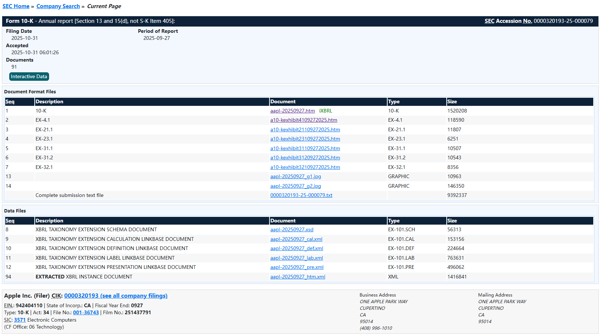
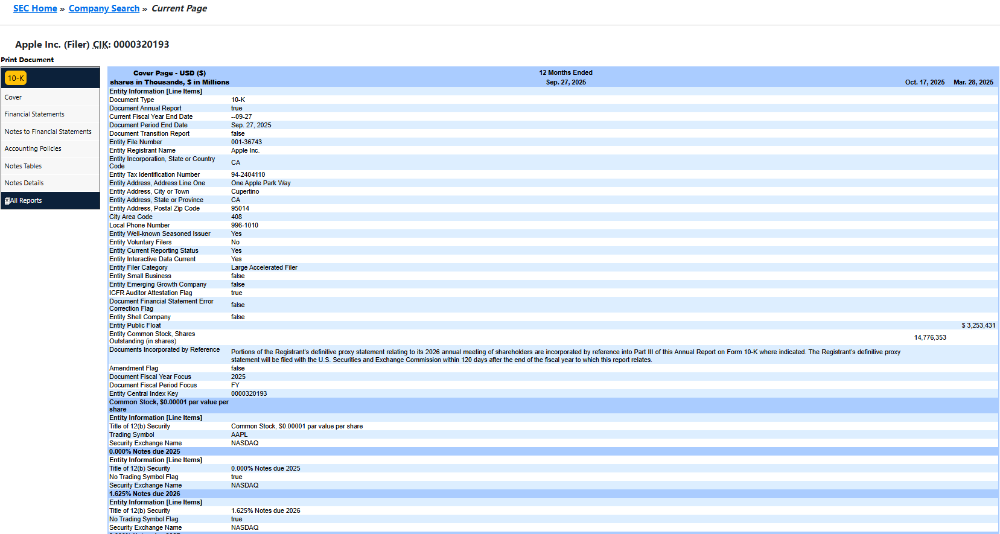

# 第28章 数据资源与数据治理

## 第1节 行情数据

### 一、概述

获取中美及全球股票行情数据，按接入方式与使用成本，通常分为**免费开源库**、**商业 API** 和**专业金融终端**三个层级。三者的核心差异不在于“能不能拿到数据”，而在于**数据稳定性、实时性、授权合规性与使用场景**。

#### 1.免费开源库

免费开源库的最大优势是零成本、即装即用，但普遍存在稳定性依赖上游网站、实时性不足、商用授权模糊等隐性代价。适合个人用户学习和兴趣开发。从Python库入手门槛最低，能快速满足大部分基础需求。

##### 1.1. yfinance

`yfinance`是获取美股及全球主要市场数据最便捷的工具之一，它封装了Yahoo Finance的公开接口。无需API Key，安装后即可通过`pip install yfinance`使用。

-   **核心优势**：支持美股（如`AAPL`）、港股（如`0700.HK`）、全球指数（如`^GSPC`代表标普500）及ETF等资产的日线级历史OHLCV数据。
-   **使用注意**：数据可能存在**15-20分钟延迟**；由于依赖Yahoo Finance的网页接口，其稳定性并非100%，可能因对方策略调整而中断。

##### 1.2. AKShare

`AKShare`是中文开源社区的明星项目，基于网页抓取整合了海量数据源，完全免费且无需注册。它覆盖A股、港股、美股、期货、基金等广泛品类，尤其对A股市场的支持非常细致。

-   **核心优势**：数据覆盖面极广，是探索A股及多市场数据的利器。
-   **使用注意**：由于其“爬虫”性质，接口的稳定性依赖于上游网页结构，一旦源网站改版，接口可能暂时失效。

##### 1.3. Tushare Pro

`Tushare Pro`采用Data-as-a-Service模式，返回字段类型强类型化的标准化DataFrame，尤其适合直接对接Pandas进行严谨的A股量化回测和基本面分析。

-   **核心优势**：数据经过专业清洗，处理了复权、停牌、财报日期对齐等棘手问题，数据质量和API稳定性较高。
-   **使用注意**：采用**积分制**，基础功能免费，但获取更高级数据（如分钟线、港股美股）需要充值或满足特定条件。其核心优势集中在A股，港美股数据需独立申请，个人门槛较高。

##### 1.4. Alpha Vantage

Alpha Vantage 是一个面向开发者的**金融数据API服务商**，属于典型的入门级金融DaaS：把股票、ETF、外汇、加密货币、大宗商品、基本面、技术指标和新闻情绪等数据封装成REST API，供程序直接调用。

-   **核心优势**：接入简单，使用REST API，支持JSON/CSV，有Python客户端。覆盖较广，股票/ETF的盘中、日线、周线、月线历史数据，以及外汇、加密、商品、宏观和技术指标。
-   **使用注意**：免费层很紧张，25次/天、5次/分钟，只适合接口测试和极低频原型。付费起步约\$49.99/月起，主要解除调用频率限制。 延迟约5-10秒，没有Tick/盘口深度，不适合高频或实盘交易。

同样仅适合学习、教学、个人兴趣和策略原型验证；不适合机构级深度基本面研究、大量标的持续监控或低延迟实盘系统。

| 工具 | 主要覆盖市场 | 核心特点与局限 |
|------------------------|------------------------|------------------------|
| **yfinance** | 美股、全球指数、港股、加密货币 | 完全免费、无需注册，一行代码即可拉取历史数据，上手门槛最低；但依赖 Yahoo Finance 后端，国内访问不稳定，A股覆盖弱，且曾因上游校验升级出现全线故障 |
| **AkShare** | A股、港股、美股、期货、宏观等 | 国内开源社区最流行的聚合库，覆盖面极广、无需 Token；本质是网页抓取聚合，稳定性受源站改版影响，实时延迟较高，不宜直接用于生产环境 |
| **Tushare / Tushare Pro** | A股为主，部分港股、美股 | 国内量化圈认知度最高，返回标准 DataFrame，字段规范、质量较稳；免费版有积分限制，高级财务与实时数据需积分或付费，曾有停运先例，长期依赖需评估风险 |
| **BaoStock** | A股（专注） | 完全免费、无需积分，日线与复权因子处理稳定，适合A股历史回测；但仅支持A股，无实时行情，数据更新偏慢 |
| **Alpha Vantage** | 全球股票、外汇、加密货币 | 提供免费 API Key，文档清晰，内置 50+ 技术指标，实时性在免费层中较好；免费额度非常有限（如每日 500 次），国内访问速度可能偏慢 |

#### 2.商业 API

商业 API 在稳定性、接口规范和授权清晰度上明显优于免费库，但价格与实时权限、商用许可紧密挂钩，需要仔细评估个人需求和付出的费用。

-   **国内/跨市场常用**

    -   **TickDB**：覆盖 A股、港股、美股、外汇、指数等，REST + WebSocket，基础版约 **\$99/月**（50 个订阅、60 次/分），商业展示与再分发需单独确认授权。

    -   **Tushare Pro（付费积分）**：严格来说是“免费+积分”模式的延伸，付费积分可解锁更丰富的 A 股财务与另类数据，但实时能力仍偏弱。

-   **国际主流**

    -   **Twelve Data**：全球多资产目录，美股实时源默认覆盖约美国总成交活动的 5%，不等同于完整合并行情；Grow 套餐 \$29/月起，但 WebSocket 仍为试用，Pro \$99/月起才含较完整的实时推送额度。

    -   **ODHD**：全球历史与延迟数据性价比突出，EOD 套餐 **\$19.99/月**，含 WebSocket 的 EOD+Intraday 套餐 **\$29.99/月**；美股实时源为 Cboe EDGX，不能外推为全市场实时。

    -   **Polygon**：国际专业级，美股为主，REST + WebSocket，适合对数据粒度、订单簿深度有要求的量化场景，定价高于入门级商业 API。

    -    **LSEG（Refinitiv）Data API**：机构级全球数据，API 按数据集单独授权，公开起价约 **\$25,000/年**，适合有明确合规与全球深度数据需求的机构。

    -   **FactSet API**：机构级基本面与行情，通常在 Workstation 订阅基础上叠加，API/Feeds 年费约 **\$30,000–\$100,000+**，门槛较高。

#### 3.专业金融终端

专业终端不是“数据接口”，而是将行情、基本面、研报、新闻、计算工具整合在一个桌面/云端工作流中的系统，核心价值在于工作流整合与机构合规，而非单纯的行情获取。本节不展开介绍。

| 终端 | 定位与市场格局 | 大致成本参考 |
|------------------------|------------------------|------------------------|
| **Bloomberg Terminal** | 全球机构投研与交易的事实标准，覆盖全球全资产类别，即时通讯与生态壁垒极强 | 单席位约 **\$30,000–\$32,000/年**，多席位合同可略低 |
| **Wind（万得）** | 中国市场绝对主导，国内机构标配，A股/港股/债券/基金/宏观覆盖最全 | 基础端约 **3.98万元/年/账号**，大中华终端约 **6.8万元/年/账号**；机构合同常见更高配置 |
| **东方财富 Choice** | Wind 的高性价比替代，覆盖 A股/港股/美股，提供 Excel 插件与 Python 接口（EMQuantAPI），适合中小机构与个人研究者做数据拉取与分析 | 显著低于 Wind，具体按模块与账号数询价 |
| **同花顺 iFinD** | 主打智能化与 AI 方向，B端功能较全；面向学生和个人有轻量“青春版”入口，可作为低成本接触专业终端数据的途径 | B端按模块/账号计费；青春版门槛较低 |

#### 二、AkShare 

AkShare 在国内量化与数据科学圈层中知名度很高，核心价值在于**用一行代码，从公开财经网站获取相对权威的原始数据**。它本质上是一个**数据采集聚合工具**，而非像 Wind 或 Bloomberg 那样提供经过深度清洗与合规授权的数据源。理解这一点，是合理使用 AkShare 的前提。

#### 1.功能定位与核心特征

AkShare 的目标是覆盖股票、期货、期权、基金、外汇、债券、指数、加密货币等全品类，采集基本面、实时与历史行情及衍生数据。它的设计哲学是**还原原始数据**，便于研究者进行多源交叉验证，而非直接提供加工后的“结论”。

它的优势与代价都非常鲜明：

-   **优势**：完全免费，无需 API Key；接口命名统一，返回标准 `pandas.DataFrame`；文档极其详尽，每个接口都附带可复制的示例代码。对于非 Python 用户，官方还提供了 **AKTools**，可将 AkShare 封装为 HTTP API 服务。
-   **代价**：数据来自网页抓取，**稳定性完全取决于上游网站**。目标页面改版、增加反爬校验或限制频率，都可能直接导致接口失效或报错。官方文档中明确声明，数据**仅用于学术研究**，商业使用需自行评估风险。

#### 2.安装与环境配置

AkShare 对 Python 版本有一定要求，新版本通常需要 **Python 3.11 及以上**（推荐 3.13.x），并依赖较新版本的 `pandas`。

常规安装：

```bash
pip install akshare --upgrade
```

国内网络环境下，直接从 PyPI 下载可能较慢，建议使用国内镜像源：

```bash
pip install akshare -i http://mirrors.aliyun.com/pypi/simple/ --trusted-host=mirrors.aliyun.com --upgrade
```

或使用清华源：

```bash
pip install akshare --default-index https://pypi.tuna.tsinghua.edu.cn/simple --upgrade
```

安装后建议做一次简单验证：

```python
import akshare as ak
print(ak.__version__)
```

#### 3.核心用法：按场景组织

AkShare 的接口数量庞大（仅股票相关接口就超过 90 个）。有效的方式是按**使用场景**来定位接口，并养成随时查阅官方文档的习惯。

##### 3.1.A股实时与历史行情

获取全市场 A 股实时快照，最常用的是东方财富源接口：

```python
import akshare as ak

# 全市场 A 股实时行情（字段包括：代码、名称、最新价、涨跌幅、成交量、成交额等）
df_spot = ak.stock_zh_a_spot_em()
print(df_spot.head())
```

获取单只股票的历史日线（支持前复权 `qfq` / 后复权 `hfq` / 不复权 `""`）：

```python
df_hist = ak.stock_zh_a_hist(
    symbol="000001",
    period="daily",
    start_date="20240101",
    end_date="20241231",
    adjust="qfq"
)
print(df_hist.head())
```

关键提醒：`stock_zh_a_hist` 这类历史接口在高频、并发调用时，极易触发东方财富的限流机制，表现为 `RemoteDisconnected` 或 IP 被临时封禁。一个更稳妥的生产级策略是：用实时接口按日增量拉取最新数据，在本地维护历史数据库，而不是每次回测都重新拉取全量历史。

##### 3.2.港股与美股

港股实时行情使用 `stock_hk_spot_em()`；美股实时行情使用 `stock_us_spot()`。

需要注意的是，这些接口同样依赖对应的上游数据源，实时性属于“快照”级别，不适用于对延迟敏感的交易场景。

##### 3.3.宏观经济指标

AkShare 也聚合了国内主要宏观数据，接口命名直观：

```python
ak.macro_china_gdp()   # GDP
ak.macro_china_cpi()   # CPI
ak.macro_china_pmi()   # PMI
```

##### 3.4.基本面与衍生数据

基本面与衍生数据方面，有 `stock_fundamental`（基本面）、`stock_valuation`（估值，如 PE/PB）、`stock_profit_em`（盈利）等接口。这些数据适合做初步筛选和因子挖掘，但若用于严谨的财务分析，建议与原始财报或更稳定的数据源交叉核验。

#### 4.稳定性、限流与常见报错

稳定性问题是使用 AkShare 必须正视的环节。绝大多数报错并非 AkShare 代码本身的问题，而是上游网站的限制或网络环境所致。

| 现象 | 典型原因 | 应对思路 |
|------------------------|------------------------|------------------------|
| `RemoteDisconnected` / 连接超时 | 请求频率过高，IP 被上游临时限制 | 降低调用频率；切换网络（如切换为手机热点）；等待数小时后再试 |
| `AttributeError: module 'akshare' has no attribute 'xxx'` | Python 版本过低；AkShare 未升级；接口已重命名或移除 | 升级 Python 至 3.11+；`pip install akshare --upgrade`；核对官方文档中的最新接口名 |
| `ReadTimeout` | 网络不稳定或目标网站响应慢 | 重新运行；更换 IP/代理；降低并发 |
| 数据返回错位或字段异常 | 网络波动导致解析错乱；`pandas` 版本兼容问题 | 升级 `pandas` 至较新版本；多运行几次排除偶发网络问题 |
| Linux 下 `execjs` 报错 | 缺少 JavaScript 运行环境 | 安装 `nodejs` |

总之，AkShare 最合适的定位是：**研究、教学、原型验证、低频回测与个人探索**。它以零成本提供了极宽的覆盖面，让你能够快速把想法跑通。如果你需要的是**稳定、可商用、且授权清晰的数据管道**，AkShare 不应作为生产系统的唯一数据源。

#### 5. R 语言交互

AkShare 本身是一个 Python 库，**R 无法直接“安装”或原生加载它**。在 R 中使用 AkShare 有两条路径：用 `reticulate` 包在 R 进程内桥接 Python，或者用 AKTools 把 AkShare 封装成 HTTP 服务，R 再发请求取数。下面直接给可用方案和代码。

##### 5.1. 方案一：借助`reticulate`

这是最直接的方式，R 会话中会“虚拟”出一个 Python 环境，然后把 AkShare 的函数当成 R 对象来调用。

作为前置条件，你的系统里必须有一个**安装了 AkShare 的 Python 环境**，并且 R 能找到它。建议用 Conda 专门建一个环境，避免路径混乱：

```bash
# 在终端中执行
conda create -n r-akshare python=3.11
conda activate r-akshare
pip install akshare
```

R 端配置与调用

```r
# 安装并加载 reticulate
install.packages("reticulate")
library(reticulate)

# 关键一步：显式指定装有 akshare 的 Python 环境
# 方式 A：用 Conda 环境名（推荐）
use_condaenv("r-akshare", required = TRUE)

# 方式 B：直接指定 Python 解释器的绝对路径
# use_python("/path/to/your/python", required = TRUE)

# 导入 akshare 模块，写法类似 Python 的 import akshare as ak
ak <- import("akshare")

# 调用 AkShare 接口，把 Python 的 . 换成 R 的 $
# 以 A 股历史行情为例
df <- ak$stock_zh_a_hist(
  symbol = "000001",
  period = "daily",
  start_date = "20240101",
  end_date = "20241231",
  adjust = "qfq"
)

# 返回值本质上是 pandas DataFrame，在 R 中通常可以直接当 data.frame 用
head(df)
```

**核心陷阱**：如果你只写 `library(reticulate)` 而不 `use_condaenv()` 或 `use_python()`，R 会去用它找到的默认 Python，那个环境里极大概率没有装 AkShare，于是报错 `ModuleNotFoundError: No module named 'akshare'`。**显式指定环境是成功的前提。**

##### 5.2.方案二：AKTools

如果你不想在 R 里管理 Python 环境，或者团队里有多语言混用的情况，AKTools 是更干净的架构：它是一层 HTTP 网关，启动一次服务后，R 只需要发普通的 GET/POST 请求。

第一步，在终端/Python 中，启动 AKTools 服务

```python
pip install aktools
python -m aktools
```

默认服务地址是 [`http://127.0.0.1:8080`](http://127.0.0.1:8080)。启动后，AkShare 的每个函数都会映射为一个 API 端点，例如 `stock_zh_a_hist` 对应 `/api/public/stock_zh_a_hist`。

第二步，R 端请求数据：

```r
library(RCurl)
library(jsonlite)

# 构造请求，参数名和 AkShare 函数参数保持一致
temp <- getForm(
  uri = "http://127.0.0.1:8080/api/public/stock_zh_a_hist",
  symbol = "000001",
  period = "daily",
  start_date = "20240101",
  end_date = "20241231",
  adjust = "qfq",
  .encoding = "utf-8"
)

# 返回的是 JSON 字符串，解析为 R 的 data.frame
df <- fromJSON(temp)
head(df)
```

这是 AKTools 官方 Demo 中直接给出的 R 示例写法。如果你更习惯 `httr`，也可以用 `httr::GET()` 配合 `query` 参数，逻辑完全一样。

AKTools 的本质是，引入了一个需要单独维护和启动的服务进程。如果该服务没开，R 端就会连接失败。适合作为长期运行的数据微服务，而非临时一次性脚本。

如果你只是**在自己的 R 脚本里快速用 AkShare 取数**，走 `reticulate` 方案，把 Python 环境一次性配好，后面就只剩 `ak$函数名()` 这一层语法转换。如果你希望**把数据获取从 R 脚本中彻底解耦**，或者团队里 Python/R 混用，AKTools 的 HTTP 方案架构上更干净，代价是多维护一个服务进程。

### 三、Tushare 

Tushare 在国内量化与金融研究领域是一个绕不开的名字。它的核心演变，是从一个早期的开源聚合库，升级为 **Tushare Pro**：一个以标准化 API、Token 鉴权和**积分制**为核心的数据服务平台。理解 Tushare，关键不在于记住几百个接口，而在于理解它的**定位、权限规则和最佳适用场景**。

#### 1.定位与演进

早期的 Tushare 是一个完全免费的 Python 库，通过聚合公开网页数据来提供行情。随着用户量增长，这种模式在稳定性和维护成本上难以为继。

**Tushare Pro 是当前的主流形态**，它转型为一个由社区自主生产数据、通过服务器提供 API 服务的平台。用户必须注册获取 **Token** 才能调用，这带来了更规范的数据结构和稳定性，但也引入了**积分/付费**的准入门槛。目前新用户应直接从 Pro 开始，其 Python 包 `tushare` 本身已内置对接 Pro 的功能。

Tushare 官方将其定位为 **“高性能、低成本的一站式金融数据底座”**，并已扩展出 Skill（自然语言取数）、MCP（供 AI 工具直接调用）等通道，以适配 AI 投研场景。平台宣称拥有 **300+ 标准化接口**，覆盖 A股、港股、美股、基金、期货、期权、债券、外汇及宏观数据。

#### 2.数据体系

Tushare 的数据覆盖可以清晰地分为三个层次，其中**A股财务与特色因子**是其最核心的竞争力。

-   **市场交易数据** 覆盖股票（日/周/月线、分钟线、复权行情）、指数、ETF、期货、期权等。统一使用 `ts_code`（如 `000001.SZ`）和 `trade_date`（`YYYYMMDD`）作为标准标识，降低了多源整合的成本。

-   **基本面与特色数据** 这是 Tushare 区别于 AkShare 等聚合工具的关键。它提供**利润表、资产负债表、现金流量表**及衍生指标（ROE、毛利率等），并包含**业绩预告、业绩快报、分红、增发、龙虎榜、机构持仓、一致预期**等深度财务与事件数据。此外，平台还提供自研的**特色因子库**（如每日筹码、券商金股等），服务于多因子选股场景。

-   **宏观经济数据** 内置 GDP、CPI、PPI、PMI、利率、汇率等关键指标，支持自上而下的策略分析。

#### 3.调用方式

Tushare 原生以 Python 为核心，同时官方也维护了 R 包，方便 R 用户直接接入。

##### 3.1.Python

所有调用围绕一个 `pro` 对象展开，返回标准的 **pandas DataFrame**。

```python
import tushare as ts

# 用你的 Token 初始化接口
pro = ts.pro_api('你的TOKEN')

# 获取个股日线行情
df = pro.daily(ts_code='000001.SZ', start_date='20240101', end_date='20241231')

# 获取财务指标
df_fina = pro.fina_indicator(ts_code='000001.SZ', start_date='20240101')
```

对于行情数据，官方推荐使用统一的 `pro_bar()` 接口，它可以直接处理**前复权、后复权**，并内置均线计算等参数，比单独拼接行情和复权因子更便捷。

##### 3.2.R 包

Tushare 的 R 包已发布在 CRAN 上，核心逻辑是将 Python 的 `pro.query` 封装为一个可调用的 `api` 函数对象。

```r
install.packages('Tushare')
library(Tushare)

# 获取接口对象
api <- Tushare::pro_api(token = '你的TOKEN')

# 调用接口：第一个参数是接口名，后续传入对应参数
df <- api(api_name = 'daily', ts_code = '000001.SZ', 
          start_date = '20240101', end_date = '20241231')

# 使用 pro_bar 接口（支持复权与均线）
bar <- Tushare::pro_bar(token = '你的TOKEN')
df_adj <- bar(ts_code = '000001.SZ', start_date = '20240101', adj = 'hfq')
```

R 包依赖 `httr`、`tidyverse`、`forecast`、`data.table`，安装时会自动处理。

#### 4.积分与权限体系

这是使用 Tushare 最需要提前理解的部分。它的权限分为两类：

-   **积分制接口：**凭积分门槛解锁，积分决定你能访问哪些数据以及调用频次。基础日线数据在 **120 积分**即可调用（免费额度通常对应约 50次/分钟、8000次/日）。随着积分提升，频次和可访问的数据范围逐步扩大。**5000 积分以上**可解锁大部分常规数据且频次较高；**10000 积分以上**则涉及特色因子等深度数据。

-   **独立付费权限**：**与积分无关，需单独购买。**高频或实时类数据不纳入积分体系，需要单独开通。例如：

    **历史分钟数据**（1/5/15/30/60分钟）：**2000元/年**；

    **实时分钟数据**：**1000元/月**；

    **实时日线（当日盘中快照）** ：**200元/月**，每分钟 50 次，每次可提取全市场。

这意味着：**免费或低积分账户可以完成日频历史回测和基础财务分析，但若涉及分钟级研究、盘中实时信号或深度特色因子，则需要明确的预算规划。**

#### 5.优势与局限

##### 5.1.核心优势

**A股财务与因子数据最全、最规范**。在个人可负担的范围内，Tushare 的财务数据完整度和标准化程度显著优于网页抓取型工具，是多因子研究的务实选择。数据由平台自主生产并经过质检，接口返回稳定的 DataFrame，降低了清洗成本。相比 Wind 等终端，其成本门槛低得多，基础功能对个人研究者友好。

##### 5.2.局限性

**它不是实时交易系统。**Tushare 的定位是**盘后数据底座**，免费/基础权限下的行情存在延迟（常见描述为分钟级或更久），接口返回的是快照而非 Level-2 逐笔推送。如果在实盘策略的主线程中同步调用 `pro_bar`，一次网络波动就可能阻塞整个交易流程。

**积分制是一把双刃剑。**它保证了服务的可持续性，但也意味着“低成本”是有边界的。随着需求向高频、实时或深度特色数据延伸，成本会逐步上升，甚至可能接近部分商业 API 的入门价位。

**与 AkShare 的定位差异清晰**：AkShare 胜在**免费、覆盖面广**（含加密、海外），但数据依赖源网站、稳定性需自行验证；Tushare 胜在**A股财务数据的规范性与稳定性**，但广度和“零成本”程度不及 AkShare。二者不是替代关系，完全可以**组合使用**：用 AkShare 做广度探索与交叉验证，用 Tushare 作为 A股基本面与日频因子数据的稳定来源。

##### 5.3.使用方法建议

**正确的使用架构**是：在盘后通过定时任务，将 Tushare 的日线、财务、因子数据批量拉取并**落地到本地数据库**（如 DuckDB），研究与回测直接读取本地数据；实盘系统的实时行情另接专业行情源。这样既利用了 Tushare 在数据规范上的优势，又规避了其在实时性和接口稳定性上的短板。

### 四、结语

事实上，前面提到的许多基础行情、财务与宏观数据，并不必然依赖商业 API 或专业终端。交易所官网、监管机构网站、上市公司公告、国家统计部门以及部分公开数据平台，均可免费获取相当数量的原始数据，且来源权威、可追溯。不过，公开渠道的数据往往分散在不同站点，格式、字段和更新频率不统一，实时性与调用便利性也有限，使用时还需遵守各网站的访问条款与授权要求。因此，公开资源更适合作为低成本研究、交叉验证和补充数据源，而非无条件替代商业数据服务。

基于这一考虑，本章的重点是，将系统介绍一些常用的公开数据资源及其获取方式，帮助读者在控制成本的同时，建立更透明、可复核的数据链路。

## 第2节 FRED 数据库

### 一、FRED 数据库概述

FRED（Federal Reserve Economic Data，联邦储备经济数据）是由**圣路易斯联邦储备银行（Federal Reserve Bank of St. Louis）研究部**创建并维护的免费在线经济数据库。它本质上是一个**数据聚合器**，将来自众多政府机构、国际组织和私人机构的数据汇集到统一平台，并提供从查找到分析、从可视化到程序化下载的一整套工具。

#### 1.数据规模与覆盖范围

FRED 的数据体量随时间持续扩张。根据近年的官方资料，它已收录**超过 825,000 条时间序列**，来源超过 **100 个**，涵盖美国政府机构（如美国经济分析局、劳工统计局、人口普查局）、国际组织以及 Zillow 等私营数据提供方。数据频率覆盖**年度、季度、月度、周度和日度**。

其核心覆盖领域包括：

-   **宏观经济**：GDP、通胀、就业与失业率、货币供应。
-   **金融与利率**：联邦基金利率、国债收益率、汇率、收益率曲线。
-   **区域与行业数据**：各州就业、房价指数、制造业活动等。
-   **国际比较数据**：来自 OECD 等来源的跨国指标。

#### 2.历史沿革与定位

FRED 的起源可以追溯到圣路易斯联储长期以来的数据公开传统。1991 年，它作为互联网普及前的**电子公告板系统（BBS）** 上线，最初仅提供约 30 条数据序列。此后逐步扩展：2006 年推出 **ALFRED**（归档版）和图表功能；2009 年发布 **API**；2011 年推出 **Excel 插件**和移动端应用。如今，FRED 每年服务全球数百万用户，其中超过三分之一来自美国以外。

#### 3.主要功能与访问方式

FRED 的价值不仅在于“有数据”，更在于它提供了将数据转化为分析的一系列工具。

**网页端与可视化** 在 FRED 网站上，你可以直接搜索序列、绘制多序列对比图、进行单位变换（如从水平值转为同比百分比），并生成可分享的图表或仪表板（Dashboard）。**GeoFRED** 进一步支持以地图形式呈现州、县、都市区等地理层级的经济数据。

**程序化访问（API）** FRED 提供 RESTful API，需注册获取免费密钥。API 支持检索序列元数据、观测值、分类、发布信息和来源，并允许通过 `realtime_start` / `realtime_end` 参数访问 ALFRED 的历史版本数据。主要 Python 封装库包括 **`fredapi`** 和 **`pyfredapi`**，R 语言则有 **`fredr`**。

**Excel 插件**则允许用户在表格中直接拉取并刷新 FRED 数据，适合不写代码的常规分析场景。

#### 4.ALFRED 数据库

**ALFRED**（ArchivaL Federal Reserve Economic Data）是 FRED 的关键补充，于 2006 年上线。二者的核心区别在于：

|   | FRED | ALFRED |
|------------------------|------------------------|------------------------|
| **数据版本** | **当前（最新修订后）** 的数值 | **历史“实时”版本（vintage）**，保留数据首次发布时的原貌及后续修订轨迹 |
| **典型用途** | 了解经济指标的当前状态 | **避免前视偏差**，还原决策者在特定历史时点实际掌握的信息 |

这一功能对于**政策评估与实证研究**尤为重要：如果研究 2008 年金融危机期间的货币政策反应，使用 FRED 的“修订后 GDP”会引入当时决策者不可能拥有的信息，而 ALFRED 可以精确还原当时的数据环境。

#### 5.与其他主要经济数据库的对比

与全球性数据库相比，FRED 的独特之处不在于“最大”，而在于**深度、工具链与更新历史**的结合。

-   **世界银行（World Bank）** ：优势在于**全球覆盖广度**（200+ 国家的发展指标），但多为年度数据，且不提供逐次修订的历史档案。
-   **FRED**：数据总量并非最大（约 80 余万条序列），但**聚焦于美国宏观与金融数据的深度**，频率更细（日度/周度），且 ALFRED 为每条序列保留了完整的修订记录。一份行业指南将其概括为：“**美国和 international 宏观数据，每条序列均附完整修订历史**”。
-   **OECD / IMF**：分别在成员国结构性数据和国际金融统计方面有专长，但与 FRED 的定位重叠度较低，更多是互补关系。

因此，如果你的分析对象是**美国宏观经济、利率与金融市场**，并需要处理数据修订或进行高频跟踪，FRED 通常是首选；若需要广泛比较各国的长期发展指标，则世界银行或 OECD 的数据覆盖更为全面。

#### 6.总结

FRED 的核心价值可以概括为三点：**免费且权威的聚合数据**、**从可视化到 API 的完整分析工具链**，以及**通过 ALFRED 实现的“时间旅行”能力**——让你不仅能看见数据“现在是什么样”，也能看见它在历史上“曾经是什么样”。这三者的结合，使其成为宏观经济研究与金融分析中最常被调用的基础设施之一。

### 二、FRED 数据库主要内容

FRED的核心内容是一个庞大且高度组织化的经济时间序列集合。它的“主要内容”可以从**数据来源**、**主题分类**、**核心序列**和**地理覆盖**四个层面来理解。

#### 1.数据来源

FRED本身不生产大部分数据，而是一个**数据聚合平台**，其价值很大程度上源于来源的广度与权威性。它汇集了来自**超过100个**公共和私人机构的**逾82.5万条**时间序列。

主要来源包括：

-   **美国联邦政府机构**：这是最核心的来源，包括**经济分析局（BEA）**（负责GDP、个人收入等）、**劳工统计局（BLS）**（负责CPI、失业率、非农就业等）、**人口普查局**（负责零售、住房等）以及**国会预算办公室（CBO）**等。
-   **美联储系统**：包括**联邦储备委员会**（Board of Governors）发布的利率、货币供应量等数据，以及**联邦公开市场委员会（FOMC）**的相关决议数据。
-   **国际组织与外国央行**：包括**世界银行、国际货币基金组织（IMF）、欧盟统计局（Eurostat）**，以及**英格兰银行、日本央行、欧洲央行**等多国中央银行。
-   **私人部门与行业组织**：例如房地产数据来自**Zillow**和**全美房地产经纪人协会（NAR）**，股市数据可能来自**标普（S&P）**，还有**全美经济研究局（NBER）**等研究机构。

这种聚合模式让研究者可以在同一平台上交叉分析来自不同发布机构的数据。

#### 2.主题分类

为了管理海量序列，FRED提供了多种分类和导航方式。最直接的是**主题类别（Category）**，FRED的根类别下通常包含**8个顶层分支**：

1.  **货币、银行与金融（Money, Banking & Finance）**：这是FRED最传统的核心领域，涵盖货币供应量、银行信贷、利率结构、金融条件等。
2.  **人口、就业与劳动力市场（Population, Employment & Labor Markets）**：包括失业率、非农就业、劳动参与率、工资增长、人口结构等。
3.  **国民账户（National Accounts）**：以GDP为核心，涵盖其支出法各组成部分（消费、投资、政府支出、净出口）、收入法构成以及国民收入与产出账户（NIPA）的完整框架。
4.  **生产与商业活动（Production & Business Activity）**：包括工业生产指数、产能利用率、企业库存、订单、零售销售等。
5.  **价格（Prices）**：涵盖消费者价格指数（CPI）、生产者价格指数（PPI）、个人消费支出（PCE）价格指数、GDP平减指数以及进出口价格等各类通胀指标。
6.  **国际数据（International Data）**：专门汇集来自其他国家、地区和超国家机构的数据，便于进行跨国比较。
7.  **美国区域数据（U.S. Regional Data）**：聚焦美国国内的地理层级数据（详见下文）。
8.  **学术与其他数据**：包括来自NBER等研究机构的历史序列或特定学术数据集。

除了层级化的“类别”，FRED还提供了**标签（Tags）**系统进行更细粒度的筛选，标签维度包括**概念、地理、频率、来源、发布、季节调整**等。例如，一个序列可以同时被标记为“月度”、“季调”、“BLS来源”和“CPI概念”。用户也可以按**数据发布（Release）** 来浏览，直接查看与某个官方报告（如就业形势报告）相关的所有序列。

#### 3.代表性核心序列一览

FRED收录了宏观经济分析中最常被引用的指标。以下是一些具有代表性的序列及其FRED代码示例：

| 领域 | 代表性指标 | 常见FRED代码示例 |
|:-----------------------|:-----------------------|:-----------------------|
| **总产出** | 实际国内生产总值（Real GDP） | `GDPC1` |
| **劳动力市场** | 失业率（Unemployment Rate） | `UNRATE` |
|  | 非农就业人数（Total Nonfarm Payrolls） | `PAYEMS` |
| **通货膨胀** | 消费者价格指数（CPI） | `CPIAUCSL` |
|  | 核心个人消费支出价格指数（Core PCE） | `PCEPILFE` |
| **货币政策** | 联邦基金有效利率（Effective Federal Funds Rate） | `FEDFUNDS` 或 `DFF` |
| **金融市场** | 10年期国债收益率 | `DGS10` |
| **消费与收入** | 实际个人消费支出（Real PCE） | `PCEC96` |

这些序列是构建宏观经济仪表板或进行实证研究时最常调用的基础数据。

#### 4.地理覆盖

FRED的地理数据并非只有“美国”和“国际”两个模糊的层级，而是细化到了多个行政与统计单元。

-   **国际层面**：覆盖众多主权国家，数据主要来自世界银行、IMF、OECD等国际组织的标准化统计。
-   **美国区域层面**：这是FRED区域数据的重点，支持**9种地图类型**，包括**州（States）、县（Counties）、都市统计区（MSA）、人口普查区（Census Regions/Divisions）、联邦储备区（Federal Reserve Districts）** 等。这意味着研究者可以获取到县级失业率、都市区房价指数、各州GDP等精细数据。**GeoFRED**工具就是专门用于将这些区域数据以地图形式进行可视化分析的。

#### 5.总结

FRED的主要内容可概括为一个 **“多源聚合、主题纵深、地理细化”** 的时间序列生态系统。它既包含了从GDP、通胀到就业等**宏观核心支柱**的权威序列，也通过精细的**区域数据**和**国际数据**支持结构性分析。其价值不仅在于序列的数量，更在于通过**类别、标签、发布**等多重维度建立的导航体系，使研究者能够从数万条序列中高效地定位到分析所需的那一条。

### 三、FRED 数据库使用方法

FRED 的使用方法可以按照从**网页端交互**到**程序化自动化**的递进顺序来掌握。

#### 1.网页端

这是最直接的使用方式，适合探索性浏览和一次性提取。

##### 1.1.定位数据序列

FRED 提供了多种查找路径，可以按需组合使用。

路径一：关键词搜索。**关键词搜索**是最快的方式。在首页搜索框中输入指标名称（如 “unemployment rate”），系统会给出建议序列，点击即可进入序列页面。如果你已经知道序列代码（如 `UNRATE`），直接输入代码也能精确定位。

1.  访问FRED官网：[https://fred.stlouisfed.org](https://fred.stlouisfed.org）.)。

2.  在顶部搜索框中输入关键词（如unemployment、GDP、CPI）。

3.  从搜索结果中选择目标数据系列。

路径二：浏览结构。除了搜索，还可以通过浏览结构来发现数据：

-   按来源（Source） ：数据来自哪个机构（如 BLS、BEA），适合于“我知道要找某机构发布的数据”的场景。

-   按发布（Release） ：围绕某一份定期报告（如“就业形势报告”）浏览其包含的所有序列。

-   按类别（Category） ：按主题浏览，首页类别页面会显示每个主题下有多少条序列。

-   按标签（Tags） ：用概念、频率、季节调整等标签交叉筛选，适合需要精确限定条件时使用。

路径三：ID直达：

FRED中的每个数据序列都有唯一的SeriesID，可直接通过URL访问，例如：

<https://fred.stlouisfed.org/series/UNRATE> → 美国失业率

<https://fred.stlouisfed.org/series/GDP> → 美国GDP

<https://fred.stlouisfed.org/series/DGS10> → 10年期美国国债收益率

#### 1.2.编辑图表

进入序列页面后，核心操作集中在图表上方的 **“EDIT GRAPH”** 按钮。

你可以通过 “EDIT LINE” 对图表进行编辑和变换（Transform） ：在 “Units” 下拉菜单中，可以将原始水平值改为同比变化率、环比变化、指数等；在 “Frequency” 下拉菜单中，可以进行频率聚合，例如把月度数据降为季度或年度数据。这些变换在网页端即时完成，无需先下载原始数据再处理。

你可以通过 “ADD LINE” 标签页向同一张图中添加更多序列，进行跨指标对比。

图表的时间范围也可以快速切换：图表上方有 “1Y / 5Y / 10Y / Max” 按钮，点击即可调整观察窗口。

##### 1.3.数据导出

从图表导出是最直接的单序列导出方式：点击图表上方的 **“Download”** 按钮，选择 CSV 或 Excel 格式即可。

如果需要**同时导出多条序列**，则需要使用 **Data Lists（数据列表）** 功能。登录免费账户后，在序列页面的 “Account Tools” 中选择 “Add to Data List”，将多条序列汇入同一个列表，然后整体下载。需要注意一个限制：**同一个 Data List 中的序列必须具有相同的频率**（例如不能把月度序列和日度序列混在同一个列表中直接导出）。

图表和 Data List 也都可以**保存到你的 FRED 账户**中。保存图表时可以选择“始终从某个起始日期展示到最新值”，这样当源数据更新时，图表会自动纳入新观测值。

#### 2.Excel 插件

如果你熟悉 FRED 序列代码，并且工作流主要在 Excel 中完成，**FRED Add-in** 是效率最高的方式。

安装入口在 Excel 的 **“插入” → “获取加载项”** 中搜索 FRED 并添加，支持 Excel 2019 及以上版本（Windows 和 Mac）。

安装后，在表格中按约定格式填入序列代码和参数（如起始日期），点击 **“Get FRED Data”**，数据即被拉入工作表。插件同样支持**频率聚合、单位变换和自定义日期范围**，并且可以在数据更新后刷新获取最新值。

#### 3.Python 程序化调用

FRED数据库支持 Python 与 R 两种语言调用 API。两者的底层逻辑一致：都是向 FRED 的 RESTful 接口发送带参数的 HTTP 请求。Python 生态以 `fredapi` 为最常用的轻量级入口，`pyfredapi` 作为功能更完整的替代；R 生态以 `fredr` 为标准选择，辅以 `alfred` 包处理历史 vintage 数据。

##### 3.1.安装与 API Key 配置

`fredapi` 的安装方式为 `pip install fredapi`。使用前需要先在 FRED 网站免费申请 API Key。Key 的配置有两种方式。最简单的是在实例化 `Fred` 对象时直接传入：

```python
from fredapi import Fred
fred = Fred(api_key='你的API密钥')
```

另一种推荐做法是将 Key 设置为环境变量 `FRED_API_KEY`，`Fred()` 实例化时无需再传参，`pyfredapi` 同样支持从环境变量自动读取。在 Linux/macOS 上可以在 `~/.bashrc` 或 `~/.zshrc` 中加入 `export FRED_API_KEY="your_api_key"`。

##### 3.2.获取序列数据

`get_series()` 是 `fredapi` 最核心的函数，返回一个以日期为索引的 pandas Series。基本调用方式如下：

```python
unrate = fred.get_series('UNRATE')
```

该方法接受多个关键参数，覆盖了网页端图表编辑中的大部分变换能力：

| 参数 | 作用 | 示例值 |
|:-----------------------|:-----------------------|:-----------------------|
| `observation_start` / `observation_end` | 限定观测日期范围 | `'2020-01-01'` |
| `frequency` | 将数据聚合到更低频率 | `'q'`（季度）、`'a'`（年度） |
| `aggregation_method` | 配合 `frequency` 使用，指定聚合方式 | `'avg'`、`'sum'`、`'eop'` |
| `units` | 数据变换 | `'pch'`（百分比变化）、`'pc1'`（同比百分比变化）、`'chg'`（差分） |

例如，获取失业率的季度平均值并转换为同比变化：

```python
unrate_yoy_q = fred.get_series(
    'UNRATE', 
    frequency='q', 
    aggregation_method='avg',
    units='pc1'
)
```

`units` 的可选值包括 `lin`（水平值）、`chg`（差分）、`ch1`（同比差分）、`pch`（环比百分比变化）、`pc1`（同比百分比变化）、`pca`（复合年化变化率）、`cch` / `cca`（连续复利变化）以及 `log`（自然对数），与 R 端 `fredr` 的参数完全对应。

`pyfredapi` 的对应函数是 `pf.get_series(series_id, **kwargs)`，同样接受上述参数，返回 pandas DataFrame（默认）或 JSON，并支持通过 `return_format` 指定格式。

##### 3.3.搜索序列与获取元数据

`fredapi` 提供 `search()` 用于按关键词查找序列，`get_series_info()` 用于获取序列的元数据（标题、频率、单位、季节调整方式等）：

```python
results = fred.search('unemployment rate state')
info = fred.get_series_info('UNRATE')
print(info['title'])  # Unemployment Rate
```

`pyfredapi` 在这方面的组织更为结构化：`pf.get_series_info(series_id)` 返回一个 `SeriesInfo` Pydantic 对象，字段以属性方式访问（如 `.title`、`.frequency`），同时各 FRED 端点被映射为独立模块（`series`、`category`、`release`、`tags` 等），适合需要系统性遍历多个端点的项目。

##### 3.4.`realtime_start` / `realtime_end`

这是 Python 端最容易被忽略但最重要的能力。`get_series()` 同样接受 `realtime_start` 和 `realtime_end`，将请求“锚定”到历史某一时点，从而获取当时可见的数据版本（即 vintage）：

```python
# 站在 2019-01-01 看 GDPC1 当时的最新数据
gdp_as_known = fred.get_series(
    'GDPC1', 
    realtime_start='2019-01-01', 
    realtime_end='2019-01-01'
)
```

`fredapi` 还提供 `get_series_vintage_dates(series_id)`，返回该序列所有发生过修订或新发布的日期列表，帮助你确定应该用哪些 `realtime_start` 进行提取。

`pyfredapi` 在 ALFRED 方面提供了更专门的函数：`get_series_asof_date(series_id, date)` 直接封装了“截止某日已知的最新数据”这一语义；`get_series_all_releases(series_id)` 则一次性返回该序列**所有 release 版本**的观测值，适合需要对比多次修订轨迹的场景。

#### 4.R 程序化调用

##### 4.1.安装与认证

`fredr` 在 CRAN 上可用，安装命令为 `install.packages("fredr")`。认证同样需要一个免费的 FRED API Key。

推荐的做法是将 Key 写入 `.Renviron` 文件。可以调用 `usethis::edit_r_environ()` 打开该文件，加入一行 `FRED_API_KEY=你的密钥`，保存后**重启 R** 使环境变量生效。另一种方式是在当前会话中临时设置：`fredr_set_key("你的密钥")`，但这只在当前会话有效，不适合脚本的可复现运行。

##### 4.2.核心函数 `fredr()`

`fredr()` 是 `fredr_series_observations()` 的别名，返回一个 **tibble**，默认包含五列：`date`、`series_id`、`value`、`realtime_start`、`realtime_end`。基本调用如下：

```r
library(fredr)

fredr(
  series_id = "UNRATE",
  observation_start = as.Date("1990-01-01"),
  observation_end = as.Date("2000-01-01")
)
```

`fredr()` 的参数体系完整对应 FRED API 的系列观测端点，主要参数包括：

| 参数 | 说明 |
|:-----------------------------------|:-----------------------------------|
| `frequency` | 聚合频率：`"d"` 日、`"w"` 周、`"m"` 月、`"q"` 季、`"a"` 年等 |
| `aggregation_method` | 聚合方式：`"avg"`、`"sum"`、`"eop"` |
| `units` | 变换方式，取值与 Python 端一致（`"lin"`、`"pch"`、`"pc1"`、`"chg"` 等） |
| `observation_start` / `observation_end` | 观测日期范围 |
| `realtime_start` / `realtime_end` | 实时期间（ALFRED） |
| `vintage_dates` | 直接指定一组 vintage 日期，批量下载多个历史版本 |
| `sort_order` | `"asc"` 或 `"desc"` |
| `limit` / `offset` | 分页控制，默认上限 100,000 |

频率聚合的用法示例：

```r
fredr(
  series_id = "UNRATE",
  observation_start = as.Date("1990-01-01"),
  observation_end = as.Date("2000-01-01"),
  frequency = "q",
  units = "chg"
)
```

##### 4.3.搜索序列

`fredr` 提供 `fredr_series_search_text()` 用于按文本搜索序列，与 `fredapi.search()` 对应。搜索结果返回包含序列 ID、标题、频率、单位等元数据的 tibble，可以作为后续 `fredr()` 调用的输入来源。

##### 4.4.历史数据和ALFRED

`fredr()` 本身已经内置了 `realtime_start` / `realtime_end` 和 `vintage_dates` 参数，可以直接在同一个函数中完成 vintage 数据提取，无需额外包。

如果分析工作流以 ALFRED 为中心，专门的 **`alfred`** 包提供了更直接的封装。安装后，`get_alfred_series()` 的核心参数包括 `series_id`、`observation_start` / `observation_end` 和 `realtime_start` / `realtime_end`，返回结果中包含 `realtime_period` 列，便于按 vintage 分组筛选。

此函数可从 ALFRED 数据库（<https://alfred.stlouisfed.org）> 拉取时间序列，并提供下载不同数据版本（vintages）以进行实时分析的功能。

```r
get_alfred_series(
  series_id,
  series_name = NULL,
  observation_start = NULL,
  observation_end = NULL,
  realtime_start = NULL,
  realtime_end = NULL,
  api_key = NULL
)
```

| 参数 | 说明 |
|------------------------------------|------------------------------------|
| `series_id` | FRED 时间序列 ID。 |
| `series_name` | 为输出中的序列列指定名称。默认值：`series_id`。 |
| `observation_start` | 第一个观测值的日期，格式为 `"yyyy-mm-dd"`。默认值：可用的最早观测值。 |
| `observation_end` | 最后一个观测值的日期，格式为 `"yyyy-mm-dd"`。默认值：可用的最新观测值。 |
| `realtime_start` | 第一个实时期间（数据版本 vintage）的日期，格式为 `"yyyy-mm-dd"`。默认值：可用的最早数据版本日期。 |
| `realtime_end` | 最后一个实时期间（数据版本 vintage）的日期，格式为 `"yyyy-mm-dd"`。默认值：可用的最新数据版本日期。 |
| `api_key` | 你可以提供自己通过 <https://fredaccount.stlouisfed.org/login/secure/> 获取的 API key，以便运行大批量请求。否则可能会遇到 API 的查询次数限制。 |

```r
library(alfred)

get_alfred_series(
  series_id = "GDPC1",
  series_name = "my_gdp",
  observation_start = "2018-01-01",
  observation_end = "2019-01-01",
  realtime_start = "2018-01-01",
  realtime_end = "2020-01-01"
)
```

`alfred` 包的优势在于其设计目标就是“下载不同**数据快照**进行实时分析”，对于需要系统性地构建 vintage 面板的研究场景，比直接在 `fredr()` 中逐个指定 `realtime_start` 更为顺手。

此外，经典的金融量化分析工具包 quantmod 内置了极简的FRED数据获取方法。使用getSymbols("UNRATE",src="FRED") 即可直接获取美国失业率等经济序列，返回一个xts时间序列对象。最大的优点是无需注册API密钥，开箱即用，非常适合快速查看数据或进行简单的技术分析。不过它的功能仅限于获取序列的观测值，不支持搜索、元数据查询或服务器端变换。

## 第3节 EDGAR 系统

### 一、EDGAR 系统概述

EDGAR 是美国证券交易委员会（SEC）运营的一套核心电子系统，全称为 **电子数据收集、分析和检索系统**（Electronic Data Gathering, Analysis, and Retrieval system）。

#### 1.核心定义与功能

EDGAR 是上市公司、共同基金等实体依法向 SEC 提交官方文件的主要电子门户。它并非一个简单的文件存储库，而是一个执行自动化流程的系统，负责对提交的文件进行收集、验证、索引、接收和转发。

EDGAR 连接着两个主要的群体：

-   **提交方（Filers）**：在美国，所有本土和外国上市公司都被要求通过 EDGAR 以电子方式提交注册声明、定期报告（如 10-K 年报）及其他重要表格。自1996年起，绝大多数上市公司的文件提交已强制通过该系统进行。
-   **查阅方（Users）**：**公众可以免费访问** EDGAR 的公开数据库。投资者、分析师或任何感兴趣的人都可以在这里研究一家上市公司的财务信息、运营状况，以及共同基金、ETF 等产品的披露文件。

EDGAR 是维持美国证券市场透明度的基石。它通过加速重要公司信息的接收与传播，提升了市场的效率、透明度和公平性，从而惠及投资者、企业和整体经济。

其数据规模也反映了它的核心地位：EDGAR 平均每天处理约 4,700 份文件，每年向公众提供高达 3,000 TB 的数据，并平均容纳 40,000 名新提交者。

EDGAR 是美国证券监管体系数字化基础设施的核心，是获取在美上市企业官方披露信息最权威、最直接的公开渠道。

#### 2.提交方法和案例

以一家美国上市公司提交 10-K 年报为例，通过 EDGAR 提交文件并非简单地上传一个文档，而是一套涉及身份认证、格式规范和系统操作的标准流程。

##### 2.1.第一步：获取“数字身份证”——申请 EDGAR 访问权限

在提交任何文件之前，公司必须先获得在 EDGAR 系统内的“户口”。对于首次进行电子申报的公司，核心步骤是提交 Form ID 来申请 EDGAR 访问代码（即 CIK 账号和密码）。

具体操作是：公司的授权人员需要在 EDGAR Filer Management 门户 上在线填写并提交 Form ID 申请。提交后，还需将填写好的表格打印出来，由公司的授权代表在公证人面前签字进行公证，最后将这份经过公证的认证文件上传回系统，以完成身份核验。

##### 2.2.第二步：登录专用门户，准备提交

获得访问权限后，正式的提交操作通常在 EDGAR Filing 门户 上进行。提交人需要使用自己的个人账户凭证（通常与 Login.gov 账户关联）登录，并完成多因素认证。

登录后，操作者需要输入公司的 CIK 号码（EDGAR 系统中的唯一识别码），以确保文件被归入正确的公司档案下。

##### 2.3.第三步：组装并提交 10-K 文件

这是最核心的环节。10-K 年报的内容复杂，包含财务报表、管理层讨论、风险因素等，且必须遵循 EDGAR Filer Manual 规定的严格技术格式要求（例如，财务数据常需使用 XBRL 格式）。

在实际操作中，许多公司（尤其是大型公司）会借助财务打印商或专业申报代理的服务来组装和传输文件，以确保格式合规并避免技术错误。一切就绪后，提交人通过 Filing 门户上传组装好的 10-K 文件包，完成正式提交。

##### 2.4.提交文件种类

通过 EDGAR 提交的文件种类繁多，以下是几个常见文件类型的真实提交示例：

-   **10-K 年报**：**Ranpak Holdings Corp.** 就曾通过 EDGAR 提交了其截至2025年12月31日财年的 10-K 年报。这是上市公司每年必须履行的核心披露义务。
-   **8-K 临时报告**：当发生需要及时向市场公告的重大事件时，公司会提交 8-K。例如，**Moleculin Biotech, Inc.** 在2026年10月16日提交了一份 8-K，披露其使用了新的公司演示文稿这一信息。
-   **S-1 注册声明**：这是公司计划进行首次公开募股（IPO）时提交的“招股书”文件。例如，**Amaze Holdings, Inc.** 于2026年10月16日通过 EDGAR 提交了其 S-1 注册声明。

##### 2.5.关键操作提醒

-   **提交时间窗口**：EDGAR 系统在工作日（联邦假日除外）的**东部时间早上6点至晚上10点**接受提交。在此窗口外提交的文件，将被视为在下一个工作日处理。
-   **账户角色管理**：现代 EDGAR 系统（EDGAR Next）强调账户的角色分工。公司可以指定**账户管理员**来管理账户，并邀请其他个人作为“用户”或“技术管理员”来执行具体的提交操作，实现了权限的分离与制衡。

总结来说，通过 EDGAR 提交文件是一个将线下准备、法定认证与线上系统操作相结合的标准流程，其核心在于通过严格的账户管理和格式规范，确保向市场披露信息的权威性与一致性。

### 二、美国上市公司提交表格种类

#### 1. 财务信息与经营成果

美国国内上市公司需提交年度报告、季度报告，以及在发生需要及时披露的特定事件时提交临时报告。年报和季报均包含相关期间的财务报表。

| 表格类型 | 说明 |
|------------------------------------|------------------------------------|
| 10-K | 年度报告——提供经审计的年度财务报表、公司及其业务的重大风险因素讨论，以及管理层对上一财年经营成果的讨论与分析。 |
| 10-Q | 季度报告——提供未经审计的季度财务报表、公司面临的重大风险更新，以及管理层对上一财季经营成果的讨论与分析。 |
| 8-K | 临时报告——披露公司在下次定期季报或年报之前选择或按要求公开的重大事件或信息。 |

部分公司目前（且即将所有公司都必须）以 Inline XBRL 结构化数据格式提交含财务信息的披露报告，EDGAR 已集成相关工具以方便用户利用这些信息。

#### 2. 股东大会

受 SEC 委托书规则约束的上市公司、共同基金和 ETF 会向股东发送委托书（proxy statement），以征求其在股东大会上的投票。委托书描述会议将表决的事项，并可能包含公司或基金董事会及高管薪酬等信息。此类委托书可在 EDGAR 上查到。

| 表格类型 | 说明                                                       |
|----------|------------------------------------------------------------|
| PRE 14A  | 初步委托书——须经 SEC 工作人员审查的初步委托书。            |
| DEF 14A  | 最终委托书——与股东大会相关的、发送给公司股东的最终委托书。 |

#### 3. 高管薪酬

美国国内上市公司定期披露首席执行官及其他高薪高管的薪酬，并说明其高管和董事会薪酬政策。

| 表格类型 | 说明 |
|------------------------------------|------------------------------------|
| DEF 14A | 受委托书规则约束的公司通常会在年度委托书中提供详细的薪酬披露，包括薪酬讨论与分析部分。 |
| 10-K | 若委托书中未包含薪酬披露，或公司未提交委托书，则 10-K 年度报告应包含该披露。 |
| 8-K | 某些高管薪酬的变更须根据该报告第 5.02 项披露。EDGAR 对 8-K 表格报告的搜索结果会显示每份报告包含的项目编号。 |

#### 4. 内部人交易

公司内部人——高管、董事以及持有公司某类注册股权证券超过 10% 的持有人——必须定期披露其在该公司所有股权证券中的持股和交易情况。

| 表格类型 | 说明                                                             |
|-----------------|-------------------------------------------------------|
| 3        | 受益所有权初始声明——公司股权证券持股的初始声明。                 |
| 4        | 受益所有权变更声明——在交易后两个营业日内披露公司股权证券的交易。 |
| 5        | 受益所有权年度声明——公司股权证券持股的年度声明。                 |

#### 5. 受益所有权权益

任何个人或团体如取得某上市公司某类注册有表决权证券超过 5% 的受益所有权，必须披露其持股。此外，公司会定期披露其主要股东，机构投资管理人（如共同基金、对冲基金或养老金的管理人）也会定期披露其持股。

| 表格类型 | 说明 |
|------------------------------------|------------------------------------|
| Schedule 13D | 当一方取得某公司某类注册有表决权证券超过 5% 时提交；也用于披露其后的持股变更。 |
| Schedule 13G | 当一方以被动投资方式取得某公司某类注册有表决权证券超过 5% 时提交。 |
| DEF 14A | 公司须在此披露其董事和高管受益拥有的股权证券数量，以及任何受益拥有公司某类有表决权证券超过 5% 的个人或团体。 |
| 13F | 机构投资管理人报告——机构投资管理人按季度披露其持股及持股变更。 |

#### 6. 企业合并

根据并购交易的结构不同，交易涉及的公司可能需要提交不同类型的备案。与企业合并相关的常见表格类型包括：

| 表格类型 | 说明 |
|------------------------------------|------------------------------------|
| PREM14A | 与并购相关的初步委托书——须经 SEC 工作人员审查的初步委托书。 |
| DEFM14A | 与并购相关的最终委托书——发送给公司股东的最终委托书，包含交易条款及交易理由的讨论。 |
| S-4 | 注册声明——当公司注册拟作为并购对价使用的证券时提交。注册声明通常并入发送给股东的任何委托书。 |
| 425 | 招股说明书与通讯——证券作为部分对价的企业合并相关的书面披露和通讯。 |
| SC TO-T / SC TO-I | 第三方/发行人要约收购声明——由拟向公众公司股东购买其流通股的当事方提交。发送给股东的披露文件通常作为附件提交。 |
| SC 14D-9 | 要约收购征求/建议声明——须披露目标公司对要约收购建议的备案。 |
| 8-K | 企业合并的某些信息可能在 8-K 表格中披露，例如合并协议首次签署，或收购无需股东批准时有关被收购公司的信息。 |

#### 7. 公开发行

公司须向 SEC 提交注册声明，以注册向公众的要约和销售证券。公司首次公开发行并销售证券称为首次公开募股（IPO）。招股说明书（prospectus）通常是注册声明的很大一部分，是提供给投资者、披露公司和发行信息的文件。

| 表格类型 | 说明 |
|------------------------------------|------------------------------------|
| S-1 | 注册声明——为注册向公众的要约和销售证券而提交，通常与首次公开募股相关。 |
| S-3 | 简式注册声明——某些已报告公司可使用的简化注册声明，用于注册向公众的要约和销售证券。 |
| 424B\[#\] | 招股说明书——披露公司和发行信息、通常构成注册声明很大一部分的文件。 |
| UPLOAD | SEC 函件——SEC 工作人员在审查过程中（包括对 IPO 注册声明的审查）向公司发出的公开书面函件。 |
| CORRESP | 函件——公司及其顾问在审查过程中向 SEC 工作人员发出的公开函件。 |

#### 8. 证券型众筹

众筹是从大量人群的小额个人投资或出资中筹集资金的方式。依据证券型众筹注册豁免向公众要约和销售证券的公司必须在 EDGAR 上提交备案。

| 表格类型 | 说明 |
|------------------------------------|------------------------------------|
| C | 发行声明——众筹发行公司作出的披露，包含公司自身及发行信息。 |
| C-U | 进展更新——发行期间关于是否达到目标发行金额的进展披露（除非中介机构在其在线平台提供更新）以及最终售出证券金额。 |
| C-AR | 年度报告——公司年度报告，包含财务报表。 |
| C-TR | 终止报告——如符合条件，公司终止其年度报告提交义务的备案。 |

#### 9. Regulation A 发行

Regulation A 允许符合条件的公司在 12 个月内筹集不超过 5,000 万美元，以比注册证券发行要求更有限的披露向公众要约证券。进行 Regulation A 发行的公司根据拟筹资金额适用 Tier 1 或 Tier 2 要求。Tier 1 发行公司除提交披露发行终止或完成的最终报告外，无持续报告义务；Tier 2 发行公司则有持续报告义务。

| 表格类型 | 说明 |
|------------------------------------|------------------------------------|
| 1-A | 发行声明——包含发行通函（offering circular），即提供给投资者、提供公司和发行重要披露的文件。 |
| 1-Z | 退出报告——详述发行的终止或完成。Tier 2 公司可在 1-K 表格中披露此信息。 |

**Tier 2 公司的持续报告**

| 表格类型 | 说明 |
|------------------------------------|------------------------------------|
| 1-K | 年度报告——包含经审计财务报表及公司年度财务成果讨论。 |
| 1-SA | 半年度报告——包含公司财年上半年未经审计的中期财务报表及该期间财务成果讨论。 |
| 1-U | 临时报告——披露特定事件，包括根本性变更、破产、会计师变更、不再依赖先前财务报表或审计报告、控制权变更以及主要高管离职。 |

#### 10. 外国私人发行人

部分在美国境外组织或设立的公司（联邦证券法下称为外国私人发行人）可能以不同于美国上市公司的表格向 SEC 提交报告。

| 表格类型 | 说明 |
|------------------------------------|------------------------------------|
| F-1 | 注册声明——外国私人发行人可选择以此备案注册证券发行。 |
| 20-F | 年度报告或注册声明——包含外国私人发行人经审计财务报表及公司财务成果讨论。封面页的复选框指示该备案是年度报告还是注册某类证券。 |
| 6-K | 报告——与新闻稿、致证券持有人通讯以及公司母国法律要求向证券持有人作出的任何披露相关而提交。 |

#### 11. 共同基金与 ETF

共同基金和 ETF 在 EDGAR 上提交的部分备案与上市公司相同或类似，也有一些不同的表格，其中部分仅由货币市场基金提交。请注意基金可能名称相似，为确保查看的是正确的基金，请核对搜索结果页面上的股票代码。除 EDGAR 外，通常也可从基金网站或您的理财专业人士处获取这些文件。

| 表格类型 | 说明 |
|------------------------------------|------------------------------------|
| N-1A/485 | 注册声明（含招股说明书）——招股说明书包含基金信息，如投资目标/目的、费用表、投资策略与风险及业绩、顾问与投资组合经理、基金份额的购买与赎回以及税务信息。 |
| 497K | 摘要招股说明书——摘要披露文件，包含完整招股说明书开头所需的相同关键信息。 |
| 497 | 基金招股说明书定期更新——包含招股说明书的定期更新。 |
| N-CSR / N-CSRS | 年度/半年度股东报告——描述基金运作情况，包含基金持仓和财务报表。年度报告还讨论上一财年对基金业绩产生重大影响的市场状况和投资策略。 |
| DEF 14A | 最终委托书——就基金股东大会上将表决的事项发送的委托书。 |
| N-PX | 委托投票记录——列明基金有权对其底层投资组合持仓投票的具体提案以及基金对每项提案的投票方式。 |
| N-PORT | N-PORT 附件中的投资组合持仓明细——包含基金第一和第三财季（未在 N-CSR 表格中报告）的投资组合持仓清单。 |
| N-14 | 基金合并注册声明——披露文件包含基金合并或其他类似交易的信息。 |

#### 12. 可变年金

可变年金的许多备案与共同基金和 ETF 相同或类似。为获得最佳结果，请按可变年金合同的营销名称搜索。请注意保险公司及其合同可能名称相似，为确保查看的是正确的可变年金，请核对合同名称和保险公司名称。除 EDGAR 外，通常也可从保险公司网站或您的理财专业人士处获取这些文件。

| 表格类型 | 说明 |
|------------------------------------|------------------------------------|
| N-4/485 | 注册声明（含招股说明书）——招股说明书包含可变年金信息，如费用、投资选项以及保险特征（如身故保险金或收入保障）。 |
| 497 | 可变年金招股说明书定期更新——包含招股说明书的定期更新。 |

#### 13.附件（Exhibits）

备案中通常要求附上附件，可包括重大协议、组织文件（如公司章程）、财务报表和演示材料。附件清单可在备案文件末尾附近的附件索引（exhibit index）中找到，上市公司现在须为所列每份附件包含超链接。附件可能与备案同时提交，也可能此前已提交。若附件随先前版本的备案提交，通常会有注明表明该附件此前已提交；若附件随完全不同的另一份备案提交，附件索引通常会注明该附件通过引用并入（incorporated by reference）。附件索引示例：

| 编号 | 说明 |
|------------------------------------|------------------------------------|
| 3.1 | 公司章程（通过引用并入公司 2012 年 1 月 2 日提交的 S-1 表格注册声明附件 3.1）——该附件可在所引用的先前备案中找到。 |
| 3.2 | 修订与重述的公司章程\*——如标注所示，该附件已在当前备案的较早版本中提交。 |
| 10.1 | 公司与 Big Bank 于 2018 年 1 月 30 日签订的贷款协议——该附件随当前备案提交。 |

: \* 此前已提交。

EDGAR 对查阅方而言，核心价值在于免费、权威、可追溯。它不是一个为终端投资者设计的“漂亮界面”，而是一套以原始披露文件为单位的数据库。查阅方能否高效利用它，取决于是否理解它的检索逻辑和边界。

### 三、EDGAR 查询

#### 1.入口

EDGAR 的公开查阅入口没有单一门户，而是按用途分散在 SEC 官网的不同位置：

-   **首页快捷搜索**：在 SEC.gov 首页（[SEC.gov \| Home](https://www.sec.gov/)）搜索栏直接输入**公司名称或股票代码**，即可进入对应公司的 filing 列表。
-   **Company Search（公司搜索）** ：最常用的检索页面（[SEC.gov \| Search Filings](https://www.sec.gov/search-filings)），可按公司名称、股票代码或 CIK 编号查找，结果按日期倒序列出该公司全部 filing。
-   **Full-Text Search（全文检索）** ：独立于公司搜索，用于在 filing **正文和附件**中查找关键词，详见下文。
-   **基金专用入口**：查找共同基金或 ETF 时，需从首页进入 Company Filings，再使用左侧的 **Mutual Funds** 工具；ETF 也通过这一入口检索（[SEC.gov \| Mutual Funds Search](https://www.sec.gov/search-filings/mutual-funds-search)）。

**CIK（Central Index Key）** 是 EDGAR 内部识别实体的唯一数字编号。当公司名称存在歧义（如子公司、曾用名）时，用 CIK 检索最为精准。

#### 2.核心检索工具

##### 普通搜索 vs. 全文检索

这是查阅方最需要分清的一组工具。

|   | 普通搜索 / Company Search | Full-Text Search |
|:-----------------------|:-----------------------|:-----------------------|
| **检索对象** | 公司**元数据**：名称、代码、CIK、filing 类型、日期 | filing 的**正文与附件全文** |
| **时间范围** | 覆盖该公司全部历史 filing | **2001 年至今**提交的 electronic filings |
| **典型用途** | “这家公司过去五年提交过哪些 10-K？” | “哪些公司的 filing 里提到过‘某产品’或‘某风险因素’？” |

全文检索支持布尔逻辑：默认所有输入词都必须出现（AND）；用 `OR` 连接可放宽条件；用 `NOT` 或 `-` 前缀排除；`NEAR(n)` 可限定两个词之间的最大间隔词数。通配符 `*` 可用于词根检索（如 `gas*` 匹配 gas、gasoline），但不能用在词首或精确短语中。高级搜索选项（More Search Options）允许进一步按 form type、日期区间、公司等条件收窄结果。

一个关键局限：全文检索不支持自然语言搜索，必须使用关键词和逻辑运算符构造查询。

#### 3.按实体类型查阅

##### 3.1.上市公司

公司 filing 列表按时间倒序排列，**form type 是第一列**。读懂 form type 是快速定位信息的前提：

-   **10-K / 10-K/A**：年报及其修正案，包含经审计财务数据、MD&A、风险因素。
-   **10-Q**：季报，覆盖财年前三个季度，未经审计。
-   **8-K**：重大事件临时报告，通常在事件发生后 **4 个工作日**内提交。
-   **DEF 14A**：股东大会前的代理声明，涉及董事选举、高管薪酬等治理信息。
-   **Form 4**：内部人（董事、高管、10% 以上股东）持股变动的 **2 个工作日**内披露。

当一家公司提交了 **10-K/A** 时，意味着原 10-K 存在需要修正的内容，查阅时应以修正后的版本为准。

##### 3.2.共同基金与 ETF

基金类产品的披露逻辑与上市公司不同，需要通过 **Mutual Funds 工具**进入。查阅方通常关注以下几类文件：

-   **N-PORT**：月度投资组合报告，是查看 ETF **实际持仓**的核心文件，可按总资产、持仓标的代码、月度回报等参数检索。
-   **485BPOS**：基金注册声明的生效后修正案，涉及新基金设立或现有基金的重大变更。
-   **N-CSR**：基金年度/半年度股东报告。

基金检索的一个复杂之处在于**系列（series）和类别（class）** 的多层结构：同一信托（trust）之下可能有多只基金，每只基金又有不同的份额类别。EDGAR 的检索结果会以系列 ID 和类别 ID 区分，需要留意所查文件对应的具体层级。

##### 3.3.获取数据

如果查阅目的不止于阅读单份 PDF/HTML，EDGAR 提供了更结构化的数据获取路径。

**Inline XBRL Viewer** 嵌入在 filing 的 HTML 页面中。财务数据在 filing 中被标记为 XBRL 标签，使用 Viewer 可以**直接点击报表中的数字**，查看其在后续 filing 中的连续变化、对应标签和上下文信息，而不必手动从多个文档中摘录比对。

**XBRL（eXtensible Business Reporting Language，可扩展商业报告语言）**是一种用于商业和财务报告电子化交换的**开放国际标准**。简单来说，它就像给财务报告中的每一个数据（如“净利润”“总资产”）贴上计算机能读懂的“条形码”标签，让机器可以自动抓取、分析和比较这些数据。

**data.sec.gov 的 RESTful API** 提供 JSON 格式的提交历史和 XBRL 财务数据，**无需 API 密钥**即可访问。核心端点包括：

-   `data.sec.gov/submissions/CIK##########.json`：某实体的 filing 历史元数据。
-   `data.sec.gov/api/xbrl/companyconcept/...`：单家公司、单一 XBRL 概念的多期数据。

另有**批量 ZIP 文件**每日凌晨约 3:00 ET 更新，适合需要全量数据的研究场景。

对于批量或脚本化访问，SEC 要求遵守 **Fair Access** 原则：声明 User-Agent、限制请求频率，避免对公共基础设施造成负担。

#### 4.查阅方必须知道的信息边界

EDGAR 的权威性来自它的**强制性**：只有依法必须向 SEC 提交文件的实体才会出现在这里。这同时决定了它的边界：

-   **不覆盖非 SEC 注册实体。** 私人公司、大多数场外交易（OTC）公司（尤其是 Pink Sheets 层级）**没有**向 EDGAR 提交定期报告的义务。对这些公司的信息，EDGAR 可能只有零星的 **Form D**（豁免发行通知），而 Form D 不包含经审计财务报表或持续经营信息。如果需要研究私人公司，需要转向商业数据库、州务卿注册记录或其他替代来源。

-   **场外和固定收益交易数据存在结构性盲区。** EDGAR 披露的是**发行人层面**的信息，而不是**交易层面**的数据。场外交易、固定收益市场的成交信息在 EDGAR 中只有“碎片化覆盖”，公开股票的交易虽最终会被报告，但时效性和完整性都有限。

-   **披露时点不等于信息生成时点。** EDGAR 记录的是 filing **被系统接收的时间**。从信息形成到文件上传之间存在时滞，学术研究曾记录过 pre-EDGAR 时代长达数周的分发延迟；即便在 EDGAR 时代，filing 到达网站与 FTP 时间戳之间仍可能存在数十秒量级的随机延迟。对于高频交易或事件驱动策略，这一时滞需要纳入考量。

#### 5.总结

EDGAR 对查阅方的意义，在于它提供的是一个未经二次加工的、可程序化访问的原始披露池。它的效率不来自界面，而来自你对 form type 体系、全文检索语法、CIK 定位、XBRL/API 结构化数据的熟练运用；它的边界同样清晰——强制披露的对象范围和交易层面数据的缺失，决定了它适合研究“发行人说了什么”，而不适合替代交易数据或私人公司研究工具。

### 四、EDGAR 查询案例

我们以获取 Apple Inc. 最新年度 10-K（FY2025，财年截止 2025 年 9 月 27 日，于 2025 年 10 月 31 日提交） 为例，分手动查阅与程序化获取两条路径说明具体操作。

#### 1.确认关键定位信息

在 EDGAR 中精准定位 Apple 的文件，需要记住四个标识：

-   **CIK**：`0000320193`（Apple 在 EDGAR 中的唯一编号，用 CIK 检索比用公司名更精确）
-   **Form type**：`10-K`
-   **最新一份的 Filing Date**：`2025-10-31`
-   **Accession Number**：`0000320193-25-000079`（该份 10-K 在 EDGAR 中的唯一文件编号）

如果只记得股票代码，EDGAR 的公司搜索也支持直接输入 `AAPL`，系统会自动解析到 CIK 320193。

#### 2.路径一：手动查阅

##### 2.1.第 1 步：进入 Apple 的 EDGAR 公司页面

打开浏览器，访问 EDGAR 的公司搜索入口：

```         
https://www.sec.gov/edgar/browse/?CIK=320193
```

或直接使用 Apple 的 CIK 拼接：

```         
https://www.sec.gov/cgi-bin/browse-edgar?action=getcompany&CIK=0000320193&type=10-K
```

第二个链接会直接过滤出 Apple 历史上所有的 10-K 文件，按日期倒序排列。最新一条即 2025-10-31 提交的 FY2025 年报。

##### 2.2.第 2 步：打开文件

在 filings 列表中，每条记录通常提供两个入口：

**Documents**：进入该次提交的**文件索引页**，列出本次提交包含的全部文件（主文档、XBRL 附件、 Exhibit 等）。



**interactive Data**：进入该 filing 的 **index 页面**，展示提交元数据（CIK、form type、period of report、文件编号等），并提供**主 10-K 文档**的链接。



##### 2.3.第 3 步：Inline XBRL Viewer

Apple 的 10-K 主文档是以 **Inline XBRL** 格式提交的。这意味着文档中每一个被标记的财务数字都嵌入了结构化的 XBRL 标签。SEC 在 HTML 页面中内置了 **Inline XBRL Viewer**，打开主文档后，你可以：

-   将鼠标悬停在任何一个有 XBRL 标签的数字上，页面会自动为该数字加上**上下高亮边框**，表明这是一个结构化事实。
-   点击该数字，Viewer 会弹出侧栏，显示这个数字对应的 **XBRL 标签名**（如 `RevenueFromContractWithCustomerExcludingAssessedTax`）、所属 taxonomy、报告期间、单位，以及它在历史 filing 中的连续数值。

这意味着，在 10-K 的**合并利润表**或**合并资产负债表**中，你无需手动摘录或跨文件比对，点击“Total net sales”或“Net income”就可以直接看到该概念在多期的序列。

#### 3.路径二：程序化获取

如果需要把数据导入 Excel、Python 或数据库，手动点击效率太低。SEC 在 `data.sec.gov` 提供了**无需 API Key** 的 JSON API，数据直接来源于 XBRL 标签，跳过 HTML 解析。

##### 3.1.端点选择：companyconcept vs. companyfacts

| 端点 | 返回内容 | 适用场景 |
|:-----------------------|:-----------------------|:-----------------------|
| `companyconcept` | **单一概念**在所有报告期的全部数值 | 只取收入、净利润等少数指标 |
| `companyfacts` | 该公司**全部 XBRL 概念**的一次性全量返回 | 需要批量提取多张报表 |

对于“获取最新年报中的财务数据”，**`companyconcept` 最直接**。例如，获取 Apple 收入数据的端点：

```         
https://data.sec.gov/api/xbrl/companyconcept/CIK0000320193/us-gaap/Revenues.json
```

返回的 JSON 中，`units.USD` 数组包含了从 2016 年至今每一期的收入数值，每条记录带有 `form`（10-K / 10-Q）、`fy`（财年）、`fp`（财季）、`filed`（提交日期）等元数据。筛选 `form == "10-K"` 且 `fy == 2025` 的记录，即可定位到 FY2025 的年度收入。

**但要注意一个常见陷阱**：Apple 近年实际使用的收入标签并非 `Revenues`，而是 `RevenueFromContractWithCustomerExcludingAssessedTax`。如果你的请求对 `Revenues` 返回不完整或较旧的数据，应改用这个更具体的标签。净利润的常用标签则是 `NetIncomeLoss`。

##### 3.2.简单示例

下面是一个 R 脚本，读取你提供的 JSON 文件并转换为 `data.frame`。运行后你会得到一个 11 行的 data.frame，列包括 `cik, taxonomy, tag, label, entityName, start, end, val, accn, fy, fp, form, filed, frame`。

```r
library(jsonlite)
library(httr)

url <- "https://data.sec.gov/api/xbrl/companyconcept/CIK0000320193/us-gaap/Revenues.json"

resp <- GET(url, add_headers(`User-Agent` = "Your Name your.email@example.com"))

# SEC 要求带 User-Agent（填你的名字/邮箱）

raw <- fromJSON(content(resp, "text", encoding = "UTF-8"), simplifyVector = FALSE)

# 提取 USD 单位下的记录
usd <- raw$units$USD

df <- do.call(rbind, lapply(usd, function(x) {
  data.frame(
    cik        = raw$cik,
    taxonomy   = raw$taxonomy,
    tag        = raw$tag,
    label      = raw$label,
    entityName = raw$entityName,
    start      = x$start,
    end        = x$end,
    val        = x$val,
    accn       = x$accn,
    fy         = x$fy,
    fp         = x$fp,
    form       = x$form,
    filed      = x$filed,
    frame      = if (!is.null(x$frame)) x$frame else NA_character_,
    stringsAsFactors = FALSE
  )
}))
```

python代码示例如下：

```python
import requests

headers = {
    "User-Agent": "YourName your-email@example.com"  # SEC 强制要求声明身份
}

# 获取 Apple FY2025 收入（使用公司实际使用的标签）
url = (
    "https://data.sec.gov/api/xbrl/companyconcept/"
    "CIK0000320193/us-gaap/RevenueFromContractWithCustomerExcludingAssessedTax.json"
)
r = requests.get(url, headers=headers)
data = r.json()

usd = data["units"]["USD"]
fy2025 = [
    f for f in usd
    if f.get("form") == "10-K" and f.get("fy") == 2025 and f.get("fp") == "FY"
]

for f in fy2025:
    print(f"期间: {f['start']} → {f['end']}")
    print(f"收入: ${f['val']:,} 美元")
    print(f"accession: {f['accn']}")
    
```

**注意**：

-   **`User-Agent` 必须包含**。SEC 将匿名请求视为对公共基础设施的不当使用，会限流或拒绝。格式建议为 `“应用名/版本 联系邮箱”`，例如 `“my-research/1.0 me@example.com”`。
-   全局限速约为 **10 请求/秒**，个人研究场景通常不会触及，但批量脚本需要留意。
-   **财年 ≠ 日历年**。Apple 的 FY2025 截止于 2025 年 9 月 27 日，与自然年不一致。用 `fy` 筛选时，取的是 Apple 自己定义的财年标记，不是日期区间。

**如果你只需要看 Apple 年报中的几个核心数字**，路径一（浏览器 + Inline XBRL Viewer）最快，点击即见，还能看到上下文。**如果你需要把这些数字放入持续更新的模型、对比表或数据库中**，路径二的 `companyconcept` 端点更可靠，因为它返回的是 company 自己用 XBRL 标签“盖章”过的数值，不经过第三方录入或解析。

一个需要留意的细节：EDGAR 中存在**修正 filing**（如 10-K/A）时，同一财年可能出现多个版本。程序化取数时应以 `filed` 日期最新的记录为准；手动查阅时，index 页面上 filing type 显示为 `10-K/A` 的文件才代表修正案，而非新的年度报告。

### 五、获取财务数据完整案例（R 语言）

用 R 语言从 EDGAR 获的财务数据，主要有三种路径，从“开箱即用”到“完全掌控”各有侧重。核心思路依然是直接利用 SEC 官方的 **`data.sec.gov` XBRL API**，因为这是最结构化、最稳定的数据源。

#### 1.路径一：`edgarfundamentals` 包

这个包专门为“拉取最新 10-K 核心财务数据”设计，用股票代码（ticker）就能直接返回关键指标，无需手动处理 API 细节。

**安装与配置**

```r
install.packages("edgarfundamentals")

library(edgarfundamentals)

# SEC 要求所有自动化请求声明身份，否则会被限流
options(edgarfundamentals.user_agent = "Your Name your@email.com")
```

**获取苹果最新年报数据**

```r
# 默认返回最近一份 10-K 中的关键财务比率和数据
aapl_data <- get_fundamentals("AAPL", to_date = "2025-12-31")
print(aapl_data)
```

`get_fundamentals()` 返回的内容包括 **EPS、净利润（NetIncome）、总收入（Revenue）、ROE、ROA、负债权益比、毛利率、营业利润率、净利率** 等，数据直接来源于 EDGAR 的 XBRL API，覆盖最近一个完整财年的 10-K 文件。`to_date` 参数用于指定“在此日期之前最近一份已完成的年报”，并非严格的截止日期。

如果你想同时拉取多只股票的数据，可以使用 `get_fundamentals_batch(c("AAPL", "MSFT", ...))`。

#### 2.路径二：`httr` + `jsonlite` 包

如果需要**精确控制取哪个指标、哪个财年**，或者需要原始的多期时间序列（而不仅仅是单一快照），直接调用 API 是更好的选择。核心是 `companyconcept` 端点，它返回**某一个 XBRL 概念在所有报告期的全部数值**。

**加载必要的包**

```r
library(httr)
library(jsonlite)
library(dplyr)  # 用于后续筛选
```

**构建请求并获取收入数据**

苹果公司实际使用的收入标签是 `RevenueFromContractWithCustomerExcludingAssessedTax`，而非通用的 `Revenues`。CIK 为 `0000320193`。

```r
# 1. 定义请求
url <- paste0(
  "https://data.sec.gov/api/xbrl/companyconcept/",
  "CIK0000320193/us-gaap/",
  "RevenueFromContractWithCustomerExcludingAssessedTax.json"
)

# 2. 发送请求，必须携带 User-Agent 头
resp <- GET(url, add_headers("User-Agent" = "Your Name your@email.com"))

# 3. 解析 JSON
raw_data <- fromJSON(content(resp, "text", encoding = "UTF-8"), flatten = TRUE)
```

**从返回结构中提取 FY2025 年度收入**

API 返回的 `raw_data$units$USD` 是一个数据框，包含所有报告期（10-K 年度 + 10-Q 季度）的记录。筛选 `form == "10-K"` 且 `fy == 2025` 且 `fp == "FY"` 即可定位年度数据。

```r
usd_data <- raw_data$units$USD

aapl_rev_fy2025 <- usd_data %>%
  filter(form == "10-K", fy == 2025, fp == "FY") %>%
  select(start, end, val, accn, filed) %>%
  arrange(desc(filed))  # 按提交日期降序，取最新一份

print(aapl_rev_fy2025)
```

**净利润同理**，只需将 URL 中的标签换成 `NetIncomeLoss`：

```r
url_ni <- paste0(
  "https://data.sec.gov/api/xbrl/companyconcept/",
  "CIK0000320193/us-gaap/NetIncomeLoss.json"
)
# 后续请求、解析、筛选步骤完全一致
```

**路径二的要点**：`companyconcept` 返回的是**多期序列**，你可以在一次请求中拿到苹果过去多年的收入或净利润，便于直接在 R 中绘制趋势图或进行时间序列分析。全局限速约 **10 请求/秒**，个人使用通常不会触及。

#### 3.路径三：`edgarWebR` 包

如果你需要**先拿到苹果所有 10-K 的文件链接**（例如，想批量下载原始 HTML 或 XML 文件），`edgarWebR` 包可以快速完成这一步。

```r
# install.packages("edgarWebR")
library(edgarWebR)

# 获取苹果历史上所有 10-K 提交的列表
aapl_10ks <- company_filings("0000320193", type = "10-K", page = 1000)

# 查看最新的 10-K 记录及其链接
head(aapl_10ks[, c("filing_date", "href")], 1)
```

返回的数据框中，`href` 字段是每一份 10-K 在 SEC 网站上的索引页链接。拿到链接后，可以进一步用 `XBRL` 包解析原始的 XBRL 实例文档，或者在浏览器中打开查看。

#### 4.选择建议

| 需求场景 | 推荐路径 |
|:-----------------------------------|:-----------------------------------|
| 快速拿到苹果最新年报的 EPS、收入、净利润等**核心快照** | **路径一** `edgarfundamentals` |
| 需要**多期时间序列**（例如过去 5-10 年的收入），用于建模或绘图 | **路径二** `httr` + `jsonlite` + `companyconcept` |
| 需要**批量下载原始文件**（HTML/XBRL 实例）进行深度解析 | **路径三** `edgarWebR` 获取链接，再配合 `XBRL` 包 |

**注意：**无论哪条路径，`User-Agent` 声明都是必须的。SEC 将未声明身份的自动化请求视为对公共基础设施的不当使用，可能导致请求被拒绝或限流。

实践中，最好的做法是将 User-Agent 写入项目根目录的 `.Renviron` 文件，`SEC_EDGAR_USER_AGENT="Your Name email@example.com"`，然后用 `Sys.getenv("SEC_EDGAR_USER_AGENT")` 读取，避免将个人信息硬编码在脚本中。

### 六、`edgarfundamentals` 包

`edgarfundamentals` 是一个设计思路非常明确的 R 包。它的目标不是做一个大而全的 EDGAR 客户端，而是将“从最新 10-K 中提取一组核心财务比率”这个高频、重复的动作，压缩成一行代码。

#### 1.核心定位和功能

这个包的作者 Robert P. Schumaker 将其定位为面向**量化金融教学和研究工作流**的工具。它不试图覆盖 EDGAR 的所有功能，而是通过一个极简的 ticker 驱动接口，直接返回**任何美国上市公司最近一份 10-K 年报中的关键财务比率**。

你不需要手动拼接 CIK、查找 Accession Number、解析 XBRL 标签，也不需要处理不同公司可能使用不同标签（如 `Revenues` vs. `RevenueFromContractWithCustomerExcludingAssessedTax`）的麻烦。输入 `"AAPL"`，输出的是一组已经计算好的、可直接用于筛选或建模的指标。

#### 2.安装与配置

包已发布在 CRAN 上，直接从官方仓库安装即可。

```r
install.packages("edgarfundamentals")
```

在使用任何函数之前，**必须设置一次 User-Agent**。这不是这个包的额外要求，而是 SEC 对所有自动化访问其公共 API 的强制规定。包通过一个 R option 来接收这个信息：

```r
library(edgarfundamentals)

options(edgarfundamentals.user_agent = "Your Name your@email.com")
```

设置后，包在内部发起 HTTP 请求时会自动携带该标识，你无需在每次调用时重复处理。

#### 3.核心函数

包的功能高度收敛，主要围绕以下四个函数展开。

| 函数 | 作用 | 关键参数 |
|:-----------------------|:-----------------------|:-----------------------|
| **`get_cik(symbol)`** | 将**股票代码**翻译为 SEC 的 **CIK 编号** | `symbol`：如 `"AAPL"`，大小写不敏感 |
| **`get_fundamentals(symbol, to_date)`** | 获取**单只股票**最新 10-K 中的核心比率 | `to_date`：日期字符串，用于定位“在该日期或之前”最近一份 10-K |
| **`get_fundamentals_batch(symbols, to_date)`** | 批量获取**一组股票**的比率 | `symbols`：股票代码向量 |
| **`get_filing_history(symbol, form_type, n)`** | 查看某只股票**最近的 filing 历史** | `form_type`（如 `"10-K"`）、`n`（返回条数） |

`get_cik()` 虽然简单，但它是所有后续操作的基础。它将 ticker 映射到 EDGAR 内部识别实体的唯一数字编号，这个编号在 `get_fundamentals()` 等函数的内部逻辑中被使用。

#### 4.函数返回值

`get_fundamentals()` 的返回值是一个**命名向量（named vector）** ，而非数据框。这意味着你可以像访问向量元素一样直接提取单个指标。

返回的比率清单如下，所有数据均直接来源于 SEC EDGAR 的 XBRL API，**不经过任何第三方估算**：

| 类别 | 返回的指标 |
|:-----------------------------------|:-----------------------------------|
| **盈利与规模** | `EPS`（稀释每股收益）、`NetIncome`（净利润）、`Revenue`（总营收） |
| **回报率** | `ROE`（净资产收益率，%）、`ROA`（资产回报率，%） |
| **杠杆与流动性** | `DE`（负债权益比）、`CurrentRatio`（流动比率） |
| **利润率** | `GrossMargin`（毛利率，%）、`OperatingMargin`（营业利润率，%）、`NetMargin`（净利率，%） |
| **估值（混合来源）** | `PE`（市盈率）、`PB`（市净率）、`DIV`（股息率，%） |

**一个需要留意的关键细节**：前 10 个指标（从 EPS 到 NetMargin）完全来自 EDGAR。但最后三个估值指标（**PE、PB、DIV**）是 **EDGAR 的财务数据与 Yahoo Finance 的当前市场价格**通过 `tidyquant` 包混合计算得出的。这意味着这三个指标的值会随着市场价格实时波动，而不是 10-K 提交时“冻结”的快照。

#### 5.适用场景

`get_fundamentals()` 每次只返回**一份 10-K** 对应的比率快照，而不是 Apple 过去 5 年的收入序列。如果你需要构建趋势模型或进行时间序列分析，这个包本身并不直接满足需求，仍需回到 `data.sec.gov` 的 `companyconcept` API 路径。

包的定位更适合这样的场景：你有一组股票池（例如 500 只股票），需要快速获得它们最新年报的 ROE、毛利率、负债权益比等指标，用于排序、筛选或初步回归。对于单只股票的深度财务分析，你仍然需要回到原始 10-K 文件或更底层的 XBRL 数据。

如果某公司在 `to_date` 之前提交了 **10-K/A（修正案）** ，包是否以及如何处理修正案，取决于其内部 `companyfacts` 接口的返回逻辑。在用于严谨的实证研究前，对于存在修正案的公司，建议用 `get_filing_history()` 核对 filing 状态。

### 七、`edgar` 包

R 语言中的 **`edgar` 包**是一个专为系统化获取和解析美国证券交易委员会（SEC）EDGAR 数据库公司文件而设计的工具。它的核心优势在于，能将原本分散、格式各异的原始申报文件，转化为结构化的数据，方便研究者进行批量处理与文本分析。

#### 1.核心定位与功能

`edgar` 包提供了一套完整的“**检索、存储、搜索、解析**”工作流，其核心功能可概括为以下几类：

-   **索引与下载**：获取 SEC 的每日或季度文件索引，并批量下载完整的申报文件全文。
-   **解析与提取**：从下载的文件中提取关键信息，如头部信息（公司名、申报日期等）、年报中的“业务描述（Item 1）”和“管理层讨论与分析（Item 7）”章节，以及 8-K 文件的触发事件。
-   **文本分析**：支持在文件全文中搜索关键词并统计词频，同时内置了基于 Loughran-McDonald 词典的情感度量功能。
-   **辅助功能**：可将申报文件转换为 HTML 格式以便浏览，并能检索特定公司的申报信息。

#### 2.核心函数

该包提供了约 **11 个** 核心函数来覆盖上述功能。以下是主要函数的分类与说明：

| 函数 | 功能描述 |
|:-----------------------------------|:-----------------------------------|
| **索引与信息获取** |  |
| `getDailyMaster()` | 根据指定日期，从 SEC 服务器下载当日所有申报的文件索引，并返回为数据框。 |
| `getMasterIndex()` | 下载指定年份的**季度**索引，并将其合并、保存为年度 Rda 格式，便于快速查找。 |
| `getFilingInfo()` | 检索特定公司的申报信息。 |
| **文件下载与转换** |  |
| `getFilings()` | 核心下载函数。根据 CIK、文件类型和年份，从 SEC 服务器**批量下载**完整的申报文件全文。 |
| `getFilingsHTML()` | 将已下载的文本格式申报文件转换为 **HTML 格式**，便于在浏览器中直接查看原始版面。 |
| **解析与提取** |  |
| `getFilingHeader()` | 解析已下载文件的**头部信息**，返回包含 CIK、公司名、申报日期、SIC 代码等字段的数据框。 |
| `get8KItems()` | 提取 **8-K 文件**中的触发事件信息。 |
| `getBusinDescr()` | 专门提取年报（10-K 系列）中的 **“Item 1. 业务描述”** 章节。 |
| `getMgmtDisc()` | 专门提取年报中的 **“Item 7. 管理层讨论与分析”** 章节。 |
| **文本搜索与情感分析** |  |
| `searchFilings()` | 在申报文件中搜索用户指定的**关键词列表**，返回关键词出现的次数（`word.hits`）及文件信息，并可生成包含上下文的 HTML 详细结果。 |
| `getSentiment()` | 基于 Loughran-McDonald 情感词典，对申报文件文本提供**情感度量**（如负面、正面、不确定性等类别）。 |
| `LMMasterDictionary` | 内置的 **Loughran-McDonald 情感词典**数据。 |

#### 3.使用前提与关键参数

使用该包时，必须遵守 SEC 的公平访问政策，**每次调用涉及下载的函数时，都需要提供有效的 `useragent` 参数**。

-   **参数格式**：`useragent` 应设置为 `"你的姓名 你的邮箱@域名.com"`（例如 `"Zhang San zhangsan@example.com"`）。
-   **目的**：方便 SEC 在流量异常时能联系到你。同时应避免高频请求，仅下载实际需要的数据。

#### 4.自动管理的本地目录结构

`edgar` 包的一个显著特点是**自动在工作目录下创建子目录**来分类存储数据，避免文件混乱。例如：

-   `Daily Indexes`：存放每日索引文件。

-   `Master Indexes`：存放年度索引文件。

-   其他目录（如 `Edgar filings_HTML view`、`Keyword search results` 等）则用于存放对应功能的输出结果。

#### 5.基本使用示例

以下代码展示了从下载索引到提取章节的典型流程：

```r
# 设置 useragent（必须替换为你的真实信息）
my_agent <- "Zhang San zhangsan@example.com"

# 1. 下载 2023 年的年度索引
getMasterIndex(2023, my_agent)

# 2. 为特定公司（如 CIK 320193，苹果公司）下载 2023 年的 10-K 文件
getFilings(cik.no = 320193, form.type = "10-K", filing.year = 2023, useragent = my_agent)

# 3. 解析该文件的头部信息
header_info <- getFilingHeader(cik.no = 320193, form.type = "10-K", filing.year = 2023, useragent = my_agent)

# 4. 提取“业务描述”章节
getBusinDescr(cik.no = 320193, filing.year = 2023, useragent = my_agent)
```

#### 6.相关包区分

-   **与 `edgarWebR` 的区别**：CRAN 上还有另一个名为 **`edgarWebR`** 的包，它同样用于访问 SEC EDGAR 系统，但两者的设计思路不同。`edgar` 包侧重于**直接处理原始文件**（下载、解析文本），而 `edgarWebR` 可能更侧重于通过 API 接口进行访问。
-   **与实验设计包区分**：需注意，还存在一个缩写同为 “EDGAR” 但全称为 `ExperimentalDesignGeneratorandRandomiser` 的包，它用于**农业与生物学实验设计**，与 SEC 财务数据完全无关。

总结来说，`edgar` 包通过一套清晰的函数组合，将 SEC EDGAR 数据库的原始文件处理流程标准化，尤其适合需要**批量下载和进行文本挖掘**（如关键词分析、情感分析）的学术研究与数据分析工作。

### 八、tidyedgar 包

`tidyedgar` 是一个设计理念与之前讨论的 `edgar` 包截然不同的 R 包。如果说 `edgar` 包是一个“原始文件处理工具”，那么 `tidyedgar` 就是一个“结构化数据获取管道”。它不直接处理长篇的申报文件全文，而是通过 SEC 官方的 XBRL 数据 API，直接获取已经结构化好的财务数据，并整理成分析就绪的“整洁”（tidy）格式。

#### 1.核心定位和功能

`tidyedgar` 的目标非常专注：**简化获取和转换基础财务数据的过程**，使其能直接用于财务分析和基于基本面的股票筛选。它自动完成了从 API 请求到数据清洗的整个流程，让你无需关心原始文件的格式问题。

该包围绕一个清晰的工作流设计：**获取数据 -\> 整合与计算**。

##### 1.**1. 获取数据**

这是数据获取的入口。你无需指定公司，函数会根据你指定的**会计科目（account）**和年份，从 SEC 的 API 拉取所有美国上市公司的对应数据。

-   **`get_ydata()`**：获取年度数据。例如，`get_ydata(account = "NetIncomeLoss")` 会返回所有公司指定年份的“净利润”数据。

-   **`get_qdata()`**：获取季度数据。

返回的数据框已经包含了丰富的信息，如公司名称、CIK、数据期间、数值、单位等。

##### 1.**2. 整合与计算**

获取单个科目的数据后，`prepare_data()` 函数负责将多个科目的数据框进行**合并**，并可以计算**衍生指标**。 \* 你可以将营收（`Revenues`）、净利润（`NetIncomeLoss`）、营业利润（`OperatingIncomeLoss`）等数据框传入，它会基于公司标识和期间自动对齐合并。 \* 合并后，可以方便地计算如**净利润率**等指标。

##### 1.**3. 一站式快捷方式**

对于需要快速获取全市场概览的场景，包内提供了一个高阶封装函数 `yearly_data(years = 2015:2023)`。一行代码即可获取指定年份区间内**所有公司**的综合基础财务数据框，非常适合进行快速的横截面分析或数据探索。

#### 2.与 `edgar` 包的关键区别

理解两者的差异是选择的关键，它们服务于完全不同的分析场景。

| 维度 | **`tidyedgar` 包** | **`edgar` 包** |
|:-----------------------|:-----------------------|:-----------------------|
| **数据来源** | SEC 官方的 **XBRL 数据 API** | SEC EDGAR 系统的**原始申报文件**（如 10-K 文本） |
| **核心产出** | **结构化、整洁的财务数据框** | 下载的**文件全文**、解析出的**章节文本**（如业务描述） |
| **核心优势** | **效率与便捷**：直接获取数值，自动整理，无需解析文本 | **深度与灵活性**：可获取 API 未结构化的**定性信息**（文本、叙述） |
| **典型用例** | **量化分析**：计算财务比率、构建选股因子、横截面筛选 | **文本分析**：关键词搜索、情感分析、管理层讨论内容挖掘 |
| **数据粒度** | 以**会计科目**（如 `Revenues`）为维度组织 | 以**文件**（如一份 10-K）为维度组织 |

简而言之，如果你的分析依赖于**数值型财务指标**，`tidyedgar` 是更直接、高效的选择。如果你的研究需要分析公司的**叙述性文本**（如风险因素、管理层讨论），或者需要获取 API 未覆盖的特定信息，则仍需使用 `edgar` 包来处理原始文件。

#### 3.安装与基本用法

**安装**：该包已发布在 CRAN 上。

```r
install.packages("tidyedgar")
# 或安装开发版
# devtools::install_github("gerardgimenezadsuar/tidyedgar")
```

**基本用法示例**：

```r
library(tidyedgar)

# 1. 获取特定科目的年度数据（例如，2020-2023年的净利润）
net_income <- get_ydata(account = "NetIncomeLoss", years = 2020:2023)

# 2. 获取营收数据
revenue <- get_ydata(account = "Revenues", years = 2020:2023)

# 3. 整合数据并计算衍生指标（例如，为计算净利润率做准备）
yearly_combined <- prepare_data(revenue, net_income, quarterly = FALSE)
# 合并后的数据框可进一步用于计算净利润率等指标。

# 4. 一站式获取全市场多年概览数据
all_data <- yearly_data(years = 2020:2023)
```

#### 4.总结

`tidyedgar` 精准地填补了 `edgar` 包在“结构化数值数据”方面的空白。它不是一个功能繁多的工具箱，而是一个**专注、高效的管道**，旨在将 SEC 的 XBRL 财务数据快速转化为分析师可以直接使用的整洁数据框。对于以财务指标为核心的量化研究或筛选任务，它是一个比处理原始文件更合适的选择。

### 九、最佳实践与注意事项

#### 1.必须遵守 SEC 使用规则

**始终设置 User-Agent，**包含公司名称或个人邮箱信息，如 User-Agent: ResearchProject (your_email\@domain.com)。缺少或虚假的 User-Agent 违反机器人访问政策，官方可能限制 IP。

**遵守请求频率：**即便在无认证的官方 API 中，也要主动控制 QPS ≤ 10。edgartools 内置了自动节流功能，能规避绝大多数风险。

**只下载你需要的数据：**批量下载所有申报文件会导致大量冗余数据，占用带宽和存储。只关注你确实要分析的文件类型和年份范围。

#### 2.数据局限性

**XBRL的质量取决于公司申报：**SEC数据源本身没有错，但上市公司在标记XBRL标签时可能存在不一致（例如某些小公司使用自定义标签而非标准us-gaap概念）。tidyedgar和finreportr内置了映射表来缓解这个问题，但并非100%全覆盖。

**2009 年之前：**SEC 尚未强制 XBRL（自 2009-06-15 起强制，大型加速申报人 2009 年过渡，小型申报人时间更晚）。2009 年以前的历史数据需要通过解析旧 10-K 的 HTML 获取，可以配合 BeautifulSoup 和正则表达式进行手动提取，或者使用第三方服务在后台完成回溯。

**同一期间存在修正文件（/A）：**SEC 中常见 10-K/A、10-Q/A 是对原申报的更正。通常应以最新修正版本（即后缀为 /A 的版本）的数据为准，原申报数据视为废弃。

**单位不一致：**某些指标可能以 shares、USD、ratio 等单位标记，在读取 units 数据时注意区分。

**概念标签的变更：**XBRL tag 可能因会计准则演进而被弃用。例如 GAAP 收入早期可能标记为 RevenueFromContractWithCustomerExcludingAssessedTax，现为 Revenues。使用标准化映射库（如 edgartools 内置的 concept mapping 表）可自动处理。

#### 3.性能优化建议

**善用缓存：**yfR的do_cache = TRUE可以大幅减少重复的网络请求；对于SEC API，建议在项目中维护一个本地的响应缓存层，避免反复拉取相同的历史事实数据。

**使用fst** **或 Parquet** **格式：**列式存储格式 fst 或 Parquet 的读写效率远超CSV，尤其在数据量大、列数多的财务数据集场景中。arrow包提供了R与Parquet之间的无缝集成。

**增量同步而非全量重拉：**维护处理状态表，每天只拉取最新的几个申报文件，而不是每次重新解析全部历史。

**尽量使用tidyedgar按需拉取：**get_ydata(symbol = "AAPL", account = "Revenues")请求的传输量远小于yearly_data(years = 2010:2024)，后者会下载全市场数据再筛选，若只关注单个公司，应优先选择前者。

## 第4节 巨潮资讯

### 一、巨潮资讯网概述

巨潮资讯网（CNINFO，`cninfo.com.cn`）是中国资本市场中**法定信息披露的“源头”平台**。它的核心身份决定了它的价值：它由中国证监会指定，由深圳证券交易所全资子公司**深圳证券信息有限公司**运营，上市公司的大量法定公告必须通过它发布。这意味着你在巨潮上看到的文件，在法律效力上与交易所官网同步，是信息链条的起点，而非二手加工或转载。

#### 1.法定地位与运营背景

巨潮资讯网于1995年上线、1996年正式运营，**1999年12月被证监会指定为深市上市公司法定信息披露网站**，2009年又成为创业板指定披露网站。2020年9月起，证监会进一步将其设为**法定信息综合披露平台**，覆盖范围从深市扩展到沪深京三地交易所、新三板及港股。

这一法定身份带来的直接结果是：**上市公司公告的“首发”发生在巨潮（或交易所官网）**，其他财经媒体、数据终端上的公告内容，原则上都应以巨潮或交易所官网的原始文本为准。一项行业观察指出，90%以上的投资者、分析师和机构将巨潮作为查找公告的**默认首选**，其界面友好度和检索体验被认为优于交易所官网。

#### 2.数据覆盖

巨潮的覆盖范围已远不止早期的深市上市公司。目前它涵盖：

| 市场/品种      | 覆盖情况                                   |
|:---------------|:-------------------------------------------|
| **A股**        | 深市主板、创业板、沪市主板、科创板、北交所 |
| **港股**       | 港交所主板及创业板                         |
| **新三板**     | 挂牌公司                                   |
| **基金与债券** | 公募基金、债券等品种的信息披露             |

这一覆盖结构使它成为一个**跨市场、多品种的一站式披露入口**，而非仅服务于单一交易所的窗口。

在**公告类型**上，巨潮覆盖了上市公司信息披露的完整谱系：**定期报告**（年报、半年报、一季报、三季报）、**临时公告**（业绩预告、权益分派、董事会/监事会/股东会决议、日常经营、公司治理、中介报告等），以及招股说明书、募集说明书、上市公告书等发行文件。

#### 3.时效特征

巨潮在时效上有一个值得注意的特点：定期报告和公告类数据由上市公司直接报送，**可在披露日前一天入库**，较市场同类信息提前一天。实际操作中，上市公司通常在披露日前一天收市后（15点后）开始上传需要披露的信息，因此在巨潮上有时能在当晚看到标注为次日日期的公告。

这意味着对于需要**第一时间获取原始公告**的场景（如事件驱动研究、合规核查），巨潮的时效性优于许多经过二次加工的数据终端。不过，这种“提前可见”是披露流程的产物，并非信息泄露，使用时仍需以公告标注的正式披露日期为准。

#### 4.核心功能

巨潮的核心功能是**公告检索与原文下载**，但围绕投资者关系和信息获取，它还有几项值得了解的工具：

**公告检索与 PDF 下载**。网站支持按股票代码/简称、公告类别、行业、时间范围等维度筛选，检索结果提供公告标题、类型和 PDF 原文下载。PDF 是法定披露的原始格式，也是后续引用和存档的基准版本。

**互动易（irm.cninfo.com.cn）** 。这是深交所主办的上市公司与投资者网上交流平台，由深圳证券信息有限公司承办，功能包括**互动问答、投资者关系信息、实时访谈**等。需要区分的是：互动易是**法定披露的补充沟通渠道**，而非指定披露平台；业绩预告、重大合同、资产重组等尚未公开的重大事项，仍须以巨潮上的正式公告为准。

**网络投票**。巨潮承载深交所股东大会互联网投票系统，与交易系统投票共同构成网络投票渠道。自2005年股权分置改革以来，网络投票已全面覆盖深市股东大会，是中小投资者参与公司治理的正式途径。

**“成长通”** 。这是面向上市公司的服务入口，与投资者端功能相对应，用于上市公司侧的信息报送和相关服务。

#### 5.访问方式

**网页端**是功能最完整的使用方式，适合检索、对比和下载原文。

**巨潮资讯 APP**（iOS/Android，免费）是官方移动端，整合了公告、市场数据、互动易和云访谈等功能，支持个性化订阅和公告推送，并新增了公告下载与自选股数据展示。2026年，巨潮还入驻了 ima，建设“深证信（巨潮）公告库”，进一步拓展了知识管理场景下的可发现性。

**程序化访问**方面，巨潮没有公开一份与 FRED 对标的、带正式文档的官方 API 产品，但存在可供技术用户使用的公开端点。常见的有：

-   **全文搜索接口**：`POST http://www.cninfo.com.cn/new/fulltextSearch/full`，用于公告元数据查询，免费且无需 Key。
-   **历史公告查询接口**：`/new/hisAnnouncement/query`，用于按股票代码分页获取公告列表。
-   **PDF 直链**：公告原文通常可通过 `static.cninfo.com.cn/{adjunctUrl}` 形式的地址访问。

此外，社区已有围绕巨潮构建的 **MCP Server**（如 `cninfo-mcp`），允许 AI 助手通过自然语言查询和下载定期报告 PDF。

需要注意一个实操限制：**巨潮后端不建议高并发请求**，社区工具通常推荐将并发数控制在较低水平，以避免触发 403 或 IP 临时限制。对于机构级的批量获取和授权使用，巨潮也提供正式的信息授权与定制服务渠道，可通过深圳证券信息有限公司申请。

#### 6.信息生态中的位置

理解巨潮的定位，需要把它放在三层信息结构里看：

-   第一层：法定源头。 巨潮与上交所官网、深交所官网同属法定披露渠道，公告内容同步、法律效力等同。巨潮的差异化在于跨市场聚合和检索体验，而不是替代交易所官网的原始发布功能。

-   第二层：商业数据终端。 Wind、同花顺、东方财富等终端会对公告和财务数据进行结构化加工，便于筛选、计算和建模，但它们不是法定披露渠道，数据经过二次处理，可能存在延迟或口径调整。巨潮提供的是未经加工的原始文本（PDF） ，适合需要核对原文、追溯修订版本或进行合规判断的场景。

-   第三层：补充沟通渠道。 互动易等平台承载投资者问答和调研纪要等自愿性披露信息，其法律层级低于巨潮的法定公告，但能提供公告之外的增量信息。

一般来说，做初步筛选和日常跟踪可以用商业终端，但一旦涉及关键事实（如分红方案、重组条款、会计数据的具体附注），应回到巨潮核对 PDF 原文。巨潮的优势不在于数据“加工得好”，而在于它是信息链的起点。你看到的就是监管机构和上市公司共同确认的版本。

### 二、巨潮资讯数据内容

巨潮资讯的数据，可以理解为一条从**法定披露的原始文件**，延伸到**可被程序化检索的结构化信息**的链条。它的核心是一套围绕上市公司信息披露构建的多维度。

#### 1.数据覆盖范围：跨市场、多品种

巨潮数据的广度建立在其法定披露平台的地位之上，覆盖范围早已超出早期的深市范畴：

| 市场/品种      | 覆盖内容                                   |
|:---------------|:-------------------------------------------|
| **A股**        | 深市主板、创业板、沪市主板、科创板、北交所 |
| **港股**       | 港交所上市公司公告与文件                   |
| **新三板**     | 挂牌公司信息披露                           |
| **基金与债券** | 公募基金、债券等品种的披露文件             |
| **衍生品种**   | 权证等信息（巨潮数据库涵盖范围中列明）     |

从数据性质上看，巨潮数据库被描述为涵盖“**新闻、评论、上市公司基本面、交易统计、机构会员**”等多类信息，表现形式包括文字、数据、图片、音频、视频和英文内容。这意味着它同时承载**原始文本（PDF/HTML公告）** 和**经过组织的结构化数据**两种形态。

#### 2.公告数据分类体系与类型细分

公告是巨潮最核心的数据资产，其分类并非简单的“年报/临时公告”二分，而是有一套**层级化的编码体系**。

##### 2.1.定期报告的类别码

巨潮为不同类型的定期报告分配了可直接用于检索的**类别码（category code）**，这在程序化调用中尤为实用：

| 报告类型 | 类别码                |
|:---------|:----------------------|
| 年报     | `category_ndbg_szsh`  |
| 半年报   | `category_bndbg_szsh` |
| 一季报   | `category_yjdbg_szsh` |
| 三季报   | `category_sjdbg_szsh` |

##### 2.2.临时公告的大类编码

临时公告在分类标准中通常使用**`NT`**作为大类编码，与定期报告的`GB`编码相区分。在具体细分上，临时公告覆盖权益变动、融资、公司治理、交易、日常经营、中介报告等多个子类。巨潮网站的信息披露分类选项中可直接看到**业绩预告、权益分派、董事会/监事会/股东会决议、日常经营、公司治理、中介报告**等具体条目。

这种编码体系的意义在于：**公告类型本身就是一个可查询的维度**，研究者不需要先下载全部公告再人工筛选，而是可以在请求层面直接用类别码限定范围。

##### 2.3.结构化财务数据

巨潮不仅提供财报PDF，也提供可被程序化访问的**结构化财务数据**。这部分数据通常围绕以下核心表展开：

| 数据表 | 主要内容/字段示例 |
|:-----------------------------------|:-----------------------------------|
| **资产负债表** | 货币资金、应收账款、存货、固定资产、负债合计、所有者权益等 |
| **利润表** | 营业总收入、营业收入、营业总成本、营业利润、净利润、每股收益等 |
| **现金流量表** | 经营活动/投资活动/筹资活动产生的现金流量净额等 |
| **股本表** | 股本结构相关字段 |
| **主要财务指标** | 每股收益（EPS）、净资产收益率（ROE）等衍生指标 |

数据字段通常包括**证券代码、公告日期、报表截止日期、报告年度、合并类型**等元数据，以及各报表的具体科目数值。需要留意的是，**PDF原文是基准**，结构化数据是在原文基础上的提取与组织；对于关键财务数字，核对PDF附注仍然是必要的。

##### 2.4.经营数据

巨潮上还有一类容易被忽视但分析价值很高的数据：**行业经营数据公告**。这类公告按监管要求披露，通常包含**分产品、分地区、分渠道**的经营拆分，且以表格形式呈现，结构化程度较高。

常见维度包括：

-   **按产品档次/类别**：不同产品线的收入、成本、毛利率；
-   **按销售渠道**：直销、经销等渠道的销售表现；
-   **按地区**：境内/境外，或更细的区域拆分（部分细分地区数据需从年报PDF中进一步提取）。

这类数据的独特之处在于，它提供了**比合并报表更细颗粒度的业务结构信息**，且披露格式相对规范。例如白酒、食品制造等行业的公司，会定期发布“主要经营数据公告”，将产品、渠道、地区的拆分数据以公告附件形式公开。

##### 2.5.互动易问答数据

互动易（`irm.cninfo.com.cn`）是深交所指定的投资者交流平台，其问答数据已经被社区封装为可程序化获取的结构化接口。

需要特别注意一个覆盖范围限制：**互动易主要覆盖深市公司，沪市问答需使用“上证e互动”**，两者不是同一数据源。此外，互动易的问答属于**自愿性沟通信息**，其法律层级低于巨潮上的法定公告；涉及重大事项时，仍应以正式公告为准。

##### 2.6.公司层面基础数据

除了公告和财务表，巨潮还组织了一批公司基础信息，便于快速概览一家上市公司的关键维度。这些数据通常包括：

-   **公司概况**：基本资料、所属行业、上市信息；
-   **分红送转**：分红年度、方案说明（如“10派X元”）、方案进度（董事会预案/实施等）；
-   **高管与股东变动**：主要管理人员及股东持股变化信息。

这些数据在巨潮网页端以个股F10页面的形式呈现，部分也可通过结构化接口获取。

#### 3.数据结构与获取方式

巨潮数据的“形状”取决于获取渠道。

**网页端**提供的是**人可读的组织形式**：公告按类别、日期、代码筛选，财务数据以页面表格展示，经营数据嵌在公告PDF中。

**程序化获取**方面，巨潮没有一份与FRED对标的、带完整官方文档的公开API，但存在可用的公开端点，社区已围绕这些端点构建了接口封装。

常见端点包括公告全文检索（`POST /new/fulltextSearch/full`）、历史公告查询（`/new/hisAnnouncement/query`）以及互动易问答接口。以互动易接口为例，其调用需要先解析公司的组织ID（`secid`），再以其为参数请求问答列表，且参数需以查询字符串形式传递，而非放在请求体中。

对于需要**批量、稳定获取**的场景，巨潮背后的深圳证券信息有限公司提供正式的**数据授权与定制服务**渠道，这是机构级使用的合规路径。

### 三、R 语言程序化获取巨潮资讯数据

在R语言中程序化获取巨潮资讯的数据，需要先接受一个前置事实：**巨潮没有官方发布的、带文档的公开API**。

所有可用端点都是从网页 XHR (XML Http Request) 请求中反向识别出来的。这意味着没有现成的 CRAN 包可以一键调用，你需要用 `httr` 发送 HTTP 请求，用 `jsonlite` 解析返回结果，核心工作是**正确构造请求参数**。以下按你列出的数据类型逐一说明获取策略和可运行的 R 代码框架。

#### 1.获取 orgId 映射

这是所有按股票精确查询的基础。巨潮的公告查询接口 `stock` 参数要求格式为 `<6位代码>,<orgId>`，只传 6 位代码会返回 0 条数据。`orgId` 是巨潮的内部标识，不公开映射表。

需要先说明一个**关键的接口现状**：`hisAnnouncement/query` 的 `stock` 参数在 2026 年 5 月后已部分失效，按股票精确查询公告元数据时，更稳妥的入口是**全文搜索接口 `/new/fulltextSearch/full`**，它用 `searchkey` 直接传股票代码，不需要再构造 `code,orgId` 的 `stock` 参数。下面的定期报告和临时公告代码会同时给出两个接口的写法，你可以根据实际返回情况选用。

可以通过一个公开的 JSON 文件动态获取全部 A 股的映射关系：

```r
library(httr)
library(jsonlite)
library(dplyr)
library(stringr)

# 获取全部 A 股公司基础名录（代码、简称、orgId），无需鉴权
resp <- GET("http://www.cninfo.com.cn/new/data/szse_stock.json")

stock_list <- fromJSON(content(resp, "text", encoding = "utf-8"))$stockList %>%
  as_tibble() %>%
  mutate(stock_param = paste0(code, ",", orgId))  # hisAnnouncement 用的 stock 参数

# 示例：锁定平安银行
target_code <- "000001"
target_stock <- stock_list %>% filter(code == target_code) %>% pull(stock_param)
```

这个 JSON 文件覆盖**全部 A 股（约 5600+ 只）**，包含深市、沪市、北交所的股票，无需鉴权，一次获取后可缓存复用。拿到 `stext` 后，就可以用它作为 `stock` 参数进行精确查询。

#### 2.获取定期报告

定期报告是你列出的数据类型中**最直接可程序化获取**的一类，因为巨潮为它们定义了固定的 `category` 编码。定期报告的类别码可以直接在请求的 category 参数中使用。根据巨潮页面加载的类别字典，四个核心编码如下：

| 报告类型 | category 值           |
|:---------|:----------------------|
| 年报     | `category_ndbg_szsh`  |
| 半年报   | `category_bndbg_szsh` |
| 一季报   | `category_yjdbg_szsh` |
| 三季报   | `category_sjdbg_szsh` |

这些编码可以直接用于 `hisAnnouncement/query` 的 `category` 参数。

R 实现核心是用 `httr::POST` 发送 `form-urlencoded` 请求，`body` 以 `encode = "form"` 编码。以下几个参数需要特别注意：

-   **`pageSize` 硬限 30**：传更大的值也只返回 30 条，必须循环翻页。
-   **`column` 必须与交易所匹配**：深市（00/30 开头）用 `szse`，沪市（60/68 开头）用 `sse`，传错返回空结果但不报错。

```r
# 动态获取 orgId 映射
resp_map <- GET("http://www.cninfo.com.cn/new/data/szse_stock.json")
stock_map <- fromJSON(content(resp_map, "text", encoding = "utf-8"))$stockList

target_row <- stock_map[stock_map$code == "000001", ]
target_stock <- paste0(target_row$code, ",", target_row$orgId)  # 用真实 orgId 拼接

# 再发起 hisAnnouncement/query 请求
body_his <- list(
  tabName    = "fulltext",          # 这个参数在文档中是必填，你原来的代码漏了
  pageNum    = "1",
  pageSize   = "30",
  column     = "szse",
  category   = "category_ndbg_szsh",
  seDate     = "2023-01-01~2025-12-31",
  stock      = target_stock,
  isHLtitle  = "true"
)

res_his <- POST(
  "https://www.cninfo.com.cn/new/hisAnnouncement/query",
  body = body_his, encode = "form",
  add_headers(
    `User-Agent`      = "Mozilla/5.0",
    `X-Requested-With` = "XMLHttpRequest",
    Accept            = "application/json, text/plain, */*"
  )
)

raw <- content(res_his, "text", encoding = "utf-8")
parsed <- fromJSON(raw)
parsed$totalAnnouncement   # 先看总数，不要直接取 announcements
```

返回的 tibble 包含 `announcementTitle`、`announcementTime`、`adjunctUrl`、`secCode`、`secName` 等字段。`adjunctUrl` 是 PDF 的相对路径，拼接 [`http://static.cninfo.com.cn/`](http://static.cninfo.com.cn/) 前缀即可直接**下载原文**。

或改用 `fulltextSearch/full`。这个接口不要求 orgId，参数更简单，是当前获取公告元数据更可靠的入口。

```r
body_full <- list(
  searchkey = "000001",           # 直接传代码，不需要 orgId
  pageNum   = "1",
  pageSize  = "30",
  seDate    = "2023-01-01~2025-12-31"
)

res_full <- POST(
  "https://www.cninfo.com.cn/new/fulltextSearch/full",
  body = body_full, encode = "form",
  add_headers(`User-Agent` = "Mozilla/5.0")
)

raw_full <- content(res_full, "text", encoding = "utf-8")
parsed_full <- fromJSON(raw_full)
parsed_full$announcements
```

#### 3.临时公告

临时公告需要根据你要抓取的事项选择对应的 `category`。巨潮类别字典中已验证的常用临时公告编码包括：

| 公告事项 | category 值              |
|:---------|:-------------------------|
| 日常经营 | `category_rcjy_szsh`     |
| 公司治理 | `category_gszl_szsh`     |
| 股东大会 | `category_gddh_szsh`     |
| 权益分派 | `category_qyfpxzcs_szsh` |
| 董事会   | `category_dshgg_szsh`    |
| 监事会   | `category_jshgg_szsh`    |

: 如果你不确定该用哪个编码，更实用的做法是**不传 `category`**，只靠 `seDate` 和股票代码拉取一段时间内的全部公告，再在 R 端用 `str_detect` 按标题关键词筛选：

```r
# 不限定 category，拉取平安银行 2024 年全部公告
body_all <- list(
  searchkey = target_code,
  pageNum   = "1",
  pageSize  = "30",
  seDate    = "2024-01-01~2024-12-31"
)

res_all <- POST("https://www.cninfo.com.cn/new/fulltextSearch/full",
                body = body_all, encode = "form",
                add_headers(`User-Agent` = "Mozilla/5.0"))

ann_all <- content(res_all, "text", encoding = "utf-8") %>%
  fromJSON() %>%
  .$announcements

# 按标题筛选“日常经营”类事项（例如中标、签署合同）
ann_ops_keyword <- ann_all %>%
  filter(str_detect(announcementTitle, "董事会决议公告"))
```

注意 `stock` 传空字符串时接口仍然可用，但返回量会很大，务必配合 `seDate` 和 `plate` 收窄范围。

#### 4.结构化财务数据

前文中，`hisAnnouncement/query` 和 `fulltextSearch/full` **返回的是公告元数据和 PDF 原文，不返回可直接使用的结构化财务报表**（资产负债表、利润表、现金流量表的字段级数据）。巨潮的定位是**法定披露的源头**，PDF 才是基准载体。

如果需要在 R 中获取结构化财务数据，现实的选择是：

**方案一：从 PDF 解析（纯 R 路径）** 。先通过 `hisAnnouncement/query` 拿到定期报告的 `adjunctUrl`，下载 PDF，再用 `pdftools` 提取文本。年报中的财务主表有时以文本表格形式呈现，`pdf_text()` 可以拿到全文。**表格提取的可靠性因 PDF 排版而异**，年报中的财务附表往往不是规整的文本表格，需要较多的后处理。更前沿可行的方法是采用用**大模型**尝试提取表格。

```r
#接上文程序
library(pdftools)

# 假设 ann_ndbg 中已经包含 2024 年年报的记录
pdf_url <- paste0("http://static.cninfo.com.cn/", ann_ndbg$adjunctUrl[1])
tmp <- tempfile(fileext = ".pdf")
download.file(pdf_url, tmp, mode = "wb")

# 提取全文文本（不是结构化表格）
report_text <- pdf_text(tmp)
```

**方案二：使用第三方数据源**。巨潮公告查询接口本身是“源头”，而结构化财务数据更适合从已经做过提取和标准化的数据源获取。

#### 🏭 经营数据：没有独立端点，按“特定公告类别”处理

经营数据（如白酒、食品公司的“主要经营数据公告”）在巨潮上**没有独立的 API 端点或专属类别码**。它是以**临时公告**的形式发布的，因此获取方式与上一节完全一致：用 `hisAnnouncement/query` 按公司、日期范围拉取公告列表，再用标题关键词（如“主要经营数据”“经营数据公告”）筛选出目标公告，最后下载 PDF 解析。也可采用 `fulltextSearch/full` 按股票代码和日期范围拉取公告，再用标题关键词定位。

```r
# 拉取贵州茅台 2023–2025 年公告，筛选“经营数据”相关
body_moutai <- list(
  searchkey = "600519",
  pageNum   = "1",
  pageSize  = "30",
  seDate    = "2023-01-01~2025-12-31"
)

res_moutai <- POST("https://www.cninfo.com.cn/new/fulltextSearch/full",
                   body = body_moutai, encode = "form",
                   add_headers(`User-Agent` = "Mozilla/5.0"))

ann_moutai <- content(res_moutai, "text", encoding = "utf-8") %>%
  fromJSON() %>%
  .$announcements

ops_reports <- ann_moutai %>%
  filter(str_detect(announcementTitle, "经营数据|主要经营"))
```

如果你希望直接按“日常经营”类别缩小范围，也可以在 `body` 中加入 `category = "category_rcjy_szsh"`，但需要注意 `fulltextSearch/full` 对 `category` 参数的支持程度可能因接口版本而异，先不加类别、后做标题过滤是更稳妥的策略。

#### 5.公司层面基础数据

公司代码、简称、orgId 等**静态基础信息**，在第一步的 `szse_stock.json` 中已经拿到了。字段包括 `code`、`zwjc`、`orgId`、`category`（A 股/港股等），可以直接用于构建公司列表或匹配其他数据源。

公司概况、分红送转、高管持股等基础数据，在巨潮上主要以**网页 F10 页面**的形式组织，而非独立的 JSON 数据端点。`szse_stock.json` 本身提供了一份基础的公司名录，包含 `code`、`zwjc`（中文简称）、`orgId`、`category`（A股/港股等），可以作为公司静态信息的起点。

更丰富的公司层面明细（分红送转方案、高管持股变动等）**没有独立的 JSON 端点**，它们同样以临时公告的形式存在。例如，分红送转对应类别字典中的“权益分派”（`category_qyfpxzcs_szsh`），可以按该类别拉取公告，再下载 PDF 提取具体方案：

```r
body_dividend <- list(
  searchkey = "000001",
  pageNum   = "1",
  pageSize  = "30",
  seDate    = "2023-01-01~2025-12-31",
  category  = "category_qyfpxzcs_szsh"
)

res_div <- POST("https://www.cninfo.com.cn/new/fulltextSearch/full",
                body = body_dividend, encode = "form",
                add_headers(`User-Agent` = "Mozilla/5.0"))

ann_div <- content(res_div, "text", encoding = "utf-8") %>%
  fromJSON() %>%
  .$announcements
```

#### 6.汇总

| 数据类型 | 获取方式 | R 关键函数/参数 | 主要限制 |
|:-----------------|:-----------------|:-----------------|:-----------------|
| **orgId 映射** | `szse_stock.json` | `GET` + `fromJSON` | 无，一次获取后缓存 |
| **定期报告** | `hisAnnouncement/query` + `category_*_szsh` | `POST`，`encode="form"`，`category` 精确指定 | `pageSize` 硬限 30，需翻页 |
| **临时公告** | 同上，`category` 按事项选择或留空后标题过滤 | `plate` + `seDate` 收窄，`grepl` 筛选 | 类别码覆盖不全，依赖标题匹配 |
| **结构化财务数据** | **巨潮不直接提供**；PDF 解析或第三方源 | `pdftools` / `tabulizer`，或外部数据 | PDF 表格提取可靠性有限 |
| **经营数据** | 作为临时公告的子集，标题关键词定位 | 同临时公告流程 | 无专属类别码 |
| **公司基础数据** | `szse_stock.json` 提供名录；其余从公告提取 | 同公告流程 | F10 页面无对应 JSON 端点 |

### 四、总结

巨潮资讯（CNINFO，`cninfo.com.cn`）是中国证监会指定的法定信息披露平台，由深圳证券交易所全资子公司深圳证券信息有限公司运营。其覆盖范围已从早期的深市扩展到沪深京三地交易所、新三板及港股，并承载互动易、网络投票等配套功能。它的核心价值在于**信息链的起点地位**。它是上市公司公告的法定首发渠道，你在巨潮看到的 PDF 是监管确认的原始版本。

#### 1.数据内容的层级结构

巨潮的数据可以按“原始文件 → 结构化入口 → 补充沟通信息”三层来理解：

-   **第一层：公告原文（PDF）** 。这是巨潮最核心的资产，也是法律效力的基准载体。定期报告（年报、半年报、一季报、三季报）和临时公告（权益分派、董事会决议、日常经营、公司治理等）均以 PDF 形式发布，且定期报告和公告可在披露日前一天入库，时效上优于许多二次加工终端。

-   **第二层：公告元数据与检索入口**。巨潮为公告建立了类别码体系，这是程序化获取的关键抓手：定期报告有 `category_ndbg_szsh`（年报）、`category_bndbg_szsh`（半年报）等固定编码；临时公告则按事项细分为 `category_rcjy_szsh`（日常经营）、`category_gszl_szsh`（公司治理）、`category_qyfpxzcs_szsh`（权益分派）等。此外还有公司名录 JSON（`szse_stock.json`）提供代码、简称、orgId 等静态信息。

-   **第三层：补充沟通信息**。互动易平台的问答数据可程序化获取，字段包括股票代码、提问内容、回答内容、时间戳等，但法律层级低于法定公告，且主要覆盖深市公司（沪市需用“上证e互动”）。

需要特别明确的是：**巨潮的公开 JSON 端点不直接返回结构化财务报表字段**（资产负债表、利润表、现金流量表的数值级数据）。巨潮的定位是“PDF 为源”，三表数据要么从 PDF 解析，要么引入 Tushare、Wind 等外部结构化数据源。经营数据（如“主要经营数据公告”）同样没有专属类别码，本质上是临时公告的子集，靠标题关键词定位。

#### 2.程序化获取的现实路径

巨潮没有官方文档化的公开 API，可用端点均从网页 XHR 请求中反向识别。实操中需要接受几个现状：

-   **端点选择上**，`hisAnnouncement/query` 的 `stock` 参数（格式 `code,orgId`）在 2026 年前后已部分失效，按股票精确查询时更稳妥的入口是 **`fulltextSearch/full`**，直接用 6 位股票代码作为 `searchkey`，无需构造 `orgId`。

-   **分页与频率上**，`pageSize` 硬限 30，必须循环翻页；请求间隔建议 1–2 秒，并发过高会触发 403 或 IP 临时限制。

-   **调试习惯上**，先看返回的 `totalAnnouncement` 总数再取 `announcements`，能快速区分“参数错误”和“解析逻辑错误”。

-   **R 语言的角色**，`httr` + `jsonlite` + `dplyr` 的组合足以完成公告元数据获取和 PDF 下载，但结构化三表数据的字段级提取不在 R 的舒适区内，更现实的策略是 R 负责“取公告、下 PDF、做筛选”，PDF→结构化提取可交给大模型。

## 第5节 国内官方数据资源

### 一、国家统计局网站

国家统计局网站的数据资源体系以**国家数据发布库（“国家数据”平台）**为核心，辅以**统计出版物**、**微观数据**及**新媒体渠道**，覆盖了从宏观汇总到微观个体、从时序数据到普查资料的多层次需求。

#### 1.核心平台：国家数据发布库

这是获取宏观统计数据最主要的入口，通常通过官网的“数据查询”或“国家数据”图标访问，网址为 **data.stats.gov.cn**。该平台是国家统计局最主要的数据查询与服务平台，2013年上线，截至2024年6月收录指标**7.6万个**，数据总量**1357万笔**。

##### **1.1.数据分类体系**

发布库的数据按七个维度组织：

| 类别 | 内容与特点 |
|------------------------------------|------------------------------------|
| **月度数据** | 涵盖价格指数、工业、能源、投资、房地产、国内贸易、对外经济、财政、金融等14个大类 |
| **季度数据** | 涵盖国民经济核算、农业、工业、建筑业、人民生活、价格指数等8个大类 |
| **年度数据** | 涵盖综合、国民经济核算、人口、就业、投资、贸易、能源、财政、价格、人民生活、城市概况、资源环境、农业、工业、建筑业、运输邮电、零售、金融、教育、科技、卫生、文化等**28个大类** |
| **普查数据** | 汇总人口普查、经济普查、农业普查等历次普查数据集 |
| **地区数据** | 提供31个省（区、市）的月度、季度、年度主要指标，并支持**数据地图**可视化 |
| **部门数据** | 整合财政、金融、海关等部门的公开统计指标 |
| **国际数据** | 世界主要国家/地区的宏观对比指标，以及国际组织统计网站链接 |

##### **1.2.查询与使用功能**

-   **精准查数**：在首页搜索框输入关键词，结果按相关度排列，并可点击“相关报表”查看关联数据。

-   **报表式查询**：按“主题—指标分组—报表”层级展开，选择时间范围后即可生成时间序列，并一键切换柱形图、折线图、饼图等可视化形式。

-   **高级查询**：支持跨专业、跨地区、特定时间段的指标组合查询。

-   **在线编辑与导出**：可在查询页面内进行指标计算、筛选、统计，报表可转置、维度转换，并支持**Excel、WPS、CSV、XML、PDF**等多种格式下载。

##### **1.3.更新节奏**

-   **月度/季度数据**：发布后**3个工作日左右**入库。

-   **年度数据**：分三次更新：统计公报发布后更新主要数据，统计摘要出版后补充，**《中国统计年鉴》出版2个月后**加载全部年度数据及年鉴光盘。

#### 2.其他重要数据资源

发布库的“出版物”栏目及官网“统计出版物”专区，提供了系统的官方统计资料电子版。主要出版物及覆盖时段包括：

-   **《中国统计年鉴》**：**1999年至今**，是全面反映中国经济社会发展的综合性年鉴，一般在每年**9月**出版，**出版2个月后**官网加载电子版。

-   **《国民经济和社会发展统计公报》**：**1978年至今**，每年2月底左右发布，是上一年度经济社会发展情况的权威概览。

-   **《国际统计年鉴》**：**2008年至今**，提供国际比较数据。

-   **《金砖国家联合统计手册》**：**2011年至今**。

除综合年鉴外，国家统计局还出版**30余种专业统计年鉴**，例如《中国工业统计年鉴》《中国投资领域统计年鉴》《中国人口和就业统计年鉴》《中国农村统计年鉴》《中国城市统计年鉴》《中国县域统计年鉴》等，覆盖更细分的领域。中国统计资料馆（官网可查）收录有**1981年至今**的历年《中国统计年鉴》，可供现场免费阅览。

除上述平台外，国家统计局还通过**官方网站新闻稿**（含发布日程表）、**新闻发布会**、**统计政务新媒体**（微博、微信）等渠道同步发布数据，重要指标在新闻稿中先行披露，结构更细的数据则在发布库中后续加载。

除了核心发布库，平台还设有**微观数据实验室**，面向**高校及科研机构的研究人员**，开放经济普查、人口普查、农业普查、住户调查等**16类微观数据**的使用。需要使用者在 **microdata.stats.gov.cn** 在线提交申请，审核通过后前往指定的物理实验室（如与北大、清华等高校共建的中心）进行现场分析，数据通常不可下载带走。

国家统计局网站的数据资源以 **“国家数据”平台**为主体，提供了结构化的宏观数据自助查询与可视化分析能力；同时通过**微观数据实验室**满足深度研究需求，并以**统计出版物**和**新媒体渠道**作为补充，形成了一个覆盖不同用户群体、兼顾广度与深度的官方数据获取体系。

#### 3.获取数据

根据数据用途和你的技术背景，从国家统计局网站获取数据主要有**网页在线查询**、**统计出版物查阅**、**微观数据申请**以及**API接口调用**四种方式。对于绝大多数宏观数据需求，通过“国家数据”平台在线查询是最直接高效的路径。

##### 3.1.方式一：通过“国家数据”平台在线查询

这是获取月度、季度、年度等宏观统计数据的主要途径。你可以在浏览器中直接访问 [`https://data.stats.gov.cn/`](https://data.stats.gov.cn/)。

**1. 精准搜索：“查数”功能** 如果你明确知道要查的指标，首页搜索框是最快的入口。

**操作方法**：在首页搜索框输入关键词（如“GDP”、“居民消费价格指数”），搜索结果会按相关度高低排列。点击结果旁的“相关报表”链接，可以进一步查看与该指标相关的完整数据表。

**2. 结构化导航：报表式查询** 如果不确定具体指标名称，或想浏览某一主题下的所有数据，可以使用这种层级导航方式。

**操作路径**：平台采用“**主题 → 指标分类分组 → 报表**”的三级结构。你只需在左侧菜单中逐层点选（例如：月度数据 → 价格指数 → 居民消费价格分类指数），右侧便会呈现对应的数据报表。你还可以在报表上方自由选择时间范围，查询时间序列数据。

**3. 高级查询与数据地图**：**高级查询**：支持跨专业、跨地区自由组合多个指标，并自定义时间序列，适合进行多维度的对比分析。

**数据地图**：在“地区数据”栏目生成报表后，可以切换至“数据地图”视图，直观地观察各省（区、市）数据的分布特征和差异。

**4. 数据导出与在线编辑** 查询到数据后，你可以直接在网页上进行处理和导出。

**在线编辑**：平台支持将数据表一键转换为柱形图、折线图、饼图，并能在页面上进行简单的指标新增、数据筛选、转置等操作。

**导出格式**：处理后的数据可下载为 **Excel、WPS、CSV、XML、PDF** 等多种格式，方便你导入本地软件进行深度加工。

##### 3.2.方式二：查阅统计出版物

对于需要系统、完整数据（尤其是历史数据）的场景，统计出版物是重要的补充。上述“国家数据”平台的“出版物”栏目已集成了《中国统计年鉴》（1999年起）、《国民经济和社会发展统计公报》（1978年起）、《国际统计年鉴》（2008年起）等核心资料的电子版，可直接在线查阅。在查看年鉴等表单时，你可以用鼠标选中区域后复制，再粘贴到Excel中，格式通常能很好地吻合。

##### 3.3.方式三：申请微观数据

如果你是需要进行深度实证研究的学者，可能对个体层面的微观数据有需求。这类数据**不能在线直接下载**，需通过严格的申请流程现场使用。

**申请平台**：访问 [`https://microdata.stats.gov.cn`](https://microdata.stats.gov.cn) ，通过“国家统计局微观数据用户注册申请系统”进行操作。

**重要限制**：微观数据严禁用于营利目的，且不得公开、散布或对外提供研究过程中接触到的个体信息。

##### 3.4.方式四：程序化获取

**官方并未提供带文档、带鉴权、承诺稳定的“正式API”**。如果需要批量获取数据，或希望将数据集成到自己的应用程序中，需要读者自己编程自动抓取。本文限于篇幅不便展开。

### 二、中国人民银行

中国人民银行网站（www.pbc.gov.cn）的数据资源以**调查统计司**维护的“统计数据”栏目为核心，辅以货币政策、金融市场等司局发布的报告与公告，形成了一个按**年份与主题双维度**组织、覆盖货币金融运行主要方面的公开数据体系。以下从资源结构、核心分类、行情与操作数据、报告出版物、查询路径与使用规范几个方面展开。

#### 1.调查统计司“统计数据”栏目

央行公开统计数据的主要入口是**“调查统计司 → 统计数据”**。该页面采用**年份为主轴、主题为分支**的组织方式：页面依次列出2015年至今各年份，每个年份下再分设若干主题子栏目。不同年份的主题覆盖略有差异，近年通常包含：**社会融资规模、货币统计概览、金融业机构资产负债统计、金融机构信贷收支统计、金融市场统计、金融账户、企业商品价格（CGPI）指数、景气调查指数**等。部分早期年份（如 2011 年之前）的主题数量相对较少。

这种结构意味着：**要获取某一指标的历史序列，需要先定位到对应年份，再进入相应主题**；它不是在一个页面内直接提供跨年时间序列下载，而是逐年归档。对于需要长序列的研究者，需要逐一下载后自行拼接。

此外，部分主题下还包含更细分的子项。例如“景气调查指数”下设有**城镇储户收入与物价扩散指数表、企业家信心指数与企业景气指数表、银行家信心与银行业景气指数表**等。

#### 2.统计数据的主题构成与代表性子项

从近年数据来看，各主题覆盖的核心内容大致如下：

**社会融资规模**：反映实体经济从金融体系获得的资金总量，是宏观分析中最常引用的指标之一。

**货币统计概览**：包括货币当局资产负债表、存款性公司概览、货币供应量（M0/M1/M2）等基础货币统计表。在英文版或部分分表中，还可见官方储备资产、汇率等子项。

**金融机构信贷收支统计**：涵盖金融机构本外币信贷收支表（含按部门分类），反映银行体系的资产运用与来源结构。

**金融市场统计**：这是子项最为具体、表格格式也最明确的主题之一。包含： - 股票市场统计表 - 国内各类债券统计表 - 中债国债收益统计表 - 全国银行间同业拆借交易统计表 - 全国银行间质押式回购交易统计表 - Shibor 统计表

上述每一张表通常同时提供 **HTM（网页直接查看）** 和 **XLS（Excel 下载）** 两种格式，便于直接引用或进一步处理。

**企业商品价格（CGPI）指数**：反映企业间商品交易价格变动，是观察上游价格压力的央行口径指标。

**金融账户**：资金流量核算的一部分，近年栏目中可见，但并非每个年份都完整覆盖。

#### 3.行情、操作与利率类数据

除统计报表外，央行网站还发布若干**频率更高、时点性更强**的数据，但分布在不同栏目：

**公开市场操作**：货币政策司（[货币政策司网址](https://www.pbc.gov.cn/zhengcehuobisi/125207/index.html)）逐日或逐次发布《公开市场业务交易公告》，披露逆回购、MLF 等工具的操作量、期限、中标利率等信息，是跟踪银行体系流动性投放的权威来源。该数据分布在“货币政策”相关栏目下，以编号公告形式逐条发布，未以统一数据库形式集中提供。

**LPR（贷款市场报价利率）**：由全国银行间同业拆借中心受权发布，每月 20 日（遇节假日顺延）公布。央行网站“关键图表”等栏目可查询，但**完整历史数据与报价明细**更适宜在全国银行间同业拆借中心（中国货币网）获取。

**Shibor（上海银行间同业拆放利率）**：在“金融市场统计”的 Shibor 统计表中以月度或年度汇总形式出现；**各期限逐日报价**同样需以中国货币网为主要查询渠道。

简言之，**统计报表类数据以央行网站为主**，**高频行情与报价类数据则以中国货币网及央行公告的分散发布为主**，两者存在一定分工。

#### 4.公开报告与出版物

央行网站发布若干具有较高分析价值的定期报告和出版物，它们虽以文本为主，但包含大量经过整理的统计信息和政策口径说明：

**《中国货币政策执行报告》**：按季度发布，栏目内按年份归档，可追溯至 2001 年。每期报告除政策分析外，通常附有货币政策操作、金融市场运行等统计数据，是理解央行政策逻辑与数据背景的核心文本。

**《中国金融稳定报告》**：通常按年度发布，由金融稳定局相关栏目归档，覆盖金融体系稳健性评估、压力测试结果等内容。历年报告可在央行网站对应栏目下载 PDF 版本。

**《中国人民银行年报》** 与 **《中国金融年鉴》**：前者为央行年度综合出版物，后者为更全面的金融统计资料汇编。央行网站“报刊年鉴”或相关出版物栏目提供入口，但部分年鉴的 Excel 明细数据可能需通过其他渠道获取。

#### 5.获取数据

从央行网站获取数据，主要有**手动下载**和**编程自动抓取**两条路径，两者在效率、适用场景和稳定性上有明显区别。

##### 5.1.手动下载

这是获取官方原始数据最可靠的方式，适合一次性查询或对特定报表的核对。

**通用统计数据（货币供应量、社融、信贷收支等）**路径与上一轮介绍的结构一致，具体操作如下：

1.  **进入官网**：`www.pbc.gov.cn`
2.  **导航至调查统计**：点击导航栏 **「信息公开」** → **「调查统计」**（部分页面也标为“统计调查”）
3.  **选择年份**：在“统计数据”栏目下，点击目标年份，如「2025年统计数据」
4.  **进入主题子页**：选择具体主题，如「货币统计概览」、「社会融资规模」、「金融机构信贷收支统计」等
5.  **下载文件**：在目标报表页面，点击右上角或表格附近的 **XLS / XLSX** 链接，即可下载 Excel 文件。早期年份（约2019年前）多为 `.xls`，近年为 `.xlsx`

社会融资规模数据的数据文件就在各年“社会融资规模”子页下，文件名通常包含“增量统计表”等字样。从统计数据索引到最终文件，全部按“年份 → 主题 → 报表”的稳定中文标签组织，而非依赖可能变化的数字ID。

**利率历史数据：**存款基准利率等历史利率数据不在“调查统计司”下，而在首页右侧的 **「热点栏目」**。具体路径为：**热点栏目 → 利率 → 利率水平 → 历史数据**。这与统计数据是两套并行的入口，容易混淆。

**公开市场操作等公告类数据：**这类数据以逐条公告形式发布，没有统一的Excel汇总表。需要在“货币政策”相关栏目下逐条翻阅《公开市场业务交易公告》，手动记录或复制，效率较低，但属于最原始的官方口径。

##### 5.2.编程自动抓取

编程方式的核心思路有两种：**直接调用可能的端点**，或**解析网页与Excel附件**。

**路径一：尝试直接端点（需验证）**

公开信息中**未见央行提供正式的、文档化的数据API**。

社区资料中曾提及一个疑似JSON数据端点：[`https://www.pbc.gov.cn/api/data`](https://www.pbc.gov.cn/api/data)，可通过 `curl` 直接请求。但这一端点**并非央行官方公开文档中列明的正式API**，可用性、返回结构和稳定性均未经确认，可能随时变动或失效。此外，社区出现的各类“API”均为**第三方商业服务**，也并非央行官方接口。

**路径二：解析网页与Excel附件**

这是实践中更常见的编程获取方式，本质是模拟手动点击的行为：

-   **定位文件链接**：用 `requests` 或 `httpx` 获取“统计数据”页面HTML，解析出目标 `.xls` / `.xlsx` 附件的真实下载链接。文件链接通常嵌入在页面中，需要从HTML里提取。
-   **处理反爬（WAF）**：**裸 `httpx` 或 `requests` 请求可能被央行网站的WAF拦截**。社区经验是使用 `curl_cffi` 并伪装Chrome的TLS指纹，才能稳定下载附件。
-   **解析Excel**：下载后，用 `pandas` + `openpyxl`（处理 `.xlsx`）或 `xlrd`（处理 `.xls`）读取表格。

**路径三：借助第三方库**

一些开源金融数据工具已经封装了央行数据的获取逻辑，可以直接调用，避免从零编写爬虫：

-   **AkShare**：社区中广泛使用的金融数据接口库，覆盖央行货币供应量、社融等宏观指标。搜索结果中明确提及“主要来源：AkShare-中国人民银行”。
-   **Tushare**：提供 `pro.monetary_policy()` 等接口，可拉取央行货币政策执行报告等数据，适合已在使用该平台的用户。

## 第6节 商品期货数据

### 一、**CFTC（**美国商品期货交易委员会**）**

美国商品期货交易委员会（Commodity Futures Trading Commission, **CFTC**）是美国的联邦独立监管机构，主要负责监管美国的衍生品市场，包括期货、期权和掉期（Swaps）交易。其核心使命是在促进衍生品市场诚信、韧性与活力的同时，保护市场参与者与公众免受欺诈、操纵和滥用行为的侵害。

#### 1.历史沿革

CFTC的地位是随着金融市场演变而逐步确立和扩张的。

-   **起源与独立（1974年）**：其前身是美国农业部下属的**商品交易管理局**，仅监管农产品期货。1974年，国会通过《商品期货交易委员会法案》，创建CFTC作为独立机构，并将其管辖权历史性地扩展至**所有商品**的期货交易。
-   **持续扩张：**国会此后多次重新授权并扩大其职权（如1978、1982、1986、1992、2000年）。2000年《商品期货现代化法案》为场外（OTC）衍生品提供了法律确定性，并明确了CFTC对零售外汇交易的管辖权。
-   **2008年危机后的核心重塑（2010年）**：2008年金融危机暴露了场外掉期市场的巨大风险。2010年《多德-弗兰克法案》彻底改变了CFTC的监管格局，将规模庞大的掉期市场纳入其监管框架，要求标准化掉期进行中央清算和实时报告，并赋予其对掉期交易商等主要参与者的全面监管权。

#### 2.组织结构：两党制下的五人委员会

CFTC采用委员会制，以确保决策的独立性与两党平衡。

-   **委员会构成**：由**五名委员**组成，其中一人担任主席。委员由总统提名并经参议院确认，且**来自同一政党的委员不得超过三名**，这一设计旨在防止政治力量过度集中。
-   **主要职能部门**：委员会下设多个核心运营部门，各司其职：
    -   **市场监督部**：负责日常市场监督、审查合约与交易所规则，并监测市场风险。
    -   **清算与风险部**：监控清算所和中介机构的财务与运营稳健性，保护客户资金。
    -   **执法部**：负责调查并起诉违反《商品交易法》和委员会规则的行为。
    -   **数据部**：通过增强数据分析能力，支持市场监督与执法工作。

#### 3.监管范围

CFTC的监管对象极为广泛，且随着金融创新不断演变。

**主要监管产品与市场**

-   **期货与期权**：所有在指定合约市场（DCM）交易的期货和期权合约，标的资产涵盖农产品、能源、金属，以及金融指标（如股指、利率、外汇）。如今，金融类合约已占据交易量的约80%。

-   **掉期（Swaps）**：自2010年起，几乎所有掉期交易（除证券类掉期外）均受其监管，包括能源、农产品、利率等掉期。

-   **零售外汇**：对面向零售客户的场外外汇交易拥有反欺诈和监管权。

**监管的实体与中介**

-   **交易场所**：指定合约市场（DCM，如芝商所CME）和掉期执行设施（SEF）。

-   **中介机构**：期货佣金商（FCM）、商品池运营商（CPO）、商品交易顾问（CTA）等，均需注册并接受监管。

-   **清算机构**：负责衍生品交易清算的清算所。

**加密货币与数字资产（前沿领域）** CFTC在此领域的角色日益关键但存在边界。CFTC将**比特币和以太坊**视为商品，并对其**衍生品**（期货、期权、掉期）拥有明确监管权。 对于加密资产的**现货**交易，CFTC的权限主要局限于依据《商品交易法》的反欺诈条款进行执法，**缺乏全面的现货市场监管授权**，该领域主要由各州或SEC（若被认定为证券）覆盖。2026年，CFTC批准了注册交易所推出**比特币永续合约**，标志着将加密领域流动性最高的产品之一纳入美国监管框架的尝试。

#### 4.核心职能与执法手段

CFTC通过“监管”与“执法”双轮驱动来履行使命。

-   **规则制定与市场监督**：制定衍生品市场的交易规则，并运用数据分析工具持续监控市场，以识别异常交易和潜在风险。
-   **强有力的执法行动**：执法是其核心职能，针对欺诈、市场操纵等行为，可采取的处罚措施包括：
    -   **民事罚款**：可高达数百万美元（如对某对冲基金经理处以**220万美元**罚款的案例）。
    -   **追缴与赔偿**：责令返还非法所得并赔偿受害者（如在庞氏骗局案中，要求被告支付超过**2.28亿美元**的赔偿）。
    -   **交易与注册禁令**：禁止违规者进入市场或注册为受监管实体。
    -   **平行刑事追诉**：常与司法部合作，违规者可能同时面临刑事监禁。

#### 5.关键区分：CFTC 与 SEC 的分工

理解CFTC，常需与**美国证券交易委员会（SEC）**进行对比。两者的核心分工在于监管对象的不同：

| 维度 | **CFTC** | **SEC** |
|:-----------------------|:-----------------------|:-----------------------|
| **核心使命** | 管理**风险**，确保衍生品市场为对冲和价格发现服务 | 促进**资本形成**，保护**证券**投资者 |
| **监管市场** | **衍生品**市场（期货、期权、大部分掉期） | **证券**发行与交易市场（股票、债券、证券类期权与掉期） |
| **监管逻辑** | 关注合约的**衍生性**及其市场功能 | 关注工具的**证券性**（如是否构成投资合同） |
| **重叠与模糊地带** | 监管商品和期货期权 | 监管股票、指数期权 |
| **数字资产** | 视比特币、以太坊为**商品**，监管其衍生品 | 视多数代币为**证券**，监管其发行与交易（根据豪威测试） |

### 二、CFTC网站上的数据资源

CFTC网站（Commitments of Traders \| CFTC）上的数据资源体系庞大且开放，其核心逻辑是**将监管过程中收集的数据，经过加工后以多种形式向公众回馈**，以履行其“数据驱动监管”和“开放数据”的承诺。这些资源大致可分为**面向公众的定期报告**、**更底层的专业数据集**，以及**灵活的数据获取工具**三个层面。

#### 1.核心公开数据报告

这是CFTC数据资源中最广为人知的部分，主要是一些按固定周期发布的摘要性报告，为市场提供了透明度。

-   **持仓报告 (Commitments of Traders, COT)**：这是CFTC的旗舰数据产品。它每周五发布（数据截至周二收盘），明细展示各类交易者（如商业性、非商业性）在不同市场的多头、空头及价差持仓情况。COT报告本身包含多个子报告，以适应不同的分析需求：

    -   **Legacy (传统报告)**：最经典的分类，主要区分商业头寸和非商业头寸。
    -   **Disaggregated (分类报告)**：对生产商、掉期交易商、管理基金等类别进行更细的划分。
    -   **Traders in Financial Futures (TFF)**：专门针对金融期货（如股指、利率、外汇）的交易者分类。
    -   **Supplemental (补充报告)**：针对部分特定市场的额外披露。

-   **周度掉期报告 (Weekly Swaps Report)**：自2010年多德-弗兰克法案后，CFTC开始发布此报告，旨在揭开庞大场外掉期市场的面纱。报告每周一发布，提供利率和信用掉期市场的总名义敞口，并按货币、期限、交易对手类型和清算状态进行细分。此外，还衍生出**实体净名义报告 (Entity-Netted Notionals, ENNs)**，约每季度发布，用于衡量交易对手间的风险敞口。

-   **银行参与报告 (Bank Participation Report)**：月度报告，汇总银行在各类金融和非金融商品期货中的大型交易者头寸，用于观察银行机构在衍生品市场的参与深度。

-   **FCM财务数据 (Financial Data for FCMs)**：月度报告，提供期货佣金商 (FCM) 和零售外汇交易商 (RFED) 的关键财务信息，是评估中介机构稳健性的重要窗口。

-   **其他专项报告**：包括**棉花待定价报告 (Cotton On-Call)**（周度）、**清算保证金报告 (Cleared Margin Reports)**（月度，提供衍生品清算组织DCO的初始保证金数据）等。

#### 2.专业监管数据与底层数据源

除了上述摘要报告，CFTC的网站也提供了更底层、更专业的数据入口，这些是生成上述报告的基础，也服务于更专业的分析和监管需求。

-   **大型交易者报告计划 (Large Trader Reporting Program)**：这是CFTC市场 surveillance 的基石。根据相关规定，清算成员、FCM等必须每日向CFTC报告超过特定水平的交易者头寸。虽然单个交易者的**身份和精确头寸是保密的**，但该系统的汇总数据是COT等公开报告的主要来源。其衍生数据产品如**净头寸变化数据 (Net Position Changes Data)** 曾对公众开放，提供了特定历史时期内大型交易者的日均净头寸变化。

-   **多元化的数据馈送 (Data Feeds)**：CFTC内部每日处理海量数据，一份资料将其归纳为**九大类别**，这些数据源构成了CFTC监管的“数据骨干”：

    1.  **日内交易/事件数据**：期货交易所的所有交易及报告至掉期数据仓库(SDR)的所有事件。
    2.  **时间与销售数据 (Time & Sales)**：期货成交时订单簿顶部的数据。
    3.  **头寸数据**：期货和期权的日终多空头寸，或掉期的名义金额。
    4.  **市场数据**：结算价、未平仓合约、成交量等实时或日终数据。
    5.  **保证金与抵押品数据**：初始保证金、维持保证金、变动保证金等。
    6.  **估值与压力测试数据**：用于对头寸进行估值或压力测试结果的数据。
    7.  **财务报表/资本化数据**：来自财务报告提交的数据。
    8.  **组织与产品数据**：关于机构与产品规格的参考数据。
    9.  **执法数据**：调查和案件档案。

-   **执法与纪律数据 (Enforcement & Disciplinary Data)**：CFTC提供**纪律处分历史 (Disciplinary History)** 的公开查询，可按被告姓名、案卷号等检索赔偿制裁和行政制裁记录。此外，其**预算与绩效报告**中也会详细披露每年的执法案件数量、获得的经济救济金额等定量数据。例如，报告曾提及在FY2024财年追回了超过**171亿美元**的货币救济。

#### 3.数据访问与利用方式

CFTC不仅提供数据，还提供了不同层次的技术手段来获取和利用这些数据。

-   **公共报告环境 (Public Reporting Environment, PRE)**：这是访问COT数据的现代化核心平台。它提供了一个交互式界面，允许用户通过下拉菜单**筛选**报告日期、资产类别（农业、金融、自然资源）和具体合约市场，**自定义**数据查询。用户可以将筛选后的结果直接**导出**为CSV、Excel等格式，极大地提升了个性化数据获取的效率。传统的COT报告格式与PRE的数据同源，不存在差异。

-   **应用程序编程接口 (API)**：对于需要批量或自动化获取数据的开发者、量化分析师和机构，PRE提供了API接口。通过API，用户可以**程序化地**检索、筛选和下载COT数据，实现与自有分析系统的无缝集成。该API基于Socrata (SODA) 平台构建，是CFTC开放数据战略的关键组成部分。

-   **历史归档与多元格式**：CFTC网站保留了可追溯多年的历史数据。除了在PRE中按需查询，还提供**按年份打包的压缩历史文件**（如 disaggregated 格式自2009年起的年度数据），便于进行长周期回溯测试。数据下载格式丰富，包括**CSV、XML、RSS、RDF、TSV**等，满足不同软件环境的需求。

-   **开放数据与AI战略**：CFTC的开放数据实践与《证据法案》(Evidence Act) 保持一致，并设有**首席数据官 (CDO)** 和**首席人工智能官 (CAIO)** 职位，显示出其将数据作为战略资产，并探索AI在监管中负责任应用的制度性努力。

### 三、持仓报告

持仓报告（Commitments of Traders, COT）是CFTC透明度最高的核心产品之一。它的本质是一份**每周更新的“仓位地图”**：告诉你截至本周二，期货市场里各类大型参与者分别持有多头、空头各多少，以及这些头寸在过去一周发生了什么变化。它不预测价格，但能揭示“谁在做什么”，以及当前的仓位是否已经变得拥挤或极端。

#### 1.历史与定位

COT的渊源可追溯至1924年美国农业部发布的年度套保与投机报告。1962年6月30日，CFTC的前身机构开始每月发布覆盖13种农产品的COT数据。此后数十年间，其频率和时效经历了持续提速：1990年改为半月刊，1992年改为双周刊，2000年起正式转为周刊；发布时滞也从最初的一个月以上，逐步压缩至“截至日后的第六个工作日”（1990年），再到“截至日后的第三个工作日”（1992年至今）。

1995年起，COT数据开始在CFTC官网**免费向公众开放**，使其从专业订阅品转变为全球性的公共数据基础设施。

#### 2.四大报告类型

COT并非单一报告，而是基于CFTC收集的大型交易者头寸数据，按不同分类逻辑切分出的**四个并行报告**。理解COT的关键，在于先弄清楚哪个报告适用于哪种市场、回答的是哪类问题。

**报告入选门槛**：只有当某个市场中，持仓达到或超过CFTC设定报告水平的交易者**不少于20个**时，该市场才会出现在COT中。若大型交易者数量降至20以下，该市场会从当周报告中暂时消失。

| 报告类型 | 适用市场 | 核心分类逻辑 | 主要用途 |
|:-----------------|:-----------------|:-----------------|:-----------------|
| **Legacy（传统）** | 几乎所有期货市场（基础版） | 商业 vs. 非商业 vs. 非报告 | 最广为人知的情绪基准，尤其适合外汇、股指等 |
| **Disaggregated（分类）** | **实物商品**（农产品、能源、金属） | 将原“商业”拆分为生产商/贸易商与掉期商，投机拆分为管理基金 | 更精细地观察实物商品中套保与投机力量的对比 |
| **TFF（金融期货交易者）** | **金融期货**（股指、利率、外汇） | 按“卖方式”vs.“买方式”功能划分 | 专门解读金融期货的机构行为结构 |
| **Supplemental（补充）** | **13种特定农产品** | 在Legacy基础上单独列出**指数交易者** | 观察商品指数基金在农产品中的头寸 |

-   **Legacy**：最基础、历史最长的分类。

    -   **商业交易者**指声称以套期保值管理业务风险为主的实体（生产商、加工商、贸易商等），历史上常被视为“聪明的钱”，在极端价格附近往往站在趋势的反面；

    -   **非商业交易者**则是大型投机者（对冲基金、CTA、CPO等），是趋势的主要推动力量；

    -   **非报告头寸**是未达到报告门槛的小型交易者（散户），通常跟随趋势，分析价值相对有限。

    -   需要注意的是，交易者的分类基于其在**Form 40**中自报的“主要业务目的”，CFTC并不知晓其每一笔头寸的具体动机，因此一个被归为“商业”的交易者，其头寸中也可能包含投机成分。

-   **Disaggregated**：2009年推出，直接回应了2008年金融危机后对商品市场透明度的批评——原“商业”类别中混杂了掉期交易商，掩盖了真实的套保与投机图景。它将大型交易者细分为四类：**生产商/贸易商/加工商/用户**（真正的实物套保者）、**掉期交易商**（为掉期敞口进行对冲的金融机构）、**管理基金**（注册CTA/CPO及未注册基金，是商品市场中最具投机色彩的力量）和**其他可报告**（不属于前三类的专业交易者）。

-   **TFF**：2010年7月推出，专为金融期货设计。它不再沿用“商业/非商业”的标签，而是按市场功能划分：**交易商/中介**（“卖方式”，大型银行、证券和掉期交易商，扮演做市与风险中介角色）、**资产管理/机构**（养老金、捐赠基金、保险公司、共同基金等，偏趋势跟随和长期持有）、**杠杆基金**（对冲基金、CTA、自营交易商，最活跃的投机力量）和**其他可报告**（企业司库、央行、小型银行等，主要进行风险对冲）。同一个人或机构，在Legacy报告中可能被归为“商业”，在TFF报告中则可能落入“交易商”或“其他可报告”类别——分类逻辑不同，结论的指向也不同。

#### 3.数据机制

COT的数据流有一个清晰的时间链条：报告公司（FCM、清算成员、交易所等）在**周三上午**将截至**周二收盘**的头寸数据提交给CFTC；CFTC在周三至周五之间进行修正与核验；最终在**周五美东时间下午3:30**向公众发布。因此，你在周五看到的数据，反映的是**三天前的仓位状态**。

这个时滞是COT最常被提及的“硬伤”，但它的实际影响取决于使用方式。对于以周或月为单位的头寸趋势分析，三天时滞通常不构成实质障碍，因为大型机构的仓位调整是缓慢、渐进的，“脚印”在报告发布时往往仍然新鲜。但对于日内或数日级别的短线交易，COT几乎不具备择时价值。

#### 4.如何解读

COT数据表本身并不难读，真正的分析工作发生在数据之外。

**第一步是计算净持仓**：净头寸 = 多头合约数 − 空头合约数。例如，非商业交易者持有黄金多头20万张、空头5万张，则净多头为15万张。这给出了某一类交易者整体的方向性偏向。

**更有信息量的是变化的方向和幅度**，而非静态数字。大型投机者的净持仓是否在持续扩大？管理基金是否在价格创新高时反而削减多头？这种**仓位与价格之间的背离**，往往是比净持仓绝对值更强的信号：价格在涨，但投机净多却在收缩，说明推升价格的资金基础正在松动；价格在跌，但投机净多保持稳定甚至增加，则可能意味着抛压正在被承接。

**最具实战意义的框架，是识别“极端仓位”**。当某一类交易者的净持仓达到其自身历史区间的高位或低位时，该方向上的“拥挤度”就已经很高。拥挤本身不意味着立刻反转，但它意味着**一旦触发平仓，反向运动的幅度可能被放大**。经典案例是2022—2023年的日元投机性空头：仓位达到数十年极端水平，基本面逻辑（美日利差）在当时是成立的，但每一次日本央行政策意外都触发了剧烈的空头回补。

**商业头寸的极端状态同样值得关注**。历史上，大型商业套保者在价格底部附近持有极端净空、在价格顶部附近持有极端净多，这一“逆势”特征使商业净持仓的极端值常被用作判断价格是否处于不可持续区域的反向参考。但这一规律并非机械有效：在趋势强烈的市场中，商业头寸可能长期处于“错误”的方向而不触发反转。

#### 5.优势和局限性

**COT的强项在于“结构判断”**。它回答的是：当前趋势背后，是投机资金在推动，还是套保资金在承接？仓位是否已经高度一致，以至于市场的“反身性风险”在上升？对于中长线交易者和宏观研究者而言，COT提供的是一个仓位背景板，用来校准对趋势可持续性的判断，而不是替代价格分析或基本面分析。

**它的局限同样明确**：三天时滞决定了它不是择时工具；它只告诉你谁持有多少，不告诉你为什么持有；分类基于自报的业务目的，存在一定的模糊地带（例如通过掉期渠道执行的头寸在Legacy分类中可能被归入“商业”）；此外，COT覆盖的是美国受监管期货与期权市场，并不直接反映场外现货或非美市场的仓位全貌。

总结来说，COT报告的正确用法，不是把它当作“跟着大户做多/做空”的信号单，而是把它当作一张定期的仓位地形图：它让你知道市场里各路人马站在哪里、拥挤在哪个方向、以及当价格与仓位出现裂痕时，哪里可能存在脆弱性。真正的决策，仍然需要价格行为、基本面以及风险管理框架的共同参与。

### 四、如何获取

获取COT数据的方式非常灵活，核心可以概括为三条路径：**通过官网界面手动筛选下载、通过API编程获取，以及利用各类现成的封装工具**。对于绝大多数分析需求，官方免费渠道已经足够，选择哪条路径主要取决于你的技术舒适度与自动化需求。

#### 1.官网手动筛选与下载

这是最直观的方式，CFTC提供了两个并行的入口，数据源完全一致，没有差异。

**1.1.入口一：公共报告环境 (PRE)**

这是推荐的首选方式，提供了强大的交互式筛选功能。

1.  **访问平台**：进入 `publicreporting.cftc.gov`。首页会列出全部**七种**COT报告，包括 Legacy（期货/期货期权合并）、Disaggregated（期货/合并）、TFF（期货/合并）以及 Supplemental。
2.  **应用筛选器**：在数据网格上方，你可以组合使用多种下拉筛选器来精确定位所需数据：
    -   **报告日期**：可选择特定日期范围、单周，或“本周”、“本月”等相对时间段。
    -   **资产类别**：先选择**农业 (Agricultural)**、**金融 (Financial)** 或**自然资源 (Natural Resources)** 大类，再逐级下钻至子类、具体商品名称和合约市场名称。
3.  **导出数据**：筛选完成后，点击数据网格右上角的 **“Export Data (⤓)”** 按钮即可下载。支持的数据格式非常丰富，包括 **CSV、Excel、XML、RSS、RDF、TSV** 等。

**历史数据深度**：PRE的Legacy报告数据可回溯至**1986年**；Disaggregated、TFF和Supplemental报告则可回溯至**2006年**。

**1.2.入口二：CFTC官网**

如果你更习惯原始的报表样式，可以直接访问CFTC官网的COT板块。该页面提供与PRE同源、但以传统HTML表格形式呈现的报告，适合快速浏览或打印。此外，官网还设有**“Historical Viewable”**页面，可按周查阅自2005年以来的完整历史报告。

#### 2.路径二：API编程获取

如果你需要将COT数据接入量化模型、自动交易系统或数据库，API是唯一的选择。CFTC的PRE构建在**Socrata开放数据平台 (SODA)** 之上，提供了一套免费、公开的API。

-   **核心机制**：每个COT报告页面都会醒目地显示对应的API端点链接，并附有使用说明。你可以通过API对报告日期、商品组、合约市场等字段进行**搜索和筛选**，以程序化方式获取精确的数据子集。
-   **访问与限制**：基础读取**无需账户**。不过，Socrata会对来自单一IP的请求进行限流；如果请求量较大，可以申请一个免费的**应用令牌 (App Token)**，将限流对象从IP转移到你的应用上，从而获得更稳定的配额。数据本身属于公共领域，CFTC仅请求在使用时注明出处。
-   **原生Socrata数据集ID**：如果你希望直接调用Socrata API，需要知道各报告的底层数据集ID。例如，**Legacy（仅期货）** 的ID是 `6dca-aqww`。其他报告的ID可在相关技术社区或通过PRE的API链接中发现。

#### 3.现成工具与封装库

对于不想从零开始处理API请求和数据清洗的用户，社区提供了大量现成的封装方案。以R语言为例，

在R语言中获取COT数据，主要有两种思路：一是使用封装好的**CRAN或GitHub上的R包**，它们简化了与CFTC官方API的交互；二是**手动下载官方数据文件**，再用R进行读取和处理。下面整理了几种可用的方法。

##### 3.1.investdatar 包

`investdatar` 是一个功能较全面的投资数据工具包，它直接封装了CFTC公共报告环境（PRE）的Socrata API，可以精确地按报告类型、市场代码和日期范围检索数据，返回格式规范、便于分析的 `data.table`。

获取COT数据的核心是 `get_source_data_cftc_cot()` 函数。其关键参数包括： \* `report_type`：报告类型，可选 `"tff"`（金融期货交易者）、`"disaggregated"`（分类报告）或 `"legacy"`（传统报告）。 \* `report_variant`：变体，可选 `"futures_only"`（仅期货）或 `"combined"`（期货与期权合并）。 \* `market_codes`：CFTC合约市场代码（可选），用于指定特定的市场（如黄金、原油）。 \* `from` / `to`：报告日期的起止范围（格式 `YYYY-MM-DD`）。

一个基本的调用示例如下：

```r
# 从CRAN安装
install.packages("investdatar")
library(investdatar)

# 获取金融期货（TFF）的仅期货数据，限定在特定日期范围内
tff_data <- get_source_data_cftc_cot(
  report_type = "tff",
  report_variant = "futures_only",
  from = "2024-01-01",
  to = "2024-06-30"
)
```

该包还提供了批量同步功能。你可以先通过 `get_cftc_cot_registry()` 查看默认的报告注册表，然后使用 `sync_all_cftc_cot_registry_data()` 一次性将所有注册的报告同步到本地，后续再通过 `get_local_cftc_cot()` 从本地路径快速读取。

##### 3.2.`fmpcloudr` 包

`fmpcloudr` 包通过Financial Modeling Prep (FMP) 的API来获取COT数据。FMP 是一家金融数据平台公司，成立于 2016 年，总部位于加拿大多伦多。它将自己定位为 Investing.com 等平台的低成本替代方案，主要服务于对成本敏感但又需要可靠数据的金融科技公司和独立开发者。它通过技术手段，将原本昂贵、分散的专业金融数据，以更低的成本和更灵活的方式（主要是 API）提供给广泛的用户。

FMP API 方法需要一个FMP的API密钥（有免费套餐，但存在调用限制）。其核心函数是 `fmpc_cots_data()`。

```r
install.packages("fmpcloudr")
library(fmpcloudr)

# 首先必须设置有效的FMP API令牌
fmpc_set_token('YOUR_FMP_API_KEY')

# 获取所有COT数据，可指定日期范围（此参数仅在 cots_sym = "all" 时生效）
all_cots <- fmpc_cots_data(cots_sym = "all", startDate = "2024-01-01", endDate = "2024-06-30")

# 或者获取特定品种（例如ES，标普500期货）的全部历史数据
es_cots <- fmpc_cots_data(cots_sym = "ES")
```

需要注意的是，当 `cots_sym` 指定为特定代码而非 `"all"` 时，函数会拉取该品种的全部历史数据，`startDate` 和 `endDate` 参数将不再生效。

此外，GitHub上的 `alphar` 项目中的 `get_cot_data` 函数，展示了如何不依赖专用R包，直接通过 `httr` 包调用FMP API来获取数据。这为需要高度自定义请求或希望了解底层机制的开发者提供了很好的参考模板。其核心逻辑是构造包含API密钥的URL，然后使用 `httr::GET()` 发送请求并解析JSON响应。示例代码显示，该方法同样是面向Financial Modeling Prep的API，而不是CFTC的官方数据源。

##### 3.3.手动下载

如果你希望完全掌控数据获取过程，或者避免任何对第三方API的依赖，可以直接从CFTC官网下载数据文件，再用R读取。CFTC提供历史数据的ZIP压缩包（如 `CFTC_COT.zip`），下载解压后，可以使用 `vroom`、`data.table::fread` 或 `readr::read_csv` 等高性能函数来读取。

这是一种在Stack Overflow上被讨论过的经典方式，基本流程如下：

```r
# 定义下载URL和目标文件
url <- "https://www.cftc.gov/files/dea/history/deacot2024.zip" # 示例URL，请以官网实际链接为准
temp_zip <- tempfile(fileext = ".zip")

# 下载并解压
download.file(url, temp_zip, mode = "wb")
unzip(temp_zip, exdir = "cftc_cot_data")

# 读取解压后的文本文件（使用vroom包以获得高速读取）
library(vroom)
cot_data <- vroom("cftc_cot_data/CommodityFutures.txt") # 文件名请以实际解压内容为准
```

##### 3.4.httr+jsonlite 包

用 `httr` 直接对接 CFTC 的 Socrata API 获取 COT 数据，核心是**构造带 SoQL 参数的 GET 请求**，并处理好**分页**与**数字字段的类型转换**。

CFTC 的 Socrata API 是 CFTC 将其公开数据（包括 COT 报告）**托管在第三方开放数据平台 Socrata 之上**，由该平台提供的标准化编程接口。用 `httr` 调用的 `publicreporting.cftc.gov/resource/6dca-aqww.json`，本质上就是向 Socrata 平台请求特定数据集。

**数据集 ID 与端点格式**。CFTC 的 COT 报告按类型和变体拆分为多个独立的 Socrata 数据集，每个数据集有自己的 ID。最常用的 Legacy 报告对应关系如下：

| 报告          | 变体         | 数据集 ID   |
|:--------------|:-------------|:------------|
| Legacy        | Futures Only | `6dca-aqww` |
| Legacy        | Combined     | `jun7-fc8e` |
| Disaggregated | Futures Only | `72hh-3qpy` |
| Disaggregated | Combined     | `kh3c-gbw2` |
| TFF           | Futures Only | `gpe5-46if` |
| TFF           | Combined     | `yw9f-hn96` |

端点统一为 [`https://publicreporting.cftc.gov/resource/{id}.json`](https://publicreporting.cftc.gov/resource/{id}.json)。

**SoQL 参数**。Socrata 的查询语言 SoQL 通过 URL 查询参数传递，常用的有 `$where`（过滤）、`$order`（排序）、`$select`（选列）、`$limit`（每页行数，默认 1000，最大 50000）和 `$offset`（分页偏移）。`$where` 中字符串使用**单引号**，日期字段 `report_date_as_yyyy_mm_dd` 的格式为 `YYYY-MM-DD`，多值匹配使用 `in('a','b')`。

下面是“构造请求 → 分页拉取 → 解析 JSON → 类型清洗”的完整流程。

```r
library(httr)
library(jsonlite)
library(dplyr)

# 1. 数据集端点：Legacy 报告，Futures Only 变体
url <- "https://publicreporting.cftc.gov/resource/6dca-aqww.json"

# 2. 构造查询参数（SoQL）
#    这里取黄金 088691 和 WTI 原油 067651，2024 年以来的数据
params <- list(
  `$where`  = "cftc_contract_market_code in('088691','067651') AND report_date_as_yyyy_mm_dd >= '2024-01-01'",
  `$order`  = "report_date_as_yyyy_mm_dd",
  `$limit`  = 50000
)

# 3. 发送请求
resp <- GET(url, query = params, timeout(60))
stop_for_status(resp)   # 状态码非 2xx 直接报错

# 4. 解析 JSON 为数据框
cot <- fromJSON(content(resp, as = "text", encoding = "UTF-8"),
                simplifyDataFrame = TRUE)

# 5. Socrata 返回的数值列是字符串，需要转换
cot$report_date_as_yyyy_mm_dd <- as.Date(cot$report_date_as_yyyy_mm_dd)
cot$noncomm_positions_long_all  <- as.numeric(cot$noncomm_positions_long_all)
cot$noncomm_positions_short_all <- as.numeric(cot$noncomm_positions_short_all)

# 6. 计算非商业净持仓并查看
cot %>%
  mutate(net_noncomm = noncomm_positions_long_all-noncomm_positions_short_all) %>%
  select(commodity_name, report_date_as_yyyy_mm_dd, net_noncomm) %>%
  arrange(commodity_name, report_date_as_yyyy_mm_dd) %>%
  head(10)
```

注意：Socrata 平台对匿名请求的限流是**按来源 IP 地址**进行的。你的请求可能因为短时间内发起次数过多，或者你所在的网络环境（如公司、学校或云服务器的 IP 段）被平台的风控系统判定为“高风险”，从而直接返回 403，而不是标准的 429（Too Many Requests）。

官方提供的标准解决方案是，申请并添加 App Token。App Token 的作用是将限流对象从“你的 IP 地址”转移到“你的应用”上，从而获得独立的、更宽松的配额。获取步骤如下：

1\. 访问 Socrata 的免费注册页面创建账户：

[`https://evergreen.data.socrata.com/signup`](https://evergreen.data.socrata.com/signup)。

2\. 登录后，前往 CFTC PRE 的开发者设置页面生成你的专属 Token：

[`https://publicreporting.cftc.gov/profile/edit/developer_settings`](https://publicreporting.cftc.gov/profile/edit/developer_settings)。

3.拿到 Token 后，在 `httr` 请求中通过 `add_headers` 传入即可：

```r
# 假设你的 token 保存在变量 MY_TOKEN 中
resp <- GET(url, query = params, 
            add_headers(`X-App-Token` = "你的_APP_TOKEN_字符串"),
            timeout(60))
```

如果 App Token 也无法解决（例如 IP 被彻底封禁），可以考虑绕过 API，改用**直接下载官方数据文件**的方式。CFTC 官网提供了历史数据的 ZIP 压缩包，这种方式完全独立于 Socrata API，不受其限流策略影响。下载后，再用 R 读取本地文件进行分析。

### 五、国内期货交易所官网

国内期货交易所官网也提供有很多公开数据。以上海期货交易所（SHFE）为例：其数据生态可以清晰地分为两条轨道：**一条是官网直接面向公众的免费、结构化历史数据与统计信息，适合构建日线级别的量化研究基础；另一条是面向会员与商业机构的高频、深度数据接口，需要相应的权限或商业协议才能接入。**

#### 1.官网公开数据

SHFE官网是一个相当实用的数据源，尤其适合需要低频行情数据和基本面统计数据的量化策略。

上海期货交易所（SHFE）的官网主站是 **`www.shfe.com.cn`**。后文提到各类数据没有一个统一的下载中心，都分布在官网 **“数据”** 或 **“市场数据”** 导航栏下的几个独立子页面里。

##### 1.1.历史行情数据

**历**史数据批量下载是最直接的入口。在官网的 `Historical Data` 页面，交易所按年份提供了期货和期权历史数据的打包下载，可回溯至2012年。这意味着你可以一次性获取多年的日线级合约行情，格式为结构化的表格文件，直接用于回测或因子计算，无需逐日爬取。

**网址**：[`https://www.shfe.com.cn./eng/reports/StatisticalData/Annualdata/HistoricalData/`](https://www.shfe.com.cn./eng/reports/StatisticalData/Annualdata/HistoricalData/)

**用途**：一次性获取多年的日线级合约行情，适合回测和因子计算的基础数据搭建。

##### 1.2.日、周、月度统计数据

日、周、月度统计数据则提供了更高维度的市场切片。`日周数据`页面并不仅仅包含每日行情，还整合了多类对量化分析有价值的信息：

-   每日结算参数：对于计算保证金占用、展期成本至关重要。

-   仓单日报：反映实物交割压力与库存变化，是商品基本面量化的重要因子来源。

-   日交易排名：披露活跃合约前20名会员的成交量与持仓量，可用于构建持仓集中度或会员行为类因子。

**网址**：[`https://www.shfe.com.cn/reports/tradedata/dailyandweeklydata/`](https://www.shfe.com.cn/reports/tradedata/dailyandweeklydata/)

**核心子板块**：

-   **日交易排名**：活跃合约前20名会员的成交量与持仓量，可用于构建持仓集中度、会员行为类因子。
-   **每日结算参数**：计算保证金占用和展期成本的关键。
-   **仓单日报**：反映实物交割压力与库存变化，是重要的基本面量化因子。
-   此外还包括 **日交易快讯**、**交易综述**、**每周行情**、**库存周报** 等。

##### 1.3.月度统计数据

月度数据页面则提供了月均结算价、月度参考价等统计量。这些数据由交易所直接发布，权威性最高，且官网通常提供TXT或Excel的导出按钮，便于批量处理。

-   **网址**：[`https://www.shfe.com.cn/reports/tradedata/monthlyandyearlydata/`](https://www.shfe.com.cn/reports/tradedata/monthlyandyearlydata/)
-   **核心数据**：包括 **月均结算价**、**月度参考价**、**每月行情** 以及 **年度统计数据** 等，页面通常提供 **TXT** 和 **Excel** 的导出按钮，便于批量处理。

此外，官网还设有专门的`数据下载`栏目，集中提供各类统计报表和参数文件，可以作为公开数据的补充入口。

访问这些页面时，最可靠的方式是直接通过官网顶部 **“数据”** 或 **“市场数据”** 导航栏进入。你只需在页面上选好日期和品种，浏览器地址栏显示的URL就是该次查询的准确地址，之后在R中用 `httr` 请求这个动态生成的URL即可。

#### 2.会员与商业数据接口

当策略需要**Tick级、分钟级、五档盘口**或**实时结算文件**时，公开数据便不再够用，需要进入交易所的会员或商业数据体系。**会员服务API**是交易所为具备交易或结算资格的会员单位提供的技术接口。它不面向公众，而是一套用于**结算文件查询与下载、业务数据交互**的专用系统。**非会员无法直接调用这套接口。**

#### 3.量化社区的第三方封装

官网数据的批量获取、格式清洗和持续更新需要大量的工程投入。量化社区已经发展出多个成熟的开源或商业封装，可以直接通过代码拉取SHFE数据，绕开手工下载的繁琐。

-   **AkShare（开源，Python）** 是免费方案中覆盖面较广的选择。它直接封装了上期所官网的公开数据接口，例如 `futures_shfe_warehouse_receipt()` 可以获取**仓单日报**，`get_futures_daily()` 则能按日期范围拉取日线行情。数据格式规整，适合快速搭建研究管道。

-   **Tushare（积分制，Python）** 提供 `fut_daily`（期货日线）和 `ft_mins`（期货分钟历史）等接口，SHFE是其主要覆盖的交易所之一。它的优势在于数据经过统一清洗，字段规范，但分钟级或更细粒度的数据可能需要相应的积分权限。

-   **tqsdk（天勤量化，免费版+专业版）** 提供了层次分明的免费额度。**免费版**即可获取**最近1年的分钟线**以及**任意历史区间的日线**数据（自2021年起）。如果需要更早期的分钟线或Tick数据，则需升级至专业版。其历史行情服务返回**CSV流式数据**，可直接被 `pandas.read_csv` 读取，对R用户也可以通过导出CSV再读取的方式衔接。

-   **RQData（米筐，商业）** 是机构级选择，通过 `vnpy_rqdata` 等接口与VeighNa等量化框架深度集成，覆盖SHFE的K线和Tick数据，数据质量与稳定性较高，但需要付费订阅。

#### 4.实践路径与选择建议

对于大多数量化研究场景，务实的路径是：**以官网公开数据为“真值来源”，以开源封装为“效率工具”**。

如果策略主要基于**日线频率**，可以直接从SHFE官网的 `Historical Data` 页面**批量下载**多年的期货与期权数据，这是最干净、最权威的起点。同时，定期从`日周数据`页面获取**仓单日报**和**会员持仓排名**，可以低成本地引入基本面与情绪因子。

如果希望将数据获取**自动化并嵌入Python/R管道**，**AkShare** 的 `get_futures_daily` 和 `futures_shfe_warehouse_receipt` 是免费方案中与官网数据对应最直接的选择；若需要分钟线回测，**TqSdk免费版**提供了1年的分钟窗口，足以支撑策略原型的快速验证。当策略进入对数据连续性、深度或实时性有严格要求的阶段时，再评估**RQData**或交易所授权行情商的商业接入方案。

## 第7节 国际官方数据资源

### 一、IMF Data Portal

IMF Data Portal（data.imf.org）是国际货币基金组织面向公众开放的一站式宏观经济与金融统计数据平台，于2015年随IMF数据免费开放政策全面启用，旨在替代旧的eLibrary-data门户，提供更灵活的查询、可视化、下载与分享功能。

它并非单一数据库，而是一个集成层：底层汇聚IMF内部各统计部门维护的数十个数据集，同时通过专题页面链接外部国际组织的数据资源，并统一以标准化接口（SDMX）对外输出。以下从**核心数据库、专题与补充资源、外部数据聚合、访问方式**四个层面展开介绍。

#### 1.核心数据库

Data Portal最基础也最常被引用的部分，是IMF几大旗舰统计数据库。这些数据库在2015年1月1日随IMF数据开放政策一并免费，构成了平台的核心骨架。

**International Financial Statistics（IFS，国际金融统计）** 是覆盖面最广的基础数据库，时间序列可追溯至1948年前后，内容涵盖汇率、国际清偿能力、国际银行业、货币与银行、利率、价格、生产、国际交易、政府账户与国民账户等，报告频率从月度到年度不等，通常有约两个月的发布滞后期。IFS的定位是“一国宏观经济运行的全景底表”，多数跨国比较研究以它为起点。

**Balance of Payments Statistics（BOP，国际收支统计）** 专注于一国与外部世界的经济交易，包括经常账户、资本与金融账户、国际投资头寸（IIP）等，部分序列可回溯至1960年。BOP数据库拥有超过10万个标准化时间序列，是分析外部失衡、储备变动与跨境资本流动的核心工具。

**Government Finance Statistics（GFS，政府财政统计）** 覆盖各级政府（中央政府、一般政府等）的财政收入、支出、赤字/盈余与债务数据，拥有超过13.5万个时间序列，旨在支持财政流动性评估与财政稳定性分析。GFS的时间深度因国家而异，部分序列可追溯至1990年代。

**Direction of Trade Statistics（DOTS，贸易方向统计）** 按贸易伙伴国拆分商品进出口额，覆盖IMF成员国及部分非成员，**年度数据可回溯至1947年，月度与季度数据自1960年起**，是全球双边贸易格局分析最持久、最一致的来源之一。

**World Economic Outlook（WEO，世界经济展望）数据库** 与每年4月、10月发布的同名旗舰报告绑定，提供**1980年至今**的各国国民账户、通胀、失业、国际收支、财政指标及商品价格数据，并对多数序列给出**未来五年的预测**；部分中期指标延伸更长。WEO数据库的突出特征是“历史数据+前瞻预测”一体，使其成为政策分析与情景推演中使用频率最高的IMF数据集之一。

此外，**Fiscal Monitor（财政监测）** 与 **Global Financial Stability Report（全球金融稳定报告）** 的相关数据集也通过Data Portal提供，前者聚焦各国财政态势，后者围绕金融市场稳定性指标，二者均每年发布两次，与报告同步更新。

#### 2.专题与补充数据集

除旗舰数据库外，Data Portal还整合了一批主题更聚焦、方法更专门化的数据集，通常通过“Additional IMF Data Resources”页面集中索引。

**Global Debt Database（GDD，全球债务数据库）** 是其中覆盖范围最广的专题库之一，提供**190个**发达经济体、新兴市场与发展中经济体的非金融部门（私人+公共）总债务数据，**部分国家可回溯至1950年代**，包含私人债务、住户债务、非金融企业债务、中央政府债务与一般政府债务等细分指标。GDD的独特价值在于将公共与私人债务置于同一框架下进行长时段跨国比较。

**COFER（官方外汇储备货币构成）** 提供全球外汇储备的币种结构数据，按美元、欧元、英镑、日元、人民币等主要货币拆分。该数据库具有保密性，仅公布自愿披露名称的参与经济体汇总信息，但覆盖的报告经济体数量已达147个。**CDIS（协调直接投资调查）** 则专门收直接投资的**头寸（存量）** 数据，按**直接交易对手经济体**进行地理拆分，旨在提升双边直接投资统计的质量与可比性。

**Macroprudential Policy Survey Database（宏观审慎政策调查数据库）** 收录各成员国为控制系统性风险而采用的审慎工具与制度安排，已更新至第六版，是研究宏观审慎政策跨国差异的少有的结构化来源。**MONA（Monitoring of Fund Arrangements）数据库** 则跟踪IMF支持安排下各国的经济目标与实际结果，涵盖定量与结构性条件、计划购买与审查等维度，属于IMF贷款项目的绩效评估数据。

此外，**Dissemination Standards Bulletin Board（DSBB）** 本身并非一个传统数据集，而是IMF数据披露标准的门户，链接各成员国的“国家数据概要页”（NSDP），并覆盖SDDS Plus、SDDS、e-GDDS等不同层级的数据披露要求，同时承载**数据质量评估框架（DQAF）** 的相关文档。对于需要了解一国统计体系健全程度或数据修订惯例的研究者，DSBB是重要的元数据入口。

#### 3.外部国际组织数据资源的聚合功能

Data Portal还专门设有“Data Resources from Other International Organisations”页面，将IMF之外的主要国际统计数据源以链接导航的方式整合在同一界面下，便于用户从IMF平台出发快速跳转到互补的全球数据集。收录的机构包括**国际清算银行（BIS）**、**欧洲中央银行（ECB）**、**欧盟统计局（Eurostat）**、**国际劳工组织（ILO）**、**OECD**、**联合国（UNdata）** 与**世界银行**，以及IMF与BIS、OECD、世界银行联合维护的**Joint External Debt Hub（联合外债枢纽）** 。这一设计的意图并非将外部数据“搬入”IMF服务器，而是以IMF的统计标准与分类框架为参照，提供一条通往更广泛全球统计生态的路径。

#### 4.访问方式

Data Portal在用户体验层面提供了从“零代码浏览”到“程序化获取”的完整梯度。

**交互式界面**：平台首页的**Predefined Data Tables**允许用户按国家或指标直接调取常用表格，并在多数表内更改国家、指标与日期范围；**Data Explorer**提供网格化浏览与筛选；**Data Topics**标签按部门对数据集进行分类，分为**External（外部部门）、Financial（金融）、Fiscal（财政）、Real（实体部门）** 四大板块，另有跨领域（Cross-domain）专题。**IMF Data Mapper**是面向快速可视化的轻量工具，仅纳入13个精选数据集（如WEO、Fiscal Monitor、Global Debt Database），但以地图与图表形式降低了使用门槛。

**批量下载与格式**：注册用户可对数据集执行**批量下载（bulk download）**，并可订阅数据更新通知。下载格式通常包括**CSV**与**SDMX**，部分数据集还提供预格式化表格或PowerBI适配格式。

**API与程序化访问**：这是Data Portal面向研究者和开发者最具技术含量的部分。平台通过**SDMX 2.1与SDMX 3.0 REST API**对外开放数据，基础端点位于[`https://api.imf.org/external/sdmx/`](https://api.imf.org/external/sdmx/)。官方文档提供了**MATLAB、Python、R与Stata**的连接指南，社区中也已出现`readimf`（R）、`imfapi`（R）等封装包，可直接以整洁数据框形式拉取旗舰数据库。SDMX查询通常以“数据流（dataflow）”为组织单位，每个数据流对应一个数据集（如`IFS`、`WEO`、`GFS`、`BOP`等），用户可通过Swagger页面浏览可用数据流并测试查询。对于需要定期更新、可复现研究的场景，API路径在效率和可审计性上明显优于手动下载。

综合来看，IMF Data Portal的资源优势不在于“单一数据库的体量”，而在于**旗舰数据库的权威性与时间深度、专题数据集的政策针对性、外部资源的导航整合，以及标准化机器接口带来的可编程性**四者叠加。对于宏观经济学、国际金融与发展研究而言，它既是快速获取基准数据的入口，也是构建可复现数据管道的底层基础设施。

### 二、World Bank Open Data

**World Bank Open Data与 DataBank** 共同组成了世界银行数据库系统：**Open Data 是面向公众的轻量入口**，提供搜索、浏览与快速下载；**DataBank 是核心分析与查询引擎**，承载数十个时间序列数据库的定制化提取、交叉制表与可视化；而**Data Catalog** 则作为元数据总目录，统摄时间序列、微数据与外部关联资源。

#### 1.核心数据库

**World Development Indicators（WDI）**是World Bank Open Data体系中最基础、使用频率最高的数据库，定位相当于IMF体系中的IFS与WEO的合体。既提供长时段的历史发展指标，也覆盖经济、社会、环境等多维度截面比较。

**覆盖广度与时间深度**：WDI 收录**约1,600个时间序列指标**，覆盖**近220个经济体**与**超过45个国家组**，许多指标的时间序列**回溯超过50年**，部分序列可至1960年前后。指标来源包括各国官方统计机构以及200余个国际伙伴组织，世行在此基础上进行标准化与补充估算，形成“国际可比的跨国发展统计”。

**指标结构**：WDI 的指标按**经济、社会、人口、环境**四大维度组织，具体涵盖国民账户与人均收入、贫困与不平等、人口动态、劳动力与就业、教育、健康、能源与排放、基础设施、私营部门与金融部门、公共财政与债务、贸易与资本流动等。其设计逻辑是“发展结果—政策条件—外部环境”三层并列，而非严格的核算框架，因此适合做跨国描述性比较与趋势追踪，但在需要严格部门核算（如BOP或GFS）时需回溯到更专门的数据库。

**与债务数据的历史渊源**：WDI 曾长期包含外部债务与金融流数据（原 Global Development Finance, GDF）。GDF 更名为 **International Debt Statistics（IDS）** 后独立建库，但债务与金融流指标**仍在 WDI 中保留**，IDS 则作为更深入、更细分的专门数据库存在。这意味着 WDI 的债务数据在粒度上弱于 IDS，但保持了跨主题的横向可比性。

#### 2.专题与补充数据集

DataBank 汇集了**55个以上数据库**，除 WDI 外，专题数据库在特定政策议题上的指标深度和结构专门化程度显著高于 WDI 的对应模块。

**International Debt Statistics（IDS）** 是债务领域最核心的专门库，继承 GDF 的债务人报告系统（DRS）传统。其指标量在不同版本和口径下有所差异：较新的公开描述显示其包含**超过500个指标**，覆盖**130余个债务国**，时间跨度**超过60年**；较早的版本描述则为200余个时间序列指标，覆盖1970年至报告期后若干年，并包含未来五年左右的偿债预测。核心内容涵盖外债存量与流量、债务比率、按主要债权人的多边债务拆分、公共与公共担保债务等。IDS 的独特价值在于以**债务人报告**为基础，而非债权人汇总，因此在债务归属与债权人构成上具有不同于BIS或OECD口径的信息含量。

**Education Statistics（EdStats）** 持有约**2,500个国际可比教育指标**，覆盖从学前教育到高等教育的全周期，包括入学、升学、完成率、识字率、教师、教育支出，并整合 PISA、TIMSS 等国际学习评估的结果数据、基于住户调查的公平性数据，以及**至2050年的教育预测数据**。这是DataBank中专题指标量最大的数据库之一，适合教育政策的长时段与前瞻性分析。

**Gender Statistics** 围绕人口、教育、健康、劳动力参与和政治参与等核心性别议题组织，提供男女分列指标，是跨国性别差距比较的基础来源。**Health Nutrition and Population Statistics（HNP）** 则覆盖人口动态、营养、卫生筹资、医疗资源与使用、免疫、传染病（含HIV/AIDS）、DALY、生殖健康以及人口预测等，来源多样且经过世行标准化。

**Global Economic Monitor（GEM）** 在频率维度上填补了年度发展数据库的空缺。它提供**每日更新**的高频全球经济金融数据，覆盖汇率、股票市场、利率、剥离债券利差、新兴市场债券指数，以及月度消费者价格等指标，面向高收入与发展中经济体的即时经济状况监测。其历史序列可追溯至1987年前后，频率涵盖年、季、月、日。对于需要跟踪短期波动而非结构性趋势的研究，GEM 是 DataBank 内频率最高的宏观数据集。

**Statistical Capacity Indicators** 提供发展中国家国家统计体系的能力评估，包括总体国别统计能力指标及其分项维度，属于“关于数据的数据”，对于研究统计能力与数据质量的关系具有专门用途。

需要特别说明的是 **Doing Business（DB）数据库的状态**。DB 项目自2004年起测量各国私营企业面临的监管负担，但世行于**2021年9月**决定停止发布 DB 报告及相关数据，原因包括内部审查发现部分经济体数据受到不当干预。其替代项目 **Business Ready（B-READY）** 已逐步推出，在方法论和覆盖范围上对 DB 进行了重构。因此，在 DataBank 或 Data Catalog 中检索营商环境数据时，需明确使用的是已终止的 DB 历史序列，还是 B-READY 的新框架数据；两者在指标定义和可比性上不可直接混用。

#### 3.微数据、数据目录与外部资源聚合

World Bank Open Data体系在**微观数据**和**元数据目录**层面的整合更为系统。

**Microdata Library（微数据图书馆）** 是世行体系内独立于时间序列数据库的专门平台，收录通过住户调查、企业调查、普查和行政记录收集的**单元级或受访者层级**的微观数据，重点关注发展中国家的居民、制度、环境、社区与经济运行。大量数据集可公开访问，部分受使用条件限制。它与 DataBank 的时间序列数据形成“宏观—微观”互补：DataBank 提供的是已汇总的国别—年份面板，Microdata Library 提供的是可用于重新估计和异质性分析的原始观测。

**Data Catalog** 是整个世行数据生态的**单一入口与总目录**，不仅列出 DataBank 中的全部时间序列数据集，还纳入 Microdata Library、Finances、EnergyData.Info 等平台的数据，以及部分经过相关性评估后收录的**外部数据集**。对于需要确认某一数据集是否属于世行官方产品、追溯其版本与许可状态，或发现非时间序列类资源（如调查报告、行政记录）的用户，Data Catalog 是比 DataBank 更完整的检索起点。

在外部聚合方面，DataBank 也纳入了 **Joint External Debt Hub（联合外债枢纽）** 和 **Quarterly External Debt Statistics GDDS** 等跨机构债务数据，但整体上世行的外部聚合功能不如IMF Data Portal那样以“外部资源导航页”的形式集中呈现，更多是通过 Data Catalog 的目录条目和联合数据库的方式嵌入。

#### 4.访问方式

**交互式入口**：Open Data 网站（data.worldbank.org）以搜索栏和**国家、主题、指标**三维导航为核心，适合快速查看单一指标的时间序列或地图，并提供“分享/嵌入”小工具，使图表在源数据更新时自动刷新。DataBank 则提供更重的分析环境：用户可跨数据库选择国家、指标与年份，以**表格、图表、地图**三种视图呈现，并支持类似 Excel 数据透视的交叉制表与自定义报告保存、嵌入和分享。DataBank 中的数据集覆盖超过**7,000个**财务、商业、健康、经济与人类发展指标，并支持整个数据集或按国家/指标子集的下载。

**批量下载**：WDI 提供完整的 Excel 与 CSV 批量包，DataBank 层面也允许在查询结果基础上导出，格式涵盖 **Excel、CSV、text、SDMX**。单次下载或查询的数据量上限通常以数据点计，公开描述中提及最多可包含**250万个单项数据**的数据集下载能力。对于需要离线复现或构建本地数据仓库的用户，批量文件与修订历史文件的配合使用，可以实现版本可追溯的面板构建。

**API 与程序化访问**：世行提供两条并行的程序化路径。

-   **Indicators API**（亦称 World Bank Open Data API），以指标代码（如 `NY.GDP.PCAP.CD`）、国家代码和年份为参数，直接返回 JSON 或 XML，是 R 包 `WDI`、Stata 模块 `wbopendata` 等社区工具的基础。这类封装使得从 R 或 Stata 中以一两行命令拉取整洁面板数据成为世行生态中非常成熟的实践。

-   **SDMX REST API**，端点用于程序化访问 DataBank 中的数据库。当前 SDMX API **主要覆盖 WDI**，世行表示计划逐步扩展至更多数据集。SDMX 查询支持按 series code、country code、frequency 和 time range 等维度过滤，响应格式包括 SDMX-ML 2.1 generic、structure-specific 以及 **SDMX-JSON**。为避免服务器过载，单次调用限制在**15,000个数据点**（含空值）以内，因此全库拉取需要分片合并。与IMF Data Portal以SDMX 2.1/3.0为统一底层、覆盖多个旗舰库的API策略相比，世行SDMX的覆盖面目前较窄，但其 Indicators API 的简洁性和社区封装成熟度在应用层面弥补了这一不足。

### 三、OECD Data

OECD Data（data.oecd.org）是经济合作与发展组织（OECD）的官方数据门户，其核心价值在于提供一个**统一、开放、可编程**的入口，以获取该组织跨越数十个政策领域的跨国可比统计数据。它不仅仅是一个数据下载库，更是一套面向研究者、政策制定者和开发者的数据基础设施。

#### 1.平台定位与规模

OECD Data的核心是**OECD Data Explorer**，这是一个交互式数据仓库，整合了OECD的全部统计产出。就规模而言，OECD体系内维护着**44个在线统计数据库**，数据点总量超过**70亿条**，此外还包括国际能源署（IEA）的9个专门数据库。自2024年7月起，OECD全面转向开放获取模式，所有数据、出版物和分析均以**CC-BY-4.0**许可协议免费开放，允许自由共享与再利用。

#### 2.主题领域

OECD数据资源的广度是其显著特征。根据OECD的统计工作计划与iLibrary的主题分类，数据覆盖的主要领域包括：

-   **宏观经济与国民账户**：GDP及其构成、通胀（CPI）、失业率、生产率、货币与财政指标、国际收支等。短期经济指标（KEI）数据库专门汇集商业趋势、消费者信心、零售贸易、利率、汇率等高频率数据。
-   **贸易与全球化**：按商品分类的国际贸易统计、贸易增加值（TiVA）数据库、外国直接投资（FDI）监管限制指数、跨国投入产出表（ICIO）。
-   **就业与劳动力市场**：劳动力、就业与失业统计，含长期时间序列及按个人特征和主要工作类型的细分数据，辅以福利与工资数据库。
-   **教育**：PISA（国际学生评估项目）、PIAAC（国际成人能力评估）、TALIS（教与学国际调查）等旗舰评估项目的数据，以及教育支出与入学率指标。
-   **卫生与社会福利**：医疗质量与结果指标、卫生支出与融资、儿童福祉数据门户（含300余项比较指标）、收入不平等与贫困数据。
-   **环境与能源**：环境指标、环境经济账户、有效碳率、温室气体排放、能源平衡与价格、能源技术研发预算。
-   **治理与公共部门**：公共治理指标、公共诚信、政府采购、税收收入统计（含非洲、亚太区域版）、监管政策指标。
-   **农业与渔业**：农业环境指标、渔业和水产养殖统计、OECD-FAO农业展望。
-   **科技创新与产业**：研发支出、专利统计、服务业贸易限制指数（STRI）、企业层面微观数据（ORBIS）。
-   **性别与福祉**：性别数据门户、社会制度与性别指数（SIGI）、更广泛的福祉指标体系。

#### 3.国家覆盖

OECD数据以**38个成员国**为核心，但覆盖范围显著超出这一群体。通过合作框架，OECD数据涵盖约**70个非成员经济体**，并确保对**G20、欧盟和东盟**所有国家的覆盖。许多具体数据集进一步纳入了主要新兴经济体和伙伴国家。例如，农业环境指标数据库除OECD成员外，还包含保加利亚、克罗地亚、塞浦路斯、马耳他、罗马尼亚5个欧洲国家，以及阿根廷、巴西、中国、印度、印度尼西亚、哈萨克斯坦、菲律宾、俄罗斯、南非、乌克兰、越南11个伙伴国家。拉丁美洲和加勒比（LAC）数据门户则专门汇集了覆盖27个LAC国家的指标。

#### 4.访问与使用方式

OECD Data提供分层级的访问路径，适应不同用户的技术能力与需求：

-   **交互式探索（OECD Data Explorer）** 用户可在 `data-explorer.oecd.org` 上通过筛选器（国家、指标、时间等）浏览、预览数据，并直接下载为**CSV、Excel**等多种格式。界面设计旨在支持从新手到专家的各类用户。

-   **编程访问（SDMX API）** 对于需要自动化、可复现分析的用户，OECD提供基于**SDMX标准**的免费RESTful API。该API支持**JSON、XML和CSV**格式，允许开发者直接查询数据集（Data query）或获取结构元数据（Structure query，如维度和属性）。API查询的URL遵循特定语法，用户可在Data Explorer中选定数据后，直接获取对应的API代码片段。API实施了**速率限制**，并建议用户本地缓存结果以优化使用。

-   **社区工具与封装** 围绕API，已形成了一些辅助工具，例如R语言的 `readoecd` 包和Python的 `oecddatabuilder`，它们简化了数据获取与整理（如输出为tidy格式的DataFrame）的流程。

#### 5.数据治理与质量线索

OECD数据的可靠性建立在其**分散式统计体系**与**协调机制**之上。数据由OECD内部不同司局（如统计司、教育司、环境司等）分别产出，但通过年度统计工作计划和内部问卷进行协调与整合。数据文档通常包含方法论说明与元数据，部分数据库（如国民账户）还提供国别特定信息来源与方法说明的链接。SDMX标准本身也通过结构元数据（维度、属性、计量单位等）来保障数据定义的一致性。

总体而言，OECD Data的资源厚度不在于单一数据库的纵深，而在于**跨领域、跨国家、跨时间**的可比性，以及通过开放许可与标准化API所实现的可及性。对于比较政策研究、跨国计量分析或需要高频经济指标的应用场景，它是一个基础性的数据源。

### 四、BIS Data Portal

BIS Data Portal（data.bis.org）是**国际清算银行（Bank for International Settlements, BIS）** 的官方统计门户。BIS Data Portal则**高度聚焦于全球金融体系的运行结构与稳定性**，为分析跨境银行活动、债务市场、衍生品风险以及货币政策传导提供**不可替代的专门化数据基线**。

#### 1.定位与规模

BIS Data Portal被描述为“通往全球统计数据的入口”，其核心使命是“为货币与金融稳定、国际货币溢出效应以及全球流动性分析提供信息”。它的数据来源以各国中央银行及其他国家当局报送的官方统计为基础，再由BIS统计人员进行加工与编制，以构造诸如全球流动性指标、汇总信贷数据和有效汇率等特定测度。

在体量上，门户以**时间序列**为基本单元进行组织，数据集所包含的序列数量因主题而异（例如，OTC衍生品未偿统计包含超过1,000条序列），整个门户汇总的序列规模在数十万条量级。与OECD相比，BIS的数据规模较小，但**纵深极强**：许多数据集提供了追溯至数十年前的长序列，且维度设计精细，服务于专业化的金融分析需求。

#### 2.主题领域

BIS Data Portal的数据集按**主题（Topics）** 组织，主题之下是**数据集**，数据集之内是**时间序列**，形成三级结构。从批量下载页面列出的完整清单来看，主题覆盖了全球金融体系的几个关键侧面：

**国际银行业统计**是BIS统计的基石，分为两个互补的视角：

-   **所在地银行统计（Locational Banking Statistics, LBS）**：按**居住地**原则编制，揭示银行资产与负债的地理分布和货币构成，包括集团内部业务。

-   **合并银行统计（Consolidated Banking Statistics, CBS）**：按**国籍**原则在全球并表基础上编制，衡量报告银行的国家风险暴露。

**债务证券市场**统计覆盖在债务资本市场中的借款活动，区分国内发行与国际发行。其中国际债务证券部分由BIS利用商业供应商的证券级数据自行编制。

**信贷统计**追踪政府部門与私人非金融部门的借款活动，并由此衍生出两个在宏观审慎分析中广泛使用的指标：**信贷-to-GDP缺口**与**债务偿还比率**。

**全球流动性指标（GLIs）** 衡量全球金融市场的融资难易程度，重点追踪以美元、欧元和日元三大储备货币计价的、对非居民的信贷，涵盖银行信贷与国际债务证券融资。

**衍生品统计**覆盖交易所交易衍生品、场外（OTC）衍生品未偿头寸，以及外汇和OTC利率衍生品的成交额，提供关于全球衍生品市场规模与结构的综合测度。

**房地产价格统计**追踪住宅与商业房地产市场的价格走势。自2024年1月起，BIS的房地产价格统计**仅通过Data Portal发布**，不再以其他渠道分发。此外，主题清单还包括**中央银行统计**（资产负债表规模与政策利率）、**消费者价格**、**汇率**（双边汇率与名义/实际有效汇率），以及**零售支付与金融市场基础设施**（CPMI“红皮书”统计）等。

#### 3.地理覆盖

BIS统计的地理覆盖不是简单的“国家清单”模式，而是由**报告辖区**界定核心数据边界。不同数据集对应的报告群体存在差异：合并银行统计基于约**31个报告国家/地区**（G10加上澳大利亚、奥地利、巴西、智利、中国台北、丹麦、芬兰、希腊、香港特别行政区、印度、爱尔兰、卢森堡、墨西哥、挪威、巴拿马、葡萄牙等）；OTC衍生品统计由**12个辖区**每半年报告一次，另有**30余个辖区**每三年报告一次。在中央银行政策利率方面，门户覆盖**40余个经济体**；消费者价格数据则包含**60余个国家**的月度与年度序列。

对于非报告经济体，BIS并非完全“缺失”，而是通过统计编制中的汇总类别（如“非报告发达经济体”“非报告亚洲及太平洋发展中经济体”等）将其纳入总量框架，但**个体层面的细分数据不可得**。这意味着，若研究需要比较具体非报告经济体的金融头寸，BIS Data Portal通常不是充分的单独数据源。

#### 4.访问方式

BIS Data Portal的一个突出特征是**完全由SDMX标准驱动**：导航菜单、可视化、表格、数据查询与发布日历均建立在SDMX数据模型之上。这赋予了平台高度结构化的元数据体系，也决定了其访问方式的层次性。

-   **交互式浏览与导出** 用户可按主题浏览数据集，利用搜索栏跨主题检索时间序列，并通过筛选器（国家、频率、维度）缩小结果范围。门户提供**发布表（Publication tables）** （预定义视图，可直接查看或下载PDF）、**自定义表（Custom tables）** （用户拖拽维度定制布局后导出）以及**交互式仪表盘（Dashboards）** ，并支持将选定序列导出为Excel或CSV（单次导出的序列数量存在上限，约4,500条）。

-   **批量下载** 对于需要完整主题数据集的用户，`data.bis.org/bulkdownload` 提供每个主题的**单一压缩文件**，格式为**CSV或SDMX**。批量下载页面明确建议，在需要全面数据时**应优先使用批量下载而非反复调用API**，以降低对接口的负担。

-   **SDMX RESTful API** 程序化访问的端点为 [`https://stats.bis.org/api/v1`](https://stats.bis.org/api/v1)，该API是官方SDMX RESTful API规范的一个子集。数据查询支持**JSON、XML和CSV**格式，并可通过SDMX的**通配符机制**仅检索所需维度，避免拉取整个数据流。常见的调用模式包括按数据流（dataflow）代码和频率直接请求，例如央行政策利率的日度数据流 `WS_CBPOL`。API的官方文档位于 `stats.bis.org/api-doc/v2/`，社区中也已出现R、Python等语言的封装工具（如 `bbk`、`getBISy`），用于简化序列获取与整理。

#### 5.数据治理与使用条款

BIS统计的使用条款在开放性与规范性之间采取了**较为宽松但有明确底线**的立场。条款规定，BIS统计的**使用不受限制**，前提是满足以下核心条件：

-   **署名**：复制统计结果时，必须在出版物或产品中将BIS列为来源。
-   **非误导性使用**：不得以可能暗示BIS或其关联机构**认可、背书或存在隶属关系**的方式使用数据。
-   **翻译声明**：若将统计内容翻译为其他语言，须注明该翻译并非BIS官方译本。
-   **商业使用不额外收费**：若用于商业出版物或产品，其收录不得导致订阅者或其他用户被额外收费。

同时，BIS明确**不提供对数据准确性、完整性或适用性的保证**，并声明数据不构成投资建议。对于API的使用，BIS保留**限制或暂停特定IP访问**的权利，并可随时更新API版本，用户需承担跟进最新版本的责任。

### 五、Eurostat

Eurostat（[Home - Eurostat](https://ec.europa.eu/eurostat)）是**欧盟的官方统计机构**，其数据资源的核心逻辑是服务于欧洲一体化进程，为欧盟的政策制定、法律实施和跨国比较提供**经过高度标准化与协调的官方统计基线**。它是欧洲统计体系（European Statistical System, ESS）的中枢产出端。

#### 1.定位与规模

Eurostat是欧盟委员会的一个总司，其根本使命是提供“**高质量、可比**”的欧洲层面统计数据。它的运作建立在与各成员国国家统计机构（NSI）以及欧洲自由贸易联盟（EFTA）国家统计机构的**伙伴关系**之上，这一网络共同构成了ESS。

在数据体量上，Eurostat的在线数据库维护着**超过7,000个数据集**，数据点总量达到**1万亿**级别。这些数据集通常**每日更新两次**（约11:00和23:00），确保了时效性。与OECD等国际组织相比，Eurostat的数据版本迭代更快，更接近一个实时更新的官方统计生产线，而非阶段性发布的数据仓库。

#### 2.主题领域

Eurostat的数据组织严格遵循**九个统计主题**，这一框架直接映射了欧盟的政策优先事项与法律要求：

-   **一般与区域统计**：涵盖NUTS（地域统计单位命名法）框架下的区域数据、城乡分类以及LUCAS（土地利用/覆盖统计）。
-   **经济与金融**：国民账户（GDP及其构成）、通货膨胀（HICP，消费者价格协调指数）、政府财政统计（债务与赤字）、国际收支等。
-   **人口与社会条件**：人口统计、劳动力市场（失业率、就业）、收入与生活条件（EU-SILC）、贫困与社会排斥指标。
-   **工业、贸易与服务**：结构性商业统计、服务业产出、内部市场交易。
-   **农业、林业与渔业**：农业产出、价格、农场结构以及渔业捕捞统计。
-   **国际贸易**：欧盟对内及对外的商品贸易数据，通常细化到产品类别与贸易伙伴。
-   **运输**：客运与货运量、交通方式分担、道路安全等。
-   **环境与能源**：温室气体排放、能源生产与消费、废物统计、环境经济账户。
-   **科学与技术、数字社会**：研发支出、专利、ICT使用率、数字经济与技能指标。

这一主题结构在数据集划分中也体现为**8个领域与34个子领域**的底层管理框架，反映了Eurostat数据库在内部管理上的精细化程度。

#### 3.地理覆盖

Eurostat地理覆盖的**第一圈层**是**27个欧盟成员国**，以及作为政策参照的**欧元区（Euro area）** 聚合体。**第二圈层**是**欧洲自由贸易联盟（EFTA）国家**，主要包括冰岛、列支敦士登、挪威和瑞士，这些国家通过与欧盟的统计合作协议，数据被纳入多数泛欧数据集。**第三圈层**是**欧盟候选国与潜在候选国**（如阿尔巴尼亚、波黑、格鲁吉亚、摩尔多瓦、黑山、北马其顿、塞尔维亚、土耳其、乌克兰等），Eurostat为其定义了类似NUTS的分类，以支持入盟进程中的统计对齐与监测。

总体而言，Eurostat的地理重心明确落在欧洲，其数据深度（尤其是区域级NUTS细分）和制度性覆盖（候选国对齐数据）是其他国际组织难以替代的。

#### 4.访问方式

Eurostat的数据分发体系以**完全免费、无需注册、无需API密钥**为原则，商业与非商业用途均可，仅要求署名。访问路径分为三个层次：

-   **交互式数据浏览器（Data Browser）** 这是面向一般用户的主入口。用户可通过主题树、A-Z关键词搜索或数据集代码定位数据，在二维或三维表格中进行筛选、可视化与导出。数据集代码具有内在逻辑（例如 `une_rt_m` 代表失业率 `une`、月度 `m`），熟悉后可直接通过代码在浏览器中定位目标。

-   **批量下载设施（Bulk Download Facility）** 适合需要完整数据库或大量数据集进行离线分析的用户。Eurostat提供**TSV（制表符分隔值）、SDMX-ML和DFT**格式的原始数据集压缩包，同时附带XML格式的目录（包含5,000余项数据集与表格的元信息）以及各类编码系统的“字典”文件。这一设施使得构建本地数据仓库或进行大规模历史分析成为可能。

-   **程序化API（SDMX与JSON）** 对于可复现研究或自动化管道，Eurostat提供两套主要的程序化接口：

    -   **SDMX 2.1 REST API**：遵循国际统计元数据交换标准，支持结构与数据查询，是更正式、更具元数据感知能力的通道。端点通常为：

        [`https://ec.europa.eu/eurostat/api/dissemination/sdmx/2.1`](https://ec.europa.eu/eurostat/api/dissemination/sdmx/2.1)。

    -   **JSON-UI API**：更轻量、对开发者友好的REST接口，直接返回JSON格式的“SDMX-lite”结构，便于在Python、R等环境中快速解析。其基础端点为 ：

        `.../api/dissemination/statistics/1.0/data/{dataset_code}`。

        社区已有成熟的封装工具（如R的 `eurostat` 包、Python的 `requests` 自定义函数）来简化调用流程。

#### 5.数据治理与质量

Eurostat数据的可靠性并非仅源于其自身的技术处理，而根植于**欧洲统计体系（ESS）的制度设计**。ESS由Eurostat与所有欧盟及EFTA国家的国家统计机构组成，其运作遵循 **《欧洲统计实践准则》（Code of Practice）** 以及ESS共同质量框架（Quality Assurance Framework）。

具体而言，Eurostat的角色是**协调者与聚合者**：它从各国NSI接收数据，推动方法论的**协调（harmonisation）**，然后生产欧盟与欧元区层面的聚合数据。这意味着，一份Eurostat数据集的比较价值，取决于各成员国在概念定义、分类标准（如NACE行业分类、NUTS地域分类）和调查方法上对ESS标准的对齐程度。Eurostat会发布标准质量报告（Standard Quality Reports）和质量概况（Quality profiles），为用户提供关于指标质量特征的概要说明。

总结而言，Eurostat的数据资源厚度在于**法定性、协调性与区域纵深**：它是理解欧盟及其周边经济体社会经济状况的**基准数据层**，其九大主题框架和ESS质量体系保证了跨国比较的制度可信度。对于聚焦欧洲的研究，Eurostat与OECD Data构成互补关系——前者提供欧洲内部的法定标准化基线，后者提供更广泛的跨区域可比视角。

### 六、**WTO Statistics Database** 

**WTO Statistics Database**（数据门户为 data.wto.org，核心操作界面为 stats.wto.org）是**世界贸易组织（WTO）的官方统计门户**。它的定位非常聚焦：为全球贸易政策分析、谈判监测和学术研究提供关于**货物贸易、服务贸易、关税与市场准入**的权威、可比的官方统计数据基线。与OECD或Eurostat覆盖广泛社会经济主题不同，WTO数据库的**纵深体现在贸易及相关政策领域**，是研究全球贸易体系运行结构的核心基础设施。

#### 1.定位与规模

WTO统计数据库由WTO秘书处经济研究与统计司的统计小组维护，其数据来源主要是各成员国海关与相关当局的官方报送，并由WTO进行协调、加工与标准化。门户的核心使命是支撑对贸易流动、关税壁垒以及贸易政策措施的量化分析。

在体量上，data.wto.org作为一个CKAN数据目录，汇集了**16个以上的数据集**，内容涵盖货物贸易、服务贸易、关税、非关税措施等多个维度。数据的更新频率因指标而异，涵盖**年度、季度和月度**，时间序列最早可追溯至**1999年**，地理覆盖为**全球范围**。

#### 2.主题领域

WTO统计数据库的主题结构紧密围绕其机构职能展开，主要数据集与工具包括：

**货物贸易统计**是基础层，提供基于海关数据的进出口货值、数量与贸易流向的时间序列，可按商品类别、贸易伙伴和报告国进行细分。

**服务贸易统计**覆盖商业服务贸易，其数据来源与编制框架涉及国际收支统计（BPM6），自2005年起由WTO与UNCTAD、ITC联合汇编。在这一领域，门户还提供了几个更具分析深度的专门数据集： - **WTO-OECD Balanced Trade in Services (BATiS)**：双边服务贸易的平衡数据集，旨在协调各国报告的不对称性。 - **Trade in Services by Mode of Supply (TISMOS)**：按服务提供模式（跨境交付、境外消费、商业存在、自然人流动）划分的服务贸易数据。 - **Digitally Delivered Services Trade Dataset**：专门衡量数字化交付的服务贸易。

**关税与市场准入**是WTO统计的独特优势所在，相关工具集群包括： - **WTO Tariff & Trade Data platform（TTD）** ：提供**超过150个经济体**的官方关税与进口数据，部分经济体的年度数据可追溯至**1996年**。 - **Integrated Database (IDB)**：关税数据的核心来源，汇总各成员的应用关税与进口统计。 - **Consolidated Tariff Schedule (CTS)**：约束关税（bound tariffs）的整合视图。 - **Tariff Analysis Online**：面向标准化关税统计的下载与查询工具。 - **World Tariff Profiles**：年度出版物，提供国别约束税率与应用税率数据。

**贸易政策与措施**方面，**I-TIP数据库**是涵盖关税与非关税措施（NTMs）的单一入口，**RTA数据库**（区域贸易协定）与**PTA数据库**（优惠贸易安排）则追踪贸易协定网络及其对贸易流的影响。

此外，门户还包含**贸易连通性、全球价值链（GVC）指标**以及**外国附属机构统计（FATS）** 等衍生数据集，用于从增加值与商业存在角度理解贸易。

#### 3.地理覆盖

WTO统计的地理范围首先由**WTO成员**界定，同时涵盖**观察员政府**以及**其他关税区**（如欧盟作为一个单独关税区、中国香港、中国澳门、中国台北等）。许多全球性数据集（如TTD）的实际覆盖范围进一步扩展到**150个以上经济体**，超出了WTO成员的范围。

需要留意的是，WTO统计的“覆盖”并非在所有数据集中都意味着个体层面的完整细分。部分指标可能以汇总形式呈现非成员或特定组别的数据，在使用前应核对具体数据集的覆盖清单与维度定义。

#### 4.访问方式

WTO统计数据库的访问路径层次清晰，适应从探索性分析到自动化管道搭建的不同需求：

-   **交互式统计门户（WTO Stats Portal, stats.wto.org）** 这是面向一般用户的主入口。用户可通过主题导航或搜索定位指标，在二维表格与仪表盘中进行筛选与可视化。门户提供了预定义的**仪表盘**（如货物贸易、服务贸易、市场准入、GVC等），并附有**数据库清单**、**技术说明**（概念、方法、定义与来源）以及**用户指南**，帮助用户理解数据结构与提取方式。数据可直接导出为**Excel或CSV**格式。

-   **批量下载** 对于需要完整数据集进行离线分析的用户，WTO在**stats.wto.org**或专门的数据集页面提供**按数据集组织的Excel/CSV批量下载**。这是获取全量数据的高效方式，尤其适合需要构建本地数据仓库的场景。官方指导建议，对于全数据集加载，**优先使用批量下载**而非反复调用API。

-   **程序化API（WTO Developer Portal）** WTO的API通过**apiportal.wto.org**管理，核心是**Timeseries API**，可用于以编程方式获取大量WTO统计指标的时间序列。API的使用需要**免费注册并获取API Key**，在请求头中通过 `Ocp-Apim-Subscription-Key` 传递。

在速率限制方面，WTO**未公开严格的官方阈值**，但社区实践中通常建议将请求频率控制在**每秒不超过1次**，以避免触发限流（HTTP 429）。有资料提及免费层级的**实践性日均调用指南约为10,000次**，但这并非硬性配额，实际使用中应以稳定、低频为原则。门户内还提供了**API查询构建器**，可辅助生成调用代码。社区中已有R语言封装（如 `wtor` 包）和Python库，用于简化API交互与数据整理。

#### 5.数据治理

WTO统计的可靠性依托于其**成员报送—秘书处协调**的机制。技术说明文件系统性地记录了指标的概念、定义、方法来源，是理解数据可比性边界的首要参考。在使用条款上，WTO统计通常可免费用于非商业目的，但商业性再利用或再分发需留意具体的版权与许可声明。

### 七、UN Comtrade

UN Comtrade（United Nations Commodity Trade Statistics Database）由联合国统计司（UNSD）维护，其定位是**全球商品与服务贸易统计最基础、最全面的原始档案库**。如果说 WTO 统计数据库侧重于**贸易政策与规则**（关税、非关税措施、协定），那么 UN Comtrade 的核心价值在于提供**由国家统计当局直接报送的、颗粒度极细的贸易流微观数据**，是所有后续平衡处理与衍生分析（如 OECD 的平衡贸易数据、BACI 数据集）的源头。

#### 1.定位与规模

UN Comtrade 的数据直接来源于各国统计当局的官方报送，再由 UNSD 统一转换为标准格式。它的规模与覆盖深度在同类数据库中处于顶层：

-   **时间跨度**：商品贸易年度数据最早可追溯至 **1962 年**；月度数据自 2010 年起系统性收录；服务贸易年度数据则始于 2000 年。需要注意的是，HS 编码级别的详细商品分类数据实际上从 **1988 年**起才具备。自1962年以来的早期年度数据，其商品分类主要基于更早的贸易分类体系，而非现行的HS编码。
-   **覆盖范围**：涵盖约 **200 个国家和地区**，代表全球商品贸易的 **99% 以上**。数据点总量达**数十亿至上百亿**级别。
-   **地理与频率**：商品数据以年度和月度为主；服务贸易目前以年度数据为主。

#### 2.核心数据维度

UN Comtrade 的数据结构围绕几个核心维度展开，其中“税则细目”（Tariffline）数据是其区别于一般汇总性贸易统计的关键特色。

**标准商品贸易数据**通常按 **HS（协调制度）** 分类组织，HS 编码的前 6 位在国际层面是统一的，便于跨国比较。每条记录可以包含：**贸易流**（进口/出口）、**报告国**、**伙伴国**（含“第二伙伴国”）、**商品代码**、**贸易额**（CIF/FOB）、**净重**、**第二数量单位**，以及**运输方式**和**海关程序代码**等扩展参数。

**税则细目（Tariffline）数据**是 UN Comtrade 的一项独特资源。它指的是**各国提交的原始、未经预聚合的协调数据**，其商品编码可以达到 **HS 6 位以上**，甚至包含纯粹的国家层面税则编码。这为分析**特定产品的关税税则结构、细粒度贸易流向**提供了可能，但这些数据并未经过向统一 HS 标准的转换，跨国可比性需要用户自行处理。公共访问层级即可获取 Tariffline 数据，只是受到记录数和调用频率的限制。

**服务贸易数据**涵盖商业服务贸易，分类框架通常基于扩展的国际收支服务分类（EBOPS）。与商品贸易相比，服务贸易的年度覆盖和国别完整性通常稍弱，且颗粒度一般不如商品贸易精细。

#### 3.访问方式与订阅层级

UN Comtrade 的访问体系以“免费基础层 + 付费深度层”为核心，这一点与 Eurostat 的完全免费或 BIS 的宽松使用条款有所不同。

**Web 交互界面**（`comtradeplus.un.org`）提供 Quick Search（快速检索）和 Advanced Search（高级检索），无需登录即可进行基本的数据预览。注册免费账户后，可保存搜索条件、使用数据预览功能，并解锁一定的下载额度。

**批量下载与 API 调用**是区分访问层级的关键。免费 Basic Individual 账户的核心限制包括：UI 单次下载上限 **100,000 条**记录，API 每日 **500 次**调用，API 单次调用最多返回 **100,000 条**记录，速率限制为**每秒 1 次**调用。Premium Individual 将 API 配额提升至每日 **5,000 次**，单次调用上限提升至 **250,000 条**，并解锁 Bulk API 和 Async API（单次可达 **250 万条**），速率限制放宽至**每秒 5 次**。Premium Institutional 则进一步提供机构级认证，API 调用次数**不设每日上限**，具体年度订阅价格需通过 `shop.un.org` 查询。

**API 本身分为两个通道**：无需密钥的 **Preview API**（`public/v1/preview`）可用于快速探查数据是否存在，但记录数和频率受到严格限制，仅适合验证性查询；正式数据提取需要注册并获取 **subscription key**，通过 `data/v1/get` 等端点调用，免费密钥与付费密钥在可访问的端点和配额上存在差异。社区已有 R（`comtradr`）和 Python 封装，可简化密钥管理与查询构建。

#### 4.使用条款

UN Comtrade 的数据获取在技术上有免费路径，但在**法律权利上并非开放许可**。联合国保留 UN Comtrade 数据的版权。数据被限定为 **“内部使用”（internal use）** ，即仅限机构单位内部工作人员为机构利益使用，明确排除了向机构外部任何实体传播数据的行为。未经 UNSD 许可，不得以任何形式**再分发**数据。唯一的宽松例外是在**联合项目框架内**与其他机构共享，但除此之外的共享行为均需获得许可，且可能涉及付费分发许可。无论通过免费还是付费渠道获取数据，使用行为均受统一的许可协议约束。在引用时，应将数据来源标注为 **“UN Comtrade”**，并遵守相应的免责声明条款。

#### 5.使用边界

UN Comtrade 的核心优势在于**原始性、细颗粒度与长时序**。当你需要**特定产品在特定双边流向上的实际贸易额、重量或数量**，或者需要探查**国家层面的税则编码结构**时，它是首选的一手数据源。

它的边界同样清晰：数据质量与报送完整性**高度依赖各国统计当局**，部分国家的数据可能存在滞后、修订或缺失；不同国家在商品分类、计价方式（CIF/FOB）上的实践差异，使得未经平衡处理的原始双边数据可能出现不对称。

### 八、IEA

IEA《Oil Market Report》（OMR）的数据资源体系，需要区分两个层面来理解：**月度报告（PDF与内嵌表格）** 是面向订阅者的分析产品，而支撑其产出的**底层结构化数据库MODS（Monthly Oil Data Service）** 则是更接近你此前关注的OECD、Eurostat模式的数据服务。OMR的权威性正来源于这种“分析叙事”与“底层数据”的绑定。

#### 1.定位与产出

OMR被IEA自身定义为全球石油市场“最权威、最及时的数据、预测与分析来源之一”，覆盖供应、需求、库存、价格、炼厂活动以及IEA与部分非IEA国家的石油贸易。它并非一个可自由浏览的数据门户，而是一个**以订阅为基础的月度出版物产品**，每月**巴黎时间10:00**发布，订阅周期通常为1年或2年。

一份OMR订阅所包含的内容，可以视为一个分层的数据包：

-   **月度报告PDF**：核心分析文本与可视化图表。

-   **报告内嵌统计表格**：随报告发布的标准化数据表。

-   **炼厂利润率文件**：专门的衍生数据文件。

-   **年度统计增刊（Annual Statistical Supplement）** ：通常与某个月度报告捆绑发布，提供更长时间跨度的数据汇编。

-   **年度中期展望**：如《Oil 2025 – Analysis and Forecast to 2030》，作为订阅的附加组成部分。

对于非订阅者，OMR的**执行摘要（highlights）** 每月公开发布，完整报告在**发布三个月后**向公众开放。

#### 2.数据内容与核心指标

OMR的数据结构围绕石油市场的**质量平衡（mass balance）** 展开，核心变量集中在一张基准表中，即报告**Table 1**。理解Table 1的构成，是理解OMR数据逻辑的关键。

**基准平衡表（Table 1）** 试图将全球石油的供应、需求与库存变化纳入同一个核算框架。其核心恒等关系是：**供应 − 需求 = 可观测库存变化 + “杂项至平衡”（miscellaneous-to-balance）**。这里的“杂项至平衡”并非一个简单的误差项，而是一个**残余调节项**，用于吸收以下几类无法精确归集的因素：OECD与非OECD地区**未报告库存**的变化、**浮仓与在途石油**的变动，以及供需估算本身可能存在的误差。IEA明确表示，当出现不平衡时，不会对供需最佳估算值进行武断调整，而是将差额计入这一项。因此，持续偏高的“杂项至平衡”本身就是一个分析信号，可能暗示全球需求被低估、供应被高估，或存在未捕捉到的库存积累。

围绕这一基准，OMR的数据维度可以拆解为：

**供应侧**包括原油与NGLs，以及各类非常规油品和生物燃料（如巴西酒精燃料、生物柴油、加拿大合成油、煤/气基油品替代物、MTBE等），并计入**炼厂加工收益（refinery processing gains）** 。使用者需要区分“原油供应”与“总石油供应”。分项数据覆盖**OECD国家的逐油田产量**，并辅以各国政府、石油公司与咨询机构提供的个体油田信息。

**需求侧**以**交付量（deliveries）** 为操作口径，定义为内陆交付量加上炼厂燃料与船用燃料，减去石化行业回流。库存维度则提供OECD库存、非OECD库存、浮仓与在途石油的变动，并常用**远期需求天数（days of forward demand）** 和**IEA净进口天数**两种口径进行跨期比较。

**价格与炼厂经济**方面，现货原油与产品价格评估以**Argus日度价格**为基础，按产品规格转换为美元/桶；Table 13提供周、月、季、年的算术平均价格。炼厂利润率有专门的计算文件，Table 14则包含终端用户价格（汽油、柴油、取暖油零售价等）。

#### 3.地理覆盖与数据质量

OMR数据的地理厚度在**OECD**与**非OECD**之间存在制度性的不对称。

**OECD数据**是OMR数据基础中最具法定性和系统性的部分。38个OECD成员国（31个IEA成员国加上智利、哥斯达黎加、哥伦比亚、冰岛、以色列、拉脱维亚、斯洛文尼亚）通过**月度石油统计（MOS）问卷**电子报送数据。MOS要求提供每种产品的完整质量平衡：需求、生产、进口、出口、库存变化与统计差异。报送在数据对应月份之后的**7—8周**内完成，大约在报告发布前**三个月**，且可以包含对早前月份的修订。美国同时以体积单位报送。库存的初步数据覆盖EU加挪威、加拿大、日本、韩国、墨西哥和美国，其余EU国家则使用Euroilstock数据推算。

**非OECD数据**则**不存在正式的报送系统**。IEA从政府、石油公司、咨询机构和行业媒体等多种来源拼接信息，时效性与详细程度“高度可变”。历史上，约**55%** 的非OECD需求拥有相对及时的信息，部分可接近OECD数据的时效；其余部分可能滞后**六个月或更长**，一些国家仅在年末后**12—18个月**才有需求数据。当缺乏当期数据时，IEA会使用**GDP/价格弹性与季节性调整**来估算增长率。**联合石油数据倡议（JODI）** 数据库的发布增加了更及时信息的流入，但仅在数据质量有较强信心时才会纳入。非OECD供应数据的时效同样参差，从报告前一个月的初步估计到**12个月**的延迟不等。

这种不对称意味着，OMR中OECD部分的月度序列具有制度性的报送基础，而非OECD部分本质上是在**估算与拼接**的基础上构建的。使用者需要将“报送值”与“估算值”区分对待。

#### 4.访问方式

OMR的访问体系与此前讨论的Eurostat（完全免费开放）或BIS（宽松使用条款）有本质区别，其核心是**付费许可**。

**公开层**包括每月与报告同步发布的**执行摘要**，以及发布**三个月后**的完整报告PDF。这意味着非订阅者可以追踪OMR的核心判断与关键数据点，但无法获取当期完整表格与底层序列。

**订阅层**是获取完整OMR数据包的主要路径。许可价格取决于**用户数量**，2年订阅享有**10%折扣**。订阅内容包括前述的月度PDF、内嵌表格、炼厂利润率文件、年度统计增刊与中期展望。OMR本身**没有公开的专用REST API**；IEA整体的数据访问模式是“网站免费数据 + 许可订阅者的批量交付（如SFTP或直接下载链接）”。社区层面虽存在一些非官方的封装或第三方数据接口（如Apify上的IEA指标目录），但它们并非OMR官方授权的标准化API通道，使用前需审慎评估其覆盖范围与授权状态。

**底层结构化数据库（MODS）** 是理解OMR数据资源不可忽略的一层。**Monthly Oil Data Service (MODS)** 正是用于编制OMR的**详细历史与预测数据库**，包含IEA月度石油报告所依赖的底层数据。MODS提供四个数据集组件，完整服务（Full Service）仅面向**Enterprise与Global Enterprise**许可层级；有限用户许可需逐个购买组件。MODS的访问涉及**使用问卷**与单独的许可协议，数据可通过**单一ZIP文件**批量获取，属于比OMR订阅更深一层的企业级数据服务。

#### 5.使用边界与互补关系

OMR数据资源的适用性，取决于研究问题对**时效性、颗粒度与地理深度**的要求，以及可接受的访问成本。

如果研究目标是**追踪全球石油市场的月度边际变化、获取IEA的当期供需判断与价格叙事**，OMR报告本身（订阅或滞后公开版）是直接的工具。如果研究需要**从底层重新计算平衡、进行计量建模或构建自动化监测管道**，则MODS是更匹配的数据层，但其许可门槛更高，且并非一个可自由查询的API。

在地理覆盖上，OMR的优势集中在**OECD的月度石油平衡**；对于非OECD国家，其数据在很大程度上是**估算与拼合**的产物，个体国家的时序完整性和时效性远不及OECD部分。若研究聚焦于非OECD产油国或消费国的细粒度月度动态，可能需要与**JODI**数据库、各国官方统计或商业数据源交叉验证。

### 九、EIA

EIA（美国能源信息署）与 IEA（国际能源署）的数据资源在制度逻辑上构成一组有意义的对照：IEA 的《Oil Market Report》是**订阅制、以分析叙事为载体的产品**，而 EIA 的数据资源则是一套**完全免费、以原始时间序列为基本单元、对机器高度友好的开放数据基础设施**。EIA 不生产“报告式的数据包”，它生产的是可供任何人直接取用、重组和嵌入自有系统的**公共能源数据层**。

#### 1.定位与规模

EIA 定位于美国联邦统计体系中的开放数据节点，是美国能源部下属的独立统计与分析机构，其法定职能是收集、分析并传播独立、公正的能源信息。与 IEA 作为政府间组织、以订阅收入支撑部分数据产品的模式不同，EIA 的数据被明确界定为**美国政府出版物，属于公有领域（public domain），不受版权保护**。这意味着任何人可以自由使用、复制和分发 EIA 的数据、文件、数据库与图表，唯一的规范性要求是**标注来源并注明发布日期**（如 “Source: U.S. Energy Information Administration (Oct 2008)”）。

在体量上，EIA 的 API 所承载的时间序列规模具有明确的量化结构：**408,000 条电力序列**（归入 29,000 个类别）、**30,000 条州能源数据系统（SEDS）序列**、**115,052 条石油序列**、**34,790 条美国原油进口序列**、**11,989 条天然气序列**、**132,331 条煤炭序列**，以及 **368,466 条年度能源展望（AEO）序列**和 **92,836 条国际能源序列**。API 日均处理约 **110 万次数据请求**，这从侧面印证了其作为公共能源数据基础设施的实际负载。

#### 2.主题领域

EIA 的数据组织不按“政策议题”划分，而是以**能源品种和统计产品**为骨架。API Dashboard 所呈现的核心数据集群包括：

**石油与液态燃料**覆盖原油、成品油、生物燃料、天然气凝液（NGLs）的产量、消费、进口、出口、库存与价格。**原油进口数据**可细化至来源国、油品等级与目的港。**天然气**数据涵盖勘探、储量、生产、进口、出口与消费，并包含**公司层面**的天然气查询系统。**电力**是 EIA 数据中颗粒度最细的板块之一：既有**小时级的电网运营数据**（实际与预测需求、净发电量、跨系统潮流），也有**发电机组层面的数据**、零售售电数据，以及覆盖各州各行业的月度电力统计。**煤炭**数据细化至**单个煤矿**层面的产量、进口、出口与发运量。**核能**方面，EIA 维护着**核电机组停机**的专项追踪数据。

在单一品种之上，EIA 还提供几个**跨品种的综合性统计产品**：**月度能源评论（MER）** 是覆盖所有能源品种的月度综合统计，包含生产、消费、库存、贸易、价格以及**二氧化碳排放**数据；**州能源数据系统（SEDS）** 将同一套能源统计框架应用于**美国各州**，涵盖生产、消费、价格与支出，并按部门分类。此外，**短期能源展望（STEO）** 提供未来 18—24 个月的月度预测，**年度能源展望（AEO）** 提供美国至 2050 年的长期情景预测，**国际能源展望（IEO）** 则提供全球区域与国别的长期预测。

更新频率呈现出**从近实时到年度**的完整频谱：电网运营数据为**小时级**，部分仪表盘近实时更新；石油库存等为**周度**（如每周三发布的周度石油状况报告）；主要统计产品多为**月度**；AEO 与 IEO 则为**年度**。

#### 3.地理覆盖

EIA 的数据地理结构有一个清晰的**双轨特征**。

**美国国内**是 EIA 数据的纵深所在。SEDS 提供了**州级**的能源生产、消费、价格与支出数据，覆盖所有能源品种与主要部门。电力数据可细化至**发电机组**和**平衡当局**层面。煤炭数据可追溯至**单个煤矿**。原油进口数据可细化至**入境口岸与炼厂**。这种颗粒度是大多数国际能源数据集所不具备的。

**国际层面**，EIA 维护着 **International Energy Statistics（IES）** 数据集，覆盖全球约 **145 个国家**（部分资料提及更广的覆盖范围），时间序列可追溯至 **1960 年代**，内容包括各能源品种的产量、消费、进出口、储量、碳排放、价格与转换系数，部分数据细化至**月度和季度**频率。IES 的覆盖范围并非严格等同于“所有国家”，其国别清单和指标完整度存在差异，使用时需核对具体数据集的元数据。

#### 4.访问方式

EIA 的访问体系与此前讨论的几乎所有数据库都有本质区别：**没有付费墙，没有订阅层级，API 密钥免费且获取门槛极低**。

-   **交互式浏览器**是探索性使用的入口。EIA 提供了一系列**专用数据浏览器**：电力数据浏览器、煤炭数据浏览器、总能源数据浏览器、AEO 表浏览器、STEO 数据浏览器、IEO 表浏览器，以及**小时级电网监控器**和**州能源门户**等。这些浏览器支持筛选、可视化与直接导出。

-   **批量下载（Bulk Download）** 是获取全量数据最高效的路径，且**完全不需要 API 密钥**。EIA 将每个 API 数据集的完整内容打包为**单个 ZIP 文件**，按品种组织（如 `PET.zip` 为石油、`SEDS.zip` 为州能源数据、`STEO.zip` 为短期展望、`TOTAL.zip` 为总能源），批量文件**每日更新两次**（美东时间 5:00 与 15:00）。对于需要构建本地数据仓库或进行大规模离线分析的用户，这是首选方式。

-   **API** 提供程序化访问。**API v2** 的密钥**免费注册**，通过邮件获取，调用时以 `api_key=` 参数传入。免费密钥的速率限制在社区实践中被概括为**持续速率约 9,000 次/小时、突发不超过 5 次/秒**，单次请求存在行数上限（如 5,000 行）。注册并遵守 API 服务条款的主要目的是让 EIA 能够监测使用情况、保障服务可用性。API v1 已于 2022 年 11 月停止支持，新开发应直接面向 v2。

此外，EIA 还提供 **Excel 加载项**（可将 EIA 数据以及圣路易斯联储 FRED 数据直接拉入电子表格）和**可嵌入的小组件**（自动更新的图表与地图），进一步降低了非编程用户的使用门槛。

#### 5.使用条款

EIA 数据的使用条款在开放程度上处于此前讨论的数据库中的**最宽松一端**。核心规则可以概括为：**数据本身无版权限制，可自由使用与再分发；但使用时应标注来源与发布日期，且不得暗示 EIA 对衍生品的背书**。

需要留意的是，EIA 网站上**由第三方提供或授权的材料**（部分照片、插图等）可能受版权保护，不在公有领域声明覆盖范围内；EIA 的标识（logo）是注册商标，未经明示同意不得使用。API 的使用还额外受**API Terms of Service Agreement**约束，但该协议的核心功能是使用监测与服务保障，而非限制数据本身的再利用。

#### 6.与 IEA OMR 的结构性对照

将 EIA 与 IEA《Oil Market Report》并置，可以清晰地看到两种数据资源组织逻辑的差异：

-   **在产品形态上**，OMR 的核心交付物是一份带有分析叙事的月度报告，底层数据服务（MODS）以企业级订阅为门槛；EIA 的核心交付物是**无叙事包装的原始时间序列**，通过 API 和批量文件直接输送给用户，由用户自行构建分析框架。

-   **在成本结构上**，OMR 的完整数据包需要付费订阅，公开层仅有执行摘要和滞后三个月的报告；EIA 的全部数据在获取层面**零成本**，公有领域属性进一步消除了再利用的法律摩擦。

-   **在地理重心上**，OMR 的优势在于将 OECD 法定月度石油统计与 IEA 的全球平衡估算整合为连贯的市场叙事；EIA 的纵深则在于**美国能源体系的极端颗粒度**（州、机组、煤矿、口岸级），其国际数据（IES）虽然覆盖广泛，但在时效性和制度性报送基础上与 IEA 的全球平衡框架存在不同的方法论前提。

-   **在“平衡”的处理上**，IEA 的 OMR 以明确的“杂项至平衡”项来吸收供需估算的不一致，并将其作为分析信号；EIA 的统计产品通常以调查数据为基础直接发布，不平衡的处理方式取决于具体统计项目的方法论，而非统一嵌入一个全球平衡框架中。

因此，对于需要**美国能源体系最细颗粒度原始数据、或需要以零成本构建自动化数据管道**的分析场景，EIA 是更直接的基础设施。对于需要**全球石油市场月度平衡判断与 IEA 分析框架**的场景，OMR 仍然提供 EIA 不试图替代的产品。两者在石油领域可以形成“EIA 提供美国供给侧与库存的原始高频数据 → IEA 将其纳入全球平衡叙事”的互补关系。

### 十、OPEC Annual Statistical Bulletin

OPEC Annual Statistical Bulletin（ASB）是石油输出国组织（OPEC）的旗舰年度统计出版物，定位为**全球石油和天然气行业历史数据的权威参考工具**。它最核心的特点是**免费开放、时间序列极长、数据维度聚焦于供给侧**。

#### 1.定位与规模

ASB首版于**1965年**，是行业内最早的统计年鉴之一。其数据历史序列最早可追溯至**1960年**，并以年度为频率更新（部分数据可能包含月度细分）。该出版物被明确描述为“石油和天然气历史数据及关键宏观经济数据的优秀参考来源”。

#### 2.核心数据内容

ASB的数据结构以**OPEC成员国**为核心，同时提供**全球和非OPEC产油国**的对比数据，是以OPEC成员国为轴心的上下游全景。其内容通常按以下框架组织：

-   **宏观经济指标**：涵盖OPEC成员国的人口、名义/实际GDP、商品与服务进出口额、**石油出口额**以及经常账户余额等。
-   **上游石油数据**：这是ASB的基石，包括**全球已探明原油储量**（按国家细分）、活跃钻机数、完井数、OPEC及非OPEC国家的**原油产量**、非DoC（合作宣言）国家的液体产量和生物燃料产量等。
-   **下游与运输**：包括OPEC成员国的炼厂产能（按公司和地点）、全球炼厂产能、石油产品消费、进出口（按目的地）以及油轮运力、运费率等运输环节数据。
-   **价格数据**：涵盖原油及精炼产品的价格。

#### 3.访问方式

ASB的访问门槛极低，**无需注册或付费**。用户可以通过以下方式获取数据：

-   **交互式网页应用**：在 [`https://asb.opec.org`](https://asb.opec.org) 或 [`https://publications.opec.org/asb`](https://publications.opec.org/asb)，用户可**自定义表格并下载Excel格式**的数据，这是进行定制化分析的首选。
-   **PDF与智能应用**：可下载完整的PDF版本，或通过兼容iOS和Android的**Smart App**在移动端查阅。
-   **历史归档**：过往所有版本的ASB均可通过同一门户获取。

#### 4.使用条款

ASB的使用条款清晰地区分了用途：

-   **非商业用途**（如研究、教育）：**无需事先书面许可**即可使用或复制，前提是**必须完整注明OPEC为版权所有者**。
-   **商业用途**：**必须获得OPEC秘书处的书面许可**。

#### 5.独特位置

与之前讨论的IEA和EIA数据资源相比，ASB的独特价值在于其**视角的专一性与历史纵深**。IEA的OMR提供**全球月度平衡的叙事与估算**，EIA提供**美国能源体系的极端颗粒度与近实时数据**，而OPEC ASB则提供了一个**以产油国组织官方立场为基础、时间跨度超过半个世纪的年度供给面“基准档案”**。对于需要追溯OPEC成员国长期产量、储量与出口结构变化，或进行年度尺度能源经济分析的用户，ASB是一个不可替代的免费数据层。

### 十一、DBnomics

DBnomics 是一个**聚合器与标准化层**。它的核心价值在于**用一个统一的接口，抹平了上百个数据生产者在格式、协议和访问方式上的差异**。

#### 1.定位与规模

DBnomics 的自我定位是“**世界的经济数据库**”，一个由法国经济研究机构 **CEPREMAP** 主导、并得到法国战略署与法国央行支持的开源项目。其目标被概括为“经济数据是一种公共品——我们让它变得可及”。

在体量上，DBnomics 汇聚了**超过 10 亿条**宏观经济、金融与社会时间序列，来源覆盖**100 个以上**的国家与国际统计机构、央行乃至部分私人数据提供者。不同来源的统计口径略有差异，但普遍指向**90 余个**核心提供商。你此前单独研究过的 **OECD、Eurostat、BIS、WTO、IMF、世界银行、欧洲央行**等，都是 DBnomics 上游的提供者之一。

#### 2.核心设计

这是理解 DBnomics 数据质量边界的钥匙。它明确宣示自己是**非观点性的（non-opinionated）**：

-   **原始代码保留**：每个数据集的代码、每条序列的代码，都维持其来源机构的原样，DBnomics 不重新命名。
-   **数值不做任何修改**：原始观测值被原封不动地转发，`NA`（不可用）值也予以保留。
-   **不建立自己的分类层级**：每个提供者自己的类别树被**原样展示**，DBnomics 不会把所有数据强行塞进一套统一的主题目录中。

这意味着，你在 DBnomics 上看到的数据，其**统计定义、修订政策和质量特征，完全取决于原始提供者**。DBnomics 提供的“标准化”发生在**访问层面**（统一的 API、统一的数据模型、统一的输出格式），而非**统计内容层面**。

#### 3.数据覆盖与来源结构

DBnomics 的数据覆盖范围由其提供者清单决定，呈现出**国际组织与国别机构并重**的格局。

**核心提供者群体**涵盖了全球经济统计的主要制度性来源：**IMF、世界银行、OECD、Eurostat、欧洲央行（ECB）、BIS、WTO、ILO、联合国**等。在此之外，**大量国家统计机构与央行**也被纳入，例如法国的 **INSEE**、意大利的 **ISTAT**、西班牙的 **INE**、美国的 **BLS** 与 **BEA**、美联储（**FED**）等。部分非传统来源如 **Apple** 也出现在提供者列表中，反映了 DBnomics 对“公开可得的经济数据”这一边界的宽泛理解。

在主题上，由于它聚合的是各提供者的宏观经济数据，覆盖范围天然横跨**国民账户、人口与生活条件、环境与能源、农业、金融、贸易**等多个领域。

#### 4.访问体系

DBnomics 的访问设计以**工作流嵌入**为导向，而非仅仅提供一个浏览界面。

**交互式网站**（`db.nomics.world`）允许用户按提供者的类别树浏览、通过关键词全文搜索、或直接输入数据集/序列代码定位。用户可以按维度筛选，以图表或表格形式可视化，并下载为 **CSV 或 Excel** 格式。网站上单次下载的序列数量上限为 **1,000 条**（在应用筛选后）。

**Web API**（[`https://api.db.nomics.world/v22/`](https://api.db.nomics.world/v22/)）是程序化访问的核心通道。它遵循 **OpenAPI（Swagger）** 规范，**公开访问、无需认证**，任何能发起 HTTP 请求并解析 JSON 的语言均可使用。API 的设计意图是**精准查询数据子集**，而非批量下载全量数据集；官方明确建议在应用中加入**缓存层**，以避免重复请求。API 支持全文搜索所有数据集，响应中包含数据集代码、名称、提供者、序列数量及维度信息。

**客户端库**是 DBnomics 降低使用门槛的关键设计。官方维护了 **Python**（`dbnomics`，可通过 `pip install` 安装）和 **R**（`rdbnomics`）客户端。Python 客户端的 `fetch_series` 函数直接返回 **Pandas DataFrame**，将数据获取与后续分析无缝衔接。此外，社区还发展出 **Julia、Matlab、Stata** 等环境的客户端或调用方式，进一步扩展了其在不同分析工作流中的可嵌入性。对于偏好命令行的用户，`curl`、`wget` 等 HTTP 客户端也可直接调用 API。

#### 5.使用条款与法律边界

DBnomics 的法律结构是**双层**的，需要区分对待：

**平台聚合层**：DBnomics 自身聚合的数据集以 **Open Database License (ODbL)** 分发；平台的源代码（包括 API 和数据抓取器）大多以 **AGPLv3+** 许可开源。

**原始数据层**：DBnomics 明确声明，**由其分发的数据受原始提供者许可证与使用条款的约束**。也就是说，DBnomics 并不能授予你超越原始来源的权利。如果你通过 DBnomics 获取了某条来自 Eurostat 或 IMF 的序列，该序列的再利用条件仍然由 Eurostat 或 IMF 的条款决定。DBnomics 与 CEPREMAP 也明确表示不对源数据的准确性或持续可用性承担责任。

DBnomics 的强项在于，当你的一项分析需要同时调用来自 Eurostat、IMF、世界银行和 OECD 的序列时，你不必分别学习四套 API、处理四种格式、维护四条独立的抓取管道。DBnomics 用一个统一的接口消除了这种集成摩擦，并附带每日自动更新和历史修订归档功能，使得基于其上的分析具有可复现性。

但它的数据的新鲜度与完整性最终取决于上游提供者；某些提供者的数据在 DBnomics 上的更新可能存在滞后；若某个数据集未被任何抓取器覆盖，它在 DBnomics 上就不会出现。

因此，对于需要最新发布数据、或需要访问某提供者独家特有数据集的场景，直接使用原始来源仍然是必要的。DBnomics 最适合的位置，是作为多源宏观数据工作流的标准化接入层，而非取代所有原始数据门户的单一替代品。

### 十二、Global Macro Database（GMD）

Global Macro Database（GMD）是一个**由学术团队构建、旨在解决“数据碎片化”痛点的开源整合数据集**。它的核心创新不在于生产新数据，而在于**系统性地将数百个来源中格式混乱、口径不一的宏观经济统计，协调为一个可直接用于计量分析的标准化面板**。

#### 1.定位与规模

GMD的出发点非常明确：宏观经济数据散落在数百个来源中，单位、国家覆盖和时间范围各异，变量定义也不一致。研究者通常需要花费数周时间来理解、清洗和整合这些数据，才能开始真正的分析。GMD的目标就是**消除这一瓶颈**。

其规模体现在三个维度上： - **时间纵深**：数据序列最早可追溯至**1086年**，持续至**2025年**，并包含至**2030年**的预测。 - **地理覆盖**：涵盖**239个**国家和地区。 - **来源广度**：整合了**160个**历史与当代数据来源。

这一规模使其被描述为“世界上最全面的开源跨国宏观经济统计存储库”。数据集由Müller、Xu、Lehbib和Chen在NBER工作论文（No. 33714）中正式引入，更新频率为**每季度一次**，当前版本号为 `v2026_06`。

#### 2.数据内容

GMD的核心数据是一个包含**46个变量**的面板，这些变量被组织在**六个主题组**之下：**国民账户、消费与投资、对外部门、政府财政、货币与利率、价格与劳动力市场**。具体指标包括GDP、通胀、政府财政、贸易、失业率等核心宏观变量。

一个需要明确的关键特征是，GMD是一个**不平衡面板（unbalanced panel）**。这意味着并非每个国家在每个变量上都拥有从1086年到2025年的完整数据；数据的可获得性取决于其底层来源的覆盖范围。因此，在进行跨国或跨期比较时，有效样本量会随变量和时期的不同而变化。

在**数据来源的优先级**上，GMD采用了一套分层规则：**第一层**是IMF、世界银行、OECD等现代官方来源；**第二层**是国别特定的历史数据源；**第三层**是其他聚合器。这一排序决定了当多个来源对同一指标存在不同估计值时，GMD的协调面板将优先采纳哪一方的数值。

#### 3.访问方式

GMD的访问设计高度面向**可编程的分析工作流**，而非网页浏览。

-   **编程包（首选路径）** 是GMD主推的访问方式，提供 **Stata、Python 和 R** 三个官方包，三者功能完全对等，均支持按 `version`（版本）、`country`（国家）和 `variable`（变量）进行筛选：

    -   **Stata**：`ssc install gmd`，然后使用 `gmd rGDP, country(FRA)`。

    -   **Python**：`pip install global_macro_data`，然后 `gmd(country=["USA", "CHN"], variables=["rGDP", "infl"])`。

    -   **R**：从GitHub安装 `KMueller-Lab/Global-Macro-Database-R`，然后 `gmd(country = c("USA", "CHN"), variables = c("rGDP", "infl"))`。

-   **全量下载**：在Data页面可获取完整数据集，格式包括 **CSV、Excel (.xlsx) 和 Stata (.dta)**。下载时有一个重要选项：**是否同时包含底层原始来源数据**。包含原始数据会使文件显著增大，但你能看到每个来源报告的确切数值；GMD的协调面板是经过单位与币种调整后的结果，而原始数据则“按原样”保留。

-   此外，GMD的构建代码与复制材料已在GitHub上开源（`KMueller-Lab/Global-Macro-Database`），供方法学审查与复现。

#### 4.使用条款

GMD的许可结构在开放程度上**显著窄于**你此前讨论的EIA（公有领域）或Eurostat（完全免费开放），其边界需要仔细对待。

**免费适用范围**被严格限定为**学术与非营利研究**：包括大学师生与研究人员的发表性研究、教学与课程作业，以及慈善机构、基金会、NGO的非商业工作。使用时**必须引用**Müller et al. (2025) 的NBER工作论文，并提供BibTeX格式引用。

**商业使用被明确排除**。GMD声明其“**不得用于商业目的**”，具体禁止的行为包括：将数据用于产品、服务、交易与投资研究、咨询交付物、付费报告、训练商业模型，或转售衍生数值。如果对自己的使用性质不确定，GMD的建议是**默认将其视为商业用途**，并事先通过邮件联系获取许可。对于有商业需求的用户，GMD指向其合作伙伴 **Anansi Data Analytics** 提供的商业级产品 **World Economic Database**。

在技术层面，GMD以 **CC BY-NC-SA 4.0** 许可发布，同时附加了**禁止再托管（no re-hosting）** 的条款：未经明确书面许可，不得将数据重新发布到其他网站、API或平台。这与BIS或EIA允许再分发的立场形成鲜明对比。

GMD则是一个**内容层协调者**，它主动对来源数据进行清洗、单位换算、来源优先级排序，最终产出一个**可直接分析的统一面板**。GMD的独特价值在于它**将这些分散的官方数据与大量国别历史数据集（如德国帝国时期账户、墨西哥长期国民账户、荷兰1628年以来的房价指数等）纳入了同一个协调框架**。这意味着，对于需要**极长历史序列**的跨国比较研究——例如追溯制度变迁与长期经济增长的关系——GMD提供了一种在标准官方数据库中通常无法直接获得的连续性。

GMD的**时效性**受限于其季度更新节奏，且其协调值可能与原始来源的最新修订存在时滞；其**许可限制**使得商业场景下的使用需要寻求替代产品；对于**某一特定国家的最新官方数据**或**原始细颗粒贸易流**，直接使用Eurostat、OECD或UN Comtrade仍然是必要的。GMD最适合的位置，是作为**长历史、多国家宏观计量分析的起点数据集**，而非取代所有专业官方门户的通用替代品。

日常研究中：**IMF WEO + 世界银行WDI** 搭建增长与发展的基础面板，**BIS** 补充金融与流动性维度，**Comtrade/WTO** 处理贸易结构，**IEA/EIA/OPEC** 跟踪能源变量。

聚合工具可用于前期探索，但最终进入模型或报告的数据，建议以原始机构的数据页面为准，并留意各机构的数据修订惯例（如IMF WEO的预测更新、BIS统计的季度修订）对时序分析的影响。

## 第8节 财经网站

### 一、英为财情

英为财情（Investing.com）是全球头部的财经信息平台之一，其核心定位是**为个人投资者和交易者提供“机构级”的全球市场数据与工具**，并以免费模式大幅降低了专业金融信息的获取门槛。

#### 1.全球市场的“一站式”门户

英为财情是Investing.com的中文品牌，其核心价值在于打破了地域和信息壁垒，让用户通过一个平台即可追踪全球资产动向。

-   **覆盖广度**：平台支持**33种语言**，覆盖**250家交易所**，提供超过**18万只**金融交易品种的行情数据。资产类别涵盖股票、指数、外汇、大宗商品、加密货币、债券、ETF、期货和期权等几乎所有主流品种。
-   **用户规模**：官方数据显示，其每月为全球**5000万名**投资者提供服务，应用累计下载量达**1.3亿次**，并拥有**30万**活跃付费订阅用户。

#### 2.发展历程与市场地位

英为财情并非横空出世，其发展轨迹伴随着一次关键的战略升级。

-   **起源与更名**：平台前身是成立于**2007年**的Forexpros.com，早期以外汇信息见长。**2012年12月**，公司以**245万美元**收购了Investing.com这一域名，成为当年全球第二大域名交易，并随后完成品牌重塑。
-   **流量跃升**：更名带来了显著的品牌效应。其月浏览量从2013年的**5000万次**，增长至2016年的**4亿次**，目前已超过**10亿次每月**。
-   **市场排名**：根据SimilarWeb和Alexa等第三方机构的数据，Investing.com长期稳居**全球前3大财经网站**之列，与彭博（Bloomberg）、路透（Reuters）等共同被视为行业的重要参与者。

#### 3.核心功能与产品矩阵

英为财情不仅提供数据，更围绕投资决策的全流程构建了工具生态。

-   **行情与数据** 提供全球**70多家交易所**超**10万种**金融品种的实时报价与历史数据。其技术分析汇总功能，会基于移动平均线、各类技术指标，通过算法给出“买入/卖出”等参考信号。

-    **财经日历** 这是其口碑极佳的王牌功能，覆盖全球重要经济事件，提供数据的前值、预期值和实际值对比，更新及时且维度全面，被许多用户视为跟踪宏观动态的首选工具。

-   **投资组合与提醒** 用户可以建立多个自选列表和持仓组合，系统会据此计算每日盈亏。同时，可针对任一品种、财经事件或分析文章设置个性化提醒，不错过关键变动。

-   **专业金融工具** 内置一系列实用工具，包括**美联储利率观测器**（基于联邦基金期货价格预测加息概率）、**股票筛选器**、**货币换算器**以及**财报日历**等。

-   **InvestingPro（付费订阅）** 这是其面向专业需求的高阶服务，核心卖点是将“机构级”工具平民化。功能包括**AI智能选股（ProPicks AI）**、**公允价值评估**、**AI金融研究对话助手**以及**Vision AI图表分析**等。

#### 4.中文版与本地化

英为财情对中国市场的投入较为深入，并非简单的界面翻译。

-   **进入中国**：平台于**2017年底**正式进入中国市场，并启用“英为财情”作为中文品牌，在深圳设立办公室。
-   **内容合作**：其原创中文内容被**新浪财经、腾讯财经、网易财经、东方财富、雪球**等国内主流财经平台广泛采用，形成了较强的本土影响力。
-   **中文App**：中文版App于**2018年**上线，针对中国用户的使用习惯进行了优化，提供全中文的行情、资讯和工具服务。

#### 5.用户评价

用户评价呈现出明显的两极分化，这与其免费+订阅的商业模式密切相关。

-   **受到认可的优势**

    -   **数据广度与免费性**：用户普遍认可其**免费层级（Free Tier）非常强大**，能以零成本获取广泛的全球市场数据，是了解海外市场的便捷入口。

    -   **工具实用性强**：财经日历、投资组合跟踪等工具被认为是高效且不可或缺的日常辅助。

-   **主要的争议与短板**

    -   **付费服务性价比存疑**：部分用户认为**InvestingPro**的付费内容“名不副实”，AI信号有时会误导，且与免费功能的差异化不够显著。

    -   **取消订阅流程复杂**：有评论指责其利用“**暗黑模式（Dark Patterns）**”增加取消订阅的难度，例如不在平台内提供直接取消的入口，而需要用户绕道Google Play等第三方渠道操作。

    -   **广告与稳定性问题**：免费版用户可能受到**弹窗广告**的打扰。

    -   部分用户反馈App偶尔会出现**崩溃**，或个别品种数据更新不及时的情况。

#### 6.总结

英为财情（Investing.com）的核心价值在于提供了一个**广度惊人且免费可用的全球市场数据入口**。对于需要跨市场追踪资产、关注全球宏观事件的投资者而言，它是一个效率很高的工具。不过，如果你考虑升级到付费订阅，建议先充分利用其免费功能，并在试用期内仔细评估InvestingPro的实际价值，同时留意订阅条款和取消政策。

### 二、雅虎财经

与英为财情（Investing.com）以“广度”和免费工具见长的路径不同，**雅虎财经（Yahoo Finance）的核心优势在于其作为老牌财经媒体的深厚根基、原生流量入口地位，以及近年向专业级研究平台（AlphaSpace）的积极转型**。它更像一个以内容和数据为底座，正在努力补齐专业工具短板的综合性平台。

#### 1.平台概览

雅虎财经的用户规模是其最显著的特征之一，这得益于它作为雅虎门户核心资产的历史地位。

-   **用户规模**：平台拥有超过**1.5亿**的全球月度活跃用户，其中仅美国市场就有约**9000万**月活用户。
-   **市场地位**：根据Similarweb数据，雅虎财经在美国财经出版商中**排名第五**，长期位居最受欢迎的金融新闻与研究网站之列。Comscore曾将其评为**排名第一**的金融新闻与研究网站，并保持该地位至2024年。
-   **用户画像**：用户群体偏向男性（**63.69%**），年龄最大的群体集中在**45-54岁**，这正是进行严肃投资与交易的核心年龄段。

#### 2.发展历程

雅虎财经的命运与雅虎公司的起伏紧密相连，其所有权在近年发生了关键变更。

-   **早期奠基（1997-2010年代）**：雅虎财经于**1997年1月19日**上线。2001年推出实时股票报价订阅服务，2005年扩展至交易所数据，2006年改版引入交互式图表，逐步奠定了其作为综合性财经信息网站的基础。
-   **视频化转型**：平台在**2017年**开始提供实时视频内容，并在2018年增加了更多视频节目，强化了其媒体属性。
-   **所有权变更（2021年至今）**：2021年，**阿波罗全球管理公司（Apollo Global Management）**以**50亿美元**收购了雅虎（包括雅虎财经、AOL等），此后雅虎财经的战略更加聚焦于其数据与金融业务。目前，雅虎财经由雅虎公司所有，而雅虎的母公司是阿波罗全球管理公司。

#### 3.核心功能与产品矩阵

雅虎财经的功能体系围绕“**免费基础服务 + 付费专业工具**”构建，其免费层级的功能对于普通投资者已相当全面。

-   **免费核心数据与工具**：这是其吸引海量用户的基石，覆盖了投资研究的基本需求。

    -   **行情与筛选**：提供全球主要市场的股票、指数、商品、货币等报价，以及交互式图表和股票筛选器（Screeners）。

    -   **投资组合追踪**：用户可以手动创建投资组合，并与**超过100家美国券商账户同步**，实现统一的实时盈亏追踪和业绩基准比较。

    -   **基本面数据**：提供多年的历史财务数据、**ESG（环境、社会及治理）评级**以及主要股东信息。

    -   **市场概览**：包括世界指数、最活跃股票、涨跌幅排行等。

-   **强大的财经新闻与内容**：作为老牌媒体资产，内容是雅虎财经的基因。平台不仅聚合了来自众多合作伙伴的新闻，还拥有自己的记者团队制作原创报道。其内容形式已从文字扩展至**实时视频和播客**，为用户提供多纬度的信息输入。

-   **lphaSpace（付费专业平台）**：这是雅虎财经近年来最重要的产品升级，旨在回应“为普通投资者打造专业级工具”的需求。AlphaSpace于**2026年5月**推出，是一个**完全可定制的投资研究仪表盘**，其核心特点包括：

    -   **一体化工作流**：将数据、高级图表、基本面、新闻、视频和投资组合整合在单一界面，用户无需在多个标签页间切换。

    -   **AI助手（Yahoo Scout）**：AI能力被嵌入工作流，可以总结关键动态、帮助构建或修改工作流，并直接回答问题。

    -   **持久化设计**：用户的自定义仪表盘、工作流和视图在每次登录后都会保留，无需重建研究环境。

-   **付费订阅体系与商业模式**：雅虎财经采用**免费增值（Freemium）**模式，基础服务免费并以广告盈利，付费订阅则提供更深度的工具和内容。

    -   订阅层级：付费计划通常分为多个层级（如Silver、Gold），价格范围大致在每月7.95美元至39.95美元之间，主要区别在于是否包含AlphaSpace、实时期权数据等高级功能。

    -   研究增值：付费层级还提供如每日交易思路（基于用户搜索历史）、来自Morningstar和Argus等第三方机构的分析师报告等策展内容。

#### 4.Python 数据API

雅虎财经官方的历史数据API早已停用。当前量化社区实际依赖的，是开源Python库 **`yfinance`**,一个非官方工具，通过模拟请求从雅虎财经公开页面和端点抓取数据，以“免账号、免API Key、返回pandas DataFrame”的方式，成为个人量化研究者最常用的免费数据入口。截至2026年，`yfinance`已迭代至**1.6.0**版本，功能边界较早期有实质扩展：

**历史行情与基本面。** `Ticker.history()` 返回包含OHLCV、分红和拆股列的DataFrame，默认自动复权（`auto_adjust=True`），也可通过 `auto_adjust=False` 获取未复权价格用于与券商记录交叉核对。`yf.download()` 支持多标的批量下载，返回MultiIndex结构，`data["Close"]` 可直接得到宽表格式的收盘价矩阵，这是多数回测库期望的输入形状。

**实时流与筛选器。** `WebSocket` 和 `AsyncWebSocket` 类提供实时报价流，适合个人项目在不购买商业行情源的情况下获取准实时数据；`Screener` 和 `EquityQuery` 对象允许在Python内构建结构化的选股查询，无需跳出编程环境。不过需要注意，实时流反映的是雅虎报价源的延迟和交易时段，盘前盘后的tick间隔可能显著拉长，不应在逻辑中硬编码低延迟假设。

**使用条款的约束。** `yfinance` 明确声明其使用雅虎公开API，**仅限个人用途**，与雅虎官方无关联或背书。商业用途需要在编写代码之前解决授权问题。

#### 5.R 数据API

与Python的`yfinance`对应，R生态中有`quantmod`、`tidyquant`、`yfR`等包负责抓取雅虎财经数据。R中获取雅虎财经数据的三个主要入口

##### **5.1. `quantmod`**

`quantmod`的`getSymbols()`长期是R中获取雅虎财经数据的默认方式：

```r
library(quantmod)
getSymbols("AAPL", src = "yahoo", from = "2020-01-01", to = "2026-10-01")
# 返回xts对象，含AAPL.Open/High/Low/Close/Volume/Adjusted
```

默认返回的`AAPL.Adjusted`是复权后的收盘价，`AAPL.Close`是未复权收盘价。两者混用是复权口径错误的常见来源。雅虎财经更改Cookie/crumb校验规则后，`quantmod`的`src="yahoo"`曾频繁出现`HTTP error 401`或无法导入的情况，其稳定性取决于包作者对上游变化的跟进速度。**它仍可用，但不应被视为有契约保障的生产级接口。**

##### **5.2. `tidyquant`**

`tidyquant`的`tq_get()`提供更符合tidyverse习惯的返回格式：

```r
library(tidyquant)
prices <- tq_get(c("AAPL", "MSFT"), get = "stock.prices",
                 from = "2020-01-01", to = "2026-10-01")
# 返回tibble：symbol, date, open, high, low, close, adjusted, volume
```

其`get = "stock.prices"`底层仍依赖`quantmod`的雅虎源，因此**接口脆弱性会向上传导**。`tidyquant`的价值在于将取数、整理、分组计算统一在tidyverse管道中，适合因子初筛和探索性分析，但不改变数据源本身的可靠性边界。

##### **5.3. `yfR`**

`yfR`是专门针对雅虎财经数据下载维护的包，对Yahoo的接口变化跟进更直接，返回格式也更适合批量处理：

```r
library(yfR)
df <- yf_get(tickers = c("AAPL", "MSFT"),
             first_date = "2020-01-01",
             last_date  = "2026-10-01")
# 返回数据框，含 ticker, ref_date, price_open/high/low/close,
# price_adjusted, volume 等列
```

`yf_get()`支持多标的批量下载、自动处理复权列，并内置了缓存和重试机制。在2025年雅虎接口变动后，`yfR`是R社区中相对更活跃的应对方案。

但需注意：**它仍然是网页/非官方端点抓取，不是雅虎官方API，使用条款同样限定个人用途。**

在R的量化技术栈中，雅虎财经的角色与Python侧一致：**一个免费、便捷但非契约化的原始数据入口**。`yfR`、`tidyquant`、`quantmod`让R用户能以较低摩擦拿到日频美股数据，用于学习和初步探索；但**数据质量、接口脆弱性和覆盖缺失等问题**不会因为换了语言或包而消失。与系统化量化策略所需的工程可靠性之间，边界依然清晰。因此，一个务实的态度仍然是：**用雅虎财经起步，但不要在它上面建造你最终需要信任的东西。**

#### 6.总结

雅虎财经是一个**凭借历史流量红利和媒体基因，提供着极其便利的免费金融数据入口，并正通过AlphaSpace向专业研究领域坚定转型的平台**。它的独特价值在于“**发现**”：当你需要快速了解一个陌生的股票或市场动态时，它几乎是最快、最顺手的起点。

然而，如果你追求的是数据的绝对精确、无广告的纯净体验，或是深度量化分析工具，那么它的免费版可能存在局限，而付费版（尤其是AlphaSpace）的价值则需要你进行审慎评估。它更适合作为投资研究流程中的**信息聚合与初步筛查环节**，而非唯一的决策终端。

### 三、新浪财经

新浪财经是中国资深的财经资讯与金融服务平台，依托其深厚的媒体基因和门户网站背景，在财经信息领域长期占据领先地位。它的核心定位是“打破信息不对称”，并正从传统的资讯门户向“资讯+交易+数据+AI”的综合服务平台演进。

#### 1.发展历程与规模

新浪财经的发展与中国互联网的浪潮紧密相连，其关键节点勾勒出一条清晰的演进路径：

-   创立与上市 (1999-2000年)：新浪财经于1999年8月创建。2000年4月，新浪作为第一家赴美上市的中国互联网公司登陆纳斯达克，其首创的VIE架构也成为此后中国互联网公司出海的主流模式。

-   门户时代的领先者 (2000年代-2010年代)：凭借门户网站的巨大流量，新浪财经迅速成长为全球华人的首选财经门户，在财经类网站中一度占据超过三分之一的市场份额，确立了其网络财经资讯的领先品牌地位。

-   移动化与社交化 (2010年代)：顺应移动互联网趋势，新浪财经推出APP，贯彻“移动为先”战略。同时，依托微博平台，其官方微博矩阵构建了强大的社交媒体传播力，截至2024年7月，已锁定超9000万精准财经粉丝。

-   智能化转型 (2020年代至今)：面对AI浪潮，新浪财经全面发力。2023年成为百度“文心一言”首批生态合作伙伴，2025年推出喜娜AI助手，并在2026年正式上线自主研发的财经垂类大模型 “芝麻AI” ，标志着其向智能投资决策平台的关键转型。

用户规模方面，平台月浏览量逾90亿人次，覆盖中国2.2亿股民。内容供给上，拥有16000余家财经创作者入驻，日均生产超2万条财经内容。覆盖人群中，对企业高管和政府经济决策部门的覆盖率曾超过90%。

在移动端，新浪财经APP是头部证券类应用之一。2025年，中国证券类APP月活突破1.66亿，新浪财经稳居前三位置。App Store评分约4.7分（基于4483条评价），用户基础扎实。

#### 2.核心能力

##### 2.1.资讯与解读

资讯是新浪财经最深厚的护城河。在第三方实测中，其资讯表现被概括为“快、准、深”。对重大事件推送速度较同类平台快5—10秒。但更关键的差异在于解读深度。平台不仅推送原文，还通过AI自动拆解对不同板块的影响，用红绿色标注利好与风险领域，并将打新规则变化单独制成图文卡片。这种“资讯+解读+落地建议”的模式，显著降低了普通投资者理解复杂政策的门槛。

AI能力是其近年重点投入的方向。喜娜AI助手已上线AI摘要和个股公告AI解读功能，可将5000字年报浓缩为300字核心摘要，并用红绿双色标识风险点与机会点。2026年，新浪财经自主研发的财经垂类大模型“芝麻AI”通过北京市生成式AI服务备案，官方强调其“低幻觉率”优势，定位是投资者的“第二大脑”。与雅虎财经Yahoo Scout的定位相似，这些AI工具优化的是人工研究的效率，而非量化策略的自动化生成。

##### 2.2.行情覆盖与速度

新浪财经的行情能力在中文财经平台中处于第一梯队。其“环球行情”系统已实现与ICE、香港交易所、沪深京交易所的极速直连，行情刷新速度达毫秒级，官方数据为0.03秒级。平台独家接入纳斯达克Level-2数据流，提供美股10档盘口深度，这一功能在万得股票专业版中需额外付费才能获取。覆盖范围包括40余个金融市场的证券、期货及外汇数据，并汇聚富时罗素、MSCI等全球主流指数。

##### 2.3.社区与社交

这是新浪财经区别于英为财情和雅虎财经的独特资产。微博财经已成为财经领域极具影响力的社交传播阵地，通过“自有账号矩阵+财经大V协同”的模式，构建了覆盖60余个核心账号、总粉丝量超1.1亿的财经矩阵，并与粉丝量超10亿的协同账号网络形成共振。

APP内的社区功能在2025年持续升级，上线了股票、基金专属讨论吧，由专业社区管理员筛选加精内容。投资社区以大类资产为聚合维度，设有指数吧、贵金属吧、原油吧等垂直讨论区。这种“资讯触达→社区讨论→观点验证”的闭环，是纯工具型平台难以复制的。用户可以在看到一条政策解读后，立即在社区中观察市场情绪的实际反应。

#### 3.网站内容体系

新浪财经网站的内容体系远不止一个新闻门户，它围绕“**资讯、数据、交易、服务**”四大支柱，构建了一个多层次、立体化的金融信息服务平台。其内容可以大致分为以下几个板块：

##### 3.1.资讯内容

这是新浪财经的基石，内容形态从以秒计的碎片化信息，一直延伸到有深度的专业分析。

-   **7x24小时快讯**：网站首页最醒目的位置通常是**7x24快讯**滚动播报，内容涵盖全球市场异动、资金流向、主力合约涨跌等，更新频率极高，旨在第一时间捕捉市场脉搏。
-   **分类新闻频道**：网站按领域划分了丰富的垂直频道，早期架构就包含了**国内、国际、产经、管理、消费、经济学人、人物、商学院**等高端新闻栏目，以及**股票、理财、外汇、期货、银行、保险、债券、信托**等投资类栏目。首页也通过“**热点**”主信息流和“国内、国际、证券、公司、产经、金融、外汇”等标签进行分类展示，方便用户快速定位兴趣领域。
-   **深度与评论专栏**：这是新浪财经内容深度的体现，汇集了众多知名经济学家、行业领袖和资深分析师的独家观点。
    -   **《灼见》**：一档主打的深度财经对话栏目，通过与专家、企业高管的对话，挖掘产业前景与企业价值。
    -   **财经大V频道**：联合水皮等财经领域知名人士，以“**独家专栏**”和“**私享观点**”的形式，分享有价值的独家信息。
    -   **专栏作家库**：拥有一个庞大的智库，涵盖了如黑石副董事长、邓普顿新兴市场团队执行主席、世界银行前行长等海内外知名人士，提供多元化的专业解读。

##### 3.2.行情与数据

行情数据是财经网站的基础设施，新浪财经在这方面强调“全”和“快”。

-   **全市场覆盖**：行情中心提供**沪深、香港、美国、外汇、期货、基金**等市场的实时数据，并覆盖全球**40余个**金融市场。其“环球行情”系统与ICE、港交所、沪深京交易所等实现了极速直连。
-   **关键数据产品**：
    -   **资金流向**：实时追踪大盘、个股、板块的资金轨迹，以及北向资金流向，用于洞察主力动向。
    -   **指数地图**：一目了然地展示全球主要市场实时行情，并对比各类资产收益率。
    -   **龙虎榜**：提供个股的龙虎榜数据，展示机构席位动向。

##### 3.3.投资工具：从“看”到“用”的决策辅助

网站提供了多种工具，试图帮助用户将信息转化为决策或行动。

-   **自选股系统**：支持将多市场品种加入自选，具备**浮窗盯盘、分时预览、多股对比、分组管理和股价提醒**等丰富功能，是用户管理关注标的的核心工具。
-   **智能预警**：可对全市场重要财经信息、股票异动、重大公告及核心指数进行个性化预警设置。
-   **模拟交易**：提供A股、港股、美股、期货等市场的模拟交易练习场和比赛，供用户在无风险环境中练习。
-   **交易入口**：网站行情中心整合了**七十多家券商**的网上交易入口，方便用户从看行情直接跳转到交易环节。APP端也联合头部券商提供了线上开户通道。

##### 3.4.社区与互动

新浪财经通过社区功能增强用户粘性，形成了“资讯+讨论”的生态。

-   **专属讨论吧**：上线了**股票、基金专属讨论吧**，由专业社区管理员筛选并加精优质内容，促进深度交流。
-   **模拟交易与比赛**：模拟交易功能本身也带有竞技和社交属性，用户可以参与比赛，与投资高手在线切磋。

##### 3.5.视频与直播

视频内容是其资讯体系的重要补充，尤其体现在实时市场解读和大型活动报道上。

-   **《股市播报》**：一档每日两档的股市视频直播节目（上午9:15-10:05，下午15:30-16:05），邀请券商分析师**实时解盘**并回答网友问题。
-   **大型活动直播**：对“中美投资人酒会”、“可持续全球领导者大会”等重要财经会议进行视频直播。

##### 3.6.特色服务

网站还包含一些具有独立品牌影响力的特色服务板块。

-   **黑猫投诉**：一个消费者服务平台，虽然独立运营，但与新浪财经品牌紧密关联，是其服务生态的一部分。
-   **新浪股民维权平台**：专注于投资者权益保护，提供维权信息与律师资源对接。
-   **ESG评级中心**：作为国内较早建立ESG频道的媒体平台，免费提供多家主流机构的ESG评级数据查询。

#### 4.总结

总的来说，新浪财经网站的内容是一个**以海量、快速的资讯为入口，以全面的行情数据为支撑，以多种投资工具和互动社区为延伸，并辅以深度专栏和视频直播来构建专业壁垒的复合型内容体系**。它既服务于需要快速获取市场动态的交易者，也试图满足希望深入理解市场逻辑的投资者，并通过社区和工具将他们留在自己的生态内。

### 四、财联社

财联社（cls.cn）并非一个简单的财经新闻网站，而是一个以**“速度”**为核心壁垒、深度嵌入中国资本市场交易场景的**金融信息服务基础设施**。它由上海报业集团主管主办，定位是“机构和私募都在使用的A股24小时电报”。

#### 1.背景与定位

财联社的运营主体成立于2013年，并于2017年与界面新闻完成合并，形成了如今的“界面·财联社”架构。它拥有互联网新闻信息采编发布、金融信息服务和高新技术企业三大资质，这使其区别于一般的资讯平台，具备了官方认可的金融数据服务能力。

其战略定位清晰：以**“媒体+资讯+数据+服务+交易”**为业务模式，目标是成为“中国自己的路透彭博”。目前，它已实现持续规模化盈利，连续三年净利润率超过10%，触达近2亿投资人群。

#### 2.核心功能：“电报”驱动的产品矩阵

财联社的产品体系围绕“快”字构建，并根据用户深度分层。

面向大众的免费“快讯层” 其最核心的免费功能是“7×24小时电报”，这是财联社的招牌。它以秒级速度推送宏观政策、公司突发公告等关键信息。多家第三方评测和用户反馈均指出，在重大事件上，财联社的推送速度常比多数竞品快3-5分钟，部分场景下甚至能快1分40秒以上，是短线交易者捕捉机会的核心工具。此外，平台还提供“话题”、“看盘”等栏目，以及语音播报功能。

面向专业投资者的付费“深度层”（VIP体系） 免费电报追求“快”和“事实”，而VIP体系则解决“信息过载”后的“解码”与“决策”问题。其VIP板块整合了11款核心栏目，形成系统化的投研框架。代表性产品包括： \* 《盘中宝》与《风口研报》：聚焦盘中机会与行业深度逻辑。 \* 《电报解读》：将原始快讯转化为可直接支撑决策的投研工具。 \* 《狙击龙虎榜》与《九点特供》：分别服务于短线资金追踪和盘前策略准备。 这些产品依托其记者独家首发信息和星矿大数据支持，旨在为付费用户提供超越新闻本身的分析价值。

#### 3.技术内核和影响力

财联社的技术投入是其从“媒体”向“信息服务商”转型的关键支撑。

-   **星矿数据平台**：自2019年起自建，截至2024年已累积**1亿多条标准数据**和**4000多万条非标数据**，形成了“题材主题库”、“个股异动库”等特色数据库，为其资讯和分析提供底层数据燃料。

-   **财跃大模型**：2024年，财联社与阶跃星辰合资推出**千亿参数多模态金融大模型**，并已落地应用。面向机构的“财跃F1”聚焦智能投顾与投研，已与国泰海通等券商达成合作；面向个人的“AI小财神”则提供AI数据挖掘和热点解读，并跑通了付费模式。

财联社的核心受众是**A股市场的活跃投资者**，尤其是对信息时效性有极高要求的机构投资者、私募和资深个人交易者。其影响力体现在：

-   **信源地位**：它是彭博、路透、华尔街日报等国际媒体获取中国市场信息的信源之一。

-   **行业渗透**：服务覆盖超过**150家金融机构**，并对国内主要券商实现全覆盖。

-   **监管关注**：它是证监会证券信息服务系统收录量最多的新媒体，部分核心报道曾被证监会官方账号转发。

#### 4.数据资源

对于量化策略开发者而言，财联社体系内可供调用的核心资产可以拆解为三个层次：

##### 4.1.实时快讯

“财联社电报”在A股盘中信息流中占据主力位置，其速度在行业内被广泛认可——突发负面公告的推送可比部分竞品快约1分40秒，重大事件常能在1分钟内更新。自主研发的智能信息检索系统每天从超过三万个信源采集信息，信息传输以毫秒级速度同步至金融机构客户端；引入AI大模型后，发布速度从原来的1—3分钟提升至10—30秒。

##### 4.2.结构化标签与情感评分

原始快讯本身不能直接进入因子管道。财联社及围绕其数据构建的第三方工具，提供了多层级的结构化输出：

-   **关联标的**：每条电报附带A股股票代码标签；
-   **情感极性**：输出利好/利空/中性分类及数值评分（如\[-1, 1\]区间）；
-   **事件类型**：业绩预增、重大合同、政策扶持等催化剂的自动归类；
-   **热度/优先级**：阅读量、新闻等级（红标/普通）等辅助维度。

这些字段的意义在于**大幅压缩数据清洗成本**。量化团队无需从零构建NLP管道，即可获得可用的粗粒度标签，将精力集中于因子逻辑与组合构建。

##### 4.3.多模事件驱动量化平台

2023年，财联社与星环科技联合发布“多模事件驱动量化平台”（后升级为TransChaos），这是其量化应用价值的集中体现。平台的核心能力链路是：**可信数据源收集 → 智能标注 → 知识抽取 → 自动标签 → 标准化输出 → 知识图谱构建 → 量化因子生成**。

具体产品模块包括**新闻驱动、政策图谱、公告舆情、风控合规、灾害预警**等8个方向，并已形成**事件因子、情绪因子**等可回测的因子输出。平台配套了大语言模型能力，可辅助进行事件推理与历史复盘，降低研究员理解行业、政策与宏观事件的门槛。

据披露，该平台已获得某头部百亿量化私募认可，并向多家私募及证券行业头部机构提供实测。

总之，财联社本质上是一个为**交易时效性**而优化的金融信息工具，而非追求全面深度的财经杂志。它的价值高低，取决于使用者自身的信息处理能力和投资决策框架。

## 参考文献

1. Federal Reserve Bank of St. Louis. “FRED Economic Data.” [Official data portal](https://fred.stlouisfed.org/)（访问日期：2026年11月12日）
2. U.S. Securities and Exchange Commission. “EDGAR Application Programming Interfaces.” [Official documentation](https://www.sec.gov/search-filings/edgar-application-programming-interfaces)（访问日期：2026年11月12日）
3. 国家统计局. “国家数据.” [官方数据平台](https://data.stats.gov.cn/)（访问日期：2026年11月12日）
4. International Monetary Fund. “IMF Data.” [Official data portal](https://www.imf.org/en/Data)（访问日期：2026年11月12日）
5. World Bank. “World Bank Open Data.” [Official data portal](https://data.worldbank.org/)（访问日期：2026年11月12日）
6. Bank for International Settlements. “BIS Data Portal.” [Official data portal](https://data.bis.org/)（访问日期：2026年11月12日）
